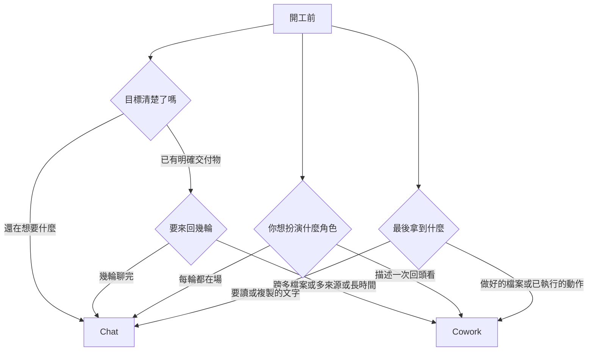

# Claude Cowork 與 Chat 怎麼選:四個問題、一句話判準、三個坑

> 整理自 YouTube 頻道 **YAHA学堂**〈[如何在Claude Cowork和Chat之间进行选择?4个问题当场判断](https://www.youtube.com/watch?v=huGHec7mpm8)〉(2026-09-17,約 12 分鐘;該片無官方字幕,逐字稿以 CPU 版 Whisper 轉錄,可能有同音字誤差,如「co-work/Covac/Kowak」皆指 Cowork)。
> ⚠️ 對照官方 [Cowork 概覽](https://claude.com/docs/cowork/overview)只能核實**架構與能力的前半**;方案可用性、computer use、排程等細節官網該頁未載,標為「未核實」。影片結尾的 Hype 按鈕與訂閱呼籲屬自我推廣,未納入。

---

## 一句話總結

> **想法和文字,聊(Chat);文件和動作,交(Cowork)。再補半句:答案在模型腦子裡的聊,答案在你電腦裡的交。** 同一個 Claude 模型,差別在「你的角色」:Chat 是你開車、一步接一步(串行);Cowork 是你描述目標後走開,它並行處理並把成品放回資料夾。

## 一、先矯正一個誤解:Cowork 不是更強的模型

✅ 官方:Cowork 使用與 Claude Code 相同的 agentic 架構(規劃、跨工具執行、自我檢查的迴圈),只是從程式庫換成你的檔案與應用,放在 Claude Desktop 裡不必開終端機。影片的說法吻合。

| 維度 | Chat | Cowork |
|---|---|---|
| 你的角色 | 每一輪都在場、握方向盤 | 描述一次,回來驗收 |
| 產出 | 文字,你讀或複製走 | 做好的檔案、已執行的動作、過程記錄 |
| 工作方式 | 串行,一步接一步 | 並行,互相獨立的部分同時跑 |
| 入口 | 網頁/桌面/手機,打開即用 | Claude Desktop |
| 記憶 | 影片:跨對話記得你是誰(Chat 的優點) | — |

**為什麼多步驟在 Chat 很累**:Chat 沒有手,你就是它的手。十個步驟要當十次搬運工(讀完第一份檔把結果記住、貼第二份、把算出的數字複製出來再餵下一步)。不是 Chat 做不到,而是所有搬運都落在你身上;委派之後搬運由它自己做,檔案在哪就在哪讀寫,輸出存在輸入旁邊,沒有上傳下載。

## 二、四個開工前的問題

影片經驗法則:四題中有**兩題**指向 Cowork,就直接走 Cowork,別猶豫。

## 三、Cowork 一次任務的三段式(影片轉述官方流程)

1. **你交活**:說清楚要做什麼,**以及做完長什麼樣**(後面第一個坑)。
2. **它接手**:先反問確認理解 → 把活拆成步驟列在側欄 → 逐步跨你的檔案、工具、網頁執行 → 自我複查品質與準確性 → 交成品+摘要。
3. **你回來**:資料夾裡有成品、工具裡有已執行動作、有完整過程記錄。

控制權:每個動作顯示在側欄、隨時可打斷改方向;**會造成後果的事(寄信、發訊息、動工作資料夾以外的檔案)會先停下來問你批准**。(影片轉述官方;官方概覽頁未逐字載明此點,標未核實。)

## 四、兩個最常搞反的例子

- **有明確交付物,卻該用 Chat**:寫一封郵件。目標清楚、輸出是文字、不碰檔案與工具、兩輪就好——官方形容「light on context」(沒有一堆檔案與來源)。為此建 Cowork 任務是殺雞用牛刀。
- **看起來是提問,其實該 Cowork**:「這季合約裡哪幾份付款條款有問題?」答案不在 Claude 腦子裡,在你資料夾的 30 份合約。在 Chat 你得先傳 30 份、自己記著上一批結論;Cowork 自己逐份讀,互不相鄰的部分並行跑(✅ 官方:sub-agent 協調、平行工作流)。**判斷關鍵不是句子像不像提問,而是答案在哪。**

## 五、影片列的「只有 Cowork 能做」五件事與前提

| 能力 | 前提(影片) | 核實 |
|---|---|---|
| 存取本機資料夾,就地讀寫 | 無 | ✅ 官方概覽 |
| 操作已登入的瀏覽器(廠商後台、內部儀表板) | 先連上 Claude in Chrome | ✅ 官方提到 Claude in Chrome 搭配 |
| 操作桌面應用(改 PowerPoint、點沒有 API 的老軟體) | 先在設定開啟 computer use | 未核實 |
| 並行處理 | 子任務要真的互相獨立,描述任務時最好明講 | ✅ 官方 sub-agent 並行 |
| 定時執行(如每週一把上週客服工單彙總成一頁) | — | 未核實 |

影片補充(未核實):computer use 為 beta,僅 Pro/Max 桌面版;Team/Enterprise 暫無;電腦與桌面應用需開著。**computer use 靠截圖看螢幕**,使用前先關閉銀行、醫療等敏感視窗,這是原理決定的,與你信不信任它無關。

## 六、三個坑

1. **只說做什麼,沒說做完長什麼樣**(最值錢)。接手第一步是理解目標,標準不明它要嘛反覆問、要嘛交出你不要的東西。習慣多加一句:輸出什麼格式、存哪個資料夾、要包含哪幾塊。
2. **前提沒開就以為它不行**:桌面應用操作不了多半是 computer use 沒開;登入頁打不開多半是 Claude in Chrome 沒連;再查方案與版本。
3. **什麼都丟進 Cowork**:一個小問題先建任務、等它理解規劃執行,繞一大圈才得一句話。那套流程對複雜任務是保障,對一句話問題是負擔。影片轉述官方:它選工具順序是**連接器 → 瀏覽器 → 最後才直接操作螢幕**,因為螢幕操作最慢、最易錯。補充:定時任務在遠端跑(電腦睡著也照跑,影片說法,未核實),所以要動本機檔案的活,先手動跑一次確認拿得到檔案,再排進日程。

## 應用案例

1. **供應商比較報告**(目標明確、多來源):丟給 Cowork:「比較資料夾 `vendors/` 裡 5 家報價單,輸出 `comparison.xlsx` 存在同一資料夾,含價格、交期、風險三張表」。這句話同時給了「做什麼」和「做完長什麼樣」。
2. **釐清方向**(目標模糊):你還不確定要做哪種定價方案——開 Chat 聊,等有了明確交付物再交 Cowork。
3. **每週例行彙總**:先手動跑一次客服工單彙總確認格式與權限,再排成每週一早上。
4. **關聯閱讀**:本庫〈[[claude-cowork-overtime-pay-audit-prompt]]〉就是把「模糊法規拆成可驗證步驟」交給 Cowork 的實例;〈[[self-improving-knowledge-base-claude-cowork]]〉則是用它維護知識庫。

## 來源

- [如何在Claude Cowork和Chat之间进行选择?4个问题当场判断 — YAHA学堂](https://www.youtube.com/watch?v=huGHec7mpm8)(2026-09-17;該片無官方字幕,逐字稿以 CPU 版 Whisper 轉錄,可能有同音字誤差)
- [Cowork Overview — Claude 官方文件](https://claude.com/docs/cowork/overview)(核實:同 Claude Code 架構、本機檔案、Claude in Chrome、sub-agent 並行、技能/連接器/外掛)
- 影片提到官方有一張四行對照表與「同一個 Claude 的兩種工作方式」說法;該表本文未能取得原頁,四題為影片轉譯。
