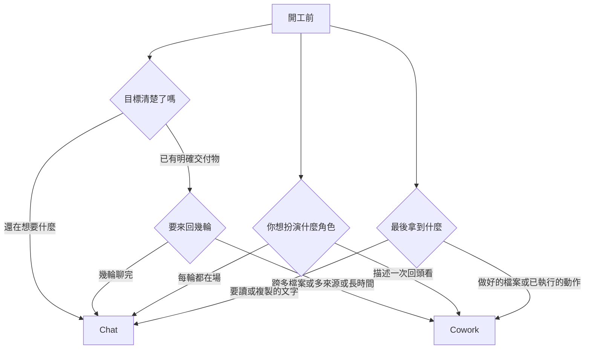

# Claude Cowork 與 Chat 怎麼選:四個問題、一句話判準、三個坑

> 整理自 YouTube 頻道 **YAHA学堂**〈[如何在Claude Cowork和Chat之间进行选择?4个问题当场判断](https://www.youtube.com/watch?v=huGHec7mpm8)〉(2026-09-17,約 12 分鐘;該片無官方字幕,逐字稿以 CPU 版 Whisper 轉錄,可能有同音字誤差,如「co-work/Covac/Kowak」皆指 Cowork)。
> ⚠️ 2026-11-07 已對照官方文件再核實:[Cowork 概覽](https://claude.com/docs/cowork/overview)、[Get started with Claude Cowork](https://support.claude.com/en/articles/13345190)、[Let Claude use your computer in Cowork](https://support.claude.com/en/articles/14128542-let-claude-use-your-computer-in-cowork)、[Choosing between Cowork or Chat(Academy)](https://academy.claude.com/tutorials/choosing-between-claude-cowork-or-chat)。四題表與「light on context」已在官方教學頁找到原文;方案可用性與定時執行已改為官方說法(見各節標示)。影片結尾的 Hype 按鈕與訂閱呼籲屬自我推廣,未納入。

---

## 一句話總結

> **想法和文字,聊(Chat);文件和動作,交(Cowork)。再補半句:答案在模型腦子裡的聊,答案在你電腦裡的交。** 同一個 Claude 模型,差別在「你的角色」:Chat 是你開車、一步接一步(串行);Cowork 是你描述目標後走開,它並行處理並把成品放回資料夾。

## 一、先矯正一個誤解:Cowork 不是更強的模型

✅ 官方:Cowork 使用與 Claude Code 相同的 agentic 架構(規劃、跨工具執行、自我檢查的迴圈),只是從程式庫換成你的檔案與應用,放在 Claude Desktop 裡不必開終端機。影片的說法吻合。

| 維度 | Chat | Cowork |
|---|---|---|
| 你的角色 | 每一輪都在場、握方向盤 | 描述一次,回來驗收 |
| 產出 | 文字,你讀或複製走 | 做好的檔案、已執行的動作、過程記錄 |
| 工作方式 | 串行,一步接一步 | 並行,互相獨立的部分同時跑 |
| 入口 | 網頁/桌面/手機,打開即用 | Claude Desktop |
| 記憶 | 影片:跨對話記得你是誰(Chat 的優點) | — |

**為什麼多步驟在 Chat 很累**:Chat 沒有手,你就是它的手。十個步驟要當十次搬運工(讀完第一份檔把結果記住、貼第二份、把算出的數字複製出來再餵下一步)。不是 Chat 做不到,而是所有搬運都落在你身上;委派之後搬運由它自己做,檔案在哪就在哪讀寫,輸出存在輸入旁邊,沒有上傳下載。

## 二、四個開工前的問題

影片經驗法則:四題中有**兩題**指向 Cowork,就直接走 Cowork,別猶豫。([4:12] 起)

> ✅ 已核實:官方 Academy 教學頁〈[Choosing between Claude Cowork or Chat](https://academy.claude.com/tutorials/choosing-between-claude-cowork-or-chat)〉的對照表四列為「你的目標(還在想 / 有明確交付物)」、「工作量(幾輪對話 / 多步驟、多來源、長時間)」、「你的角色(每輪都在場 / 描述一次、回頭檢查)」、「產出(要讀或複製的文字 / 做好的檔案或已執行的動作)」,與影片四題一致;頁面原文 Chat 適用於「a one-off question or want a thought partner」,Cowork 適用於「when there's a clear deliverable and the work touches your files or tools」。**但官方頁沒有「四題」或「兩題即走 Cowork」的經驗法則,那是影片作者的個人判斷。**

## 三、Cowork 一次任務的三段式(影片轉述官方流程)

1. **你交活**:說清楚要做什麼,**以及做完長什麼樣**(後面第一個坑)。
2. **它接手**:先反問確認理解 → 把活拆成步驟列在側欄 → 逐步跨你的檔案、工具、網頁執行 → 自我複查品質與準確性 → 交成品+摘要。
3. **你回來**:資料夾裡有成品、工具裡有已執行動作、有完整過程記錄。

控制權:每個動作顯示在側欄、隨時可打斷改方向;**會造成後果的事(寄信、發訊息、動工作資料夾以外的檔案)會先停下來問你批准**。

- ✅ 部分核實:官方求助頁說 Claude 在存取每個應用程式前會請求你的許可,全螢幕接管前也會先問一次([Let Claude use your computer in Cowork](https://support.claude.com/en/articles/14128542-let-claude-use-your-computer-in-cowork))。
- ❓ 未能核實:「寄信、發訊息會先停下來問」這個具體範圍,官方頁與官方教學頁均未逐字載明,仍只是影片說法。
- ✅ 先反問與「做完長什麼樣」:官方部落格〈[Best practices for getting started with Claude Cowork](https://claude.com/blog/best-practices-for-getting-started-with-claude-cowork)〉原文:「Make Claude ask you questions before it starts」,並建議「Describe the deliverable you want at the end and provide any necessary context」——與影片第一、二段一致。

## 四、兩個最常搞反的例子

- **有明確交付物,卻該用 Chat**:寫一封郵件。目標清楚、輸出是文字、不碰檔案與工具、兩輪就好——官方教學頁原文:「when the task is light on context, without a spread of files or sources」(✅ 已核實,見上方 Academy 頁)。為此建 Cowork 任務是殺雞用牛刀。([6:15] 起)
- **看起來是提問,其實該 Cowork**:「這季合約裡哪幾份付款條款有問題?」答案不在 Claude 腦子裡,在你資料夾的 30 份合約。在 Chat 你得先傳 30 份、自己記著上一批結論;Cowork 自己逐份讀,互不相鄰的部分並行跑(✅ 官方:sub-agent 協調、平行工作流)。**判斷關鍵不是句子像不像提問,而是答案在哪。**

## 五、影片列的「只有 Cowork 能做」五件事與前提

| 能力 | 前提(影片) | 核實 |
|---|---|---|
| 存取本機資料夾,就地讀寫 | 無 | ✅ 官方概覽 |
| 操作已登入的瀏覽器(廠商後台、內部儀表板) | 先連上 Claude in Chrome | ✅ 官方概覽提到 Claude in Chrome 搭配;官方教學頁列為 "Navigate your logged-in browser" |
| 操作桌面應用(改 PowerPoint、點沒有 API 的老軟體) | 先在設定開啟 computer use | ✅ 官方:beta,Pro / Max / Ultra,macOS 與 Windows;Team、Enterprise 目前無法使用。「設定裡開啟」的步驟未能於官方頁核實 |
| 並行處理 | 子任務要真的互相獨立,描述任務時最好明講 | ✅ 官方概覽 sub-agent 並行;「要明講互相獨立」為影片建議 |
| 定時執行(如每週一把上週客服工單彙總成一頁) | — | ✅ 官方 Get started 文章:定時任務在雲端執行,不需電腦醒著或桌面 app 開著(見下) |

**電腦使用(computer use)的核實**:官方求助頁〈[Let Claude use your computer in Cowork](https://support.claude.com/en/articles/14128542-let-claude-use-your-computer-in-cowork)〉原文:「Computer use is in beta for Pro, Max, and Ultra plans.」「Team and Enterprise plans don't have access to computer use at this time.」「Your computer needs to be awake and the Claude Desktop app needs to be open for computer use to work.」**影片說「僅 Pro/Max」已過時**,官方現列還含 Ultra。「靠截圖看螢幕」屬影片的原理說明,官方該頁未逐字載明,標未能核實。官方安全建議原文:「Do not give computer use permission access to sensitive apps (such as banking, healthcare, government).」——使用前先關閉銀行、醫療等敏感視窗,與影片一致。

**定時任務的核實**:官方 [Get started with Claude Cowork](https://support.claude.com/en/articles/13345190) 原文:「Scheduled tasks run in the cloud, so they don't need your computer to be awake or the desktop app open.」與影片「電腦睡著也照跑」一致。注意:搜尋摘要曾提到另一篇說法是需電腦醒著,但本次未能讀到該原文,以官方 Get started 頁為準。

## 六、三個坑

1. **只說做什麼,沒說做完長什麼樣**(最值錢)。接手第一步是理解目標,標準不明它要嘛反覆問、要嘛交出你不要的東西。習慣多加一句:輸出什麼格式、存哪個資料夾、要包含哪幾塊。
2. **前提沒開就以為它不行**:桌面應用操作不了多半是 computer use 沒開;登入頁打不開多半是 Claude in Chrome 沒連;再查方案與版本。
3. **什麼都丟進 Cowork**:一個小問題先建任務、等它理解規劃執行,繞一大圈才得一句話。那套流程對複雜任務是保障,對一句話問題是負擔。影片轉述官方:它選工具順序是**連接器 → 瀏覽器 → 最後才直接操作螢幕**,因為螢幕操作最慢、最易錯。❓ **未能核實**:官方教學頁列出能力但未排序;官方概覽頁未提及此順序。影片 [10:47] 畫面只寫「官方幫助文檔裡提到,Cowork 做事是挑最精準的工具先用」,未附連結。補充:定時任務在雲端跑、不需電腦醒著(✅ 官方 Get started 頁),但**本機檔案、瀏覽器與桌面應用的存取仍需桌面 app 開著**(官方同頁說明)。所以要動本機檔案的活,先手動跑一次確認拿得到檔案,再排進日程。

## 應用案例

1. **供應商比較報告**(目標明確、多來源):丟給 Cowork:「比較資料夾 `vendors/` 裡 5 家報價單,輸出 `comparison.xlsx` 存在同一資料夾,含價格、交期、風險三張表」。這句話同時給了「做什麼」和「做完長什麼樣」。
2. **釐清方向**(目標模糊):你還不確定要做哪種定價方案——開 Chat 聊,等有了明確交付物再交 Cowork。
3. **每週例行彙總**:先手動跑一次客服工單彙總確認格式與權限,再排成每週一早上。
4. **關聯閱讀**:本庫〈[[claude-cowork-overtime-pay-audit-prompt]]〉就是把「模糊法規拆成可驗證步驟」交給 Cowork 的實例;〈[[self-improving-knowledge-base-claude-cowork]]〉則是用它維護知識庫。

## 延伸閱讀與深度補充(2026-11-07 核實增補)

以下皆為實際讀過的官方頁面原文重點,比影片多出的部分才列入:

1. **「你把工作帶去 Claude,還是把 Claude 帶到你的工作」**:官方部落格〈[Best practices for getting started with Claude Cowork](https://claude.com/blog/best-practices-for-getting-started-with-claude-cowork)〉原文:「Instead of bringing your work to Claude, you bring Claude to your work.」「With Claude Cowork, you are _delegating_ work to Claude.」並說「Chat is for when the output is a thought in your head.」——比影片「想法聊、文件交」更直接給出判準:**產出是腦中的想法 → Chat;產出是要落地的東西 → Cowork**。
2. **用量成本不同**:官方〈[Get started with Claude Cowork](https://support.claude.com/en/articles/13345190)〉原文:「Multi-step tasks, like ones that run code, create files, or use your connected apps and browser,」use more of your usage than a quick question;並說「Each step Claude takes uses tokens.」影片完全沒講這點。實務上:簡單問題用 Chat,省 Cowork 的用量。
3. **Cowork 不讀本機 `~/.claude` 技能**:官方〈[Cowork 概覽](https://claude.com/docs/cowork/overview)〉:Cowork「doesn't read the Claude Code CLI's `~/.claude` directory on your machine」,要用的技能或外掛需在 **Customize** 裡加入。若你在 Claude Code 寫好的 skill 想搬到 Cowork,這是影片沒提的坑。
4. **電腦使用的權限是逐應用程式問的**:官方 computer use 頁:「Claude asks for your permission before accessing each application.」「Claude asks for your permission the first time a task needs the full screen in each session before taking over.」——這比「會造成後果才問」更細,是每個應用程式與全螢幕各問一次。
5. **方案與平台現況(2026-11-07)**:computer use 為 beta,Pro / Max / Ultra,macOS 與 Windows;Team、Enterprise 目前無法使用(同上官方求助頁)。影片說的「只有 Pro/Max」已過時。
6. **仍未能核實的**:(a) 影片「四題中兩題指向 Cowork 就直接走」屬作者經驗;(b) 「連接器 → 瀏覽器 → 螢幕」工具順序;(c) 影片說明的 computer use 截圖原理、以及「設定裡打開」的步驟。

## 來源

- [如何在Claude Cowork和Chat之间进行选择?4个问题当场判断 — YAHA学堂](https://www.youtube.com/watch?v=huGHec7mpm8)(2026-09-17;該片無官方字幕,逐字稿以 CPU 版 Whisper 轉錄,可能有同音字誤差)
- [Cowork Overview — Claude 官方文件](https://claude.com/docs/cowork/overview)(核實:同 Claude Code 架構、本機檔案、Claude in Chrome、sub-agent 並行、技能/連接器/外掛)
- [Choosing between Claude Cowork or Chat — Claude Academy](https://academy.claude.com/tutorials/choosing-between-claude-cowork-or-chat)(2026-11-07 核實:四行對照表與 "light on context"、"Same Claude, two ways of working" 原文)
- [Best practices for getting started with Claude Cowork — Claude 官方部落格](https://claude.com/blog/best-practices-for-getting-started-with-claude-cowork)(2026-11-07 核實:先反問、描述交付物、Chat 與 Cowork 的判準)
- [Get started with Claude Cowork — Claude 官方支援](https://support.claude.com/en/articles/13345190)(2026-11-07 核實:定時任務雲端執行、用量成本)
- [Let Claude use your computer in Cowork — Claude 官方支援](https://support.claude.com/en/articles/14128542-let-claude-use-your-computer-in-cowork)(2026-11-07 核實:computer use beta、Pro/Max/Ultra、Team/Enterprise 不可用、逐應用程式詢問)
