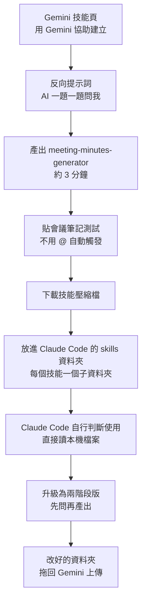

# 一份 SKILL.md 兩邊跑:Gemini 技能(Skills)與 Claude Code 互通,與「分階段技能」

**主題分類:** AI 生產力 —— Agent Skills 跨平台、Skill 撰寫方法
**來源影片:** YouTube〈Gemini 技能做一次,Claude Code 也能用|同一份 SKILL md 兩邊跑〉(YAHA学堂,2026-10-31,約 10 分鐘)
**核實對象:** 作者範例包 [buildinpublichub/YAHAClass-Document 的 gemini-skill-kit](https://github.com/buildinpublichub/YAHAClass-Document/tree/main/gemini-skill-kit)(已 clone 閱讀全部 `SKILL.md`)、[Google 官方說明](https://support.google.com/gemini/answer/18560919?hl=en)
**整理日期:** 2026-11-06

> **立場揭露:** 無業配。說明欄的 Homebrew / Claude Code 安裝連結是官方文件;作者的範例包在其個人 GitHub。結尾要求觀眾按 YouTube「Hype」。
> **字幕品質:** 自動字幕(含簡繁混雜),「Scale=Skill」「Cloud=Claude」「賴安=LINE」「帶辦=待辦」等已校正。

---

## 0. 一句話總結

> **Skill 本質上就是「資料夾 + `SKILL.md`(YAML 頭 `name` / `description` + 本文規則)」。Gemini 與 Claude Code 都吃這個格式,所以規則寫一份,兩邊都能用、都能改、都能互相搬。**
> 成敗關鍵是 `description`:它是「店門口的招牌」,決定模型何時會把整份技能翻出來讀。

## 1. 技能與 Gem 的差別

| | Gem | 技能(Skill) |
|---|---|---|
| 啟用方式 | 要先點進該 Gem 才有用 | 放在一般對話中,AI **依 `description` 自己判斷**要不要用,也可輸入 `@` 強制指定 |
| 組合 | 單一 | 可同時疊用多個技能 |
| 載入機制 | — | 每次收到訊息先掃**所有技能的名稱與說明**,對上了才讀完整內容(漸進式載入) |

**日期核實:** 影片說「11 月 17 日 Gem 自動轉成技能、轉完不能改;12 月 17 日整個拿掉;公司 / 學校帳號較晚」(字幕位於 [0:41]、[0:44]、[0:46]、[0:48])。
- Google 官方說明頁(2026-11-07 重新抓取)確認:個人帳號(18 歲以上)**2026-11-17** Gem 變唯讀、**2026-12-17** Gem 自 Gemini Apps 移除。**已核實。**
- 公司 / 學校帳號較晚:官方時程為 Workspace 商業、企業與非營利版 **2027 年 3 月**,Workspace 教育版 **2027 年 6 月**;18 歲以下個人帳號「之後再公告」。影片說「大概要到明年」**大致相符**。**已核實。**
- 先前「12 月 17 日移除」曾標「未能核實」,已更正:官方頁有明載,以官方為準。

## 2. 影片示範的流程

三個關鍵作法:

1. **反向提示詞**:不要丟一句「幫我做會議記錄技能」(會得到很通用的結果),而是叫 AI「反過來一題一題問我、問清楚再寫」。Gemini 建立技能時預設會問四件事:**做什麼、何時啟動、輸出長什麼樣、有什麼限制**——這四點就是任何技能的骨架。**[2:05]–[2:13] 畫面已核實**:2026-11-07 擷取 [2:11] 附近畫面,Gemini 回覆清單英文標示為 Purpose / Triggers / Output / Constraints,與影片口述一致。
2. **「寧可待確認、不准補」**:作者特別在限制裡寫死「沒講到的日期或負責人不可自己編」,因為 AI 最常「熱心腦補」一個負責人,錯誤就貼進群組了。
3. **分階段技能**:原本版本遇到缺漏只標「待確認」,使用者要自己一格格補。改成**第一階段只問問題、問完停下;第二階段才產出**,結果待辦表每格都填滿、沒有待確認,且存成檔案(影片字幕寫「Minus 資料夾」,資料夾名稱**推定**為 meetings,未能核實)。

## 3. 對照範例包原始檔

我讀了三個版本的 `SKILL.md`:

| 範例 | 重點內容 |
|---|---|
| `bad-example/text-helper` | `description: 幫忙處理文字。`——**刻意的壞範例**(模糊說明:作者稱實測重複跑兩次,「一次有抓到、一次沒抓到」,這是自述,未重現) |
| `v1-basic/meeting-minutes-generator` | `description` 同時寫「做什麼」與「何時用」,並列出使用者可能講的話(「幫我整理會議紀錄」「這場會開完了」);輸出固定 5 段:會議資訊、三句話摘要、決議事項、待辦表(事項/負責人/期限)、LINE 群組通知(100 字內);規則:「筆記裡沒出現的事情一律不准補,寧可寫『待確認』」 |
| `v2-two-stage/...` | 本文開頭寫「這個技能分兩個階段,一定要照順序」;第一階段「只問問題,不要產出紀錄」,缺漏項用編號列出(沒負責人、沒期限、日期與星期對不上),**資訊完整時直接說「資訊完整,開始整理」進第二階段**;LINE 通知格式拆到同資料夾的 `line-notice-template.md` |

**可學的技巧:** v2 把「格式模板」拆成同資料夾的獨立檔案(漸進揭露),主檔只負責流程。

**2026-11-07 補核實:** 重新 `git clone --depth 1` 範例包並讀取上列三個 `SKILL.md` 與 v2 的 `line-notice-template.md`,內容與上表一致。**一個值得注意的細節:** v2 的 `description` 與 v1 **完全相同**,並未寫入「兩階段」字樣;也就是說兩階段行為寫在本文(觸發後的流程),不是靠 `description` 切換。若希望 Claude 只在特定情境才進入「先問」模式,要另外在 `description` 寫明。此為本次閱讀的推論,作者未明說。

## 4. 評析與注意

- **互通成立的前提**:Claude Code 技能同樣是 `SKILL.md`。依 Claude Code 官方技能文件(`code.claude.com/docs/en/skills`,2026-11-07 抓取):
  - 專案層:`.claude/skills/<skill-name>/SKILL.md`;個人層:`~/.claude/skills/<skill-name>/SKILL.md`(所有專案都載入)。影片 [4:51] 與畫面 [4:51]–[4:55] 的「`.claude/skills/<技能名>/SKILL.md`」**已核實**(2026-11-07 擷取終端機畫面,路徑為 `.claude/skills/meeting-minutes-generator/SKILL.md`)。
  - frontmatter 開頭第一行必須是 `---`,否則整檔會被當成技能內容;`name` 可省略(預設為資料夾名),`description` 建議必寫;描述與 `when_to_use` 合計在技能清單中截斷於 1,536 字,**關鍵用途要寫前面**。
  - 預設可由 `/技能名` 呼叫,也可由 Claude 依 `description` 自動載入;`disable-model-invocation: true` 可關閉自動觸發。
  - Google 官方說明頁(`support.google.com/gemini/answer/18560919`)另要求技能名稱「全小寫、以連字號分隔」,且上傳資料夾名稱必須與技能名稱相同;此為 Gemini 端規則,Claude Code 文件未見同樣限制。
- **差異**:Claude Code 能直接讀你電腦的檔案、把輸出存檔;Gemini 網頁版則需貼上內容。Claude Code 改本機技能目錄會跳出授權詢問,屬正常保護機制。
- **Claude Code 付費方案**:影片 [5:40] 說要付費方案。Claude Code 技能文件**未列技能本身的方案條件**(僅 `/doctor` 用量檢查註明需 Pro、Max、Ultra、Team 或 Enterprise);**未能完全核實**,以官方方案頁為準。
- **隱私**:會議筆記常含人名與內部事項,貼到哪個服務要先確認公司規定。

## 5. 應用案例

1. **週報 / 客訴回覆**:作者建議暫停影片,想一件「每週都在重複跟 AI 交代的事」,用一句「做什麼 + 什麼時候用」寫成 `description`。例:「把本週零散的工作記錄整理成主管週報;當使用者說『幫我寫週報』或貼上一週待辦時使用。」
2. **團隊共用 SOP**:行銷組把「社群貼文審稿規則」寫成技能,放到共用 git repo;成員用 Gemini 的、用 Claude Code 的,都讀同一份,更新規則只改一處。
3. **兩階段技能用於報價單**:第一階段「只問」缺的客戶名稱、數量、交期,第二階段才產出報價。避免 AI 為了完整而憑空填數字。
4. **自我檢查**:把你現有技能的 `description` 拿出來,看有沒有同時包含「做什麼」「何時用」與使用者真的會說的話。

相關:[[building-claude-skills]]、[[anatomy-skill-object-is-the-explanation]]、[[model-agnostic-ai-workflow]]。

## 核實狀態

- **已核實:**
  - Gem 於 2026-11-17 變唯讀、2026-12-17 自個人帳號移除(Google 官方);企業與學校版 2027 年 3 月 / 6 月(Google 官方)。
  - Claude Code 技能路徑、frontmatter 規則、自動載入(Claude Code 官方文件)。
  - 範例包三個 `SKILL.md` 的 frontmatter 與規則內容與影片描述一致(2026-11-07 clone 讀取)。
  - 影片畫面:Gemini 建立技能的四個問題 [2:11] 附近;Claude Code 終端機中 `.claude/skills/meeting-minutes-generator/SKILL.md` 路徑 [4:51] 附近。
- **未能核實:**
  - 「模糊說明一次抓到一次沒抓到」的實測(作者自述 [6:43]–[6:50],未重跑)。
  - 影片「Claude Code 要付費方案」於技能文件中的明確條件(見第 4 節)。
  - 影片中 Gemini 端的其他操作畫面(未逐幀重跑)。
  - 技能資料夾存放名稱(字幕「Minus 資料夾」,推定為 meetings)。
- **字幕還原(本次校正):** 字幕「Cloud / clotcode / Cloud Code」指 **Claude Code**;「Gemini 的 Jam / Gem」指 **Gem**;「Creator skill」畫面上為 **Create a skill**;「Gemini 技能頁」之「Add 符號」以 `@` 為準(2026-11-07 畫面:輸入框提示「輸入 @ 即可連結應用程式、使用技能和更多功能」)。

## 來源

- 〈Gemini 技能做一次,Claude Code 也能用|同一份 SKILL md 兩邊跑〉YAHA学堂,2026-10-31:https://www.youtube.com/watch?v=zmUbbJYtxmM (自動字幕,非官方人工字幕;畫面截圖於 2026-11-07 核對)
- 範例包:https://github.com/buildinpublichub/YAHAClass-Document/tree/main/gemini-skill-kit(2026-11-07 clone 讀取 `kit/` 下三個版本)
- Google Gemini Apps Help〈About the transition from Gems to skills〉:https://support.google.com/gemini/answer/18560919?hl=en
- Claude Code 官方技能文件(頁面標題未核對):https://code.claude.com/docs/en/skills
