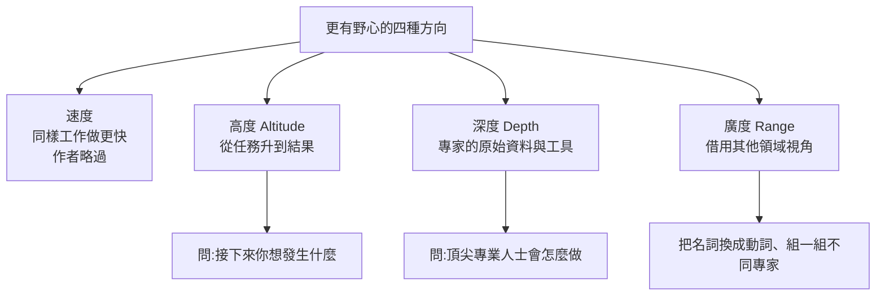

# 怎麼對模型更有野心:速度、高度、深度、廣度四種提問升級(Felix Rieseberg)

> 整理自 Felix Rieseberg 部落格文章〈[How to be more ambitious: A tutorial for humans with models](https://felixrieseberg.com/how-to-be-more-ambitious-a-tutorial-for-humans-with-models/)〉(2026-10-13,閱讀約 8 分鐘)。
>
> ⚠️ **立場揭露**:作者是 **Anthropic 的工程經理**(曾帶領 Claude.ai、Cowork、Claude Code Desktop 的工程;也是 Electron 共同維護者,先前待過 Notion、Stripe、Slack、Microsoft)。文章談的是 Claude 的用法,出自 Claude 的製造商員工之手,文中的產品體驗屬作者自述。
>
> 資料取得方式:我透過網頁擷取摘要工具讀取文章,**得到的是結構化摘要與改寫,不是逐字全文**;以下技巧與範例提示詞為忠實改寫,不是原文引號。要原句請讀原文。

---

## 一句話總結

> AI 能力隨模型更新每幾週就變,但多數人用它的方式沒跟上。作者的診斷:卡住的不是模型,是**我們對「可以要求多少」的信念**。他把「更有野心」拆成四種可練習的提問方式:**速度**(同樣的事做更快)、**高度**(從任務升到結果)、**深度**(像頂尖專家一樣用原始資料與專業工具)、**廣度**(借用別的領域的視角)。其中速度他略過,重點在後三種。

---

## 一、速度(Speed)

同樣的工作做得更快,是 AI 最基本的經濟價值,作者認為已被充分談論,不特別展開。

---

## 二、高度(Altitude):從「做這個任務」升到「想要什麼結果」

核心問題:**「你希望接下來發生什麼?」**,以及「這個目標之後的目標是什麼?」

| 技巧 | 說明 |
|---|---|
| 給脈絡,不只給範本欄位 | 把公司的業務背景交給模型,不是只丟「填這份季度簡報」 |
| 問「什麼變了、為什麼、該怎麼辦」 | 讓模型做分析,不只是整理 |
| 要求決策與正反論述 | 例:挑出最急的三個決策,各寫支持與反對的論點 |
| 要求設計更好的流程並驗證 | 例:設計一個比季度簡報更早抓到問題的方式,拿自家歷史資料測試,並與現行流程並行跑一季 |

**作者的兩個實例**

1. **季度業務檢討(QBR)**:從「填投影片」升級成「能提早浮現問題、重新分配資金與人力的流程」。
2. **當機問題**:從「修一個個 crash」升級成「讓 app 保持不當機」。為此要做的不只是下指令,而是**改工作環境**:抓取當機報告、把 app 版本對應到 git commit、讓 Claude 能操作 Windows、macOS、Linux 機器重現與驗證修復。

⭐ 重點:往高處走通常需要你**改造工作流,讓模型拿得到資料與工具**,而不只是換一句提示詞。

---

## 三、深度(Depth):用頂尖專家的原始素材與工具

目標:再往任務**底下一層**,走到該領域專業人士真正用的資料、工具與方法。

| 技巧 | 說明與例子 |
|---|---|
| 用專業儀器 | 別停在 Markdown 表格;改用資料庫與統計模型 |
| 設「不合理」的目標,並當成合理 | 例:一個要 5 秒載入的頁面,要求 200 毫秒 |
| 用原始資料挑戰假設 | 例:檢驗「流失是不是真的是 onboarding 問題」 |
| 產出新知識 | 例:用日誌建模擬,找出你不知道的早期流失訊號,並用沒看過的資料驗證 |
| **用外部裁判,不讓模型自己打分數** | 最好是模型能執行、立即回饋的工具 |

**可重複使用的提示結構(改寫):** 不要要求「更大的版本」,要求「更深的版本」。讓模型說出:頂尖專業人士會怎麼做、他們會從什麼最原始的素材開始、用哪些具體方法與工具、有什麼外部證據能顯示結果是對的;然後依此重寫提示詞。

---

## 四、廣度(Range):借別的領域的視角

| 技巧 | 說明 |
|---|---|
| **名詞換動詞** | 出自 Tom Kelley 與 Jonathan Littman《The Art of Innovation》。例:「QBR」→「在 30 分鐘內讓很忙的人相信一個因果故事,並在不確定中做出決定」 |
| **組一組不同專家** | 做簡報:分析師、記者、編輯;若要現場報告,加動態與音訊設計。紅隊可加空頭分析師與鑑識會計師 |
| **別叫模型角色扮演** | 要求它「做那位專業人士做的事」,而不是「用他的口吻寫」 |

作者的自我坦白:他做過電玩,卻從沒想過在自己首頁用 3D 環境,直到同事 Alex Albert 用 Blender 做室內設計才開竅。

---

## 五、為什麼「信念」會影響結果:文章引用的歷史與研究

| 引用 | 作者想說明的 |
|---|---|
| **George Dantzig(1939)**:遲到,把黑板上兩題抄下來當作業交,其實是統計學未解難題 | 相信可行,更容易做成 |
| **Roger Bannister(1954)**:5 月跑破四分鐘一英里,之後很快就有別人跟進 | 看到別人做到,困難的事變得可及 |
| **Patrick Collison 的「Fast」清單**:在大膽目標與緊迫期限下完成的事 | 大膽目標加緊迫期限會逼出成果 |
| **《The Inner Game of Tennis》**:太用力反而表現差(作者連到 Linux「只是個興趣」的發布) | 允許自己失敗,常讓結果更好 |
| **自我效能與目標設定研究**:Locke 與 Latham 回顧 35 年研究,具體而困難的目標勝過「盡力就好」 | 信念與具體目標可以刻意培養 |

作者的結論:既然 AI 能力每隔幾週就前進,人需要**能幫自己相信、並敢去嘗試更多**的技巧。

---

## 六、應用案例

### 案例 1:把「整理週報」升級

| 層級 | 提示詞 |
|---|---|
| 原本 | 「把這週數據整理成表」 |
| 高度 | 「這週的業績為什麼下滑?我下週一要決定砍哪個專案;列出三個最急的決策,各附正反論點」 |
| 深度 | 「用原始交易資料而不是我做好的彙總表;建一個簡單回歸看哪個因素最解釋下滑;留 20% 資料驗證」 |
| 廣度 | 「用空頭分析師的角度挑戰這份結論;再用鑑識會計師檢查資料口徑」 |

### 案例 2:效能優化的「不合理目標」

別問「幫我讓頁面快一點」。改成:「目標是首屏 200 毫秒內,現在 5 秒。先列出瓶頸測量方法,再跑量測,每次改動後用 Lighthouse 或自己的基準腳本當外部裁判。」

### 案例 3:名詞換動詞

「寫行銷企劃書」→「讓一個陌生人在 10 秒內決定點進來」。接著請模型想 5 個**不是企劃書**的做法,再挑一個測。

### 案例 4:自己是裁判的陷阱

要求模型改程式,同時又讓模型自己判斷「改好了沒」。改為:跑測試套件、跑型別檢查、對比基準數字——**把驗收交給它不能自己改的東西**。(對照本庫 [[loop-engineering-when-and-how-gary-chen]] 的「別球員兼裁判」。)

---

## 七、核實與保留

**✅ 已核實:**

- 作者身分與職務(Anthropic 工程經理)為文章自述,與文中揭露一致。
- 文中跑者例:Sabastian Sawe 於 2026-04-26 倫敦馬拉松以 **1:59:30** 奪冠,為首個在可認定賽事中跑進兩小時的成績;亞軍 Yomif Kejelcha **1:59:41** 同樣破兩小時(多家媒體報導)。⚠️ 注意:2019 年 Kipchoge 在奧地利跑進兩小時,但因配速員輪替等條件不被認定為正式世界紀錄。
- Dantzig 的故事廣為人知(1939 年,柏克萊),Bannister 於 1954 年 5 月破四分鐘、約 46 天後被 John Landy 再度打破(此為常見史實,本文未再查原始史料)。
- Locke 與 Latham 的「35 年目標設定研究」對應其 2002 年於《American Psychologist》的回顧論文(從文章敘述推定,未讀原文)。

**⚠️ 需保留:**

- 這是**一位作者的方法論文章**,沒有對照實驗;「更有野心就更有成果」靠案例與心理學研究類比,不是對這四種提問法的實測。
- 文中例子多為作者自己的工作(軟體、當機、QBR),**不保證能直接移植**到你的領域。
- 「要求不合理目標並當成合理」有風險:對**真實物理或成本限制**,模型可能做出看似達標、實則作假的結果,所以才強調要有外部裁判。

**⭐ 文章沒講、值得補的:**

- 野心上升時,**驗證成本也跟著上升**。高度與深度需要的是更多資料存取與工具權限,記得同時設權限邊界與回滾路徑(對照 [[agent-verification-before-scale-lauren-tan-reaction]])。
- 本庫 [[defining-tasks-not-prompts]] 從另一個角度講同一件事:**定義任務(目標、驗收)比雕提示詞重要**。

---

## 相關筆記

- [[defining-tasks-not-prompts]]:定義任務而非寫提示詞。
- [[loop-engineering-when-and-how-gary-chen]]:可驗證目標與別球員兼裁判。
- [[long-running-agents-goal-evaluation]]:長時間 agent 的目標與評估。
- [[bitter-lesson-cut-old-patterns]]:模型變強後,砍掉舊的提示技巧。
- [[agent-verification-before-scale-lauren-tan-reaction]]:先給 Agent 驗證,再談規模。

---

## 來源

- Felix Rieseberg,〈How to be more ambitious: A tutorial for humans with models〉(2026-10-13): https://felixrieseberg.com/how-to-be-more-ambitious-a-tutorial-for-humans-with-models/ (以擷取摘要工具讀取,非逐字全文)
- Sawe 倫敦馬拉松 1:59:30 報導: https://marathonhandbook.com/sabastian-sawe-wins-2026-london-marathon-in-15930-to-set-first-sub-two-hour-marathon-world-record/ 、 https://athleticsweekly.com/news/sub-2hr-marathon-in-london-for-history-maker-sabastian-sawe-1040010985/
