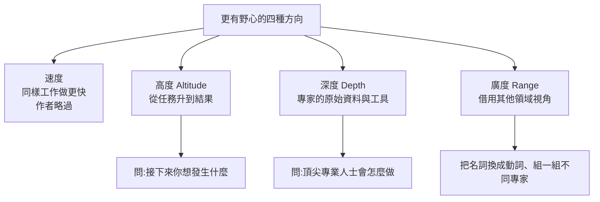

# 怎麼對模型更有野心:速度、高度、深度、廣度四種提問升級(Felix Rieseberg)

> 整理自 Felix Rieseberg 部落格文章〈[How to be more ambitious: A tutorial for humans with models](https://felixrieseberg.com/how-to-be-more-ambitious-a-tutorial-for-humans-with-models/)〉(2026-10-13,閱讀約 8 分鐘)。
>
> ⚠️ **立場揭露**:作者是 **Anthropic 的工程經理**(曾帶領 Claude.ai、Cowork、Claude Code Desktop 的工程;也是 Electron 共同維護者,先前待過 Notion、Stripe、Slack、Microsoft)。文章談的是 Claude 的用法,出自 Claude 的製造商員工之手,文中的產品體驗屬作者自述。
>
> **增補(2026-11-08):** 新增 §八,整理 Gary Chen〈To Use AI Effectively, You Need to Be More Ambitious〉(2026-11-07)對本文的中文解讀;該影片說明欄導向作者的付費 Skool 社群,影片中的「升級版提示詞」放在付費文章,**本庫不轉述付費內容**。
>
> 資料取得方式:我透過網頁擷取摘要工具讀取文章,**得到的是結構化摘要與改寫,不是逐字全文**;以下技巧與範例提示詞為忠實改寫,不是原文引號。要原句請讀原文。

---

## 一句話總結

> AI 能力隨模型更新每幾週就變,但多數人用它的方式沒跟上。作者的診斷:卡住的不是模型,是**我們對「可以要求多少」的信念**。他把「更有野心」拆成四種可練習的提問方式:**速度**(同樣的事做更快)、**高度**(從任務升到結果)、**深度**(像頂尖專家一樣用原始資料與專業工具)、**廣度**(借用別的領域的視角)。其中速度他略過,重點在後三種。

---

## 一、速度(Speed)

同樣的工作做得更快,是 AI 最基本的經濟價值,作者認為已被充分談論,不特別展開。

---

## 二、高度(Altitude):從「做這個任務」升到「想要什麼結果」

核心問題:**「你希望接下來發生什麼?」**,以及「這個目標之後的目標是什麼?」

| 技巧 | 說明 |
|---|---|
| 給脈絡,不只給範本欄位 | 把公司的業務背景交給模型,不是只丟「填這份季度簡報」 |
| 問「什麼變了、為什麼、該怎麼辦」 | 讓模型做分析,不只是整理 |
| 要求決策與正反論述 | 例:挑出最急的三個決策,各寫支持與反對的論點 |
| 要求設計更好的流程並驗證 | 例:設計一個比季度簡報更早抓到問題的方式,拿自家歷史資料測試,並與現行流程並行跑一季 |

**作者的兩個實例**

1. **季度業務檢討(QBR)**:從「填投影片」升級成「能提早浮現問題、重新分配資金與人力的流程」。
2. **當機問題**:從「修一個個 crash」升級成「讓 app 保持不當機」。為此要做的不只是下指令,而是**改工作環境**:抓取當機報告、把 app 版本對應到 git commit、讓 Claude 能操作 Windows、macOS、Linux 機器重現與驗證修復。

⭐ 重點:往高處走通常需要你**改造工作流,讓模型拿得到資料與工具**,而不只是換一句提示詞。

---

## 三、深度(Depth):用頂尖專家的原始素材與工具

目標:再往任務**底下一層**,走到該領域專業人士真正用的資料、工具與方法。

| 技巧 | 說明與例子 |
|---|---|
| 用專業儀器 | 別停在 Markdown 表格;改用資料庫與統計模型 |
| 設「不合理」的目標,並當成合理 | 例:一個要 5 秒載入的頁面,要求 200 毫秒 |
| 用原始資料挑戰假設 | 例:檢驗「流失是不是真的是 onboarding 問題」 |
| 產出新知識 | 例:用日誌建模擬,找出你不知道的早期流失訊號,並用沒看過的資料驗證 |
| **用外部裁判,不讓模型自己打分數** | 最好是模型能執行、立即回饋的工具 |

**可重複使用的提示結構(改寫):** 不要要求「更大的版本」,要求「更深的版本」。讓模型說出:頂尖專業人士會怎麼做、他們會從什麼最原始的素材開始、用哪些具體方法與工具、有什麼外部證據能顯示結果是對的;然後依此重寫提示詞。

---

## 四、廣度(Range):借別的領域的視角

| 技巧 | 說明 |
|---|---|
| **名詞換動詞** | 出自 Tom Kelley 與 Jonathan Littman《The Art of Innovation》。例:「QBR」→「在 30 分鐘內讓很忙的人相信一個因果故事,並在不確定中做出決定」 |
| **組一組不同專家** | 做簡報:分析師、記者、編輯;若要現場報告,加動態與音訊設計。紅隊可加空頭分析師與鑑識會計師 |
| **別叫模型角色扮演** | 要求它「做那位專業人士做的事」,而不是「用他的口吻寫」 |

作者的自我坦白:他做過電玩,卻從沒想過在自己首頁用 3D 環境,直到同事 Alex Albert 用 Blender 做室內設計才開竅。

---

## 五、為什麼「信念」會影響結果:文章引用的歷史與研究

| 引用 | 作者想說明的 |
|---|---|
| **George Dantzig(1939)**:遲到,把黑板上兩題抄下來當作業交,其實是統計學未解難題 | 相信可行,更容易做成 |
| **Roger Bannister(1954)**:5 月跑破四分鐘一英里,之後很快就有別人跟進 | 看到別人做到,困難的事變得可及 |
| **Patrick Collison 的「Fast」清單**:在大膽目標與緊迫期限下完成的事 | 大膽目標加緊迫期限會逼出成果 |
| **《The Inner Game of Tennis》**:太用力反而表現差(作者連到 Linux「只是個興趣」的發布) | 允許自己失敗,常讓結果更好 |
| **自我效能與目標設定研究**:Locke 與 Latham 回顧 35 年研究,具體而困難的目標勝過「盡力就好」 | 信念與具體目標可以刻意培養 |

作者的結論:既然 AI 能力每隔幾週就前進,人需要**能幫自己相信、並敢去嘗試更多**的技巧。

---

## 六、應用案例

### 案例 1:把「整理週報」升級

| 層級 | 提示詞 |
|---|---|
| 原本 | 「把這週數據整理成表」 |
| 高度 | 「這週的業績為什麼下滑?我下週一要決定砍哪個專案;列出三個最急的決策,各附正反論點」 |
| 深度 | 「用原始交易資料而不是我做好的彙總表;建一個簡單回歸看哪個因素最解釋下滑;留 20% 資料驗證」 |
| 廣度 | 「用空頭分析師的角度挑戰這份結論;再用鑑識會計師檢查資料口徑」 |

### 案例 2:效能優化的「不合理目標」

別問「幫我讓頁面快一點」。改成:「目標是首屏 200 毫秒內,現在 5 秒。先列出瓶頸測量方法,再跑量測,每次改動後用 Lighthouse 或自己的基準腳本當外部裁判。」

### 案例 3:名詞換動詞

「寫行銷企劃書」→「讓一個陌生人在 10 秒內決定點進來」。接著請模型想 5 個**不是企劃書**的做法,再挑一個測。

### 案例 4:自己是裁判的陷阱

要求模型改程式,同時又讓模型自己判斷「改好了沒」。改為:跑測試套件、跑型別檢查、對比基準數字——**把驗收交給它不能自己改的東西**。(對照本庫 [[loop-engineering-when-and-how-gary-chen]] 的「別球員兼裁判」。)

---

## 七、核實與保留

**✅ 已核實:**

- 作者身分與職務(Anthropic 工程經理)為文章自述,與文中揭露一致。
- 文中跑者例:Sabastian Sawe 於 2026-04-26 倫敦馬拉松以 **1:59:30** 奪冠,為首個在可認定賽事中跑進兩小時的成績;亞軍 Yomif Kejelcha **1:59:41** 同樣破兩小時(多家媒體報導)。⚠️ 注意:2019 年 Kipchoge 在奧地利跑進兩小時,但因配速員輪替等條件不被認定為正式世界紀錄。
- Dantzig 的故事廣為人知(1939 年,柏克萊),Bannister 於 1954 年 5 月破四分鐘、約 46 天後被 John Landy 再度打破(此為常見史實,本文未再查原始史料)。
- Locke 與 Latham 的「35 年目標設定研究」對應其 2002 年於《American Psychologist》的回顧論文(從文章敘述推定,未讀原文)。

**⚠️ 需保留:**

- 這是**一位作者的方法論文章**,沒有對照實驗;「更有野心就更有成果」靠案例與心理學研究類比,不是對這四種提問法的實測。
- 文中例子多為作者自己的工作(軟體、當機、QBR),**不保證能直接移植**到你的領域。
- 「要求不合理目標並當成合理」有風險:對**真實物理或成本限制**,模型可能做出看似達標、實則作假的結果,所以才強調要有外部裁判。

**⭐ 文章沒講、值得補的:**

- 野心上升時,**驗證成本也跟著上升**。高度與深度需要的是更多資料存取與工具權限,記得同時設權限邊界與回滾路徑(對照 [[agent-verification-before-scale-lauren-tan-reaction]])。
- 本庫 [[defining-tasks-not-prompts]] 從另一個角度講同一件事:**定義任務(目標、驗收)比雕提示詞重要**。

---

## 八、增補:Gary Chen 的中文解讀(《想把 AI 用得好,你得再瘋一點》)

- **影片:** <https://www.youtube.com/watch?v=MzklWMQ87Yw>(2026-11-07,約 13.5 分鐘;官方有繁中字幕,時間戳取自帶時間逐字稿)。
- ⚠️ **立場:** Gary Chen 是自家 Skool「AI 實戰營」付費社群的經營者(影片 [13:04] 起推廣,說明欄第一行也是 Skool 連結);他說替這支影片寫了一套「把任務升級成更有野心版本」的提示詞,放在社群文章裡,**本庫不收錄付費素材**。

**他把文章轉成「工作場景」的做法(原文沒有、是他的詮釋):**

1. **高度 = 一直問「然後呢?」** ([從 3:40 開始(逐字稿 3:50 起談季報)](https://www.youtube.com/watch?v=MzklWMQ87Yw&t=220s),季報例子)。他把原文的 QBR 例子拆成四層:丟數字進範本 → 要 AI 分析「變了什麼、為什麼、怎麼辦」→ 挑出最急的三個決策並寫正反理由 → 重新問「季報本身是不是舊時代產物」,改成每天自動監測、有重大變化才通知,並**用公司歷史資料證明比季報更早抓到問題、與季報並行跑一季**。這四層與 §二 表格逐項對得上。他的實務口訣:「往上加到 AI 開始做不好,再退回一層,那就是你現在能交給它的最大目標。」
2. **深度 = 先問 AI 四個問題,再動手**([從 6:36 開始](https://www.youtube.com/watch?v=MzklWMQ87Yw&t=396s))。四問與 §三 的提示結構一致(專家會做哪些我沒想到的事、看哪些第一手資料、用哪些方法工具、怎麼證明有用)。他實際丟給 Claude 跑「首頁轉換率低」的例子,Claude 的回答:專家第一步不碰文案,先確認問題是不是出在文案(廣告換受眾、網頁變慢、追蹤碼壞掉);看客服對話、客人評論、錄影與熱點圖;用 **LIFT 模型**逐項檢查首頁、做**五秒測試**;最後用 **A/B 測試**驗證。([LIFT 從 7:40 開始(逐字稿 7:50)](https://www.youtube.com/watch?v=MzklWMQ87Yw&t=460s)、[A/B 從 8:05 開始(逐字稿 8:15)](https://www.youtube.com/watch?v=MzklWMQ87Yw&t=485s))
   - ⚠️ 這是**單次對話的輸出**,Gary 自己展示的結果,不是穩定重現的實驗;同樣的提示在你手上可能得到不同方法。
3. **廣度 = 名詞換動詞**([從 9:53 開始](https://www.youtube.com/watch?v=MzklWMQ87Yw&t=593s))。他的例子:不說「網站首頁」,改說「五秒內讓陌生人停下來並產生好奇」,AI 就會借用電影預告片剪輯、短影音創作者、百貨櫥窗設計的手法。與 §四 吻合。
4. **開口之前**([從 11:08 開始](https://www.youtube.com/watch?v=MzklWMQ87Yw&t=668s)):沿用文章的 Dantzig(1939)與 Bannister(1954)故事,再加上兩個**他自己加的**例子(見下)。

**核實(2026-11-08,與文章及外部來源對照):**

| 影片說法 | 結果 |
|---|---|
| 作者 Felix Rieseberg 是 Anthropic 負責 Claude 的工程主管 | ✅ 與 §開頭一致(文章自述為工程經理)。 |
| 文章在 X 上破 500 萬次瀏覽([0:41](https://www.youtube.com/watch?v=MzklWMQ87Yw&t=31s)) | ❓ **未能核實**,文章頁面本身沒有瀏覽量。 |
| 四個維度:速度、高度、深度、廣度 | ✅ 原文用語是 Speed / **Altitude** / Depth / **Range**;「高度」「廣度」是譯法。速度原文略過,Gary 同樣只一語帶過。 |
| 「故意給 AI 不合理目標(10 秒改 0.2 秒),說這很合理」,有 Locke 與 Latham 撐腰([8:45](https://www.youtube.com/watch?v=MzklWMQ87Yw&t=515s)) | ✅ 原文確有「不合理目標」技巧與 Locke 與 Latham 35 年研究(見 §三、§五)。⚠️ 但「把 5 秒改 0.2 秒」的**具體數字是 Gary 的例子**;原文的頁面例子是 5 秒要求 200 毫秒,數字大同小異。 |
| 第一段「Felix 當機例子:讓 App 不當機」 | ✅ 與 §二 一致。 |
| 笑談「幫我搞個一百萬來花花」要等到 Fable 300([3:35](https://www.youtube.com/watch?v=MzklWMQ87Yw&t=205s)) | ✅ 是 Gary 的玩笑,對應文章的警語:「叫 Claude 去賺錢」在 2026 年對多數事業單靠它行不通。 |
| 「Sam Altman〈How to Be Successful〉:大多數人高估風險、低估回報」([12:08](https://www.youtube.com/watch?v=MzklWMQ87Yw&t=718s)) | ✅ 該句確實出自 Altman 這篇文章第 5 節〈Make it easy to take risks〉。⚠️ **這是 Gary 加的,不在 Rieseberg 文章裡**(文章擷取摘要未見 Altman 引文),別把它歸給 Felix。 |
| 西班牙 28 歲產品經理沒受過天文訓練、沒有望遠鏡,靠 Claude Code 掃描 12 萬多顆恆星發現潛在新行星([11:55](https://www.youtube.com/watch?v=MzklWMQ87Yw&t=705s)) | ⚠️ **部分核實。** 二手報導([Cybernews](https://cybernews.com/tech/claude-code-possible-exoplanet-found-in-nasa-data/)、[egamers](https://egamers.io/amateur-uses-claude-code-codex-and-nasa-data-to-flag-a-possible-exoplanet-and-tess-will-test-it-in-november.md))說:此人為西班牙的 28 歲產品經理、無天文背景、用 Claude Code 與 Codex 分析 NASA 的 TESS 資料,標出一顆約 116 光年外恆星的 3.18 天週期亮度下降,**是候選天體、尚未確認**,NASA 已排後續觀測。**「12 萬多顆」這個數字我沒找到任何報導支持,未能核實。** 原文章只在文中順帶連到 Gizmodo 報導,沒有細節。 |
| 歷史故事(Dantzig、Bannister 46 天) | ✅ 與 §五、§七 相同。 |
| LIFT 模型六面向:價值主張、相關性、清晰度、焦慮感、分心、急迫感([7:50](https://www.youtube.com/watch?v=MzklWMQ87Yw&t=460s)) | ✅ 為 WiderFunnel(Chris Goward)的 LIFT Model,六因素名稱與影片一致([說明](https://conversion.com/blog/the-six-landing-page-conversion-rate-factors/))。注意:這是**Claude 在 Gary 的對話裡舉的方法**,不是 Rieseberg 文章的內容。 |

**新增的應用案例(Gary 的「首頁文案」流程,可直接套用):**

1. 先問 AI 四問,得到「專家會怎麼做」清單。
2. 依清單**先診斷再改文案**:查廣告受眾有沒有變、頁面速度、追蹤碼是否正常。
3. 拿客服對話與評論,**直接用客人的原話**寫標題。
4. 用五秒測試找 5 位陌生人,看他們說不說得出「這是什麼、給誰用、為什麼選它」。
5. 新舊版做 A/B 測試,以真實轉換為準。⚠️ 步驟 5 是「外部裁判」的具體化,**不能請 AI 自己評哪版比較好**(呼應 §三 與 [[loop-engineering-when-and-how-gary-chen]])。

**我的補充判斷:** Gary 的版本好用在把四個維度各配一個「馬上能做」的動作(然後呢、先問四問、換動詞),但他沒強調文章的兩個**限制**:創意類工作用高度反而可能殺掉自發性、野心越高驗證成本越高(見 §七)。用在工作上時,建議每升一層就同步補上「誰來驗證」。

---

## 相關筆記

- [[defining-tasks-not-prompts]]:定義任務而非寫提示詞。
- [[loop-engineering-when-and-how-gary-chen]]:可驗證目標與別球員兼裁判。
- [[long-running-agents-goal-evaluation]]:長時間 agent 的目標與評估。
- [[bitter-lesson-cut-old-patterns]]:模型變強後,砍掉舊的提示技巧。
- [[agent-verification-before-scale-lauren-tan-reaction]]:先給 Agent 驗證,再談規模。

---

## 來源

- Felix Rieseberg,〈How to be more ambitious: A tutorial for humans with models〉(2026-10-13): https://felixrieseberg.com/how-to-be-more-ambitious-a-tutorial-for-humans-with-models/ (以擷取摘要工具讀取,非逐字全文)
- Gary Chen,〈To Use AI Effectively, You Need to Be More Ambitious〉(2026-11-07,官方 zh 字幕):https://www.youtube.com/watch?v=MzklWMQ87Yw
- Sam Altman,〈How to Be Successful〉第 5 節:https://blog.samaltman.com/how-to-be-successful
- 太空候選天體二手報導:https://cybernews.com/tech/claude-code-possible-exoplanet-found-in-nasa-data/ 、 https://egamers.io/amateur-uses-claude-code-codex-and-nasa-data-to-flag-a-possible-exoplanet-and-tess-will-test-it-in-november.md
- LIFT 模型六因素:https://conversion.com/blog/the-six-landing-page-conversion-rate-factors/
- Sawe 倫敦馬拉松 1:59:30 報導: https://marathonhandbook.com/sabastian-sawe-wins-2026-london-marathon-in-15930-to-set-first-sub-two-hour-marathon-world-record/ 、 https://athleticsweekly.com/news/sub-2hr-marathon-in-london-for-history-maker-sabastian-sawe-1040010985/
