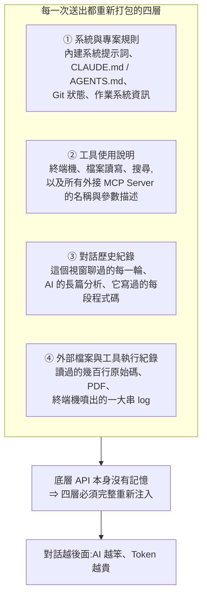
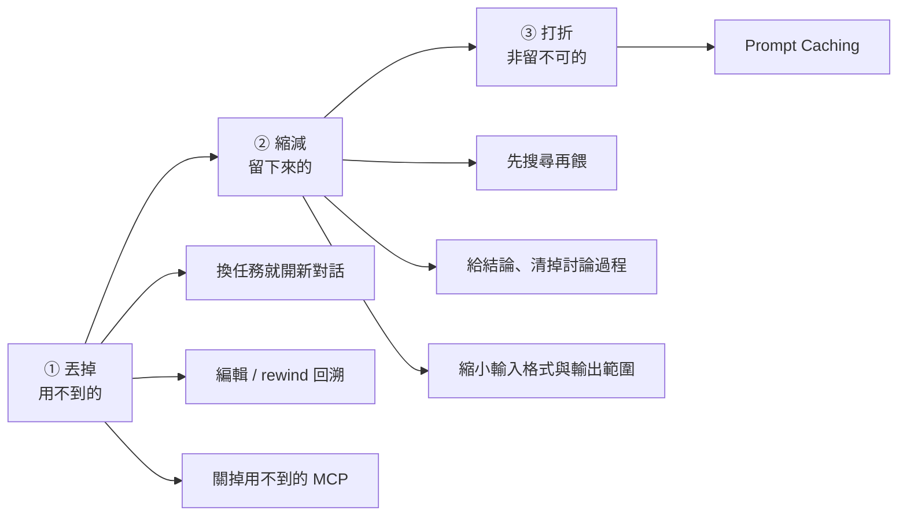
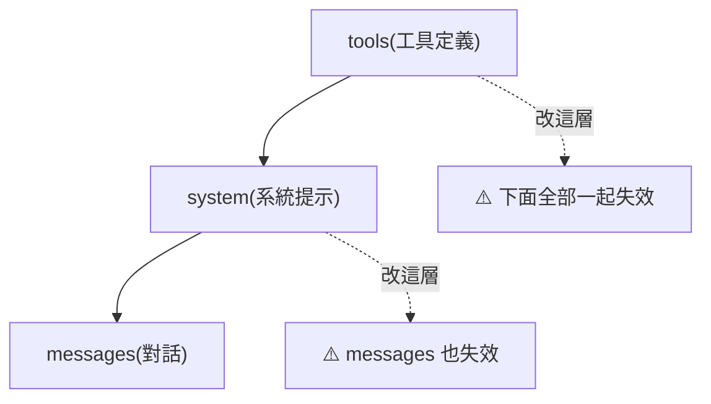
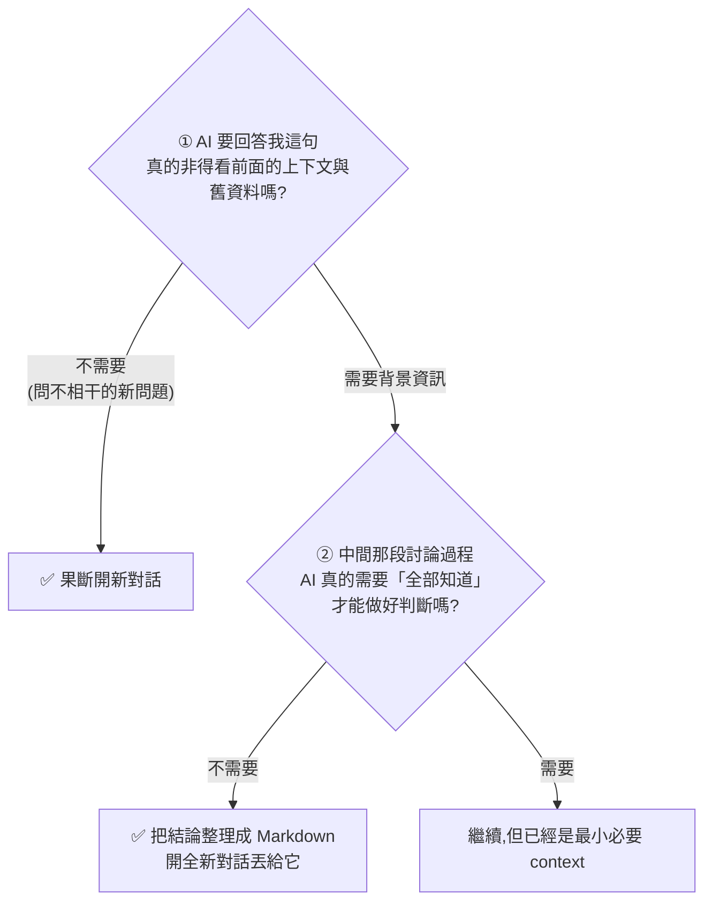
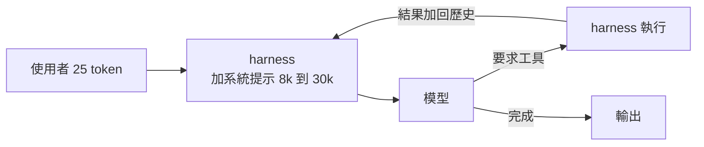

# AI 額度老是不夠用?三招省 Token:丟掉、縮減、打折

> 整理自 YouTube 頻道 **Gary Chen(@garytalksstuff)**〈AI 額度老是不夠用?三招省 Token 的實戰方法〉(2026-08-19,約 11 分鐘,官方 zh-TW 字幕)。
> 依 CLAUDE.md 慣例,**Prompt Caching 段落另比對 Anthropic 官方文件核實**,文中標出**三處影片講得不夠精確或漏掉的地方**。

> 相關筆記:[[context-engineering-processing-vs-thinking]]、[[claude-md-cut-82-percent-and-maintain-it]]、[[model-routing-compute-allocation]]、[[claude-throttling-opus-4-7]]

---

## 一句話總結

**省 Token 的重點不在「把 Prompt 寫短」,而在控制每次被重新打包送出的那包 Context。** 三個動作:**丟掉用不到的 → 縮減留下來的 → 非留不可的交給 Prompt Caching 打折。**

⭐ 而講者最後點出的動機更值得記:**省下來的不只是錢,是幫 agent 清出乾淨的 context** —— 少了雜訊,注意力更集中,產出品質也更好。

---

## 一、先搞懂:你按下送出時,模型到底收到什麼

很多人以為自己只傳了眼前那行短短的字。實際上系統會把**四層資料**一口氣打包塞給模型:



⭐ **關鍵在第 ② 層被嚴重低估**:光是工具清單,每次請求就可能先吃掉**幾千個 Token**,而且**你一個字都還沒打**。

### 雪球效應

| 輪次 | 歷史紀錄 | 你打的字佔整包比例 |
|---|---|---|
| 第 1 輪 | 空的 | 高 |
| 第 10、20 輪 | AI 的長篇分析 + 讀過的檔案 + 報錯 log **全部累積** | ⚠️ **可能不到 1%** |

> 就算你只回一句「幫我改第二行」,模型依然要把前面累積的所有內容**全部重讀一遍** —— 剩下的 99% 全是越滾越大的舊 Context。

---

## 二、⚠️ 兩個「聽起來合理但沒用」的直覺

| 直覺做法 | 為什麼效果有限 |
|---|---|
| **Prompt 寫短一點 / 叫 AI 簡短回答** | 對話視窗早就累積幾萬 Token,把眼前 Prompt 從 50 字縮成 5 字,**省下的比例微乎其微** |
| **換成便宜的小模型** | ⚠️ 一旦寫錯 code 或答非所問,**逼你來回重試好幾次,整趟累積下來反而燒更多** |

> ⭐ 這第二點與 [[model-routing-compute-allocation]] 的結論一致:**便宜模型的成本要算「完成任務的總成本」,不是單次 token 單價。**

---

## 三、三個核心動作



### 動作一:丟掉用不到的(效果最立竿見影)

核心概念:**只要是下一次請求根本用不到的內容,就讓它徹底離開對話視窗。**

**1. ⭐ 換任務,就開新對話** —— 最容易養成、效果也最好的習慣。
> 剛跟 AI 改完登入功能,順手丟一句「幫我看另一份不相干的報表」—— 這時模型還背著上一段任務的所有程式碼、報錯紀錄、工具輸出。**等於每問一句新問題,都在為早就結束的舊進度白白燒額度。**

**2. 善用編輯 / 分支回溯** —— 打錯字或指令不清,模型吐了一堆沒用的內容時:
```
❌ 在底下接著回「不對,我剛剛打錯了,重新來一次」
   ⇒ 那整段錯誤的長篇大論永遠卡在歷史紀錄裡,之後每次對話都被動送出

✅ 回頭編輯剛剛那句指令,或用 rewind 回到送出錯誤 Prompt 之前
   ⇒ 把失敗的產出徹底抹掉
```

**3. 精簡掛載的工具與 MCP Server** —— 每個 MCP 工具背後的說明文件與參數定義,**每次送出都會被完整塞進 Context**。只是要寫個小功能或改文章,就把用不到的網頁搜尋、資料庫等 MCP 果斷關掉。

### 動作二:縮減留下來的

有些背景資料確定接下來會用到,不能丟。那就問:**能不能只萃取真正關鍵的部分,把體積縮到最小?**

**1. ⭐ 先搜尋,再餵給模型**
> 不要把上百頁 PDF 或幾千行程式碼整包丟進去讓模型自己撈。如果問題本來就有明確的關鍵字、函式名稱或錯誤代碼,**先用搜尋工具找出最相關的那幾段,只餵那幾段** —— 光做這動作,每次請求消耗就能**從好幾萬降到幾百**。

**2. ⭐⭐ 給結論,把中間的討論過程清掉**
> 你跟 AI 來回討論半天、推翻兩三個方案才敲定架構。但下一步模型**只需要知道最終確認的規格和限制**,不需要知道那些被淘汰的廢案怎麼來的。
>
> 做法:把最終結論整理成一份 Markdown → **開全新對話**把檔案餵進去。

⚠️ **關於自動 compact / 摘要功能,講者的態度很明確:**
> 「這當然有幫助,但**不要把它當成萬靈丹**。因為摘要本質上是一種**有損壓縮** —— 它會保留大方向,但也可能漏掉細節。**真正重要的規格、限制、決策,最好還是你主動整理成一份乾淨的 Markdown。**」

**3. 縮小輸入格式與輸出範圍**
- 輸入:能用純文字或程式碼傳的,就不要丟幾 MB 的肥大截圖
- 輸出:只改某個函式就**明確要求它只輸出修改後的段落**,不要讓它熱心地整篇重寫

> ⭐ 講者的白話金句:**「AI 聽你說話比較便宜,但你聽 AI 說話比較貴。」**(輸出 Token 比輸入貴,也更吃額度)

### 動作三:把非留不可的拿去打折(Prompt Caching)

主流模型商都有 **Prompt Caching(提示詞快取)**:把對話中重複用到的提示詞暫存在伺服器上,後續請求更快、成本更低。

影片給的數字(以 Claude Opus 5):

| 項目 | 價格 |
|---|---|
| 一般輸入 | **$5 / 百萬 Token** |
| 命中快取後讀取 | **$0.5 / 百萬 Token(打一折)** |

**✅ 官方文件核實:完全正確。** cache read 就是基礎輸入的 **0.1×**。

---

## 四、⭐⭐ 三處影片講得不夠精確 / 漏掉的(比對官方文件)

### 補正一:快取預設是 5 分鐘,不是 1 小時

影片說「Prompt Caching **通常是 1 小時**」。

**官方文件:預設 TTL 是 5 分鐘。1 小時是要另外指定、而且要額外付費的選項**(`"cache_control": {"type": "ephemeral", "ttl": "1h"}`)。

| 環境 | 實際 TTL |
|---|---|
| Anthropic API 預設 | **5 分鐘** |
| 指定 `ttl: "1h"` | 1 小時(**寫入成本翻倍**,見補正二) |
| **Claude Code(訂閱方案內)** | ⭐ **主對話 1 小時**;API key / 雲端供應商為 5 分鐘;子代理、壓縮等其他請求預設 5 分鐘。影片講的只對訂閱版成立(⚠️ 需修正,見文末增補) |

⭐ 還有一個影片沒提的細節(⚠️ **未能核實**):官方頁只寫「每次命中快取都會重置計時」,並未說明 TTL 是從送出請求那刻起算,還是從回應結束起算。若按送出起算,一個串流 4 分鐘的回應在 5 分鐘 TTL 下只剩約 1 分鐘可接著問 —— 長 thinking / 長輸出會把自己的快取窗口吃掉一大半。

### ⭐ 補正二:快取不是免費的 —— 寫入要加價

影片只講「讀取打一折」,漏掉**寫入端要加錢**:

| 操作 | 相對基礎輸入 | Opus 5 換算 |
|---|---|---|
| 一般輸入 | 1× | $5 / M |
| **5 分鐘快取寫入** | **1.25×** | **$6.25 / M** |
| **1 小時快取寫入** | **2×** | **$10 / M** |
| 快取命中讀取 | 0.1× | $0.5 / M |

⚠️ **實務意義:快取只在「會被重複讀取」時划算。**
- 一段 context **寫入後至少要被讀到 1 次以上**才回本(5 分鐘檔:寫多付 0.25,每次讀省 0.9 → 讀 1 次就賺)
- 但如果你**寫進去卻沒再問就跑掉**,那是**淨虧 25%(或 1 小時檔的 100%)**
- ⭐ 所以「開了新 session、塞了一大包 CLAUDE.md 和 MCP 定義、問一句就關掉」是最貴的用法 —— 這正好反向支持動作一「換任務開新對話」要**成批做**,不是每問一句就開一個

### ⭐ 補正三:破壞快取的動作,官方版本更完整也更嚴重

影片點名三個:**中途換模型、中途調思考強度、中途打開加速模式**。✅ 官方文件都證實會失效(`speed`、`thinking parameters`、`effort setting`)。

但官方揭露了一個影片沒講的**層級結構**:



> **快取遵循 `tools → system → messages` 的階層。改動某一層,就會讓那一層與其後所有層全部失效。**

⭐ **這比影片的說法嚴重得多,而且直接連到動作一的第 3 點:**
**對話進行到一半才裝上 / 移除一個 MCP Server,改的是最上層的 `tools`** —— 會把**整包快取從頭打掉**,連系統提示與整段對話歷史都要重新付全額寫進去。

> ⚠️ **需修正(2026-11-07 核實)**:這句只在 **tool search 不可用**時成立。Claude Code 在支援的模型上預設啟用 tool search,此時 MCP 工具延遲載入,連接 / 斷開 MCP 不改動已快取的 tools 定義;只有 tool search 關閉或不可用時才會整包失效。「開工前決定好」仍是對的,但理由要寫清楚。

> ✅ **正確做法:MCP 的增減要在「開新對話之前」就決定好,不要中途調整。**

官方列出的其他失效觸發還包括:切換 web search、切換 citations、`tool_choice` 改動、**在任何位置增刪圖片**。

---

## 五、按 Enter 前的兩個自問題

講者給的「記不住細節也用得上」的收斂版:



---

## 應用案例

### 案例 1|⭐ 用「快取回本點」重新設計你的 session 節奏

把補正二的數字接回動作一,會得到一個影片沒推到底的結論:

```
❌ 反模式:每個小問題都開一個新 session
   每次都重新寫入 CLAUDE.md + 工具定義(1.25× 或 2× 價),問一句就關
   ⇒ 專案規則那幾千 token,每次都用「比一般輸入還貴」的價格重付

✅ 正確節奏:「換任務」才開新對話,同一任務內把問題成批問完
   第一次請求寫入快取(多付 25%),之後每輪讀取都打一折
```

⭐ **這兩個原則不衝突,分界線是「任務」不是「問題」:**
- 同一任務內的多輪往返 → **留在同一 session 吃快取**
- 換到不相干的任務 → **開新的**(因為舊 context 已成純負擔)

### 案例 2|⚠️ MCP 管理:從「裝好裝滿」改成「按任務組」

因為 `tools` 是快取層級的最上層,**中途動它 = 整包重算**。實務做法:

| 任務類型 | 只掛載 |
|---|---|
| 寫程式 / 改 code | 檔案讀寫、終端機、LSP |
| 寫作 / 整理筆記 | 搜尋、檔案讀寫 |
| 資料查詢 | 資料庫 MCP |

⚠️ **重點不是「MCP 越少越好」,而是「一個 session 內不要中途改」。** 開工前決定好,開工後就不要動。

> 本倉庫的 [[claude-md-cut-82-percent-and-maintain-it]] 砍的是第 ① 層(專案規則),這篇砍的是第 ② 層(工具定義)—— **兩層都在「你還沒打字就已經花掉的成本」裡。**

### 案例 3|把「給結論、清掉過程」做成固定交接流程

講者在 Patreon 放了一支 prompt 做這件事。自己做的話,結論檔至少要含四塊:

```markdown
## 已確認的決定
- (規格、架構、限制,附一句理由)
## 還沒解掉的問題
- (待決事項 + 目前傾向)
## 明確排除的選項
- (⭐ 這塊最重要 —— 沒寫的話新 session 會把你們推翻過的廢案再提一次)
## 現在的檔案 / 狀態
- (改到哪、下一步從哪接)
```

⚠️ **「明確排除的選項」是多數人漏掉的一塊。** 只寫結論不寫「否決了什麼」,新開的對話沒有那段討論記憶,很容易熱心地把被淘汰的方案重新推薦一輪 —— 你又得再吵一次,反而更貴。

> 這與 [[context-engineering-processing-vs-thinking]] 的主張一致:**要餵給模型的是「處理過的結論」,不是「思考的過程」。**

### 案例 4|「先搜尋再餵」在本倉庫的實例

本倉庫的 `INDEX-SOURCES.md` 與 `scripts/build_source_index.py` 就是這個原則的產物:

```bash
# ❌ 讓 AI 讀遍 198 篇筆記找某支影片有沒有整理過
# ✅ 對一份預先建好的索引做精確比對
grep -F -- "<video_id>" INDEX-SOURCES.md
```

⭐ **一次 grep(幾十個 token)取代掉讀幾百個檔案(幾十萬 token)** —— 而且更準。這正是「輸入端先做檢索,只餵相關片段」的最小可行版本。

### 案例 5|判斷輸出範圍的一句話規則

因為輸出比輸入貴,下指令時養成加一句:

| 情境 | 加上 |
|---|---|
| 改一個函式 | 「只輸出修改後的那個函式,不要重貼整個檔案」 |
| 改文章某段 | 「只給我改動的段落與前後各一句」 |
| 要它分析 | 「先給結論三點,我要細節再問」 |

⚠️ 例外:**要它做整體重構或跨檔案改動時不要硬限制輸出** —— 為了省輸出 token 而讓它只給片段,你反而要多問好幾輪把碎片拼起來,總成本更高。

---

## 六、⭐ 增補:額度「兩天見底」的機制拆解,與 Claude Code 官方快取文件的最新對照(2026-11-06,來源:YAHA学堂)

> 增補自 YAHA学堂〈[ClaudeCode 额度两天见底?每按一次回车,你都在为旧账全额付费 附解决方案](https://www.youtube.com/watch?v=yrnGrdPZx_U)〉(2026-08-24,約 11 分鐘,自動字幕;「Cloud Code」=Claude Code、「權量重發/前罪」=全量重發/前綴、「血球」=雪球、「OPS/SONIT」=Opus/Sonnet)。結論與本文前五節相同,這裡只補**新的角度**,並**用 Claude Code 官方快取文件逐項核實**。

### 6.1 影片的切入點:真正花額度的是那 99%

- API 底層**沒有記憶**,每輪把從第一句起的全部對話原封不動重塞(✅ 官方:「The model doesn't remember anything between requests」)。
- 「舊帳」四層:①系統提示+專案規則(CLAUDE.md、Git 狀態、作業系統資訊)②工具說明書(每個 MCP 的名稱、參數、使用說明全文)③聊天記錄全文(含 AI 寫過的每段長分析)④檔案與日誌(讀過的程式碼、PDF、終端機噴出的大串錯誤)。影片說 `context` 一打,還沒幹活系統提示+工具清單就先占上萬 token(個人觀察,未核實精確數字)。
- 到第 20 輪你打「幫我改第二行」,通常連整包的 1% 都不到。省額度要審的不是你打的那句,而是**滾大的雪球**。影片提到 2026 年 3 月重度用戶論壇出現「一條 Prompt 把額度從 21% 跳到 100%」,官方後來承認撞線比預期快,並說原因之一是快取 bug(⚠️ **未核實**,本次未找到一手公告)。

### 6.2 「丟」與「縮」的新細節

- **說錯話別往下接**:錯誤的長輸出會留在歷史、之後每輪重發。正確做法是回頭編輯那則訊息(影片:雙擊 Esc)或用 Rewind 回溯,把失敗產出整個抹掉。✅ 官方補充了隱藏好處:`/rewind` 把對話截回早先已快取的前綴,**下一個請求直接命中舊快取**;而 `/compact` 是產生全新(較短)前綴,要重建快取。
- 「先搜再餵」「給結論不給過程」「管住輸出」與前文一致;影片引用的定價 **Opus 5:輸入 $5/百萬、輸出 $25(5 倍)、快取命中 $0.5(一折)** ✅ 與官方 Opus 5 列相符。⚠️ 新模型已不同:**Opus 5.5 輸入 $4、輸出 $20、快取讀取 $0.20(0.05×)**,Fable 5.1/Mythos 5.1 讀取僅 0.025×。「一折」是多數模型的 0.1×,不是全部。

### 6.3 快取三顆「多米諾」——影片說法 vs 官方現況

快取是**前綴匹配**:從整包第一個字起必須一字不差,中間任何位置變了,後面全作廢。✅ 官方階層 `tools → system → messages`。

| 影片說的雷 | 官方文件現況 | 判定 |
|---|---|---|
| **中途換模型**:快取按模型分開存,整包全價重算 | ✅ 「Each model has its own cache」;`/model` 在快取仍溫時會先跳確認(≥ v2.1.238 超過 TTL 則不問) | 正確 |
| **中途動配置**:工具說明書排最前,一動全滅 | ✅ 工具定義在最前層。**但**新版 MCP 預設用 tool search 延遲載入,對話中連上/斷開 MCP 不影響已快取內容(只對 MCP;影片也講到) | 正確且影片已提延遲載入 |
| 「調思考強度、開加速模式、用權限規則禁掉內建工具,一動整排推倒」 | **需分模型修正**:fast mode 與標準速度各有快取,首次開啟會整段按 fast 價未命中 ✅;禁用整個工具(裸 `Bash` 等 deny)在 tool search 啟用的預設情況下**不改工具定義,快取保留**,僅在 tool search 不可用時才失效;**調 effort:在 Opus 5.5、Sonnet 5.5、Haiku 5.5、Fable 5.1(API key 或訂閱)上快取保留**,多數其他模型仍會失效(Claude Code 會先跳確認) | ⚠️ 影片過度概括 |
| **放涼**:API 預設 5 分鐘,訂閱版 Claude Code 自動續到 1 小時,自己接 API key 仍是 5 分鐘 | ✅ 訂閱方案額度內:主對話 1 小時;API key/雲端供應商:5 分鐘;**子代理、壓縮、forks 等「其他」請求預設 5 分鐘**;超出方案額度改用 usage credits 時主對話也降為 5 分鐘。可用 `promptCacheTtl`(或 `CLAUDE_CODE_PROMPT_CACHE_TTL`,`5m`/`1h`,≥ v2.1.242)自選 | 正確,且官方給了可調旋鈕 |

另一個影片沒講、但同屬「看似小動作」的官方列舉:啟用/停用有 MCP 的 plugin、累積大量圖片(Claude Code 會分批移除最舊圖片,造成一次慢速回合)、升級 Claude Code 後的第一個對話、`opusplan` 每次進出計畫模式(等於模型切換)。**不會破壞快取**的:編輯 CLAUDE.md(也不會生效,直到 `/clear`、`/compact` 或重啟)、切換權限模式、切換輸出風格、呼叫 skill、`/recap`、`/rewind`、派子代理(父層前綴不受影響)。

查自己的命中情況:`/usage` 的 `Prompt cache (main)` 行(≥ v2.1.251),可顯示命中比與可能的上次未命中原因(≥ v2.1.260);或讀 statusline 的 `cache_read_input_tokens` / `cache_creation_input_tokens`。

### 6.4 三問與「雪球、前綴、快取」

影片收尾的「按 Enter 前三問」比本文 §五 多一問:①新問題真的需要前面歷史嗎?不需要→開新對話;②需要的話需要全部嗎?多半只要結論→整理成文件、開新窗口;③**這個任務的模型和配置開工時定好了嗎?定好中途別動,讓快取安靜幫你打一折**。燒額度三大習慣:一個窗口聊到天荒地老、說錯話硬往下接、聊到一半換模型動配置。

### 應用案例(本節)

1. **隔夜回來接著聊**:API key 使用者預設 5 分鐘 TTL,第二天第一輪是整包全價重算。若這個任務值得長期續聊,把 `promptCacheTtl` 設 `1h`(留意 1 小時寫入 2×),或把結論整理成文件、開新對話。
2. **想用 `opusplan` 又頻繁進出計畫模式**:每次切換都等於換模型重建快取;改成一次計畫、批准後專心執行。
3. **發現「剛才指令下錯」**:用 `/rewind` 回到錯誤之前那則,而不是在下面補一句「重來」;可讀回舊快取,也不留失敗長輸出。

> 核實:快取機制/價格/TTL/失效清單均對照 [Claude Code prompt caching](https://code.claude.com/docs/en/prompt-caching.md) 與 [API prompt caching](https://platform.claude.com/docs/en/build-with-claude/prompt-caching)(該頁讀到前約 10 萬字元);「2026 年 3 月 21%→100% 事件」未核實。影片的 Hype 與訂閱呼籲屬自我推廣,未納入。

---

## 七、⭐⭐ 補充:同一句話,換成 coding harness 為什麼貴 30 倍?系統提示的「過路費」與快取的經濟學(2026-11-06 增補,來源:Caleb Writes Code)

> 來源影片:〈Why harness is SO expensive..〉(Caleb Writes Code,2026-08-12,約 9.7 分鐘;無官方字幕,逐字稿以 CPU 版 Whisper 轉錄,可能有同音字誤差;逐字稿的 Client / Klein 為 **Cline**,Pie 為 **pi**)。**含 Cline Pass 業配**(開放權重模型訂閱方案,首月 1.99 美元之類促銷),未納入。

### 六·一 實驗:同一個 25 token 的 prompt

任務:「建立一個含字母表的檔案」。用 Opus 5 定價推算:

| 路徑 | 影片數字 | 驗算 |
|---|---|---|
| 直接呼叫模型(25 token 輸入 + 約 500 token 輸出) | 約 **1 美分** | 輸入 25 × $5/M ≈ $0.000125;輸出 500 × $25/M ≈ $0.0125 ⇒ 約 1.3 美分 ✓ |
| 同一模型、同一 prompt 經 **Claude Code** | **0.37 美元** | 0.37 ÷ 0.0125 ≈ **30 倍** ✓ |
| 同一模型經 OpenCode / Cline / pi | 約 0.11 / 0.07 / 0.025 美元 | 差距來自 harness |

**原因拆解(講者):**
1. **系統提示(system prompt)**:Claude Code、pi、OpenCode、Cline、Cursor 等 harness 每則送給模型的訊息都附 **8,000–30,000 token** 的系統提示(影片估算,**未能獨立核實**;來源列的「Claude Code 系統提示不公開」一句本次未重新核實原頁;Cline 這類開源 harness 可直接讀 repo)。功能越多(slash 指令越多)描述越長。
2. **迴圈往返**:agent 不是一問一答。模型決定先查檔案是否存在 → harness 執行 → 回傳 → 模型要求建立檔案 → 執行 → 模型要求寫入內容……**每一趟都重送整包**(系統提示 + 工具定義 + 歷史)。做一個網站 10–20 分鐘,往返次數更多。
3. 引用 Anthropic 的說法:使用 agent 或多 agent 系統,成本可高出 **4 到 15 倍**。✅ **已核實**(Anthropic 工程部落格〈multi-agent research system〉,https://www.anthropic.com/engineering/multi-agent-research-system):原文為「agents typically use about 4× more tokens than chat interactions」與「multi-agent systems use about 15× more tokens than chats」。影片把兩個數字合併成「4 到 15 倍」,未區分單一 agent(約 4×)與多 agent(約 15×)。



> ⭐ 這正好是本篇 §一「雪球效應」的極端版:你的指令占整包的比例趨近 0。

### 六·二 Prompt caching 對 Anthropic 是一門好生意嗎?(講者的推算,屬推測)

上面「六·一」的成本能被快取壓下來,因為伺服器暫存 KV cache(見 [[kv-cache]])。本篇 §三、§四 已核實價格倍率(讀取 0.1×、5 分鐘寫入 1.25×、1 小時寫入 2×);影片補了**供給側的帳**:

- 一張 H100 租價約 3 美元 / 小時;假設 KV 量化後能把 **100 萬 token 的脈絡塞進 80 GB**,5 分鐘 TTL 下一小時可輪流服務 12 個這樣的快取位。
- 12 × 100 萬 token × 5 分鐘寫入價 6.25 美元 / 百萬 ≈ **75 美元 / 小時**(影片說約 70)。
- 1 小時 TTL 的寫入價 10 美元 / 百萬(影片提到「約 10 美元」,吻合 2× 倍率);講者**猜測** Anthropic 會把不活躍的快取卸到附近的 SSD、需要時再載回 GPU,才撐得起較低價格。

> ⚠️ 這段是「講者自己的 back-of-envelope」:①「100 萬 token 塞進單張 80 GB」本身是**未證實的前提**(實際 KV 大小依模型而定);②75 美元 / 小時假設每個位都被**持續重新寫入**,真正的快取以 0.1× 的讀取為主,收入遠低於此;③SSD 卸載是推測。**只當作理解快取為什麼值得供應商做的思想實驗**。

### 六·三 訂閱制:把「過路費焦慮」包掉

ChatGPT / Claude / Gemini 的訂閱讓使用者不必每次擔心 agent 花多少,用量上限週期性刷新;Anthropic 的 Pro 方案可在 Claude Code、Claude chat 等多個 harness 間共用額度並切換 Opus / Sonnet / Haiku(講者還提到 Fable 有自己的用量視窗)。這也是廠商把使用者鎖在**自己的 harness**的方法:換 harness 的痛點是對話、skills、連接器、排程都綁在平台上(同見 [[qwen38-27b-local-economics-and-august-checkpoint-wave]] §5)。

### 六·四 應用案例

**案例 A|量一下你的 harness「底價」:** 開新 session、只問一句極短的話,記下**第一則請求的 input token 數**。這就是你的「過路費」。再比較啟用 / 停用 MCP 與 skills 後的差距,即可知道哪些設定在白燒。

**案例 B|選 harness 的成本比較表:** 同模型、同任務(例如「建立字母表檔」「改一行 bug」)各 harness 各跑一次,記錄**總 token、有無命中快取、美元**。影片的 37 / 11 / 7 / 2.5 美分排序可當假說,但**你的環境與版本會變**,務必自己量。

**案例 C|長任務選 1 小時 TTL 還是 5 分鐘:** 任務中間會有超過 5 分鐘的沉默(等人、等 CI)就選 1 小時;連續密集呼叫則 5 分鐘即可(見 §四·補正二的回本點)。

**核實狀態:** ✅ 價格倍率與驗算吻合(本篇 §四 官方文件);系統提示 8k–30k token 與四個 harness 的美分數為**講者量測,未能獨立複現**;「4–15 倍」為引述;H100 帳為推測。

來源:[Caleb Writes Code〈Why harness is SO expensive..〉](https://www.youtube.com/watch?v=8ji5vURIllM)(2026-08-12)、[Claude Code settings 文件(註明系統提示不公開)](https://code.claude.com/docs/en/settings)。

---

## 延伸閱讀與深度補充(2026-11-07 核實增補)

> 逐項對照影片畫面、帶時間逐字稿與官方一手文件。標記:✅ 已核實 / ⚠️ 需修正 / ❓ 未能核實。

### 一、畫面核對(影片截圖)

- ✅ Caleb〈Why harness is SO expensive..〉畫面上 25 token 的 prompt 標示為 `$0.000125`;字幕誤聽為「$0.00001 到 $5」,以畫面為準。
- ✅ 同片 [3:20](https://www.youtube.com/watch?v=8ji5vURIllM&t=190s) 的比較圖:Claude Code 的 System Prompt 方塊最大,OpenCode、Cline、pi 依序變小,與字幕「37 / 11 / 7 / 2.5 美分」的排序一致。
- ✅ 同片 [2:17](https://www.youtube.com/watch?v=8ji5vURIllM&t=127s) 起的 37 美分結果;[2:35](https://www.youtube.com/watch?v=8ji5vURIllM&t=145s) 的「8000 到 30,000 token 系統提示」為講者估算(見 §七)。
- ✅ YAHA学堂〈ClaudeCode 额度两天见底〉[4:42](https://www.youtube.com/watch?v=yrnGrdPZx_U&t=272s) 投影片「說錯話 / 不要往下接」與「不對,重來」圖示,與本文 §三動作一第 2 點一致。
- ➖ 同片 [9:02](https://www.youtube.com/watch?v=yrnGrdPZx_U&t=530s) 之後的 Hype 投影片屬自我推廣,未納入。

### 二、價格與快取機制(官方文件核實)

| 項目 | 影片 / 本文 | 官方現況 | 判定 |
|---|---|---|---|
| Opus 5 輸入 / 快取讀取 / 輸出 | $5 / $0.5 / $25 | 相同;5 分鐘寫入 $6.25、1 小時寫入 $10 | ✅ |
| Opus 5.5 | $4 / $0.20 / $20 | 相同;快取命中為基礎輸入的 0.05× | ✅ |
| Fable 5.1 / Mythos 5.1 快取讀取 | 未提 | 0.025×($0.25 / MTok) | 補充 |
| 預設 TTL 與寫入倍率 | 5 分鐘(§四) | 預設 5 分鐘;`ttl: "1h"` 寫入 2×,5 分鐘寫入 1.25× | ✅ |
| 快取階層 | `tools → system → messages` | 相同;改上層,該層及之後全部失效 | ✅ |
| Claude Code 的 TTL | 1 小時(§四) | 訂閱方案內主對話 1 小時;API key / 雲端 5 分鐘;子代理、壓縮等 5 分鐘 | ⚠️ 需修正 |
| MCP 中途增減 | 整包失效(§四) | tool search 預設啟用時不失效;不可用時才失效 | ⚠️ 需修正 |
| 調思考強度 | 整包失效(§四) | Opus 5.5、Sonnet 5.5、Haiku 5.5、Fable 5.1 的 effort 變更保留快取;其他模型仍失效 | ⚠️ 需修正 |
| 換模型、開加速模式 | 失效 | 相同;每個模型、fast 與標準速度各有獨立快取 | ✅ |
| TTL 起算點 | 送出時起算(§四) | 官方頁未明說 | ❓ 未能核實 |

來源:[Anthropic 官方定價](https://platform.claude.com/docs/en/about-claude/pricing)、[Anthropic 快取文件](https://platform.claude.com/docs/en/build-with-claude/prompt-caching)、[Claude Code 快取文件](https://code.claude.com/docs/en/prompt-caching.md)。

### 三、Claude Code 的 TTL 細節

- ✅ 主對話 1 小時只在訂閱方案內用量時套用;改用 usage credits 超額計費時降為 5 分鐘。
- ✅ 可自選:`promptCacheTtl`(設定)或 `CLAUDE_CODE_PROMPT_CACHE_TTL`(環境變數),值為 `5m` / `1h`,需 v2.1.242 以上;子代理另有 `subagentPromptCacheTtl`。
- ✅ 1 小時寫入是 2×、5 分鐘寫入是 1.25×,差價約 60%;官方說明 1 小時快取需至少讀取 2 次才回本。
- ✅ 查命中率用 `/usage` 的 `Prompt cache (main)` 行(v2.1.251 以上),不要靠猜。

### 四、MCP、外掛、回溯的快取行為

- ✅ Skill、slash command、外掛的 skill / command / agent / hook 內容是附加在對話尾端,不破壞既有快取。
- ✅ 編輯 CLAUDE.md 不破壞快取,但也不會在當次 session 生效,要 `/clear`、`/compact` 或重啟。
- ✅ `/rewind` 截回已快取的前綴,下一個請求直接命中舊快取;`/compact` 會產生新的較短前綴,要重建快取。⇒ 走錯路想放棄用 `/rewind`,任務告一段落才用 `/compact`。
- ✅ 切換權限模式不破壞快取;例外是 `opusplan`,每次進出計畫模式都是模型切換。

### 五、應用案例

1. **用 `/usage` 驗證「換任務才開新對話」**:同一任務跑 3 輪後看 `Prompt cache (main)` 的命中率。若新 session 第一輪就大量 miss,代表前綴(CLAUDE.md、工具定義、系統提示)每次都在變,先找出變因再談省錢。
2. **API key 使用者的隔夜長任務**:預設 5 分鐘 TTL,隔天續聊第一輪是整包全價重算。若確定會在 5 分鐘後續問,才設 `promptCacheTtl` 為 `1h`;若之後沒再讀,這筆 2× 寫入就是純虧損。
3. **MCP 決定在開工前**:若環境 tool search 不可用(例如部分第三方雲端部署),中途增減 MCP 會整包重算。此時把 MCP 設定寫在啟動前,開工後不動。

---

## 重點回顧(TL;DR)

1. **省 Token 的重點不是把 Prompt 寫短,是控制那包 Context。** 對話累積幾萬 token 時,把 50 字縮成 5 字省下的比例微乎其微。
2. **每次送出重新打包四層**:①系統與專案規則(系統提示、CLAUDE.md、Git 狀態)②**工具使用說明(含所有 MCP 的名稱與參數描述,可能先吃掉幾千 token)**③對話歷史 ④外部檔案與工具執行紀錄。因為 **API 本身沒有記憶**,四層每輪都要完整重送。
3. **雪球效應**:到第 10、20 輪,你打的那句指令**可能不到整包的 1%**,剩下 99% 全是舊 Context。
4. **⚠️ 換小模型不一定省** —— 它寫錯 code 逼你來回重試,整趟反而更貴。
5. **三個動作:丟掉用不到的 → 縮減留下來的 → 非留不可的拿去打折。**
6. **丟掉**:①**換任務就開新對話**(最有效)②**編輯 / rewind 回溯**,而不是在底下回「我剛剛打錯了」(否則錯誤產出永遠卡在歷史裡)③關掉用不到的 MCP。
7. **縮減**:①**先搜尋再餵**(從好幾萬降到幾百)②**給結論、清掉中間討論過程**,整理成 Markdown 開新對話餵進去 ③縮小輸入格式與輸出範圍。
8. **⚠️ 自動 compact 不是萬靈丹** —— 摘要是**有損壓縮**,重要的規格/限制/決策要自己整理成乾淨的 Markdown。
9. **「AI 聽你說話比較便宜,你聽 AI 說話比較貴」** —— 輸出 token 比輸入貴,所以要明確限制輸出範圍。
10. **打折**:Prompt Caching。**命中後讀取打一折(0.1×)** ✅ 官方核實正確,Opus 5 $5/M → $0.5/M。
11. **⭐ 補正一:快取預設 TTL 是 5 分鐘,不是 1 小時。** 1 小時要另外指定且加價;**Claude Code 訂閱版主對話用 1 小時**,API key 則是 5 分鐘,所以影片的說法只對訂閱版成立,當成通則會錯。而且 **TTL 從送出請求那刻起算,不是回應結束** —— 長輸出會吃掉自己的快取窗口。
12. **⭐ 補正二:快取寫入要加價** —— 5 分鐘檔 **1.25×**、1 小時檔 **2×**。⇒ **寫進去卻沒再讀就跑掉是淨虧**;「開新 session 塞滿規則、問一句就關」是最貴的用法。
13. **⭐ 補正三:快取有 `tools → system → messages` 的階層,改上層會讓下層全部失效。** ⇒ **tool search 不可用時,對話中途裝/移除 MCP 會把整包快取從頭打掉**(預設啟用 tool search 則不會)—— MCP 的增減仍建議在開新對話前決定好。換模型、開加速模式 ✅ 官方證實;調思考強度在 Opus 5.5 / Sonnet 5.5 / Haiku 5.5 / Fable 5.1 上**不會**失效(⚠️ 需修正)。另外還有 web search、citations、`tool_choice`、增刪圖片。
14. **按 Enter 前兩個自問題**:① 這句真的需要前面的上下文嗎?不需要就開新對話。② 中間的討論過程 AI 真的需要全部知道嗎?不需要就整理成 Markdown 開新對話。
15. **⭐ 講者的真正動機**:「Token 燒得多本身不是壞事,真正浪費的是**讓早就沒用的 Context 在每輪請求裡白白吃掉額度**。」省下來的是**乾淨的 context、更集中的注意力、更好的產出** —— 他把這稱為「清理 AI 時代的技術債」。

---

## 來源

- [AI 額度老是不夠用?三招省 Token 的實戰方法 — Gary Chen(@garytalksstuff)](https://www.youtube.com/watch?v=d4329xvSDK4)(2026-08-19,約 11 分鐘,官方 zh-TW 字幕)
- [Anthropic 官方文件:Prompt caching](https://platform.claude.com/docs/en/build-with-claude/prompt-caching) —— 核實 TTL 預設 5 分鐘與 1 小時選項、cache write 1.25×/2× 與 cache read 0.1× 的價格倍率、`tools → system → messages` 快取失效階層
- 本倉庫相關筆記:[[context-engineering-processing-vs-thinking]]、[[claude-md-cut-82-percent-and-maintain-it]]、[[model-routing-compute-allocation]]、[[claude-throttling-opus-4-7]]

> ⚠️ 價格與 TTL 以整理時的官方文件為準,模型商調整頻繁,實際請以當下官方定價頁為準。
- 增補(§六):[ClaudeCode 额度两天见底?每按一次回车,你都在为旧账全额付费 — YAHA学堂](https://www.youtube.com/watch?v=yrnGrdPZx_U)(2026-08-24;使用自動字幕,可能有同音字誤差);官方:[How Claude Code uses prompt caching](https://code.claude.com/docs/en/prompt-caching.md)
- 2026-11-07 核實增補:[Anthropic 官方定價](https://platform.claude.com/docs/en/about-claude/pricing)、[Anthropic Prompt caching](https://platform.claude.com/docs/en/build-with-claude/prompt-caching)、[Claude Code:How Claude Code uses prompt caching](https://code.claude.com/docs/en/prompt-caching.md)、[Anthropic 工程部落格:multi-agent research system](https://www.anthropic.com/engineering/multi-agent-research-system)
