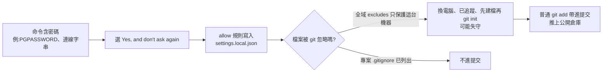

# Claude Code「不要再問」把密碼寫進設定檔:Apiiro 報告的口徑、官方文件對照與排查清單(Why QQ)

> 影片:[ClaudeCode密钥泄漏?一次永久允许,密码可能进仓库](https://youtu.be/c1ogFTJnAAo)|Why QQ|2026-11-11|9:41
> 本筆記與既有的二手日報筆記 [[ai-daily-2026-11-09-claude-code-secrets-modchip-co-design-bench-weiwei]] §1 同一事件。差別:這篇有帶時間的逐字稿,並**讀了 Claude Code 官方文件原文**核對機制;Apiiro 原報告我這次一樣讀不到(403),所以報告數字全部標「影片轉述,未讀原文」。
> 立場:頻道無業配;片尾求讚與留言。

## TL;DR

- 機制已由官方文件證實:選「Yes, and don't ask again」後,Bash 命令的永久批准會存成 allow 規則,寫進 `.claude/settings.local.json`(git 倉庫根目錄)。命令字串裡帶什麼,規則就可能留下什麼。
- 「本地檔會自動被 git 忽略」只對**當前機器、且由 Claude Code 首次建立檔案時**成立:官方文件說它會把這個檔加進你的**全域 git excludes**,不是專案的 `.gitignore`;若手動建立,要自己加 `.gitignore`。
- 規模數字(104,185 份檔案、1,122 份含敏感資訊、2,539 個憑證…)來自 Apiiro 報告,**我未能讀到原文**,只能確認影片的轉述與我查到的次級報導一致,不能自行驗證。
- 最實用的是 §4 的排查順序:**先吊銷輪換,再清檔案與歷史**。

## 1. 影片說了什麼(含時間)

| 主題 | 說法 | 時間 |
|---|---|---|
| 口徑 | Apiiro 在 2026-11-01 至 11-03 讀 GitHub 公開代碼與預設分支提交,找到 104,185 份 `.claude/settings.local.json`,分布在 103,617 個倉庫 | [0:36](https://youtu.be/c1ogFTJnAAo?t=26)–[0:49](https://youtu.be/c1ogFTJnAAo?t=39) |
| 命中 | 1,122 份含敏感資訊(約 1.1%),合計 1,379 個不同憑證;納入歷史版本、共享設定與代理對話後為 2,539 個、涉及 1,994 個倉庫 | [0:52](https://youtu.be/c1ogFTJnAAo?t=42)–[1:03](https://youtu.be/c1ogFTJnAAo?t=53) |
| 但是 | 「真實憑證」不等於仍可登入;研究者沒有測試憑證;只有一家被通知的組織確認金鑰當時有效 | [1:08](https://youtu.be/c1ogFTJnAAo?t=58)–[1:17](https://youtu.be/c1ogFTJnAAo?t=67) |
| 機制 | 命令含 `PGPASSWORD`、連線字串等,永久放行後存成 allow 規則 | [1:25](https://youtu.be/c1ogFTJnAAo?t=75)–[1:46](https://youtu.be/c1ogFTJnAAo?t=96) |
| 作用域錯配 | 首次寫入時加進全域 git exclude,不進專案 `.gitignore`;換電腦、已被追蹤、先建檔後 `git init` 都可能失守 | [2:05](https://youtu.be/c1ogFTJnAAo?t=115)–[2:31](https://youtu.be/c1ogFTJnAAo?t=141) |
| 怎麼進公開庫 | Boris Cherny 在 HN 說是使用者手動建立並提交;Apiiro 追到 1,105 個倉庫,其中 539 個修改過該檔的提交帶 Claude 共同作者標記 | [2:45](https://youtu.be/c1ogFTJnAAo?t=155)–[3:05](https://youtu.be/c1ogFTJnAAo?t=175) |
| 類型 | 1,379 個憑證中 379 個資料庫密碼、122 個 Supabase service-role 金鑰、43 組公網 SSH 登入 | [3:26](https://youtu.be/c1ogFTJnAAo?t=196)–[3:34](https://youtu.be/c1ogFTJnAAo?t=204) |
| 掃描器漏報 | 1,122 份中 Gitleaks 標 564、TruffleHog 標 643,215 份兩者都沒標;漏的多是命令參數類 | [3:41](https://youtu.be/c1ogFTJnAAo?t=211)–[3:51](https://youtu.be/c1ogFTJnAAo?t=221) |
| 外圍 | 76,011 份團隊提交的 `.claude/settings.json` 中 298 份含敏感資訊;2,523 份代理對話記錄中 120 份(87 個倉庫) | [4:08](https://youtu.be/c1ogFTJnAAo?t=238)–[4:26](https://youtu.be/c1ogFTJnAAo?t=256) |
| Auto 模式 | Anthropic 受控實驗 1,053 名付費測試者:人工審閱攔下 13.6%、Auto 模式攔下 89% | [5:28](https://youtu.be/c1ogFTJnAAo?t=318)–[5:41](https://youtu.be/c1ogFTJnAAo?t=331) |

## 2. 核實

### 2.1 機制:已核實(官方文件)

我讀了 [Claude Code 權限文件](https://code.claude.com/docs/en/permissions)與[設定文件](https://code.claude.com/docs/en/settings):

- 選 “Yes, and don’t ask again” 且批准為永久(如 Bash 命令、WebFetch 網域)時,規則存入 git 倉庫根目錄的 `.claude/settings.local.json`,並套用到之後該倉庫的所有 session(含子目錄與 worktree)。
- 設定文件:Claude Code 在**首次寫入該檔時**把它加進你的全域 git excludes;「如果你手動建立,要自己加進 `.gitignore`」。
- **影片沒講的細節(官方文件)**:當 `settings.local.json` **被 git 追蹤**時,Claude Code 把它視為「倉庫提供」而非你自己的檔案,規則會**先擱置、直到你信任該資料夾**才生效。也就是說,從別人倉庫 clone 下來、內含他人 allow 規則的檔,不會直接被當你自己的批准,但這與「憑證已經公開」是兩件事。
- 影片說全域排除檔「常見位置是 `~/.config/git/ignore`」:官方文件只寫「global git excludes」,**路徑是 git 的預設行為,不是 Claude Code 的特別設定**,我沒有逐項驗證。

### 2.2 規模與比例:未能核實原文

Apiiro 原報告頁(`apiiro.com/blog/coding-agents-leaking-secrets-github-dont-ask-again/`)我用 curl 取得 HTTP 403,只回應網站殼層、沒有文章正文。上表第一至第七列、第九列的數字**全部是影片轉述,我無法對照原文**。影片自己有兩處把口徑切得很清楚,值得保留:

- 2,539 是「暴露規模」,不能說成 2,539 個可用帳號([1:17](https://youtu.be/c1ogFTJnAAo?t=67))。
- 539 個共同作者標記只能證明 Claude 參與過提交,不能推成「它獨立推送」,也不能反推「全是使用者手動」([3:01](https://youtu.be/c1ogFTJnAAo?t=171)–[3:09](https://youtu.be/c1ogFTJnAAo?t=179))。

### 2.3 Auto 模式 13.6% 對 89%:二手,且指標不同

搜尋到的次級報導(例如 InfoWorld、letsdatascience)一致寫 1,053 名付費測試者、人工攔下 13.6%、Auto 模式攔下 89%,並說這是 Anthropic 自己的實驗、在專門環境、受試者知道自己在被評測;我只讀到搜尋摘要,**未讀 Anthropic 原文**。影片的關鍵提醒是對的:這測的是「危險命令攔截」,不是「批准規則會不會存下密碼」,不能把 89% 套到這次事件上([5:43](https://youtu.be/c1ogFTJnAAo?t=333)–[5:49](https://youtu.be/c1ogFTJnAAo?t=339))。

### 2.4 驗證表

| 項目 | 狀態 |
|---|---|
| 永久批准寫入 `.claude/settings.local.json` | ✅ 已核實(官方文件) |
| 首次寫入時加進全域 git excludes,手動建立要自己加 `.gitignore` | ✅ 已核實(官方文件) |
| 被追蹤的 `settings.local.json` 規則需先信任資料夾 | ✅ 已核實(官方文件;影片未提) |
| Apiiro 的 104,185 / 1,122 / 2,539 等數字 | ⚠️ 未能核實(原文 403,只有影片轉述) |
| 539 個共同作者標記、Gitleaks 564 / TruffleHog 643 / 215 漏報 | ⚠️ 未能核實(同上) |
| Boris Cherny 在 HN 的回應內容 | ⚠️ 未能核實(未讀 HN 原串) |
| Auto 模式 13.6% 對 89% | ⚠️ 二手核實,未讀 Anthropic 原文 |
| Issue 5544(2025-08)、13106(2025-12)描述同機制 | ⚠️ 未能核實(未讀 GitHub issue) |

## 3. 流程圖:資料怎麼從一條命令進到公開庫

## 4. 排查與處理順序(影片 6:14–9:19 整理,指令用影片提到的原樣)

1. **盤點資料流**:每次讓代理碰真實環境,問三件事:它讀到哪些秘密、寫到哪裡、這些產物之後被誰打包、提交或同步([6:17](https://youtu.be/c1ogFTJnAAo?t=367)–[6:23](https://youtu.be/c1ogFTJnAAo?t=373))。
2. **檢查是否被追蹤與歷史**:`git ls-files -- .claude/settings.local.json`,再 `git log --all --full-history -- .claude/settings.local.json`;共享的 `.claude/settings.json` 一樣查([6:56](https://youtu.be/c1ogFTJnAAo?t=406)–[7:11](https://youtu.be/c1ogFTJnAAo?t=421))。
3. **搜尋命令類密碼**:`PGPASSWORD`、`sshpass -p`、`mysql -p`、`Bearer`、連線字串前綴,別只搜 `sk-`([7:20](https://youtu.be/c1ogFTJnAAo?t=430)–[7:27](https://youtu.be/c1ogFTJnAAo?t=437))。
4. **先吊銷輪換,再清檔案**,順序顛倒會造成處理完的錯覺;歷史版本裡的值也要輪換,並查審計日誌([7:37](https://youtu.be/c1ogFTJnAAo?t=447)–[7:49](https://youtu.be/c1ogFTJnAAo?t=459))。
5. **停止追蹤並忽略**:`git rm --cached .claude/settings.local.json`,寫進專案 `.gitignore`,提交後用 `git check-ignore -v` 驗證([7:51](https://youtu.be/c1ogFTJnAAo?t=461)–[8:02](https://youtu.be/c1ogFTJnAAo?t=472))。
6. **歷史清理**:必要時 `git filter-repo`,先協調協作者;GitHub 官方提醒強推後舊提交仍可能留在 fork、clone、PR 引用與快取([8:06](https://youtu.be/c1ogFTJnAAo?t=476)–[8:16](https://youtu.be/c1ogFTJnAAo?t=486),GitHub 官方提醒我未讀原文)。

**團隊防線**([8:19](https://youtu.be/c1ogFTJnAAo?t=489)–[8:58](https://youtu.be/c1ogFTJnAAo?t=528)):模板預設忽略本地代理設定;預提交掃描暫存內容、CI 掃代理目錄與歷史;掃描規則補上命令列密碼;`.claude/`、`.cursor/`、`.gemini/` 的變更在 review 單獨列出;沙箱限制檔案系統與網路;短期憑證取代長期管理員金鑰;提交前 `git diff --cached --stat`,少用 `git add -A`。

### 應用案例:一個真實的檢查動作

你用 Claude Code 排查預發環境,命令是 `PGPASSWORD=xxx psql -h host -c "..."`,並選了永久放行。現在到該專案執行:

1. `git check-ignore -v .claude/settings.local.json`:有輸出且來源是專案 `.gitignore` 才算受保護;若只來源於全域 excludes,請補進專案 `.gitignore`。
2. 打開檔案搜尋 `PGPASSWORD`,有就把這條規則刪掉,並把密碼輪換。
3. 以後改成讓命令讀環境變數,不在命令列寫密碼。

## 5. 與本庫既有筆記的關係

- 同一事件的二手版本與 Apiiro 原文 403 的紀錄:[[ai-daily-2026-11-09-claude-code-secrets-modchip-co-design-bench-weiwei]]。
- 非技術者的資安與威脅建模入門:[[vibe-coding-security-threat-modeling]]。

## 來源

- 影片:[ClaudeCode密钥泄漏?一次永久允许,密码可能进仓库](https://youtu.be/c1ogFTJnAAo)(Why QQ,2026-11-11)。逐字稿:YouTube 官方字幕(帶時間),全程已讀。
- 說明欄引用:Apiiro 報告 [https://apiiro.com/blog/coding-agents-leaking-secrets-github-dont-ask-again/](https://apiiro.com/blog/coding-agents-leaking-secrets-github-dont-ask-again/)(HTTP 403,**未讀到正文**)。
- Claude Code 官方文件:[權限](https://code.claude.com/docs/en/permissions)、[設定](https://code.claude.com/docs/en/settings)(已讀相關段落)。
- 次級報導(僅讀搜尋摘要,Auto 模式實驗):[InfoWorld](https://www.infoworld.com/article/4207959/anthropic-makes-claude-codes-auto-mode-default-for-paid-users.html)、[letsdatascience](https://letsdatascience.com/news/anthropic-makes-auto-mode-default-in-claude-code-60dcee63)。
