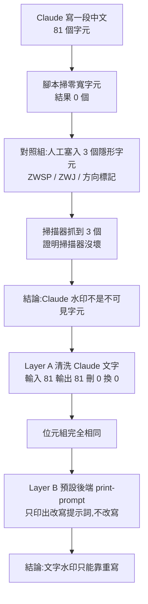

# Claude 文字水印與「1.8 萬星去水印工具」:用原始碼驗證影片的「蹭流量沒用」

**主題分類:** AI 安全 / 內容溯源(provenance)與水印
**來源影片:** YouTube〈实测1.8万星 Claude 去水印工具:蹭流量的,完全没用〉(YAHA学堂,2026-09-01,約 5 分 25 秒)
**核實對象:** [guillaumemeyer/watermarks-remover](https://github.com/guillaumemeyer/watermarks-remover)(本文已 `git clone --depth 1` 讀過,最新 commit 2026-11-01)、[Anthropic 說明文件](https://support.claude.com/en/articles/16266773-how-claude-marks-ai-generated-content)
**整理日期:** 2026-11-06

> **立場揭露:** 該片為頻道自己的工具評測,說明欄只放該 repo 連結,**未見業配或聯盟連結**。影片結尾的「Hype 按鈕」是請觀眾幫忙 YouTube 曝光,非商業推廣。
> **字幕品質:** 該片僅有自動字幕(簡體,同音字錯誤多,如「制服」=字元、「Cloud」=Claude、「淡地」=本地、「Synthet Text」=SynthID-Text),已逐句校正。

---

## 0. 一句話總結

> **Claude 的文字水印(依 Anthropic 說法)是「織進文字本身」的統計式標記,不是藏在某個不可見字元裡。**
> 所以「刪零寬字元」抓得到 0 個、也洗不掉它;影片這個核心論點**成立**。
> 但標題「完全沒用」**說過頭**:該工具的 Layer A(不可見字元、檔案中繼資料)確實有效且可驗證,只是它**從沒聲稱**能洗掉統計水印——repo 自己就把這點寫得很清楚。

---

## 1. 背景:Claude 怎麼標記 AI 內容(一手來源)

Anthropic 說明文件(2026-11 讀取)的要點:

| 項目 | 內容 |
|---|---|
| 機制一 | 模型層級把**不可察覺的水印織進文字本身**,複製貼上後仍在,輕度編輯可能仍在 |
| 機制二 | 產生的 PNG/JPEG 等檔案附 **C2PA Content Credentials** 簽章 |
| 時間 | 簽署 EU AI Act 第 50(2) 條透明度實務守則;**2026-08-02 起**於歐盟推出的模型上市即支援,舊模型為過渡期 |
| 偵測 | **文字水印偵測目前是私有預覽**(監管機關、媒體、事實查核、研究者、特定企業);免費的 Claude Content Checker **只驗檔案的 Content Credentials,不是文字偵測器** |
| 官方警語 | 偵測到水印**不等於**全是 Claude 寫的(可能只是校稿、翻譯、摘要);沒偵測到也**不等於**人寫的(舊模型、大幅改寫、極短文字、取樣參數非預設等) |

⚠️ **影片說「Claude 用的是 Google 發在 Nature 的 SynthID-Text」——Anthropic 並未公布演算法。** repo 自己的 `how-claude-marks.md` 也寫「Anthropic has not published the algorithm」,只把它歸為 *likely* 統計式 token 取樣水印(Kirchenbauer / SynthID 類)。**把它講成「就是 SynthID-Text」屬於推定。**
(Anthropic 文件另提到:Sonnet 4.6 在設定非預設 `temperature` / `top_p` / `top_k` 時,水印可能不穩定出現。)

---

## 2. 影片的實驗流程(逐步)



重點是影片設計了**對照組**(自己塞 3 個隱形字元,確認掃描器抓得到),這個做法值得學:證明「0 個」是因為真的沒有,而不是腳本寫錯。

## 3. 用原始碼核對

### 3.1 專案結構與規模(影片拍攝時 vs. 我讀到的現況)

| 項目 | 影片(2026-09-01) | 現況(2026-11-02 讀取) |
|---|---|---|
| Stars | 約 1.8 萬 | **26,409**(GitHub API) |
| Python 檔 | 82 | 122(`find` 計數) |
| 測試檔 | 48 | 77(`tests/` 下) |
| 建立日 | 8/11(水印 8/2 上線後 9 天,與影片吻合) | 2026-08-11 |
| 授權 | — | MIT;最新 release v0.7.0 |

技術棧:**純標準庫 Python 腳本 + 一個 HTTP 服務**;Skill 本身只有 markdown(薄客戶端),透過 `WATERMARKS_SERVICE_URL`(預設 `http://127.0.0.1:8765`)呼叫 `/inspect`、`/clean`。另有 `PostToolUse` hook(`Write|Edit|MultiEdit|NotebookEdit`),預設 `check` 模式只回報、`clean` 模式就地清洗。

### 3.2 Layer A:確定性清洗(有效、可驗證)

`skills/clean-user-facing-text/scripts/text_unicode.py` 內含 `STRIP_CODEPOINTS` 集合:軟連字號 U+00AD、零寬空格 U+200B、ZWNJ/ZWJ U+200C/D、LRM/RLM、雙向控制 U+202A–202E、U+2060 系列、U+FEFF、變體選擇符 U+FE00–FE0F、Hangul filler 等;另有 `SPACE_HOMOGLYPHS` 把 NBSP 等異形空白換成一般空白。

**我自己跑了一次**(塞入 U+200B、U+200D、U+00A0):

```bash
python clean_text.py s.txt --stats -o s.out
# removed: U+200B x1, U+200D x1;  replaced: U+00A0 x1
# 28 bytes -> 21 bytes,輸出 "hello world test end"
```

與影片「3 個全清掉」一致。

### 3.3 Layer B:統計水印——確實只是「盡力而為」

- `service/scripts/rewrite_text.py` 的後端有 `ollama`、`openai-compatible`、`print-prompt`;選 `print-prompt` 時只輸出提示詞(約第 812 行分支),與影片「Backend 是 Print Prompt、Model 是 None」吻合。
- repo 的 `removal-matrix.md` 對統計水印欄寫:**「Verifiable today? No without vendor key/detector」**,並說明可用 MarkLLM harness 驗證「特定方案設定」(KGW / SynthID 類),**同設定限定,不是廠商偵測器的代用品**。
- `docs/synthid-text-benchmark.md`:有基準腳本 `bench_synthid_text.py`,量 clear rate、removal margin(避免「剛好過門檻」的假清除)、語意偏移、成本。即作者**有做自己的量測**,但那是對 MarkLLM 版 SynthID,**不是對 Claude 的真實水印**。
- repo 建議 Layer B 用「**非原廠、開放權重**」模型改寫,避免被再蓋一次章——與影片提醒「用 Claude 改寫 Claude 會再被蓋章」一致。
- `ethics.md`:明列不當用途(學術欺詐、規避應揭露的透明度規範、宣稱「人寫」),並要求報告分開寫「可驗證移除」與「盡力而為的改寫」。

### 3.4 檔案類:C2PA / AI 中繼資料清除(有效;字幕把 C2PA 聽成 CRPA / CR、PA)

`removal-matrix.md` 列出 PNG/JPEG/WebP/AVIF/HEIC/GIF/TIFF/SVG/PDF/DOCX/XLSX/PPTX/EPUB/MP4/WAV/MP3/FLAC 等的 C2PA / EXIF / XMP 清除,多數標「Yes (re-inspect)」可複驗;**C2PA 軟綁定(soft binding)、音視頻 SynthID 水印、模型後門明確列為範圍外**。這也對上影片「三行不在範圍內」。

## 4. 評析:影片說對了什麼、說過頭了什麼

| 影片說法 | 核對結果 |
|---|---|
| 零寬字元掃描對 Claude 文字命中 0 | 與 Anthropic「織進文字本身」的描述**一致**;我無 Claude 輸出樣本可自行重現,**未能獨立重現** |
| Claude 水印是 SynthID-Text | **推定**,Anthropic 未公布 |
| 工具 Layer A 對人造隱形字元有效 | **已核實**(我跑了) |
| Layer B 預設只印提示詞 | **已核實**(`print-prompt` 後端) |
| 能清 C2PA / AI 中繼資料 | **已核實**(矩陣與測試檔) |
| 「完全沒用」「蹭流量」 | **說過頭**:它對不可見字元與檔案中繼資料有實際功能,星數在影片後仍從 1.8 萬漲到 2.6 萬;但對「統計文字水印」確實**沒有可驗證的移除能力**,也無官方偵測器可驗 |
| 校稿也會被蓋章、翻譯可能洗掉 | 與 Anthropic 文件(proofread / translate)**一致** |
| 改寫能繞過、明年未必 | 合理推測;repo 自己也寫「SemStamp / PostMark 等段落級方法尚未部署」 |

## 5. 應用案例

1. **你收到一段「看起來被 AI 動過」的文章,想用零寬字元掃描判斷**:別這麼做。依 Anthropic 說法 Claude 水印不在不可見字元裡,掃到 0 並不代表人寫;掃到不可見字元則多半是別的來源(複製貼上、排版工具)。
2. **工程衛生**:程式碼或 Markdown 裡混入 U+200B、NBSP 導致 diff 看不出差異、搜尋失敗——Layer A 正是為此,`clean_text.py --stats` 一行就能列出刪了哪些碼位。
3. **要發布含 AI 圖片的檔案**:想先檢查有無 C2PA/EXIF 的 AI 標記,用 `inspect_file.py`;但要注意合規場景(歐盟 AI Act 第 50 條)下刻意移除標記可能違反揭露義務,repo 自己的 `ethics.md` 也這麼警告。
4. **評估任何「去水印神器」的方法論**:學影片的作法——先建對照組(自己植入已知標記)證明偵測器有效,再看工具的「宣稱範圍」是否涵蓋威脅模型,最後看是否有**可複驗的指標**。

## 核實狀態

- **已核實:** Anthropic 標記機制與日期;repo 結構、Layer A 碼位表、`print-prompt` 後端、範圍外清單、Star 數;Layer A 清洗實測。
- **推定:** Claude 使用 SynthID-Text 類演算法。
- **未能核實:** 影片中「用 Claude 寫的 81 字」命中 0 的原始實驗(無樣本);Layer B 對 Claude 真實水印的實際去除率(無官方偵測器,私有預覽中)。

## 來源

- 〈实测1.8万星 Claude 去水印工具:蹭流量的,完全没用〉YAHA学堂,2026-09-01:https://www.youtube.com/watch?v=9leHSMk-9nY (該片為自動字幕,簡體,非官方人工字幕,同音字誤差已校正)
- guillaumemeyer/watermarks-remover(MIT):https://github.com/guillaumemeyer/watermarks-remover
- Anthropic〈How Claude marks AI-generated content〉:https://support.claude.com/en/articles/16266773-how-claude-marks-ai-generated-content
- 相關筆記:[[prompt-injection-5-techniques-defenses]](同屬 AI 安全面向,角度不同)
