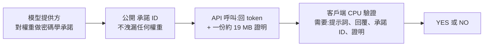

# FlashProve:用零知識證明驗「你調用的真的是那個模型」——能證明什麼、不能證明什麼、貴在哪

> 整理自 YouTube 頻道 **Why QQ**〈[你调用的 Claude，真的是 Claude 吗？](https://www.youtube.com/watch?v=v0tNOeirrO0)〉(2026-11-07,約 13.9 分鐘,官方 zh-Hans 字幕,逐字稿保留時間 `[m:ss]`)。
> 一手來源:Anthropic 研究頁〈Provable inference〉(2026-11-02)與 GitHub 倉庫 `anthropics/FlashProve`(2026-11-08 已 `git clone --depth 1` 讀 `guide/performance.md`、`guide/what-is-proved.md`、`guide/known-limits.md`、`docs/architecture.md` 後刪除 clone)。
> ⚠️ **無業配**:說明欄只有參考連結。影片畫面為燒錄字幕 + 資訊圖,2026-11-08 截圖核對 7:25 與 11:23 兩幕,內容與逐字稿一致。
> ⚠️ **研究原型**:本文所有「證明」都在 Anthropic/MIT/EPFL 的實驗設定下成立,不代表可直接用於正式環境。

## 一句話
**FlashProve 證明的是「這串 token 確實是某組已承諾的權重算出來的」,不是「答案是對的」;而且證明成本是普通推論的約 70–95 倍、只能事後審計。**

## 1. 問題:第三方 API 網關能不能偷換模型?
- 動機:在 Cursor / Claude Code 裡接第三方中轉站,網關只要把回傳 JSON 的 `model` 欄位改成 claude,日常問答幾乎看不出來([0:09]–[0:25])。
- **數位簽章解不了**:簽章只證明「訊息出自持私鑰的伺服器」,不證明顯存裡跑了什麼([1:03]–[1:17])。影片比喻:封口貼的防偽章是真的,後廚用和牛還是料理包貼紙管不到;網關可以用便宜模型出結果再蓋自己的章([1:21]–[1:44])。
- 需要驗證的是:這串 token 有沒有經過**那套特定權重**的完整計算([1:47])。

## 2. 機制(影片的白話版 + 官方文件對照)

- **承諾(Commitment)**:先對權重生成承諾,只公開承諾值([1:55]–[2:13])。
- **驗證者只需四樣東西**:提示詞、回覆、**預先信任的承諾 ID**、不到 19 MB 的證明;不需權重、不需 GPU,筆電 CPU 十幾秒即可([2:23]–[2:44])。
- **三步轉換**([4:06]–[4:50]):IOP(把計算軌跡用糾錯碼與多項式展開)→ Merkle 承諾 + Sumcheck(每次推論約兩千次求和校驗,隨機抽查)→ Fiat–Shamir(把來回互動壓成靜態證明檔)。
- **四性質**([3:13]–[3:43]):完備性、可靠性(改一個 bit 即拒絕)、零知識、簡潔性。
- **為何用 Llama 4 Maverick**([4:56]–[5:19]):權重開源可復現;400B 總參數、約 17B 啟用的 MoE,未啟用專家不必證明;並把「每層路由給哪些專家」藏起來。
- **工程手段**([5:44]–[6:38]):4-bit 量化權重 232 GB 放 CPU 記憶體、H100 串流載入當前層段並做局部 Sumcheck;多請求合批攤銷承諾檢查;整個模型改成**純確定性整數運算**以避免浮點誤差。

## 3. 效能:「110 tokens/s」是什麼
| 影片說法 | 官方核實 |
|---|---|
| 110 tokens/s 是 1024 token 輸入窗口的 **prefill** 吞吐,不是生成速度([7:05]–[7:10]) | ✅ `performance.md`:「steady prefill rates … nothing is generated」;24 請求/批約 111 tokens/s |
| 24 請求一批花 223 秒 → 0.108 請求/秒 → 約 387 請求/小時([7:23]–[7:34]) | ✅ 官方:24/批等待 220.7–225.9 秒;24÷223 = 0.108(影片自行換算,畫面 7:25 可見) |
| 單請求要等 58 秒([7:37]–[7:40]) | ✅ 官方 1 請求/批 17.41 tokens/s → 1024÷17.41 ≈ 58.8 秒(影片換算) |
| 整段回覆檢查時每秒僅 39.1 token([7:42]–[7:46]) | ✅ 官方:whole replies 108.67 ± 2.8,若只算回覆 token 為 39.1 ± 1.0,條件為較寬鬆的 clipped-gap 政策 |
| 證明 GPU 時間是普通 vLLM 的 70–95 倍([8:00]–[8:03]) | ✅ Anthropic 頁:24/批約 72×(66–77),最高負載約 94× ;repo 另列 93.0、71.4、20.1 倍三組。⚠️ **基準不對等**:vLLM 對照組是模型 **FP8 原版、八張 H100**,證明器是第三方 4-bit 轉換、一張 H100 |
| 證明檔 18.78 MB;每天百萬次呼叫 → 18.78 TB、108 張 H100([8:20]–[8:39]) | 18.78 MB 與官方一致;18.78 TB 與 108 張卡是**影片的外推算術**(1,000,000×18.78 MB;1,000,000 ÷ 0.108 ÷ 86,400 ≈ 107),官方未如此宣稱 |
| 驗證:筆電 CPU 十幾秒 | ✅ Anthropic 頁:約 17 秒(24 執行緒)/ 21 秒(單執行緒),另需下載約 6.5 MB 承諾 |

補充(官方,影片未提):離線階段(commit)約 39 分鐘、每個模型做一次;一份承諾可涵蓋約 1,600 萬請求。

## 4. 影片點出的邊界,以及官方怎麼說
1. **只證計算完整,不證事實**([2:56]–[3:09]):模型照算卻瞎編 API,仍「驗證通過」——✅ 與官方定位一致。
2. **事後異步證明(post-hoc)**([8:51]–[9:40]):先回答、後補票,只能追責不能攔截,所以是審計工具不是防火牆。✅ Anthropic 頁:requests are proven after the fact, in batches, for a subset of tokens。
3. **承諾 ID 的來源是致命盲區**([9:53]–[10:44]):惡意網關可用便宜模型連同它自己的承諾 ID 與合法證明給你「YES」。✅ repo(`AGENTS.md`、`docs/architecture.md`):**絕不要從被檢查的伺服器或隨證明附來的檔案取承諾 ID**,要從替模型背書的第三方取。
   - ⚠️ **需修正/推定**:影片說「必須由 Anthropic 或 Meta 官方維護帶權威簽名的承諾註冊表」。repo 只要求「從信得過的一方、最好是公開發布處」取得 ID,**未描述一個官方簽名註冊表的機制**,此為影片的延伸推論。
   - ⭐ repo `known-limits.md` 還指出:**提供方可以承諾任何模型**(含很小或退化的模型),一個「YES」不告訴你那是哪個真實模型;尺度檔甚至可關掉部分模型區塊——所以**承諾 ID 的信任根才是整個方案的關鍵**。
4. **形式化驗證 ≠ 全實作無洞**([11:09]–[11:56]):Lean 證的是紙面協議與慢速參考驗證器,高效能 C++ 驗證器與 CUDA 證明器沒完成與 Lean 規格的等價證明,多請求批次的零知識也沒覆蓋。✅ `what-is-proved.md` 明寫:C++ 驗證器與 CUDA 證明器「written to follow the same protocol and are tested against it, not themselves proved」;零知識定理「not for batches」。⭐ **影片未提、更重要的限定**:soundness 的 Lean 定理是對 **exact-match(每個輸出 token 都是模型 top choice)** 政策;實際服務用的**較寬鬆 clipped-gap 政策**下,Lean 只證「回覆符合該政策」,`known-limits.md` 直言這**本身擋不住多少東西**(寬鬆門檻 + 接近的分數或全零權重,幾乎任何輸出都過)。
5. **六道門檻**([12:01]–[12:29]):特定 MoE、1,024 token 上下文、必須整數運算與貪婪解碼、只能事後審計、C++/CUDA 未形式化、側信道風險——✅ 與 Anthropic 頁限制吻合(整數版模型、貪婪解碼、1,024 窗口、側信道不在範圍、架構不隱藏只隱藏權重)。

## 5. 實務意義:怎麼用才划算
影片結論([12:37]–[13:03]):不要每次呼叫都證,改成 **數位簽章 + 硬體 TEE + 1%–0.1% 隨機密碼學抽檢**,讓作弊者承擔高違約風險;適合第三方算力審計、金融醫療合規推論、排行榜防作弊評測。(此為講者建議,非官方部署指南。)

### 應用案例
> 情境:團隊用三家中轉站跑 Claude Code,月費差三倍,懷疑最便宜那家換模型。
> ① 向模型提供方取得**權威來源的承諾 ID**(不是中轉站給的);② 對中轉站流量抽 0.5% 做事後證明檢查,每小時批次跑;③ 驗證失敗或交不出證明就扣款/停用。
> 現實限制:目前只有 Maverick 一種模型的原型、1,024 token 上下文,Claude 自己的模型還不能這樣驗——所以現階段較實際的做法仍是**自建對照測試題**(固定提示詞、比較模型指紋行為)與合約審計,參見 [[ai-subscription-api-equivalent-value-semianalysis]] 對 API 價值的討論。

## 6. 核實狀態
- ✅ **已核實**(Anthropic 頁 + repo 文件):Maverick 400B/17B、約 19 MB 證明、110 tokens/s 為 prefill、24/批 223 秒、驗證約 17 秒、post-hoc、Lean 覆蓋範圍、六項限制、承諾 ID 不可取自受檢伺服器。
- ⚠️ **需修正/補充**:承諾註冊表為影片推論;vLLM 對照基準不對等(FP8 八卡 vs 4-bit 單卡);clipped-gap 政策下的保證遠弱於 exact-match——影片未提。
- ❓ **未能核實**:「Claude 參與大量撰寫密碼學系統」只見影片轉述與 Anthropic 頁面作者列表,repo 文件本次未逐字找到;影片「Anthropic 聯合 MIT 與 EPFL」——作者列表含 Anthropic、EPFL、MIT(及 StarkWare、Succinct 等隸屬標註)屬實,但「聯合」的組織關係以官方頁為準。
- 🔍 **未讀**:論文 PDF(`paper/paper.pdf`)與 Lean 程式本體,數學細節(IOP 構造、Sumcheck 次數)僅採影片與文件摘要。

## 來源
- Why QQ:〈你调用的 Claude，真的是 Claude 吗？〉 https://www.youtube.com/watch?v=v0tNOeirrO0 (2026-11-07,官方 zh-Hans 字幕)
- Anthropic:Provable inference(FlashProve) https://www.anthropic.com/research/provable-inference (2026-11-02)
- GitHub:anthropics/FlashProve(Apache 2.0) https://github.com/anthropics/FlashProve — `guide/performance.md`、`guide/what-is-proved.md`、`guide/known-limits.md`、`docs/architecture.md`
- 延伸:本庫 [[ai-subscription-api-equivalent-value-semianalysis]]、[[opencode-console-breach-guardrail-asymmetry]]
