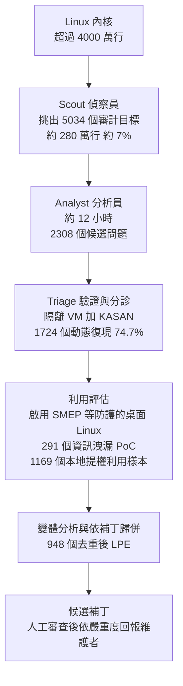

# OpenAI 用 Agent 流水線審計 Linux 內核:948 個本地提權漏洞、121 萬美元、以及「拿到 root 卻做錯」的 20 次

> 整理自 Why QQ〈AI找到948个Root漏洞:120万美元的AI安全实验解析〉(2026-11-07,約 9 分鐘,官方簡中字幕)。影片解讀 OpenAI 2026-11-04 發布的研究文章〈A thousand fewer paths to root〉。
>
> ⚠️ **資料來源限制:** OpenAI 原文頁面對我回傳 **HTTP 403,未能直讀原文**。本文數字以影片字幕為主,並與**兩份引用原文數字的二手整理**([DEV Community](https://dev.to/yehechuhai/948-linux-root-exploits-in-one-run-what-openais-kernel-pipeline-actually-proves-and-what-it-47a)、[Data Studios](https://www.datastudios.org/post/openai-948-linux-kernel-root-exploits-1-2-million-cyber-pipeline))逐項對照;原文有無更正,請以 OpenAI 頁面為準。**所有數字都是 OpenAI 自報、未經外部審計或重現。**
>
> 立場:Why QQ 這支無業配或導購。本文屬資安與 Agent 工程題材,**漏洞細節與利用技術原文皆未公開**,本文也不含任何可操作的利用內容。

---

## 一句話總結

> OpenAI 把「審計 Linux 內核」拆成**偵察、分析、驗證、利用評估、變體歸併**五段 Agent 流水線,約花 **121.3 萬美元** API 額度,最後得到 **948 個去重後的本地提權(LPE)漏洞**與候選補丁。影片最想講的不是 948 這個數字,而是三件工程事:**每一段都要拿出可執行的證據、Agent 回報成功不等於做對事(20 次拿到 root 卻用了錯的漏洞)、模型變強後舊的 Harness 要重做消融實驗**。

---

## 一、先分清楚:這是「本地提權」,不是遠端入侵

- **LPE(Local Privilege Escalation):** 攻擊者**已經**能以低權限執行程式,再利用內核漏洞升到 root。影片明講「千萬別理解成 948 個遠端入侵入口」([從 0:49 開始](https://www.youtube.com/watch?v=C2EzJjVpHpw&t=49s))。
- 為什麼仍重要:一次受限的入侵,可能因此變成整台系統失陷。
- 內核規模:超過 4,000 萬行,安全問題常藏在**物件生命週期、並行狀態、引用計數與跨模組約束**裡,不是搜幾個危險函式就找得到。

---

## 二、流水線:五段,各留證據

| 階段 | 做什麼 | 數字(OpenAI 自報) | 費用 | 與二手整理對照 |
|---|---|---|---|---|
| Scout | 判斷哪些程式碼值得優先查(普通使用者能不能到、是否涉及安全邊界、出錯影響) | 5,034 個目標、約 280 萬行(內核約 7%) | 3,426 美元 | ✅ 目標數與行數一致;費用見 DEV 整理 |
| Analyst | 讀分配到的源碼、理解函式關係與輸入約束,提出候選漏洞 | 約 12 小時、2,308 個初步去重候選 | 約 31.65 萬美元 | ✅(DEV:316,549 美元) |
| Triage | 為候選建最小測試程式,放進隔離 Linux VM、開 **KASAN**(抓越界與釋放後使用),看輸出與內核日誌,失敗就調整重跑 | 1,724 個動態復現(約 74.7%) | 約 7.3 萬美元(影片未提) | ✅(DEV:73,330 美元;30 小時) |
| 利用評估 | 在啟用 SMEP 等保護的桌面 Linux 環境驗證,不靠人為放寬的條件 | 291 個資訊洩漏驗證程式、1,169 個成功的 LPE 利用樣本 | 約 77.6 萬美元,佔總成本約 64% | ✅(DEV:775,929 美元;環境另列 SMAP、KASLR、HARDENED_USERCOPY) |
| 變體分析 | 依不同修復補丁歸併 | **948** 個不同 LPE | 總計約 121 萬、平均約 1,279 美元/個 | ✅(總額 1,213,430 美元,OpenAI 稱為上限) |

⭐ **為什麼標題是 948 而不是 1,169?** 一個漏洞可能有多種利用方式、多個樣本也可能指向同一個根本問題,所以按「修復補丁」歸併;影片([從 4:16 開始](https://www.youtube.com/watch?v=C2EzJjVpHpw&t=256s))強調 948 **不是報錯次數,也不是已進入 Linux 主線的補丁數**。對安全團隊來說,一千份報告不等於一千個要各自修的問題。

**前情(影片 [從 1:27 開始](https://www.youtube.com/watch?v=C2EzJjVpHpw&t=87s)):** 2026 年 6 月公布 24 個 LPE 利用樣本;7 月一次實驗得到 166 個不同問題;10 月組成自動化流水線得到 948 個。⚠️ 二手整理提醒:7 月那次是 GPT-5.6 Sol、花 513,690 美元、約 3,095 美元一個;10 月這次用的是一個**未公開命名的「upcoming cyber model」**,模型、範圍與工具都不同,**不能當成受控的成本比較**。

---

## 三、影片最值得學的四件事

### 1. Agent 說成功,不等於做對事:20 次拿 root 卻用了錯的漏洞

([從 4:42 開始](https://www.youtube.com/watch?v=C2EzJjVpHpw&t=282s))早期一次運行,Agent 回報 200 次 LPE 成功;人工檢查發現其中 **20 次**確實拿到了 root,卻是利用**另一個** 0-day,不是系統指派驗證的那一個。若評測只看「最後有沒有 root」,這 20 次都算成功,但實驗其實跑偏了。後來團隊加了**獨立檢查**,確認最終結果真的來自指定漏洞。

✅ 與二手整理一致(DEV、Data Studios 都引用此事,並說 OpenAI 收緊了任務規則)。

> 對照本庫:[[loop-engineering-when-and-how-gary-chen]](別讓球員兼裁判)、[[agent-verification-before-scale-lauren-tan-reaction]](先給 Agent 驗證再談規模)。

### 2. 成本集中在最難的那段,失敗任務會無底洞

最大支出是利用評估(約 77.6 萬美元,64%)。影片提醒([從 5:36 開始](https://www.youtube.com/watch?v=C2EzJjVpHpw&t=336s)):某些很難穩定觸發的問題會讓 Agent 不斷嘗試、持續燒預算。**生產環境的 Agent 不能只有「開始」與「完成」兩種狀態**,要設最大重試次數、停止條件、成本上限與獨立驗收,否則「看起來很聰明的 Agent 也可能是一台昂貴的循環機器」。

### 3. 模型變強後,舊的技能包要重做消融實驗

影片說([從 5:59 開始](https://www.youtube.com/watch?v=C2EzJjVpHpw&t=359s)):早期團隊整理出 **103 種利用技術**當外部知識給 Agent。對 GPT-5.5 Cyber,在 63 個候選任務上成功率從 76.2% 提高到 88.9%;換成 GPT-5.6 Cyber,同樣複雜的技能層只多約 1.5 個百分點。結論是「今天設計的 Harness 不一定適合下一代模型」。

⚠️ **這組數字我未能核實:** 兩份二手整理都**沒有**提到 103 種技術與這組成功率,DEV 整理甚至寫「文章沒有消融研究」。可能在 OpenAI 原文的其他段落,而二手整理沒轉述,也可能是影片解讀有誤——**原文 403,本文把它列為「影片說法,未能核實」,不要引用數字**。影片得出的「舊技能層要重測」這個**一般性結論**與本庫 [[bitter-lesson-cut-old-patterns]] 的立場一致,可獨立成立。

### 4. 報告說出了「至少十種前所未見的利用技術」,但細節不公開

OpenAI 從 166 個利用樣本抽樣研究技術,稱至少有十種過去沒見過的利用手法,並交給外部內核安全專家確認。✅ 二手整理一致,且給出分類:兩種彈性內核物件(用於記憶體噴灑)、兩種頁面整理技術、五種「只改資料」的提權方法、一種任意型別混淆。**細節因安全考量不公開**,所以這個「新穎性」目前只能當 OpenAI 與少數專家的說法;要界定能力邊界,仍需公開資料與獨立評估(影片也這麼說)。

---

## 四、最容易傳錯的一句:948 個漏洞不是「都修好了」

([從 7:18 開始](https://www.youtube.com/watch?v=C2EzJjVpHpw&t=438s))OpenAI 說的是**產生候選補丁、交給安全研究員審查,再依嚴重程度逐步回報維護者**,並沒有宣布 948 個全部合入主線。十天研究週期結束時:

- **61** 個已在上游修復
- **43** 個已有待合入補丁
- **299** 個正在公開報告或討論

✅ 三個數字與 DEV、Data Studios 一致。⚠️ **三者加總 403,不是 948**,其餘仍在回報流程中。影片還說這些數字也包含其他貢獻者的工作、不能全算 OpenAI 的修復成果:二手整理的說法是「OpenAI 沒說其中多少來自自己的提交、多少來自獨立的內核開發者」,方向一致,**但我沒讀到原文措辭**。另外:**沒有公布 CVE 編號、確切內核版本與補丁接受率**。

---

## 五、我補充的限制與判讀

1. **全部是自報數字。** 成本、復現率、利用數都來自 OpenAI 自己的研究文章與帳號,沒有外部重現。DEV 整理直接稱它們為「未經審計,最好讀作 OpenAI 的說法」。
2. **人沒有缺席。** 二手整理指出:每個利用、補丁與嚴重度評級都經**人類研究員審查**才回報,所以這不是「無監督」的成果。影片結論也是「安全審查的工作單位在變」,不是「程序員不用做安全審查」。
3. **成本不能直接外推。** 成本與產出取決於模型、目標內核快照與 Harness。OpenAI 另以賞金行情做了一個假設性對比(以 Pwn2Own、TyphoonPWN 的歷史賞金套到 948 個,約 1,890 萬到 6,630 萬美元),這只是**示意**,不是實際收入,也不代表市場上能賣到那個價。
4. **復現失敗的原因。** DEV 整理引用 OpenAI:未復現的部分中只有 3.1% 是分析錯誤,其餘是需要更高權限、超過時間預算,或需要難以觸發的條件(例如競態)。所以 74.7% 不是「Agent 準確率」,而是在時間預算下的復現率。
5. **防守端也受益。** OpenAI 的說法是未修補的低權限帳號,應視為對資源充足的攻擊者「功能上等同 root」——這是其立場,不是獨立驗證的結論。與本庫 [[opencode-console-breach-guardrail-asymmetry]] 談的「護欄對攻擊者與防守者不對稱」是同一條主線:找洞變便宜,修補與合入才是瓶頸。

---

## 六、應用案例:把這條流水線的「模式」搬到自己的專案

影片結尾的結論(我整理成步驟,不需要一百萬美元):

1. **先縮小範圍再深挖。** 對自己的程式庫,先讓 Agent 依「外部可達性、跨信任邊界、出錯影響」排序模組(對應 Scout),只深查前 5% 到 10%。
2. **要求可失敗的測試,而不是一份風險報告。** 每個懷疑都要附一個能在隔離環境跑的最小重現(對應 Triage);跑不出來就標「未驗證」,不進報告。
3. **修補後跑回歸並驗證原問題真的消失。** 不只看「測試綠燈」。
4. **「獨立驗收」要驗過程,不只驗結果。** 例:Agent 自動修 CI 時,除了「測試通過」,還要檢查它是否改了測試本身、是否繞過了指定的失敗原因(就是那 20 次 root 的教訓)。
5. **預算與停止條件。** 為每個任務設最大重試次數與成本上限;失敗任務單獨記錄,事後分析為什麼會卡住。
6. **模型升級時重跑消融。** 把積累的提示詞、技能包、流程編排拆開,逐項關掉看成績差多少,砍掉沒用的(對照 [[bitter-lesson-cut-old-patterns]])。

**不適用的情況:** 你沒有授權就不要拿這類流程去掃別人的系統;漏洞與利用細節的處理要走負責任揭露,不要公開。

---

## 字幕還原與核對

| 項目 | 結果 |
|---|---|
| 官方簡中字幕通讀 | 專有名詞(Scout、Analyst、Triage、KASAN、SMEP、LPE)皆正確,無需截圖校正 |
| 「GPT-5.5 Cyber / GPT-5.6 Cyber」 | 字幕寫法;二手整理中 7 月的是 GPT-5.5-Cyber(6 月)與 GPT-5.6 Sol(7 月),10 月是未命名模型;**模型名稱與消融數字的對應未能核實** |
| 時間點 | 皆取自帶時間逐字稿的 `[m:ss]`,連結已提前 10 秒 |

---

## 來源

- 影片:Why QQ〈AI找到948个Root漏洞:120万美元的AI安全实验解析〉(2026-11-07):<https://www.youtube.com/watch?v=C2EzJjVpHpw>(官方簡中字幕,時間戳取自字幕)
- OpenAI 原文〈A thousand fewer paths to root〉(2026-11-04):<https://openai.com/index/a-thousand-fewer-paths-to-root/>(⚠️ 對我回傳 403,**未能直讀**,以下二手整理引用其數字)
- 二手整理(用於交叉核對,均標示為 OpenAI 自報):
  - DEV Community:<https://dev.to/yehechuhai/948-linux-root-exploits-in-one-run-what-openais-kernel-pipeline-actually-proves-and-what-it-47a>
  - Data Studios:<https://www.datastudios.org/post/openai-948-linux-kernel-root-exploits-1-2-million-cyber-pipeline>
  - Unite.AI:<https://www.unite.ai/openai-pipeline-finds-948-linux-kernel-privilege-escalation-flaws/>
  - Neowin:<https://www.neowin.net/news/openais-upcoming-model-finds-948-linux-kernel-vulnerabilities-that-could-grant-root-access/>
- 延伸(本庫):[OpenCode 控制台事件與護欄不對稱](./opencode-console-breach-guardrail-asymmetry.md) · [Loop Engineering:別球員兼裁判](../ai-agents/foundations/loop-engineering-when-and-how-gary-chen.md) · [先給 Agent 驗證再談規模](../ai-agents/applications/agent-verification-before-scale-lauren-tan-reaction.md) · [Bitter Lesson:砍掉舊提示手法](../ai-agents/foundations/bitter-lesson-cut-old-patterns.md)
