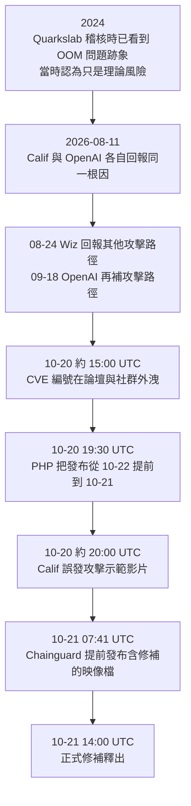

# PHP2Shell:兩個 PHP 核心 RCE、十週修補期,與一次被三方洩漏打穿的協調揭露

> 整理自 YouTube 頻道 **Caleb Writes Code**〈[PHP security crisis explained..](https://www.youtube.com/watch?v=6VmA4x1lh1M)〉(2026-10-23,約 8 分鐘,英文自動字幕 `en-orig`)。
>
> ⚠️ **立場揭露**:03:57–04:55 是 **Bluehost 業配**(agent hosting),說明欄附 Bluehost 追蹤連結;本筆記不收錄業配內容。
>
> ✅ **已對照一手來源**:PHP Foundation 官方事後說明(2026-10-21)、SentinelOne 技術分析、Socket、SecurityWeek、Bitsight。⚠️ 影片前半段「空 key 不記帳 → OOM → 解構子指標被劫持」的逐步原理,**公開資料沒有到這個細節**,本筆記只當作者的示意講解,見第六節。

---

## 一句話總結

**CVE-2026-109618 與 CVE-2026-109619(合稱 PHP2Shell)**是 PHP 核心的兩個記憶體安全漏洞,CVSS v4.0 都是 **9.2**,**未經認證就能遠端執行程式碼**。Calif 與 OpenAI 在 **2026-08-11** 回報根因,PHP 在 **10-21** 才釋出修補,中間約十週。原定協調揭露被**三件事**提前打穿:CVE 編號外洩、Calif 誤發攻擊示範影片、Chainguard 提前發布含修補的映像檔。影片的主軸:**AI 找漏洞的速度,已經遠快過修漏洞的速度。**

---

## 一、兩個漏洞是什麼

兩者共同根因(SentinelOne 的說法):PHP 遇到致命狀況時用 `longjmp` 跳出 C 呼叫堆疊,**清理程式碼沒跑、半成品狀態被留下**,之後的清理流程或下一個請求卻信任那份狀態。

| | CVE-2026-109618 | CVE-2026-109619 |
|---|---|---|
| 類型 | 記憶體不足(OOM)造成的記憶體破壞 | 殘留的全域狀態 ⇒ use-after-free |
| 觸發點 | 啟動階段處理請求資料(如 multipart 解析)時撞到 `memory_limit` | 致命錯誤後的清理;已確認的觸發點是 **session upload progress(預設開啟)** |
| 機制 | PHP **先把請求資料標記為有效、再分配記憶體**;分配失敗時,那筆項目指向**未初始化的 heap 記憶體**,失敗請求的關閉流程接著處理那些殘留位元組 | 致命錯誤後,某個全域指標仍指向已釋放的記憶體;**同一個 worker 的下一個請求**在初始化重設前碰到它 |
| 需要幾個請求 | **一個** | **兩個**(一個汙染 worker、下一個吃到殘留狀態) |
| 官方確認的影響 | Apache + mod_php 下,**未認證請求能在任何應用程式碼執行前觸發**,預設設定即可 RCE;PHP-FPM 經由應用層程式碼路徑也確認 | 確認 use-after-free 與 worker 崩潰;回報者在 Apache + mod_php 的真實應用上示範了 RCE |

**影響範圍**:PHP 5 以後的版本;所有處理網頁請求的 SAPI,包括 PHP-FPM、Apache mod_php、php-cgi、FrankenPHP、LiteSpeed。PHP 團隊認為 **mod_php 風險最高**。


---

## 二、時間線



### 三次洩漏

| 洩漏 | 內容 | PHP Foundation 的評估 |
|---|---|---|
| **CVE 編號外洩**(10-20 約 15:00 UTC) | 兩個 CVE 編號,附錯的發布時間和**錯的 CVSS 10.0** | 不含技術細節 |
| **Calif 誤發影片**(約 20:00 UTC) | 示範 PoC 對多個目標成功;雖刪除,副本已流傳 | 透露的額外細節有限,但**加速了公開 PoC 的開發** |
| **Chainguard 提前發映像**(10-21 07:41 UTC) | 比協調時間早 6 小時以上發布含修補的建置映像 | 讓攻擊者能在正式發布前**從二進位形式研究修補** |

另外 10-20 約 23:00 UTC,提供給部分關鍵基礎設施業者的緩解建議**也可能外洩**。

### Chainguard 的說法

Chainguard CEO Dan Lorenc 在 Hacker News 回應:「我在漏洞已在野外被利用時決定提前發布。」理由是有安全廠商回報野外利用、漏洞容易找也容易利用、已有公開資訊。他說決定後立刻通知了協調群組,之後在 LinkedIn 為增加 PHP 維護者的壓力道歉。

**PHP Foundation 的立場**:這是單方面打破禁令,在其他發行商還在準備更新時就讓修補落到攻擊者手上;並表示**發布當下沒有發現任何可用的公開 PoC**(這不代表其他地方沒有利用)。

> 兩方說法並陳,本筆記不判斷誰對。Lorenc 沒有點名回報野外利用的廠商,也沒有公開證據。

### 野外利用

- SecurityWeek:**Amazon 在修補釋出前約四天**觀察到利用嘗試(影片說「10 月 17 日」,與此吻合)。
- WatchTowr:修補釋出前後感測器收到首批利用嘗試,但**沒看到成功的**。
- Hadrian:之後表示「已看到大規模野外利用」。
- Sansec 預測修補釋出後 15 分鐘內就會開始大規模利用(這是預測,不是觀察)。

---

## 三、影片的主論點:找漏洞快過修漏洞

Caleb 的論點:

- 生成式 AI 和 agent 興起後,被找到的重大 CVE 越來越多。這本身是好事,軟體會更堅固。
- 但**傳統的修補流程跟不上 AI 找漏洞的速度**。這次從回報到修補花了將近十週,「即使有 AI 幫忙,修也比找慢得多」。
- PHP 約占七成網站,所以這次規模特別大。

**PHP Foundation 事後說明提供的佐證**:

- 2026 年稍早,Alpha-Omega 用 Anthropic 的 **Claude Mythos** 掃描 PHP;團隊後來加入 OpenAI 的 **Daybreak Red** 驗證回報與 exploit,以及 sanitizer 建置與重現環境。
- **7 月 1 日以來發布 15 個 CVE,另外處理了 100 多份無效、重複或無法重現的回報。**
- 原話:AI 幫忙驗證回報、把同根因的回報歸組,但「**每個決定都由人做、每個修補都由人寫**」。工具決定不了長期引擎設計的修法、權衡不了相容性、也不能審查修補。

**為什麼這次修這麼久(Socket 引述 Foundation)**:候選修法各有代價,不是破壞相容性,就是引入新的 DoS 風險,或要動到大量第三方擴充。

**PHP 打算改什麼**:2026 年 5 月成立生態系安全小組;聘任 AI Security Engineer in Residence 等人力;安全團隊從共識決改為多數決;嚴重且修法有爭議的漏洞,Foundation 領導層會更早介入。

> ⭐ 這和本庫 [[opencode-console-breach-guardrail-asymmetry]] 的主題同一條線:攻擊端的 AI 能力推進得比防守端的流程快。也可對照 [[cloudflare-security-audit-skill-pipeline]] 的「驗證者永遠不是發現者」,PHP 的 100 多份無效回報就是驗證成本。

---

## 四、修補與緩解

**唯一完整的修法:升級並重啟。**

| 分支 | 修補版本 |
|---|---|
| 8.5 | 8.5.12 |
| 8.4 | 8.4.27 |
| 8.3 | 8.3.36 |
| 8.2 | 8.2.35 |
| 8.1 / 8.0 / 7.4 | PHP 專案已不支援;團隊釋出**最小化的原始碼 backport**,部分發行版另有自己的 backport |

⚠️ **Bitsight 的掃描**:在能辨識版本的 PHP 實例中,**只有約三分之一跑在有支援的分支(8.2–8.5)**;**最常見的是 7.4,超過 200 萬筆觀察**。

**暫時性設定(SentinelOne,只能降低風險):**

```ini
; CVE-2026-109618:由管理員層級設定,並把 post_max_size 壓低
memory_limit = -1
post_max_size = 8M

; CVE-2026-109619
session.upload_progress.enabled = 0
; PHP 8.5 另外關閉
fatal_error_backtraces = 0
```

⚠️ 把 `memory_limit` 設成 `-1` 是讓 OOM 不在 PHP 層觸發,代價是單一請求可能吃光主機記憶體,要搭配 cgroup `memory.max` 等外部限制。SentinelOne 也建議**不要用 RLIMIT_AS / RLIMIT_DATA** 來限制。

**其他層:**

- Proxy / WAF 限制請求大小、欄位數、part 數、header 與巢狀深度;不用 multipart 的應用直接擋掉 multipart。WAF 只是一層防護,不是修補。
- 降低 `pm.max_requests`(worker 更常回收,殘留狀態活得更短)、用 SELinux / AppArmor 限制 web worker。
- **輪換機密**:未修補又暴露在外的主機,worker 記憶體裡可能有過的 token、金鑰、憑證都要換(CVE-2026-109619 有洩漏記憶體的路徑,可能把機密帶進 `PHPSESSID` cookie)。
- 確認版本用 `php -v` 看**實際在跑的**版本,不只看套件管理器裝了什麼;升級後要**重啟** PHP-FPM、Apache 與所有長駐 worker。

---

## 五、應用案例

### 案例 1:十分鐘盤點自己有沒有中

情境:你管理一批跑 WordPress 的主機。

```bash
# 1. 看實際在跑的版本(不是套件版本)
php -v
# Web 端也查一次,CLI 和 FPM 可能是不同版本
curl -s https://example.com/phpinfo-temp.php | grep "PHP Version"   # 查完立刻刪掉這個檔案

# 2. 看用的是哪個 SAPI(mod_php 風險最高)
apachectl -M 2>/dev/null | grep -i php

# 3. 確認 upload progress 是否開著
php -i | grep session.upload_progress.enabled
```

判讀:

| 結果 | 處置 |
|---|---|
| 8.2–8.5 但版本號低於修補版 | 立刻升級並重啟所有 worker |
| 7.4 / 8.0 / 8.1 | 找發行版或主機商的 backport;沒有就排遷移,期間限制對外暴露 |
| 跑 mod_php | 優先處理,因為未認證請求在應用程式碼執行前就能觸發 |

### 案例 2:看 log 找入侵痕跡

SentinelOne 列的獵捕方向:

- 異常的 multipart 請求之後緊跟 **memory-limit 錯誤**或**一串 HTTP 500**。
- 超大或格式異常的 `PHPSESSID` cookie。
- 由 PHP 或 web server 程序衍生的 shell、新出現的 web shell 檔案。

影片提到示範攻擊回應是 **HTTP 200**,意思是「單看狀態碼看不出異常」。這點本筆記沒找到一手來源確認,但結論成立:**只看 4xx/5xx 告警會漏掉**,要對照請求內容與後續的程序行為。

### 案例 3:你是下游發行商,拿到禁令期修補時怎麼辦

這次 Chainguard 的爭議提供了一個決策點:

| 選擇 | 好處 | 代價 |
|---|---|---|
| 守禁令,到協調時間才發 | 所有發行商同時發布,攻擊者沒有時間差可以利用 | 若野外利用已開始,你的使用者多暴露幾小時 |
| 提前發 | 自家使用者先得到保護 | 修補落到攻擊者手上,其他還沒準備好的發行商的使用者暴露時間變長 |

實務建議:事前就把「什麼情況下可以提前」寫進揭露政策(Chainguard 的政策 9 月 22 日更新後允許在野外利用、細節已公開等情況縮短時程),並且**先在協調群組裡取得共識再動**,而不是決定後才通知。

---

## 六、核實與補正

**✅ 已核實(PHP Foundation 官方說明、SentinelOne、Socket、SecurityWeek、Bitsight):**

- 兩個 CVE 編號、CVSS v4.0 都是 9.2、未認證 RCE、PHP 5 以後受影響。
- **Calif 與 OpenAI 在 08-11 回報**,10-21 修補,約十週(影片「almost 10 weeks」正確)。⭐ 影片沒提:**Wiz(08-24)和 OpenAI(09-18)後續又補了攻擊路徑**;OOM 問題的跡象**早在 2024 年 Quarkslab 稽核時就出現過**。
- 三次洩漏:10-20 的 CVE 編號外洩、Calif 誤發示範影片、Chainguard 提前發布含修補映像。PHP 因此把發布從 10-22 提前一天。
- Amazon 在修補前約四天看到利用嘗試。

**⚠️ 需補正:**

- 影片字幕把回報者聽成「OpenAI and CLI.io」,實為 **Calif**(Ryan A)。
- 影片說 Chainguard 發布「working patch image」並讓人能逆向修補,方向正確;但更精確的說法是**含修補的建置映像**,比協調時間早 6 小時以上。
- 影片講得像是「找到漏洞的公司都搞砸了」。實際上 CVE 編號是誰洩漏的,Foundation **沒有說**;Calif 的影片是誤發;Chainguard 是主動決定。三者性質不同。

**⚠️ 未能核實:**

- 影片前半段的逐步原理(空 key 的值寫入記憶體但不被記帳 → 同一請求重用該區塊 → 刻意超出記憶體上限 → 陣列在 OOM 時被當成有效項目 → 解構子指標被導向可執行指令的函式)。公開資料只到「先標記有效、再分配記憶體,分配失敗就指向未初始化 heap」這一層,**更細的利用手法各方都刻意沒公開**。影片的版本可當示意,不要當成確切的 exploit 原理。
- 「簡單示範約 3 秒就能遠端執行」與「回應是 HTTP 200」。
- 「PHP 占約 70% 網站」:這類數字通常引自 W3Techs,本次未查當日數字;Bitsight 等報導用的也是「約七成」。

---

## 來源

- YouTube:Caleb Writes Code〈PHP security crisis explained..〉 https://www.youtube.com/watch?v=6VmA4x1lh1M (2026-10-23,英文自動字幕;含 Bluehost 業配段落)
- PHP Foundation,〈Today's PHP security release and how we're strengthening PHP security〉(2026-10-21): https://thephp.foundation/blog/2026/10/21/todays-php-security-release-and-how-were-strengthening-php-security/
- SentinelOne,〈Stopping PHP2Shell〉: https://www.sentinelone.com/blog/stopping-php2shell-how-sentinelone-protects-customers-from-this-attack-technique/
- Socket,〈PHP Foundation Says Chainguard Broke Security Embargo Ahead of Emergency Patches〉: https://socket.dev/blog/php-embargo-dispute
- SecurityWeek,〈PHP2Shell: Mass Exploitation Looms for Leaked Critical PHP Flaws〉: https://www.securityweek.com/php2shell-mass-exploitation-looms-for-leaked-critical-php-flaws/
- Bitsight,〈CVE-2026-109618 and CVE-2026-109619 (PHP2Shell)〉: https://www.bitsight.com/blog/critical-vulnerability-alert-cve-2026-109618-and-cve-2026-109619-php2shell
- BleepingComputer,〈PHP ships emergency patches for critical PHP2Shell flaws〉: https://bleepingcomputer.com/news/security/php-ships-emergency-patches-for-critical-php2shell-flaws
