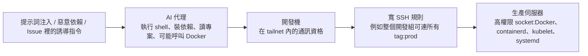

# Tailworm:Tailscale SSH 的轉發與 AI Coding 代理的網路邊界

> 整理自 YouTube 頻道 **Why QQ(為什麼叫 QQ)**〈[Tailscale: SSH 暗藏风险：AI编程远程开发，可能让服务器全暴露](https://www.youtube.com/watch?v=uFaDKby_Wzs)〉(2026-10-28,約 9 分鐘,官方簡中字幕)。影片說明欄註明資訊查核至 2026-10-26,結論依據 Tailworm 報告、Tailscale 官方文件與公開討論;**尚無真實入侵或獨立復現的公開證據**。
>
> ⚠️ 本文是安全風險整理,不是攻擊教學;未收錄任何可直接使用的漏洞利用細節。報告原文本筆記沒有讀到,事實核對以兩篇獨立報導為主,見第七節。

---

## 一句話總結

研究者 Erica Windisch(Cyberdione Labs)在 **2026-10-25** 公布 **Tailworm** 報告:她在實驗室裡,用一台**已失陷、且策略允許通訊**的設備,透過 **Tailscale SSH 的連接埠轉發**拿到其他伺服器的 root,並示範自動橫向擴散。這**不是網際網路上的零點擊入侵**,但對 AI Coding 的啟示很直接:**你讓代理遠端維護開發機時,它可能繼承了這台設備在 tailnet 裡的全部通訊資格**。該做的是檢查「開發機、AI 代理和生產伺服器之間留了多少條寬規則」,而不是恐慌式卸載。

---

## 一、事件事實(影片 + 報導交叉)

| 項目 | 內容 |
|---|---|
| 報告 | **Tailworm**,作者 Erica Windisch(Cyberdione Labs),2026-10-25 公布 |
| 測試版本 | Tailscale **1.104.2**、Headscale **0.29.5**;測試時間 10-22 到 10-24 |
| 範圍 | **11 項發現**,分五類(影片列:SSH、實驗性 app connector、Serve、DERP、客戶端與 Headscale) |
| 官方公告 | 截至 10-26,**沒有安全公告、沒有 CVE、沒有明確修復版本** |
| 官方態度 | 影片稱 Tailscale 工程副總裁 Mike Shaver 在 Reddit 表示正在處理並核查受影響配置,**不建議所有用戶一律關閉 Tailscale SSH**(⚠️ 本筆記未能直接讀到這則回覆);報導稱官方「尚未確認這些發現」 |
| 實際入侵 | 沒有公開的真實案例或獨立復現 |
| 揭露方式 | 研究者稱公開前已把報告與 PoC 寄給安全聯絡人,**但沒有協調發布**(HN 上有人爭論這點) |

---

## 二、攻擊前提:不是零點擊

必須同時成立:

1. 攻擊者**已先控制一台策略允許通訊的設備**。
2. 目標啟用了 **Tailscale SSH**。
3. 相關**轉發功能**被允許。

⇒ 所以影片的立場是:**認真加固,沒必要說成全網失守**。連線加密與設備認證是另一回事,要分開看。

---

## 三、兩種 SSH 架構要分清楚

| | **Tailscale SSH** | **OpenSSH over Tailscale** |
|---|---|---|
| 誰管 22 埠 | `tailscaled`(Tailscale 內建服務)接管來自 tailnet 的 22 埠 | OpenSSH 自己 |
| 身份怎麼認 | 用 WireGuard 節點金鑰識別設備,由**策略**決定哪台設備能登入哪台機器;認證階段可用 `none`,不再檢查傳統密碼或私鑰 | 傳統 SSH 認證 |
| 轉發誰執行 | **高權限的 `tailscaled`** | 登入使用者自己的 SSH 程序 |

影片:**連線被允許之後,轉發操作由誰執行,才決定風險落在哪裡。** 如果目標機沒有啟用 Tailscale SSH(你只是通過隧道連原有 OpenSSH),**前三項 SSH 發現的前提就不成立**。

---

## 四、報告的幾個關鍵發現(只講機制)

| 發現 | 機制 | 實驗室結果 |
|---|---|---|
| **本地轉發(`ssh -L`)** | 轉發由高權限的 `tailscaled` 執行,普通會話可借它連到只有 root 才能存取的 socket | 碰到 Docker 控制介面 ⇒ 取得 root、讀 `/etc/shadow`,**不需要 docker 群組或 sudo** |
| **遠端轉發(`ssh -R`)** | 可替換 root 擁有的 socket | root 程式碼執行 |
| **檢查與使用之間的時間差(TOCTOU)** | 程式先檢查一個「安全路徑」,隨後才連接或刪除;攻擊者在中間把路徑換成別的目標,繞過白名單 | 接觸到 systemd、Docker、`tailscaled` 的 LocalAPI;也能取得節點註冊金鑰,並在**未啟用 Tailnet Lock** 的網路加入偽造節點 |

- **禁止直接登入 root 帳號有價值**,但擋不住普通會話借用 root 程序做轉發。
- 部分競態利用**不穩定**:影片說 systemd 路徑成功率只有 0 到 4%。但「低成功率可以靠反覆嘗試彌補,防護不能寄托在對手運氣差上」。
- 一組相關背景(次級來源):同一段程式碼先前在安全公告 TS-2026-004(1.98.9)修過「檢查 socket 路徑實際指向哪裡」,Tailworm 的競態是在檢查與使用之間換路徑繞過它。

### 「wormable」的爭議

報告把實驗室裡的自動擴散稱為 wormable(每一跳不到一秒)。HN 上有人質疑,因為:**不能跨租戶傳播、需要已有立足點、需要策略許可**。影片認為更準確的說法是:**在策略允許的範圍內自動橫向移動並提權**。

⭐ 實驗中,**明確指定單一來源與單一目標的 per-pair 規則,阻斷了繼續擴散**。

---

## 五、為什麼這和 AI Coding 直接相關

- 代理的**依賴、腳本和工具呼叫都應納入威脅模型**:模型沒有惡意,也可能執行被儲存庫、Issue 或依賴包誘導的命令。
- **設備授權不會分辨命令來自人還是代理。**
- Tailscale 官方文件提醒:客戶端機器上的**任何作業系統使用者**,都可能通過這台設備連到策略允許的 SSH 服務;**如果機器會執行你不信任的程式碼,Tailscale SSH 未必適合**。
- 開發機失陷的損失未必停在這一台:一條寬規則(整組人能存取所有 `tag:prod`)讓攻擊者拿到一台就拿到規則允許的全部入口。

---

## 六、現在該做什麼(影片的檢查清單)

### 1. 先確認自己用了哪種 SSH

目標機有沒有啟用 Tailscale SSH?沒有的話,前三項 SSH 發現不適用。

### 2. 審查 SSH 規則

- 列出所有 `ssh` 規則,找出 `autogroup:member`、`tag:` 和大範圍用戶組。
- **優先處理**:來源設備多、目標伺服器多,而且目標有高權限 socket(Docker、containerd、kubelet、systemd)的環境。
- 只有家裡兩台設備、規則只指向自己的環境,風險與擴散面都小得多。**風險評估從實際配置開始,版本號只占一部分。**

### 3. 臨時加固(由效果大到小)

| 做法 | 說明 |
|---|---|
| **把 SSH 許可縮到具體來源與具體目標** | per-pair 規則;運維筆記本能連建置機,不等於同組電腦都要這條路徑 |
| **AI 開發節點不該繼承生產入口** | 去掉長期不用的 accept 規則 |
| 關閉不需要的 Tailscale SSH | 確認有備用登入方式後,`tailscale set --ssh=false` |
| 關閉本地與遠端轉發(報告建議) | ⚠️ **官方公開策略文件目前沒有列出對應欄位,不要照抄來歷不明的 JSON**;Headscale 0.29.5 無法關閉這些轉發,要把每條 SSH 許可都當成潛在 root 權限 |
| 修改後驗證 | 用 `sshTests` 和真實連線驗證,**別把自己的運維通道鎖死** |
| check mode | 連線前要求重新登入身分提供方,縮短被盜設備發起會話的窗口;自動化任務頻繁建立連線時 `always` 可能影響 Ansible 等工具,需單獨設計。⚠️ **二次認證通過後,會話裡的 Unix socket 轉發仍然存在**:它增加一道門,卻不改變門後由 root 程序執行轉發的行為 |
| 自動更新 | 該開,但**最新版尚未公告修復本次發現**;升到 1.104.2 只處理另一項憑證問題,不能據此宣布 Tailworm 已解決 |

### 4. 替 AI Coding 環境再隔離一層

- 給代理使用**獨立節點、獨立系統使用者、獨立策略**。
- 只開放程式碼庫、測試機與必要 API;**生產伺服器不放進它的目的地清單**。
- **Docker socket 不掛進代理容器**;雲端憑證不寫進它能讀的主目錄。
- 無人值守時加出站限制與命令審計。
- 高權限運維繼續走人工確認;必要時保留 OpenSSH over Tailscale,減少內建 SSH 的攻擊面。

### 5. 設備失陷後的處理順序

重新安裝系統**只清理本機**,攻擊者可能已複製節點狀態與金鑰,換機繼續使用原身分。順序應該是:

1. **先在控制面刪除設備**,使節點金鑰失效。
2. 輪換它能接觸到的 authkey、雲端憑證與其他機密。
3. 然後才重新安裝。

伺服器應開啟**節點金鑰過期**,並用 **TPM 或 Secure Enclave** 綁定設備狀態;**Tailnet Lock** 可限制未經簽名的節點加入。告警要放在失陷伺服器無法修改的位置,關注異常註冊、authkey 使用、高頻路徑重命名。

### 今天可以做完的四件事

1. 確認目標機有沒有啟用 Tailscale SSH。
2. 匯出並審查 SSH 策略,**把 AI 代理與生產權限分開**。
3. 檢查 Serve 是否把 TCP 轉發指向 Unix socket。
4. 使用實驗性 conn25 的團隊,收回多餘授權並在 connector 上限制真實出站目的地;**Headscale 自架用戶**要限制註冊介面的暴露,設定速率限制、記憶體上限與自動重啟。

---

## 七、核實與補充

**✅ 與獨立報導一致(Cybersecurity News):**

- 作者與組織(Erica Windisch / Cyberdione Labs)、2026-10-25 公布、測試版本 Tailscale 1.104.2 與 Headscale 0.29.5、10-22 到 10-24 測試、**11 項發現分五類**。
- 本地轉發(F1)在實驗室取得 root 並讀 `/etc/shadow`;遠端轉發(F2)可替換 root 擁有的 socket 而執行程式碼;時間差(F3)讓偽造節點加入。
- 截至公布當時 Tailscale **沒有安全公告、CVE 或修復版本**,也「尚未確認這些發現」;實驗室結果**不能證明客戶系統已被入侵**。
- 緩解建議與影片一致:per-pair 規則、關閉不需要的 Tailscale SSH(先確認有備用登入)、移除沒在用的 app connector 與指向 Unix socket 的 Serve、開節點金鑰過期、失陷時先在控制面刪除設備。

**⚠️ 需注意:**

- 影片說「官方在 Reddit 承認正在處理」與報導「官方尚未確認發現」並不矛盾(承認在調查 ≠ 確認漏洞),但本筆記沒讀到 Mike Shaver 的回覆原文。
- 「TOCTOU」是影片的用詞;Cybersecurity News 只稱「時間差」。
- **systemd 路徑成功率 0 到 4%**、「每跳不到一秒」的數字,報導摘要沒有給出,為影片轉述。
- 「X 上能搜尋到的公開內容以安全帳號轉發為主,樣本有限」是影片作者自己的觀察。

**⚠️ 未能核實:** Tailworm 報告原文;Tailscale 官方安全公告頁在影片之後是否有更新(本筆記撰寫時只能確認到報導的狀態);「Headscale 0.29.5 無法關閉這些轉發」的細節。**請以 Tailscale 官方安全公告頁為準。**

---

## 八、應用案例

### 案例 1:替自己的 tailnet 做一次「寬規則盤點」

| 檢查 | 問題 | 若答案是「是」 |
|---|---|---|
| 規則來源 | 有沒有 `autogroup:member`、整個 `group:dev`、或 `tag:dev` 當 SSH 來源? | 縮小成具體群組或具體設備 |
| 規則目標 | 有沒有 `tag:prod` 當目標,且來源包含開發機? | 拆成「運維筆電 → 生產」專用規則 |
| 目標特性 | 目標機有 Docker、containerd、kubelet 或 systemd 高權限 socket 嗎? | 優先處理 |
| 啟用狀態 | 這台真的需要 Tailscale SSH 嗎?能不能改用 OpenSSH over Tailscale? | 能的話關閉並改走 OpenSSH |
| 轉發 | 有沒有 Serve 把 TCP 轉發指到 Unix socket? | 移除或改為受限的來源 |

### 案例 2:給「讓 AI 在遠端開發機跑」的團隊一個分區範本

| 區域 | 內容 | 規則 |
|---|---|---|
| **代理區**(`tag:agent-dev`) | 代理專用節點,專用系統使用者,不掛 Docker socket | 只能連 `tag:git`(儲存庫)與 `tag:test`(測試機) |
| **測試區**(`tag:test`) | 與生產隔離的資料與憑證 | 只接受來自 `tag:agent-dev` 與 CI |
| **生產區**(`tag:prod`) | — | **不接受任何來自 `tag:agent-dev` 的規則**;只接受運維筆電,並開 check mode |

驗證方法:在代理節點上嘗試連 `tag:prod`,應該**被策略拒絕**;用 `sshTests` 把這條「應該拒絕」寫進測試。

### 案例 3:懷疑一台開發機失陷時的 30 分鐘流程

1. **隔離**:在控制面把設備停用或刪除,節點金鑰立刻失效。
2. **盤點**:這台設備在策略裡能連到哪些目標、持有哪些 authkey 與雲端憑證。
3. **輪換**:上述憑證全部輪換。
4. **檢查目標**:看那些目標機近期有沒有新註冊的節點、異常的 authkey 使用、路徑重新命名。
5. **最後才重灌**。順序反過來,重灌後用原本的金鑰又連回來。

---

## 相關筆記

- [[php2shell-cve-2026-109618-embargo-leak]]:同一週另一起「公開時機」爭議的核心漏洞。
- [[opencode-console-breach-guardrail-asymmetry]]:AI 輔助的攻防與密鑰放哪。
- [[prompt-injection-5-techniques-defenses]]:代理被誘導執行命令的五種手法與防禦。
- [[vibe-coding-security-threat-modeling]]:把代理的依賴、腳本與工具呼叫納入威脅模型。
- [[agent-sandbox-microvm-snapshot-iaa]]:替代理準備隔離的執行環境。

---

## 來源

- YouTube:Why QQ〈Tailscale: SSH 暗藏风险：AI编程远程开发，可能让服务器全暴露〉 https://www.youtube.com/watch?v=uFaDKby_Wzs (2026-10-28,官方簡中字幕)
- Cybersecurity News,〈Tailscale SSH flaws〉(獨立報導): https://cybersecuritynews.com/tailscale-ssh-flaws/
- The Hacker News,〈Unpatched Tailscale SSH flaws could let…〉: https://thehackernews.com/2026/10/unpatched-tailscale-ssh-flaws-could-let.html
- Runtime Wire,〈Erica Windisch publishes report alleging Tailscale SSH forwarding can reach root〉: https://runtimewire.com/article/tailscale-tailworm-security-report-ssh-forwarding
- Tailscale 安全公告頁(請以此為準): https://tailscale.com/security-bulletins
