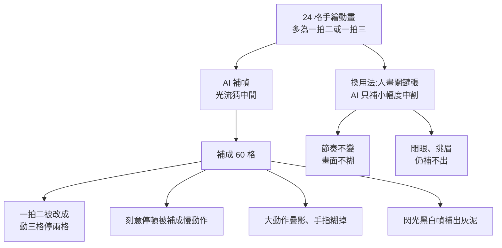

# AI 把動畫補到 60 幀為什麼更難看?一拍二、RIFE 與「補得出位置、補不出節奏」(Mia 码上 AI)

> 來源:Mia 码上 AI〈AI 把动画补到 60 帧,为什么反而更难看?〉`ktWEwBHjfVo`(2026-11-15,約 9 分 49 秒)。該片**無字幕**,逐字稿由 faster-whisper large-v3-turbo 轉錄(271 段,非官方字幕,Whisper 誤聽已在第四節校正)。
> 影片說明欄附作者自家網站互動頁(33 格找碴頁)與頻道推廣,屬自我宣傳;無業配。時間連結皆提前 10 秒。
> 本篇照科普頻道慣例,把影片提到但沒細講的概念(光流、RIFE、一拍二/三、動畫補幀論文、Filmmaker Mode、東映事件)延伸到一手來源,並標已核實/需修正/未能核實。

## 一、一句話結論

**AI 補幀回答的是「中間這格東西該在哪」,動畫真正要問的是「中間這格要不要畫、停多久」**——後者是原畫師寫在攝影表上的節奏,不在畫面裡。所以補幀會破壞一拍二的節奏、吃掉停頓、在大動作上畫崩;只有在「小幅度、無表情變化」的中割位置,AI 才是好幫手。

## 二、影片內容(含時間)

| 時間 | 重點 |
|---|---|
| [0:00](https://www.youtube.com/watch?v=ktWEwBHjfVo&t=0s) | 同一段 24 格手繪動畫,右邊用 AI 補到 60 格;停在 AI 畫的那格,手畫「化掉」 |
| [0:38](https://www.youtube.com/watch?v=ktWEwBHjfVo&t=28s) | 動畫 1 秒 24 格,但畫師很少每格新畫:一拍二=1 秒 12 張,一拍三=8 張;日本電視動畫以一拍三為主流,1963 年《鐵臂阿童木》每週一集壓成本 |
| [1:16](https://www.youtube.com/watch?v=ktWEwBHjfVo&t=66s) | 《蜘蛛人:穿越新宇宙》角色大多一拍二,製作團隊說這樣畫面才乾脆、有漫畫感;少畫是故意的 |
| [1:31](https://www.youtube.com/watch?v=ktWEwBHjfVo&t=81s) | 三種刻意設計:停(蓄力半秒)、跳(中間故意不畫,「快」感來源)、閃(閃電插兩格黑白反轉) |
| [2:04](https://www.youtube.com/watch?v=ktWEwBHjfVo&t=114s) | AI 補幀=猜中間:拿前後兩張算每個像素的移動(光流),推到半路再拼;最常見模型 RIFE(Real-time Intermediate Flow Estimation) |
| [2:37](https://www.youtube.com/watch?v=ktWEwBHjfVo&t=147s) | RIFE 默認三件事:物體連續移動、前後長得一樣、每格都是真實拍下的瞬間;動畫三條都不成立(2021 年動畫補幀論文:線條加大塊平色、無紋理、動作誇張幅度大、不走直線) |
| [3:16](https://www.youtube.com/watch?v=ktWEwBHjfVo&t=186s) | 最火的「4K 60 幀」《你的名字》:作者逐格數,一秒 60 格只有 24 張不同畫面,其餘複製,「一幀都沒補」,60 幀只是檔案格式 |
| [3:42](https://www.youtube.com/watch?v=ktWEwBHjfVo&t=212s) | 親手補:Blender Studio 短片《Hero》(2018,CC BY 4.0)+ RIFE 4.26,24→60 |
| [4:06](https://www.youtube.com/watch?v=ktWEwBHjfVo&t=236s) | 毛病一:一拍二被補成「動三格停兩格」的忽順忽卡;開「去除重複幀」後不卡了,但毛病二:原版抓寶石停半秒,AI 當漏畫補成慢動作,停頓與力道消失 |
| [5:02](https://www.youtube.com/watch?v=ktWEwBHjfVo&t=292s) | 毛病三:大動作直接畫崩(兩張差太遠,AI 只看到色塊移動,疊成半透明、手指糊、手畫進大衣);毛病四:閃光幀黑白中間補出灰泥;聰明軟體當換鏡頭不碰,是因看不懂 |
| [5:57](https://www.youtube.com/watch?v=ktWEwBHjfVo&t=347s) | 結論:不是 AI 補得不夠好,是問一個錯的問題——動畫要問「中間這格要不要畫、停多久」,這些寫在攝影表上;生成式模型能重畫中間張,但節奏與畫質無關 |
| [6:38](https://www.youtube.com/watch?v=ktWEwBHjfVo&t=388s) | 換用法:把人畫的畫抽掉一半讓 AI 補回,時機與停幾格全照原版;小幅度轉頭幾乎一樣,但閉眼、挑眉(停最久的表情重點)補不出——插值只能在前後兩張間取平均,兩頭都沒有的補不出 |
| [7:28](https://www.youtube.com/watch?v=ktWEwBHjfVo&t=438s) | 分工:小動作、無表情變化的中割交 AI,有戲的與大動作留人畫;作者放了「33 張畫哪 7 張是 AI 補的」互動頁 |
| [8:01](https://www.youtube.com/watch?v=ktWEwBHjfVo&t=471s) | 產業:2025 年東映動畫財報說明會提 AI 用於分鏡、上色、中割,被罵後改口「現在沒用、以後會用」;中割是入行第一份工作,拿走台階後原畫師從哪來 |
| [8:35](https://www.youtube.com/watch?v=ktWEwBHjfVo&t=505s) | 你家電視可能偷偷補幀(動態補償/運動平滑);2018 年 Tom Cruise 錄影求大家關掉;電視廠後來加 Filmmaker Mode |
| [9:10](https://www.youtube.com/watch?v=ktWEwBHjfVo&t=540s) | 三件事:少幀不是偷懶、停和跳是設計;AI 補得出位置、補不出節奏與兩頭都沒有的一下眨眼;節奏握在人手裡,AI 只管畫才是好工具 |

## 三、延伸閱讀與逐項核實

### 3.1 一拍二、一拍三是什麼

- 「一拍二(on twos)」=一張畫連放兩格,24 fps 下一秒 12 張;「一拍三」=一秒 8 張(24÷3,算術推得)。
- ✅ 《蜘蛛人》系列確實大量以一拍二為主:製作訪談(AWN、Creative Bloq、CG Spectrum 等,**僅見搜尋摘要**)指出第一集主要 on twos、刻意呼應漫畫靜態感,角色動畫總監 Josh Beveridge 說「不是機械地隔格,多半是 12 fps,但是個彈性尺度」,邁爾斯依情緒在一拍一與一拍二間切換;續集中 Hobie 為一拍三、Miguel 為一拍一(二手報導)。影片「大部分也是一拍二、製作團隊說畫面才乾脆」與此一致;WIRED 那段訪談我沒讀到全文。
- ✅/⚠️ 《鐵臂阿童木》:多個來源一致說它 **1963-01-01** 於富士電視台開播,是日本首部長篇電視動畫,採限定動畫(limited animation)、重複使用賽璐珞、一拍三壓成本。影片「首種智蟲」是 Whisper 誤聽的手塚治虫。⚠️「一拍三=一秒 8 張」是算術,**沒有來源直接寫阿童木每秒 8 張**,有粉絲來源說部分段落只有約 10 fps,我沒找到一手數據,不把「8 張」當阿童木的實測值。
- 停、跳、閃三種刻意設計是影片作者的歸納,對《蜘蛛人》具體鏡頭未能逐鏡核對。

### 3.2 光流與 RIFE(讀了論文摘要與 repo)

- ✅ RIFE = **Real-Time Intermediate Flow Estimation**,論文〈Real-Time Intermediate Flow Estimation for Video Frame Interpolation〉(Huang、Zhang、Heng、Shi、Zhou,arXiv 2011.06294,ECCV 2022)。我讀到摘要:用神經網路 **IFNet** 端到端直接估計「中間時刻」的光流,不依賴預訓練光流模型;訓練用特權蒸餾(privileged distillation);輸入時間編碼,可補任意時間點;宣稱比 SuperSlomo、DAIN 快 4–27 倍且更好。影片「算每個像素從哪走到哪、推到半路再拼」是正確的白話。
- ✅ 我 `git clone --depth 1` 了 [hzwer/Practical-RIFE](https://github.com/hzwer/Practical-RIFE) 並讀 README 與 `inference_video.py`(讀完已刪除):
  - README 寫「目前建議多數場景預設選 **4.25**」;4.25(2024-09-19)條目說嘗試用更多 flow block、scale_list 隨之改變,「動畫場景似乎有明顯改善」;4.26 為 2024-09-21 釋出。影片說「作者說從 4.25 開始動畫場景明顯變好」✅ 屬實,但**官方推薦預設是 4.25 而非 4.26**,影片用 4.26 是作者自選。
  - 用法:`python3 inference_video.py --multi=2 --video=video.mp4`;`--multi` 為倍率(`--exp` 為 2 的次方)、`--scale=0.5` 建議 4K 用、`--montage` 可把輸出與原片並排對照。
  - ⚠️ `--multi` 取整數倍,腳本內 `args.fps = fps * args.multi`。24→60 是 2.5 倍,不是整數倍,影片作者怎麼做到(例如先升倍再重採樣)影片沒講,**未能核實**。
  - 影片說的「去除重複幀」在 repo 對應 `--skip`(移除靜態幀再處理),但腳本現在印出「skip flag is abandoned, please refer to issue #207」——**這個開關在 Practical-RIFE 已廢棄**;影片說「很多補幀軟體帶去重開關」應指 SVFI、Flowframes 這類包裝軟體(README 有列),屬第三方功能,未逐一核對。
  - repo 只有 `warplayer.py`(用 `grid_sample` 依光流做 backward warp)、loss 與推論腳本;**IFNet 模型本體不在 repo,要另下載權重包**,所以網路架構細節我只讀到摘要與 warp 實作,沒讀到原始碼。
- 影片的「RIFE 默認三件事」(連續移動、前後一致、每格都是真實拍攝)是作者的分析,不是論文原句;論文針對真實影片設計,這個說法合理但屬詮釋。

### 3.3 動畫補幀為什麼難(2021 論文)

- ✅ 〈Deep Animation Video Interpolation in the Wild〉(Li Siyao 等,CVPR 2021,arXiv 2104.02495,**讀了摘要頁**):指出卡通有兩個困難——**平滑區域缺紋理**(難估準運動)、**運動大且非線性**(誇張的敘事)。方法 AnimeInterp 含 Segment-Guided Matching(整塊色區匹配)與 Recurrent Flow Refinement;並建 **ATD-12K**(1.2 萬組三幀資料集)。影片「線條加大塊平色、沒紋理、動作誇張幅度大、不走直線」✅ 與摘要一致。
- 動畫專用方法與較新 RIFE 版本在動畫上的差距,我沒找到公平基準,**未能核實**。

### 3.4 《你的名字》「一幀都沒補」

- 影片作者逐格數出一秒 60 格只有 24 張不同畫面、手一秒只換 8 次。這是作者對 YouTube 影片 `nTbA7qrEsP0`(Ash Edits)的檢視,**我沒有下載該片重數**,「2800 多萬播放」也未核對,標未能核實。邏輯上合理:若原 24 張被複製成 60 fps,所謂 60 fps 只是輸出格式。

### 3.5 東映動畫與 AI(2025)

- ✅ 我讀了 Anime Corner:**2025-05-16** FY2025 決算說明會簡報說要把 AI「應用於動畫製作的各個流程」,例舉 AI 分鏡/佈局/背景、AI 上色、AI 產生中割;簡報用《Wonderful 光之美少女》角色當例圖遭批評後,東映**移除圖並加註**:分鏡、上色、中割是「預期未來提升效率的領域」,**目前並未使用 AI**;背景範例是 2021 年與 Preferred Networks 推出的 Scenify。報導並指 FY2026 展望仍保留 AI 段落。影片「被罵後改口:現在沒用、以後會用」✅ 一致。「中割是入行第一份工作、拿走台階後原畫師從哪來」是影片的產業論述,不是查核對象。

### 3.6 電視「動態補償」與 Filmmaker Mode

- ✅ 2018-12 Tom Cruise 與導演 Christopher McQuarrie 發影片請觀眾關掉電視的 motion smoothing(多篇報導,**僅見搜尋摘要**):該功能原意是減少運動賽事等的模糊,各牌名稱不同(Sony MotionFlow、Samsung Auto Motion Plus、LG TruMotion)。
- ✅ 好萊塢與 **UHD Alliance** 推出 **Filmmaker Mode**,關閉動態補償等後處理、保留原長寬比、色彩與幀率;LG、Panasonic、Vizio 最先宣布支援,可由影片後設資料自動觸發或一鍵切換。⚠️ 各報導對推出年份(2019 宣布、2020 起機種)略有出入,以各廠規格為準。
- 小實驗:拿一段動畫在電視上,先開動態補償,再切 Filmmaker Mode,觀察一拍二的頓挫感是被抹平,還是變成不規則卡頓。

## 四、逐字稿校正(Whisper 誤聽)

| 逐字稿寫法 | 推定正確寫法 |
|---|---|
| 補針、補針軟件、閃光針、去除重複針 | 補幀、補幀軟體、閃光幀、去除重複幀 |
| 中歌、鐘歌 | 中割(中間畫) |
| 首種智蟲 | 手塚治虫(Tezuka Osamu) |
| 鐵壁阿童木 | 鐵臂阿童木 |
| 播譜漫畫 | 波普漫畫,推定 |
| 捕不出節奏 | 補不出節奏 |
| 去從 | 去重(推定) |
| 1拍2、1拍3 | 一拍二、一拍三 |
| 「又畫了」(7:25 附近) | 推定「又畫崩了」,未對畫面確認 |

## 五、我的判讀(含限制)

- 主張成立的核心是**「畫面插值」與「時間設計」是兩件事**。這也解釋為何生成式模型能把中間張畫得更漂亮,卻仍不會自己決定停多久。
- 作者的實驗是一部短片、一個模型版本(RIFE 4.26)、幾段挑選過的鏡頭,**不能推到所有補幀模型或所有動畫**。「七張是 AI 補的」互動頁是展示,不是基準測試。
- 限制:我沒有跑 RIFE 重做實驗,也沒有逐格看影片畫面,畫面描述(手化掉、疊影)採作者說法。

## 六、應用案例

1. **看到「4K 60 幀動畫」先驗貨**:用播放器逐格看(或用 ffmpeg 抽幀比對),若每 2–3 格重複,就只是封裝成 60 fps,沒有補幀。
2. **自己補幀時的流程**:先找出原始畫格(一拍二/三的規律)→ 只在「小幅度、無表情重點」的段落補中間 → 停頓、閃光、大動作段落保持原樣或手動處理。
3. **工作流分工**:把畫面分成「AI 可補(小幅度轉頭、毛髮飄動)」與「人畫(表情重點、爆發動作、特效幀)」兩類,攝影表當作補幀的輸入約束。
4. **家用設定**:看動畫、電影前先確認電視是否開了動態補償,改用 Filmmaker Mode。

## 相關筆記

- [[ai-live2d-vtuber-see-through-anime25drig-pipeline-mia]] — 同頻道,動畫/角色的 AI 流程
- [[blender-previz-mcp-ai-video]] — Blender 與 AI 影片
- [[minimax-h3-local-video-mac-mini-vpipe-ai-strategy-room]] — 影片生成模型與本地流程
- [[llm-quantization-q4-q8-gguf-qat-explained-mia]] — 同頻道,同樣把影片延伸到一手來源的範例
- [[yaha-video-ai-tools-filmora-topview-flova]] — AI 影片工具

## 來源

- Mia 码上 AI 影片 `ktWEwBHjfVo`:https://www.youtube.com/watch?v=ktWEwBHjfVo (無字幕,faster-whisper large-v3-turbo 轉錄,非官方字幕;說明欄為素材與授權來源)
- Real-Time Intermediate Flow Estimation for Video Frame Interpolation(RIFE,ECCV 2022):https://arxiv.org/abs/2011.06294 (已讀摘要)
- Practical-RIFE:https://github.com/hzwer/Practical-RIFE (clone 讀 README、`inference_video.py`、`warplayer.py`,模型本體不在 repo)
- Deep Animation Video Interpolation in the Wild(CVPR 2021):https://arxiv.org/abs/2104.02495 (已讀摘要頁)
- Anime Corner〈Toei Animation Responds After Backlash to AI Plans〉:https://animecorner.me/toei-animation-ai-backlash-denies/ (已讀)
- 《蜘蛛人》一拍二:AWN https://www.awn.com/animationworld/creating-stylized-universe-sonys-spider-man-spider-verse 、Creative Bloq https://creativebloq.com/features/how-into-the-spider-verse-got-its-mind-blowing-look (僅見搜尋摘要);影片提到的 WIRED 訪談 https://www.youtube.com/watch?v=l-wUKu_V2Lk (未讀)
- 阿童木與限定動畫:Tofugu https://www.tofugu.com/japan/anime-vs-cartoons/ (僅見搜尋摘要)
- Tom Cruise 與 Filmmaker Mode:Audioholics https://audioholics.com/hdtv-formats/filmmaker-mode 、What Hi-Fi https://www.whathifi.com/news/filmmaker-mode-promises-directors-vision-for-lg-panasonic-and-vizio-tvs (僅見搜尋摘要)
- 影片提到:Noodle〈Smoother animation ≠ Better animation〉https://www.youtube.com/watch?v=_KRb_qV9P4g (未讀);Blender Studio《Hero》https://studio.blender.org/films/hero/ (CC BY 4.0,未讀)
