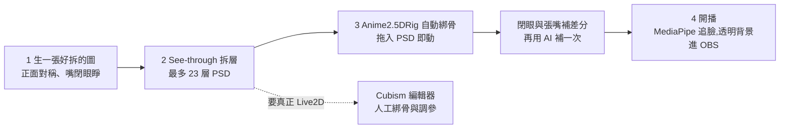

# 一張圖變成會動的 VTuber:See-through 拆層 + Anime2.5DRig 綁骨,以及離真正 Live2D 還差多遠(Mia 码上 AI)

> **來源影片:** 〈用 AI 免费做 Live2D 模型:一张图变成会动的 VTuber〉Mia 码上 AI,2026-11-09 上傳,約 8 分鐘。
> **整理方式:** 該片無字幕,逐字稿以 Whisper large-v3-turbo 轉錄(非官方字幕),時間點取自 `[m:ss]`,連結提前 10 秒。依「科普頻道要延伸到一手來源」原則,我 clone 並讀完 `see-through`、`Anime2.5DRig`、`live2d-automation` 三個 repo 的 README 與關鍵原始碼,另讀 arXiv 論文、Live2D 官方比較頁與日本博主原文,並標「已核實 / 需修正 / 未能核實」。
> **利益揭露:** 無業配。片尾作品與提示詞放在作者自家網站(miaainow.com);這是頻道自家內容導流,不是付費推廣。

## 一、一句話結論

「一張圖 → 會眨眼、轉頭、對口型的 2.5D 角色」現在可以**免費、幾分鐘**做到,但這**還不是真正的 Live2D**:AI 拿走的是最煩的「拆層補畫」,而**綁骨與藝術判斷**(臉型隨轉頭變形的參數)仍是手藝活。See-through 作者自己也寫「不算 Image-to-Live2D,至少現在還不算」。

## 二、Live2D 在做什麼,為什麼「拆」最難(0:41)

**影片說法([0:41](https://youtu.be/KOuwb96iSW4?t=31)):** Live2D 是日本公司做的軟體,不是 3D 模型,而是把立繪切成幾十上百層(瀏海、後髮、眼白、瞳孔、睫毛、嘴),每層蓋一張像橡皮膜的網格,再設參數(如角度 X):從左拉到右,每層移多少、怎麼彎都由人調;轉頭時瀏海移得多、後髮移得少,**立體感是騙出來的**。最難的不是動而是拆:瀏海擋住的額頭、頭髮後面的脖子、閉嘴裡面,圖上根本沒有,得一塊塊補畫。這「瞎編但編得特別像」正是 AI 擅長的([1:23](https://youtu.be/KOuwb96iSW4?t=73))。

**查證:**
- 網格:Live2D 官方手冊說明網格由沿圖像不透明區域放置的點組成,可自動生成或逐點編輯,形變綁在 keyform 上(docs.live2d.com mesh-edit)。✅ 已核實。
- 參數:`ParamAngleX` 範圍 -30 到 30,預設 0,「+ 時朝畫面右側轉」,描述臉部左右轉向(docs.live2d.com standard-parametor-list)。✅ 已核實。
- 「是日本公司」:官網頁面沒直接寫國別;間接證據是 Live2D Inc. 官網連到 live2d.jp、日文為首選語言。**未能直接核實**(常識上正確,但本篇不當一手事實)。
- 「新手一做十幾小時、請畫師綁骨報價幾百美元起」([0:10](https://youtu.be/KOuwb96iSW4?t=0)):作者估計,**未能核實**。

## 三、第一步:生一張「好拆的圖」(1:56)

提示詞要寫清楚([1:56](https://youtu.be/KOuwb96iSW4?t=106)):正面站好、左右對稱、手臂垂在兩側不擋身體、瀏海別蓋住眼睛、**眼睛睜開、嘴巴閉上**(這條後面會出問題)、背景乾淨、動漫畫風——因為下一步的模型只學過動漫與 VTuber 風格,寫實或糊頭髮的圖「好看但拆起來全是坑」。作者在 Codex 生了三張,挑了銀髮長髮、月亮耳墜、星星髮夾的那張。

**對照原始碼:** See-through 是專為動漫角色訓練的;訓練資料管線來自 Live2D 範例模型(README 的 `CubismPartExtr`、`README_datapipeline.md`),所以風格外的圖(寫實、厚塗)是分佈外輸入,影片的提醒合理。

## 四、第二步:See-through 拆層(2:39)

**影片說法([2:39](https://youtu.be/KOuwb96iSW4?t=149)):** 今年 SIGGRAPH 的論文 See-through、程式碼開源;丟一張圖吐出 PSD,最多 23 層,每層只放一樣東西,前後順序已排好;原理是把開源圖像模型 Stable Diffusion 改造,一次畫一疊透明圖層,再用另一個模型估計每層離你多遠;沒顯卡可用 Hugging Face 免費版,註冊後一天跑一兩次;本機要 12–16GB 顯存的 NVIDIA 顯卡,8GB 有壓縮版;作者用 Mac 硬跑通,一張圖跑一個多小時。

**查證(README + 論文 arXiv 2602.03749 + 原始碼):**

| 項目 | 結論 |
|---|---|
| 論文/會議 | README 寫「Published in ACM SIGGRAPH 2026 Conference Papers」並附 DOI 10.1145/3799902.3811209;**arXiv 頁面的備註只寫「preprint version only」,未提 SIGGRAPH,故會議資訊僅 README 自述,arXiv 側未能核實** |
| 方法 | ✅ 已核實:以 SDXL 為骨幹,採 LayerDiffusion 的 Latent Transparency 輸出 RGBA(透明解碼器由 sd-forge-layerdiffuse 初始化),階段二加 Body Part Consistency Module 讓各部位互相注意;**Marigold 對各部位微調做偽深度**,再用同一模組讓整體一致 |
| 「最多 23 層」 | README 為準:V3 模型以 23 個身體部位標籤訓練、`inference_psd.py` 輸出最多 23 層(2026-04-14 changelog)。⚠️ **需修正/補充:** 論文 preprint 的固定分類是 **19 個**語意部位,頭髮、手、上衣、下身可依深度再分前後層,所以「23」是 README 的新版(V3)說法,不是論文的數字 |
| 本機顯存 | ✅ README:bf16、1280 解析度需約 12–16GB;`--group_offload` 約 10GB(約慢 1.5 倍);NF4 量化(`inference_psd_quantized.py`)約 8GB,PSNR 約 30 dB、SSIM 約 0.96(對 bf16 基線);另有 block swap 版約 8GB |
| 線上版 | ✅ README:Hugging Face Space(ZeroGPU)註冊後每天約 1–2 次、每次約 2–3 分鐘(1280 解析度);另有 ModelScope 版,中國大陸可用、解析度略高 |
| 論文數據 | 表 1:完整方法 LPIPS 0.1549、PSNR 18.30、SSIM 0.9230、FID 18.37,對照 SAM+LaMa 基線 LPIPS 0.2880、PSNR 12.28、SSIM 0.8445、FID 81.14;分解約 74 秒/張(1024²)、深度約 10 秒(RTX 4090)。⚠️ 沒有正式使用者研究,只是 7 位動漫畫師的非正式回饋(6 位回覆);且「去掉一致性模組」的 FID 16.71 反而略優於完整模型 18.37 |
| 論文自述限制 | ✅ 層與層之間有輕微重疊;偽深度不一定能產生穩定的離散邊界,難以切成多個穩定子層 |
| 「Mac 跑一個多小時」 | 作者自述,**未能核實**(README 要求 CUDA/ROCm) |

**延伸:** 擴散模型基礎見 [[stable-diffusion-how-it-draws]]。這篇的關鍵創新不是「畫圖」而是**同時畫出被遮擋的部分**,所以才能補出瀏海後的額頭。專案另有免責聲明:未提供任何付費服務,若看到收費網站與作者無關。

### 瀏海下面是什麼?(3:28)
影片實測([3:28](https://youtu.be/KOuwb96iSW4?t=198)):掀開瀏海後有額頭與被遮住的半截眉毛——原圖一個像素都沒有、是 AI 補畫的;拿掉頭髮後脖子後面補好了;連被眼皮蓋住的瞳孔也畫成完整圓(眼珠才轉得動)。但也編過頭:額頭留了瀏海形狀的粉色影子,後髮上憑空多出兩個月亮耳墜([3:57](https://youtu.be/KOuwb96iSW4?t=227)),好在藏在後面,正面看不出。**這是我讀完 README 後認為最重要的實務提醒:補畫是「合理幻想」,要逐層檢查,不能當成事實。**

## 五、第三步:Anime2.5DRig 綁骨(4:12)

**影片說法([4:12](https://youtu.be/KOuwb96iSW4?t=242)):** 開源網頁工具,免費、免安裝,PSD 拖進去自動認出眼睛、瀏海,找到眼、嘴、脖子位置,把頭髮按髮束切開掛彈簧;拉角度 X 就轉頭、角度 Y 抬低頭。閉眼畫風對不上,因為圓圖是睜眼閉嘴,See-through 拆不出閉眼與張嘴,工具只好貼一副**通用**閉眼和嘴;解法是把原圖丟回 AI 只說「別的都不動,只把眼睛閉上」「張開嘴像在說『啊』」,取出眼睛和嘴做成兩層加回 PSD。

**查證(讀 README 全文,已核實):**
- 純瀏覽器、全部客戶端處理、不上傳 PSD;只有用 OBS 連動時才傳給同一台電腦上的 `obs_server.py`(127.0.0.1)。
- 自動做的事:認別名圖層名(中日英,如 `前髮`/`bangs`/`iris`)、**接受 See-through 輸出**(`mouth` 自動改名 `mouth_open`)、無閉眼/閉嘴差分時自動生成通用差分(依錨點縮放並依睫毛/嘴色調色)、去低 alpha 雜訊、左右眼自動分離、錨點自動偵測(可拖曳修正)、**頭髮髮束自動偵測(每層最多 6 束)**、耳飾/尾巴單擺、依圖層深度做偽 3D 轉頭(視差 + 剪切)、每束雙彈簧(根硬尖軟)。
- ⭐ 影片沒講的坑(README「圖層命名規約」):**See-through 的脖子與上身前後關係難解,動起來交界會破**,README 建議乾脆把脖子併進上衣圖層(不要單獨 neck 層)成功率更高;畫布建議正方形(768²–2048² 驗證過);PSD 限 RGB 8-bit、128MB、2400 萬畫素。
- 「口的開合只是差分切換 + 變形的簡易表現」(README 已知限制)——印證影片後面「還不算真正 Live2D」。

**補差分的做法為什麼有效:** 通用閉眼是「貼上去的一副眼睛」,與角色畫風不符;用 AI 以同一張原圖只改眼睛,才會是「他自己的眼睛」。這是**用編輯式提示限縮改動範圍**的好例子,提示詞要寫「其他都不動」。

## 六、第四步:開播(5:24)

**影片說法([5:24](https://youtu.be/KOuwb96iSW4?t=314)):** 開鏡頭,用 Google 的 MediaPipe 追蹤臉,轉頭、眨眼同步,背景透明,可疊在 OBS 上。

**查證:**
- Anime2.5DRig 用的是 **MediaPipe FaceMesh(Apache-2.0),版本鎖定並隨 repo 附帶**(`lib/vendor/face_mesh`),所以離線可用;並有左右眼獨立眨眼(wink)、眉毛、笑容、正面校準、靈敏度與平滑度調整,以及麥克風對嘴。
- 官方 Face Landmarker 說明:輸出 478 個 3D 臉部特徵點,並可輸出 52 個表情 blendshape 分數(0–1)。✅ 已核實(developers.google.com MediaPipe)。注意 repo 用的是較舊的 FaceMesh 打包版,不是新 Face Landmarker API。
- OBS:README 做法是 `start_obs.bat` 啟動本機伺服器,OBS 加「瀏覽器」來源,網址 `http://127.0.0.1:8000/?obs=1`,背景完全透明;編輯畫面關閉後 OBS 維持最後的模型與待機動作。另可錄製透明 WebM(僅 WebM 保留透明,MP4 不透明)。
- ⚠️ 「相機追蹤與麥克風對嘴只在 https 或 localhost 運作」(瀏覽器權限規則),直接雙擊開 file:// 只能拖放播放。

## 七、離真正 Live2D 還差多遠(5:47–7:22)

1. **影片的「紙片感」判斷([5:47](https://youtu.be/KOuwb96iSW4?t=337)):** 頭轉大一點看得出是幾張紙片在滑;真正的 Live2D 轉頭時臉型五官會跟著變形,要畫師逐參數調。——這與 See-through 的 Discussion 一致:README 列出 Live2D 還需要①更細的藝術性拆層(依變形行為設計)、②**綁骨(網格、物理、動作曲線)——最關鍵也最耗工,本專案不涵蓋**、③整體藝術意圖(分層、補畫風格、綁骨是一起設計的)。他們的定位是「讓畫師少做最瑣碎的分割與遮擋補畫的**起點**」。✅ 已核實。
2. **日本博主的覆盤([6:05](https://youtu.be/KOuwb96iSW4?t=355)):** ✅ 已核實(note.com/dn0288):他做全自動工具,一張圖拆 29 個部件、套通用骨架、輸出可在 Cubism Viewer 載入的模型 ZIP,**23 項測試全過**,一動就壞——通用骨架是偏長髮的上半身模型,套到短鮑伯頭髮型不合,眼與嘴位置對不上、重疊或消失。原文名句:「ファイルが正しいことと、見た目が正しいことは別です。」(檔案正確和看起來正確是兩回事)。這句對所有用 AI 做事的人是通用提醒:**測試全過 ≠ 結果可用**,要有人看最終畫面。
3. **Live2D Automation MCP([6:43](https://youtu.be/KOuwb96iSW4?t=393)):** ✅ 已核實(讀 README 與原始碼):第一行「Generate a mock intermediate Live2D package from a single character image」;`moc3_generator.py` 寫死 `artifact_stage: "mock-intermediate"`、`ready_for_cubism_editor: False`,README 也寫「Final validation and export should happen in Cubism Editor before production use」。它還有 session TTL、輸出目錄限制在 `output/`、遠端偵測預設需 opt-in(`LIVE2D_PART_API_ALLOW_UPLOAD=1` 才會把圖片上傳)等工程防護,但**產物是佔位的空殼**,影片「它自己都不打包票,至少很誠實」屬實。
4. **正經做法([7:01](https://youtu.be/KOuwb96iSW4?t=411)):** 把同一份 PSD 匯入 Live2D 官方 Cubism 編輯器,再給 VTube Studio 這類軟體用。免費版「最多放 100 層」。**需修正:** 官方比較頁(live2d.com/en/cubism/comparison/)的上限是 **ArtMesh 最多 100**(約等於每個 PSD 圖層一個,PRO 無限制),另有**Parts(資料夾)最多 30**、單一紋理 2048px 一張、動作參數 30、變形器 50,影片輸出限 1280×720;**超過限制就無法儲存**;免費版商用僅限一般使用者與年營業額一千萬日圓以下的小規模事業。「專業版免費試用 42 天」✅ 已核實(頁面寫 Start with 42-day Trial)。23 層確實遠在上限內,但若你把頭髮再拆束就要注意 Parts 30 的限制。VTube Studio 載入 Live2D 模型:VTube Studio GitHub 提到把模型放進 `Live2DModels` 資料夾與 `.model3.json`,屬間接推論,✅ 大致核實。
5. **「AI 能搶 Live2D 師傅的飯碗嗎」([7:22](https://youtu.be/KOuwb96iSW4?t=432)):** 作者結論:拿走最煩的拆層補畫(十幾小時 → 幾分鐘),能動已免費,但動得好看仍是手藝;玩玩今天幾步夠,要專業則 AI 是很好的起點。我同意,並補一個技術理由:Live2D 的價值在「變形行為設計」,這是跟畫風、角色特徵一起決定的(見上面 See-through 的第 1、3 點),短期內難以由單張圖自動推得。

## 八、應用案例

- **想自己開直播的新手:** 1) 用影片的七條規則生一張正面圖;2) 丟 Hugging Face / ModelScope 免費版拿 PSD;3) 打開 Anime2.5DRig 網頁拖入 PSD,用「模型診斷」看哪些圖層沒被辨識;4) 用「只把眼睛閉上」的編輯式提示補閉眼與張嘴差分;5) `start_obs.bat` 後在 OBS 加瀏覽器來源。全程不用裝軟體、不花錢。
- **想做可商用/成品級模型的人:** 把 See-through 的 PSD 當**起點**,匯入 Cubism 編輯器,自己或請畫師綁骨;先確認免費版的 ArtMesh 100 / Parts 30 限制,以及商用條件(年營業額一千萬日圓以下小規模事業才可用 FREE)。
- **做 AI 自動化工具的工程師:** 學日本博主的教訓——「23 項測試全過、一動就壞」。驗收一定要包含「渲染結果的視覺檢查」,不能只驗檔案格式與欄位。

## 九、轉錄還原(Whisper 聽錯處)

| 逐字稿寫法 | 還原 |
|---|---|
| LIFE 2D、LiveRD | Live2D |
| 例會(1:00 前後) | 立繪(推定) |
| 綁鼓、榜谷 | 綁骨、(「榜谷」疑為「剩下的……」之誤,**推定**,語意不影響引用) |
| Seagraph | SIGGRAPH |
| 一落透明 | 一疊透明 |
| 涂生 | 圖生(圖生 Live2D) |
| 發燒 | 髮束 |
| 像右邊這張脫腮 暴斃 頭發糊一臉(2:24) | 不通順,**推定**為「寫實/厚塗風,頭髮糊一臉」,**未核對畫面,不當事實** |
| See-Thru / See Through | See-through |

## 十、來源

- 影片:Mia 码上 AI〈用 AI 免费做 Live2D 模型:一张图变成会动的 VTuber〉<https://www.youtube.com/watch?v=KOuwb96iSW4>(無字幕,逐字稿以 CPU 版 faster-whisper large-v3-turbo 轉錄取得,非官方字幕)
- See-through(含原始碼與 README,已讀)<https://github.com/shitagaki-lab/see-through>;論文 <https://arxiv.org/abs/2602.03749>、HTML <https://arxiv.org/html/2602.03749>;ACM <https://dl.acm.org/doi/10.1145/3799902.3811209>;線上版 <https://huggingface.co/spaces/24yearsold/see-through-demo>
- Anime2.5DRig <https://github.com/852wa/Anime2.5DRig>,線上 <https://852wa.github.io/Anime2.5DRig/>
- Live2D Automation MCP Server <https://github.com/J621111/live2d-automation>
- 日本博主覆盤〈1枚絵を投げたらLive2D完成？〉<https://note.com/dn0288/n/nf89c79d14d27>
- Live2D Cubism FREE / PRO 比較 <https://www.live2d.com/en/cubism/comparison/>;編輯器手冊:網格 <https://docs.live2d.com/en/cubism-editor-manual/mesh-edit/>、標準參數 <https://docs.live2d.com/en/cubism-editor-manual/standard-parametor-list/>
- MediaPipe Face Landmarker <https://developers.google.com/edge/mediapipe/solutions/vision/face_landmarker>
- VTube Studio <https://github.com/DenchiSoft/VTubeStudio>
