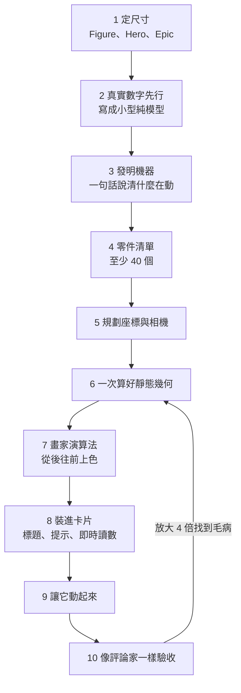

# Anatomy:一行字造出能上手玩的機器——「物體就是解釋」的 Claude Code 技能(Why QQ + 原始碼)

**主題分類:** 科技 / 應用 AI / 設計 — 技術插圖、Agent Skill
**來源:** YouTube〈一行字造出机械表，AI画图过时了〉(Why QQ,2026-10-15,約 9.5 分;官方 zh-Hans 字幕)
**原始碼核實:** 已 `git clone --depth 1` [wheresryan22/anatomy](https://github.com/wheresryan22/anatomy)(MIT,最後 commit 2026-10-15 `e948829`,本文查詢時 10-16 約 **1.27 萬 star**),讀 `SKILL.md`、`README.md`、`CHANGELOG.md`、`kit/` 與 `references/` 目錄
**整理日期:** 2026-10-16

> 📌 立場:本片未見業配或付費推廣;片尾邀觀眾在留言提出想實測的概念。影片的星數取自 10-14 GitHub API、瀏覽量取自公開報導、建造耗時取自作者官網(說明欄自述的資料口徑)。
> 🔗 同為「把設計品味寫成 skill」的案例:[[impeccable-frontend-design-skill-ai-slop]](前端去 AI 味);把審計寫成流程的案例:[[cloudflare-security-audit-skill-pipeline]]。

---

## TL;DR

1. ⭐⭐⭐ **核心規則只有一句:「The object is the explanation」(物體就是解釋)。** 不准畫方塊、箭頭、飄在空中的標籤;Claude 必須**發明一台真實存在的機器**,它的運作方式等於概念本身,並用一句話說清「什麼在動、這個動代表什麼」。
2. ⭐⭐ **Claude 一個像素都沒畫。** 產出是 SVG / HTML / WebGL **程式碼**,由瀏覽器渲染——所以圖可以改、可以查、每個零件有尺寸、幾何有審計背書。「Claude 終於能生成圖片了」的說法錯在根上。
3. ⭐⭐⭐ **品質大頭在動手前就決定了**:十步流程裡,前四步(定尺寸、收集真實數字、發明機器、列零件清單)時螢幕上一個像素都沒有。
4. ⭐⭐ **驗收才是正文**:幾何審計用射線測每對重疊零件的真實深度(遄達 970 那張圖:541 個實體、6,320 對重疊、62.4 秒驗完零問題);大圖用「建造者 + 評審 + 修復工」多 agent 輪轉,遄達三輪評審留下 309 張截圖。
5. ⚠️ **作者自己最冷靜:「Claude 很會造,不太會看。」** 數字全對、樣子仍可能不對;官方建議把第一版當草稿,上手玩、說出哪裡彆扭、再來一輪。

---

## 1. 問題:方塊加箭頭,讓讀者自己腦補

想講清哈希衝突、TCP 握手,畫出來的多半是方塊加箭頭:**方塊告訴你部件存在,箭頭代表某種運動,運動本身全靠讀者腦補。** 而每個人補出來的都不一樣——A 指向 B 的箭頭到底是推送、拉取還是輪詢?圖裡沒有答案。

開發者 Ryan 的解法:讓 AI 畫出**那個東西本身**——一台真實的機器,零件怎麼動,概念就是什麼樣;讀者不用腦補,伸手玩一遍就懂。

| 項目 | 內容 |
|---|---|
| 開源日期 | 2026-10-08(✅ GitHub API `created_at` 2026-10-08) |
| 授權 | ✅ MIT |
| 支援 | Claude Code 為主;✅ README 列出 Antigravity、OpenCode、Codex、MiniMax Code 也能載入(影片只提 OpenCode 與 Codex) |
| 安裝 | `npx skills add wheresryan22/anatomy -g`(✅ README;`-a claude-code` 等指定代理) |
| 依賴 | ✅ Node.js 20.10+、Chrome / Chromium(檢查用);**kit 只用 Node 內建模組,不用 `npm install`** |

---

## 2. ⭐⭐⭐ 「物體就是解釋」:映射表與兩種失敗

SKILL.md 的「The one idea that matters」一節原文列出過去圖的映射(✅ 原始碼):

| 概念 | 機器 |
|---|---|
| 一個共用 GPU context 服務多個 canvas | 龍門繪圖機:一個列印頭巡迴 16 個孔 |
| 沒變就跳過工作的快取鍵 | 彈子鎖:每根銷都對上,鎖芯才轉、什麼都不重畫 |
| 七個 bytes-per-texel 不同的 render target | 七層抽屜櫃,每層深度等於它的 bytes |
| 可分離模糊(49×49 vs 49+49 次取樣) | 一塊釘床印章,旁邊兩把軌道上的梳子 |

影片另外介紹了官網圖集裡的映射:**哈希表衝突 = 郵局分揀台**(編碼機給每封信印哈希值、名字對 8 取模投進鴿子籠)、**布隆過濾器 = 水果老虎機**(三個滾筒是三個哈希函數,三個標誌位全立著才中獎)、**互斥鎖 = 水箱加聯鎖鑰匙**、**TCP 三次握手 = 兩站之間的索道郵車**、**溫度取樣 = 輪盤賭**(16 格是候選詞,格寬就是機率)。

**兩種失敗(SKILL.md 原文):**
- **太抽象**:疊起來的板子、懸浮的平板、貼標籤的方塊,看不出是什麼。
- **太平太淡**:一塊大板子畫幾條線,沒體積、沒零件、沒東西可發現。

> ⭐ 藥方同一個:**一台叫得出名字的機器,由許多小而精確、各有用途的零件組成。** SKILL.md 還要求「兩種看法」:1× 讀得出是一台清楚的機器,**4× 放大後每一區仍有真東西可看**——空白的面或角落是「沒做完」,不是「留白」。

---

## 3. ⭐⭐ 用法:寫想法,不寫畫什麼

影片的反直覺提醒:**提示詞只寫想法,別寫畫什麼。** 寫「解釋 LRU 快取怎麼淘汰條目」就夠了,決定畫成書架是 Claude 的事。README 的「三個好習慣」與此一致:

1. **說出概念,不說圖怎麼畫**,並給真實數字(尺寸、數量、速率、閾值)。
2. **或直接指定物體**:已經知道想要哪台機器(義式咖啡機、本生燈、鎖),就說出來,並說明什麼該動。
3. **說出它要放在哪**:獨立 HTML、單一 SVG 檔,還是 React / Next.js 元件;亮色或暗色。

```text
/anatomy explain how a token bucket rate limiter works, interactive
/anatomy a Bunsen burner on a lab bench: opening the air collar turns the lazy yellow flame into a roaring blue cone. WebGL for the flame, one HTML file, dark theme.
```
(✅ 兩句都是 README 原文範例,第二句取自 skill 的 `evals/evals.json`)

**三個關鍵字(影片說法 vs. 原始碼):**

| 關鍵字 | 影片說法 | 原始碼 |
|---|---|---|
| `interactive` | 寫了才能拖能按,**不寫就是一張死圖** | 🟡 **需修正**:SKILL.md 的 description 本身就寫「interactive isometric SVG figures」,第 9 步「Make it live」是**每張圖都要做**的固定步驟(閒置巡演、回應指標與鍵盤、離開畫面停止)。README 範例確實在提示詞尾加 `interactive`,但本文未在 skill 中找到「不寫就不做互動」的開關規則 |
| `WebGL` | 火焰、水流交給著色器,嵌在同一個等軸相機裡 | ✅ 「只用在線條畫不出來的東西:火、排氣、水與焦散、燈光、輝光、蒸汽」;零件仍是 SVG,canvas 夾在前後兩層 SVG 之間 |
| `3D` | 零件真的在縱深裡轉、每幀重新投影排序,最貴 | ✅ beta;`references/3d.md`:「**只有當動作本身就是解釋時**才用,絕不當裝飾」;完整的 3D 軌道審計 30 個零件要 15–20 分鐘 |

> 📌 實務上的讀法:這三個詞是**給 skill 的明確意圖訊號**,寫出來可以避免它自己判斷錯;但互動是預設行為,不是付費開關。

---

## 4. ⭐⭐⭐ 十步流水線:前四步決定品質



**第 1 步的三個尺寸(✅ SKILL.md 原文):**

| 尺寸 | 規模 | 時間 | 規則 |
|---|---|---|---|
| **Figure** | 一個機構,40–80 個零件,最多一層 WebGL | **不向使用者報時間**(常常遠不到一小時) | 報出尺寸就直接做,不必問 |
| **Hero** | 密集物體、多層 WebGL 或一個 3D 主體,80–150 個零件 | 約 2–4 小時 | 先說,然後開做(除非使用者要求快) |
| **Epic** | 整台車、整棟建築或工廠,或多個 3D 主體 | 6 小時以上 | ⭐ **不准開工**:給估計、提出保留核心的 Hero 版本、列出完整版會多什麼,**使用者選了才做** |

> ⚠️ **影片說「Figure 半小時出頭」需修正:** CHANGELOG(Unreleased)記錄 **Figure 已不再向使用者報時間——舊的 30–90 分鐘估計常常比實際建造時間長得多**(issue #41)。影片說「不問你絕不擅自開工」只適用於 **Epic**;Figure 與 Hero 會直接做。
> ⭐ 不論尺寸,**第一個小時內一定要有一張能在瀏覽器打開的頁面**,之後再加深;每一步開始時跑 `date`,某步超過預算兩倍就要告訴使用者進度。

**第 2 步「真實先行」**:收集真實的尺寸、數量、閾值、曲線,讀數、動作與圖說都必須為真;最好寫成一個小的純模組(如範例的 `rig.ts`),**一切由它驅動**——所以改模型裡的一個數,零件、讀數、動畫一起跟著變。

> ⭐⭐ **影片最值得帶走的一句:「先想清楚造什麼,再動手畫——這個順序放在任何 AI 協作裡都成立。」**

---

## 5. ⭐⭐ 工程細節:相機、明暗、畫家演算法與審計

| 項目 | 規則(✅ SKILL.md) |
|---|---|
| 相機 | 等軸(正交)投影,方位角預設 45°(35–60° 可秀長邊)、仰角 30°(要看進開口的東西可更高,如漣波槽的 44°);平行邊永遠平行 |
| 明暗 | `extrude` 依朝向給四檔側面色調加一個較亮的頂面;基座 `lo`、結構 `mid`、主體 `hi`,**只有一個 `lit` 重點**——讀者該盯的那個零件 |
| 深度 | 畫家演算法,從後往前、從下往上;**包住其他零件的(繞著柱子的彈簧)劈成前後兩半,柱子畫在中間** |
| 線條 | 每條線都要結束在某個東西上;沒有引線、氣泡框、尺寸箭頭或飄著的標籤 |
| 管線 | 不准穿過任何東西——靜止、拆開、爆炸動畫的每一幀都不行 |

零件一多,人眼調不動前後順序,就交給 `kit/audit.mjs`:`recorder()` 記錄每個零件的真實形狀,`settle()` **對每對重疊零件發射線、量出真實深度並設定排序鍵**,`auditOrExit()` 跑一整串檢查(間隙、端點、支撐、摺疊、自我重疊、擁擠、替身形狀、曲面抖動、深度順序),任何問題都以非零碼退出。

> ⭐ **SKILL.md 明文:「用替身形狀讓審計閉嘴是 bug,審計會抓。」交錯修在幾何上,不准用排序偏移硬調。**

影片引用的審計數字(🟡 來自作者官網,repo 內未見,本文未獨立核實):

| 圖 | 審計結果 |
|---|---|
| 遄達 970(A380 的發動機) | 541 個實體、6,320 對重疊、62.4 秒驗完,零問題 |
| 猛禽 2 號第一版 | 抓出 54 處穿插、323 處順序錯誤 |

另有獨立的**線端檢查**(`scripts/lines.mjs`):審計看不到線條標記,所以每條接縫、刻度、指針都要在瀏覽器裡檢查是否結束在筆畫、點或輪廓上,必須印出 `line ends: 0`。

---

## 6. ⭐⭐⭐ 多 agent 評審:不看報告點頭,自己重建

大一點的圖背後是一個小團隊(影片):**一個建造者、幾個評審、一個修復工,一輪一輪轉,轉到某一輪挑不出毛病為止。**

- 每個 agent 維護自己的**進度檔**——因為你隨時會打斷它,檔案在,活就在。
- ⭐⭐ **評審不看建造者的報告點頭**:自己重建頁面、重跑審計、自己截圖。遄達三輪評審留下 309 張截圖。
- 一個實例:評審把風扇葉片一塊 50×45 像素的區域放大到 800×720,發現葉片在切口處折成薄片;修法是每片葉子畫完整,再用 0.6 個節距淡出。

SKILL.md 第 10 步「像評論家一樣驗收」的原文對應:擷取桌機、手機(390 寬)、hover 與多個動作瞬間;審計跑到零;**兩種主題都做每個接合處的 4× 特寫**;著色器做慢動作接觸表,不准有跳變。

> 📌 這套「評審自己重跑而非讀報告」與本庫 [[cross-model-review-claude-codex-harness]] 的互審原則同一精神:**驗證者不能只信被驗證者的自述。**

---

## 7. 成本:能跑的第一版很快,大頭時間花在「第二眼」

| 圖 | Claude 有效工時(影片引作者官網) |
|---|---|
| 機械錶機芯 | 1 小時 54 分,一次通過 |
| 四季地球(3D) | 1 小時 57 分 |
| 猛禽 2 號發動機 | 10 小時 33 分(能跑的第一版 38 分鐘) |
| 遄達 970 | 14 小時(首版 4 小時 41 分,後面五輪評審修復) |

> 口徑:只算 Claude 的有效工時,評審輪次算在內,發呆等待不算(影片說法;🟡 本文未獨立核實)。
> ⭐⭐ **「生成只是起點,驗收才是正文。」** 放大四倍看,毛病全藏在那:電纜穿過管道、噴口陰影斷層、葉片折成薄片。

---

## 8. ⚠️ 限制(README 與作者自述)

- **不是圖表庫**:沒有座標軸、資料序列;數字只以模型驅動的即時讀數和零件的真實尺寸出現。
- **畫機器、儀器、工具、家具;不畫人、不畫精確地圖。** 沒有機構可造的概念,效果會比較弱。
- **刻意慢**:一張圖是一個長 session(零件清單、幾何、審計、兩種主題下每個接合處的特寫)。
- **3D 模式是 beta**:只在自己的範例和一張測試圖上驗證過,還沒上過正式產品;380 個零件的壓力測試手在 1440 寬約 20 fps、限速手機約 13–15 fps。
- ⭐⭐ **作者自承:Claude 很會造,不太會看——零件數字全對,樣子還是可能不對。** 管用的修正來自你盯著它跑、說出哪裡彆扭。

---

## 9. ⭐⭐ 更大的意義:skill 變成新的工程製品

影片的觀察:**一份 SKILL.md、幾份參考文件、一個一萬六千行的繪圖工具包,就把審美和工藝固化成可重用的資產。** Ryan 說他從沒畫過一條線,他做的是:看、說哪裡不對、把那句話寫成規則。⭐ **帶著教訓寫出來的規則,比光禿禿的規則管用,AI 下一次真的會守**——SKILL.md 處處可見這種痕跡,例如 WebGL 那一節開頭就寫明規則來自「第一個著色器圖在換階段時顏色是切的而不是淡入淡出」,亮色主題的規則來自猛禽的「紅墨水煙」事故。

| 影片說法 | 本文核對 |
|---|---|
| SKILL.md 155 行 | 🟡 本文 clone 的版本為 **173 行**(10-15 仍有更新,版本不同) |
| 八份參考文件 | 🟡 `references/` 現有 **9 份**(craft、kit、motion、react、verify、webgl、walkthrough、3d,外加分享用的 publish) |
| 一萬六千行的繪圖工具包 | ✅ `kit/` 底下 `.mjs`/`.ts`/`.tsx` 合計約 **16,221 行** |

**影片點名的三個後續觀察點:**
1. **這類插圖會進技術文件與落地頁**:`anatomy-figures` npm 套件把圖集裡的機器做成 React 元件。✅ npm 上確有此套件(MIT,目前 0.1.0,描述「Every Anatomy figure as a live, themeable React component」);「33 台機器」本文未逐一計數。
2. **3D 模式成熟後天花板再抬一截**(目前 beta,見第 8 節)。
3. **「模型驅動一切」的做法會滲進更多 skill。**

---

## 10. 應用案例

### 案例一:幫內部文件解釋「連線池為什麼會排隊」

1. 提示詞照 README 的習慣寫:概念 + 真實數字 + 放在哪。
   ```text
   /anatomy a figure for our Next.js docs on database connection pooling: a pool of 10 connections, requests borrow one and give it back, and when all 10 are busy new requests wait in a queue. A React component plus a static HTML preview, dark theme.
   ```
   (這句是 skill 自己 evals 裡的範例)
2. 讓它自己發明機器,不要指定「畫十個方塊」。
3. 拿到第一版後,**當草稿**:拖一拖、在手機寬度看一次,具體說出彆扭的地方(「第 11 個請求等待時,隊伍看不出在動」),再來一輪。
4. 因為產出是程式碼,之後連線數改成 20,只要改模型裡的那個數。

### 案例二:把你自己的「品味」寫成 skill

借 Anatomy 的做法,替團隊的任何產出(簡報、報表、API 文件)寫 skill:
- **一句核心規則**放最頂上(像「物體就是解釋」);
- **列出兩種最常見的失敗**和共同的藥方;
- **尺寸分級 + 何時必須先問人**(Epic 不准自己開工);
- **驗收寫成可跑的腳本**,讓「好不好」能以非零碼失敗;
- 每次退件的理由**連同教訓**寫回規則。

### 案例三:評估要不要在落地頁用這種圖

| 問題 | 判斷 |
|---|---|
| 概念有沒有「機構」可造? | 有(快取、限流、排程)⇒ 適合;純數據趨勢 ⇒ 用圖表庫 |
| 時間預算? | Figure 通常一小時內;Hero 2–4 小時;大型多輪評審可能十幾小時 |
| 誰來驗收? | 一定要有人看第一版、說出哪裡不對,不能直接上線 |

---

## 11. 核實總表

| 說法 | 結果 |
|---|---|
| 10-08 開源、MIT、免費 | ✅ GitHub API 與 LICENSE |
| 安裝 `npx skills add wheresryan22/anatomy` | ✅ README |
| 支援 OpenCode、Codex | ✅;另有 Antigravity、MiniMax Code |
| SKILL.md 頂部核心是「物體就是解釋」、兩種失敗 | ✅ 原文 |
| 十步流程、前四步不畫任何東西 | ✅ Workflow 一節;原文也說「Most of the quality is decided there」 |
| Figure 40–80 零件「半小時出頭」 | ⚠️ **需修正**:零件數正確;**Figure 已不報時間**,舊估計 30–90 分鐘常高估 |
| 「不問你絕不擅自開工」 | ⚠️ 只適用 Epic |
| 不寫 interactive 就是死圖 | ⚠️ **與 SKILL.md 不符**:互動是第 9 步的預設 |
| 正交相機 45° / 30°、四檔明暗、畫家演算法、彈簧劈兩半 | ✅ 原文 |
| 審計用射線測重疊深度 | ✅ `kit/audit.mjs` 的 `settle` |
| 541 實體 / 6,320 對 / 62.4 秒;54 處穿插、323 處順序錯 | 🟡 作者官網數字,未獨立核實 |
| 各圖工時(1h54m、10h33m、14h 等) | 🟡 作者官網數字,未獨立核實 |
| 3D 壓力測試手約 20 fps | ✅ README / SKILL.md |
| 一萬六千行工具包 | ✅ 約 16,221 行 |
| 星數(影片 10-14:8,200 星、586 fork) | 📌 本文 10-16 查詢約 1.27 萬星;逐日數字未獨立核實 |
| 發布帖兩天 140 萬瀏覽、1.9 萬收藏 | 🟡 影片引公開報導,未獨立核實 |
| `anatomy-figures` npm 套件 | ✅ 存在,0.1.0、MIT |

---

## 來源

- [YouTube:一行字造出机械表，AI画图过时了(Why QQ,2026-10-15)](https://www.youtube.com/watch?v=fuppI9SkKrs)(官方 zh-Hans 字幕)
- [wheresryan22/anatomy GitHub repo](https://github.com/wheresryan22/anatomy) · [SKILL.md](https://github.com/wheresryan22/anatomy/blob/main/SKILL.md) · [README](https://github.com/wheresryan22/anatomy/blob/main/README.md) · [CHANGELOG](https://github.com/wheresryan22/anatomy/blob/main/CHANGELOG.md)
- [Anatomy 官網](https://skills.wheresryan.sh/anatomy)
- [Issue #41:Figure 時間估計過長](https://github.com/wheresryan22/anatomy/issues/41)
- [npm:anatomy-figures](https://www.npmjs.com/package/anatomy-figures) · [wheresryan22/anatomy-community(社群圖集)](https://github.com/wheresryan22/anatomy-community)

📎 相關筆記:[[impeccable-frontend-design-skill-ai-slop]](同為把設計品味寫成 skill)、[[cloudflare-security-audit-skill-pipeline]](把審計寫成流程)、[[cross-model-review-claude-codex-harness]](驗證者不能只信自述)
