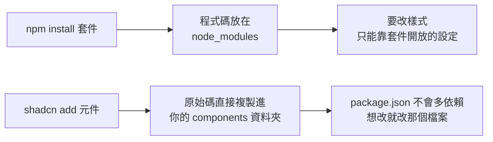

# 用 shadcn registry 做一個「假的 Claude Code」:brainless 把終端機介面變成可改的 React 元件

> 整理自 YouTube 頻道 **YAHA学堂**〈[我做了一个假的 Claude Code,官方看了都会愣一下|一行命令装进网页,版本号我说了算](https://www.youtube.com/watch?v=A2i8D66J83U)〉(2026-09-12,約 7.3 分鐘,自動字幕)。
> ⭐ 本文**已 clone 原始碼 [theswerd/brainless](https://github.com/theswerd/brainless) 核實**(MIT,作者 Ben Swerdlow),clone 讀完已刪除。
> ⚠️ 影片結尾的「Hype 按鈕」「訂閱」屬頻道自我推廣,未納入。該片只有自動字幕,「Cloud」皆為 Claude 的同音誤聽(下文一律寫 Claude)。
> 🔍 2026-11-07 追加核實:重新 clone 原始碼並讀 `registry.json`、`lib/agent-prompt.ts`、README,另截取影片 6 個畫面;下文標 ❌ 為更正、⚠️ 為未完全核實處,細節見文末「延伸閱讀與深度補充」。

---

## 一句話總結

> **brainless 是一個 shadcn/ui「registry」(元件清單),用一行 `shadcn add` 就把 Claude Code / Codex / Grok 的終端機介面,以「原始碼」形式複製進你的 Next.js 專案。它不是 npm 套件,所以你可以直接改檔案(例如把品牌色改綠、版本號寫 9.9.0)。** 官方作者自己做的示範是 Silicon Valley 影集的 Pied Piper 註冊流程,用途是文件、Demo、產品介紹頁,不是拿來騙人。

---

## 一、為什麼「registry」跟「npm 套件」差這麼多

影片後半最重要的一件事,是釐清兩者:

- 影片示範:`npm i brainless` 會裝到一個**無關的舊套件**(Brainfuck 語言直譯器)。❌ 年份需修正:影片說「2022 年後沒更新」,npm registry 端點顯示 `brainless` 描述為 `Interpreter for the Brainfuck esoteric language`,最新版 0.1.0 發佈於 **2015-01-16**(已讀 `registry.npmjs.org/brainless`;npmjs.com 網頁回 403)。因為 brainless 根本不是 npm 套件,而是 registry——「一份程式碼清單」,shadcn CLI 照清單把原始碼複製進專案。
- 實測效果:把 `claude-header` 檔頂端寫死的橘色常數改成綠色,邊框、標題、logo 一次全變;不必等任何人發新版,也不必找有沒有主題設定。
- ✅ 核實(repo):`registry/brainless/` 下依品牌分 `claude/`、`codex/`、`grok/`,每個元件是獨立 `.tsx`;`registry.json` 列約 40 個項目;`public/r/*.json` 是 CLI 讀取的建置產物。

## 二、影片的操作流程

| 步驟 | 內容 |
|---|---|
| 1 | 在現成 Next.js 專案貼上一行 add 指令,幾秒完成,在 `components/` 下產生 `.tsx`,**不動 package.json** |
| 2 | `app/page.tsx` 清空,放進 `<ClaudeHeader …/>`;外層 `main` 給深色背景 |
| 3 | 啟動本機開發環境:這是**瀏覽器網頁而非終端機**,文字可選取、語意正確(標題框是真的 `fieldset` + `legend`,螢幕閱讀器念得出來) |
| 4 | 改 props:使用者名稱、`version`、`cwd`、`tips`、`whatsNew`(陣列,塞幾條顯示幾條)。版本寫 9.9.0、命令叫「摸魚」都行,因為只是普通 React 參數 |
| 5 | 裝完整的 `claude-session`:一條命令、六個新檔,依賴元件自動拉進來。⚠️ 數量與影片不符:影片說「六個新文件」([3:05]),但 `registry.json` 的 `claude-session` 列 8 個 registry 依賴(含已先裝的 `claude-header`)加上 block 本身,扣掉 header 後約 8 檔(未實際跑 CLI 逐檔計數,以實際輸出為準)。使用者訊息、待辦清單打勾、讀檔的工具呼叫、綠加紅減的 diff、「選 1 還是 2」的權限框、旋轉思考動畫全都有 |
| 6 | 註冊簡稱:`registry add @brainless=https://brainless.swerdlow.dev/r/{name}.json`,之後 `add @brainless/<名稱>`;`{name}` 是佔位符(✅ README 原文即此指令,亦可手動寫進 `components.json` 的 `registries`;⚠️ shadcn 官方 namespace 頁面只記 `components.json` 寫法,未見 `registry add` 子命令說明,CLI 行為未本機驗證) |
| 7 | 同樣方式裝 Grok、Codex(影片稱 11 個檔,整套進來)。✅ `grok-session` 列 10 個 registry 依賴 + 自身 block = 11 檔,與影片相符(指 Grok);`codex-session` 列 5 個依賴 + block |
| 8 | 沒有專案時:`create-next-app` 全部按預設(Tailwind 預設開啟,別關,元件樣式全靠它)→ `shadcn init`(預設設定,生成 `components.json`)→ `shadcn add` |

❌ 指令寫法需修正:brainless README 的 registry 指令用 `bunx shadcn@latest …`;站上 `llms/claude-header.txt`(畫面於 [5:45] 出現)則以 `npx shadcn@latest add <URL>` 為主,另列 bun(`bunx --bun …`)、pnpm、yarn 版本。影片用 npm 系列指令,以上皆等價,擇一即可。

### 互動不是畫出來的(✅ repo 核實)

- 工具呼叫用原生 `
`:鍵盤 Tab 過去按 Enter 即可展開(`claude-tool-call.tsx`)。
- 權限確認框是 `role="radiogroup"`:方向鍵選、Enter/Space 確認(`claude-permission.tsx`);斜線選單是 `role="listbox"`。
- 三家的差別在互動邏輯,不只配色(影片舉例,**未逐一核對**):Claude 的 diff 嵌在對話裡;Codex 的是接管全螢幕的翻頁器;Grok 先把工作寫成 Plan 並提供「批准 / 要求修改 / 留言 / 退出」,且多了頂端狀態列、快捷鍵彈窗、設定面板、專案選擇器。repo 中確實有 `grok-plan`、`grok-status`、`grok-shortcuts`、`grok-settings`、`grok-project-picker`、`codex-diff` 等檔(✅ 檔案存在)。畫面 [4:46] 可見 Codex 的全螢幕 diff 翻頁器(頂列 `/ D I F F /`、底列 `q to quit`),與影片描述相符。

## 三、那個「彩蛋」:Pied Piper 註冊流程

✅ 核實:`registry/brainless/blocks/pied-piper-onboarding.tsx` 存在。內容是:綠色邊框的 `fieldset`、自己的 logo(1-bit 像素笛子 SVG)、"Welcome to Pied Piper"、"compression · middle-out"(Silicon Valley 影集的壓縮演算法梗)、版本 `v3.1.4`,以及可互動的 typewriter 對話:先問名字、再問「你在找什麼」,最後 "compression so good, it feels illegal"。✅ 2026-11-07 重讀原始碼:結語字串在 `pied-piper-onboarding.tsx` 第 226 行,版本 `v3.1.4` 在第 87 行,三步清單為 `Collect a name` / `Learn what they're looking for` / `Create the account`。畫面 [5:24] 同樣可見綠色 fieldset、`compression · middle-out` 與 `Hey — what's your name?`。

作者的用意是示範「用同一套積木拼出自己品牌的 Agent 介面」。看名字就知道是玩笑:用途是 Demo,不是冒充官方。

## 四、另一條路:把說明書丟給 Claude Code

站上有「Copy agent prompt」。❌ 需修正說法:✅ 讀 `lib/agent-prompt.ts` 核實,複製的其實是**一行短提示**:``Read https://brainless.swerdlow.dev/llms/<name>.txt and add the brainless "<title>" component (`<name>`) to this project.``。真正的「說明書」是每個元件的 `llms/<name>.txt`(畫面 [5:45] 可見 claude-header 版本:安裝指令、import 路徑、用法,以及「保留 `details`、`listbox`、`radiogroup`、`aria-live` 等語意」的 Notes)。也就是說,貼進 Claude Code 的是指向說明書的短句,由 agent 自己去讀、裝、改——影片的說法是「用 Claude Code 裝了一個假的 Claude Code」。

---

## 應用案例

1. **產品文件的互動 Demo**:你做 CLI 型 Agent 產品,文件站不想放截圖(無法選取、無法無障礙)。用 `claude-session` 的結構,換成自己的色彩、logo、`whatsNew`,讀者可點開工具呼叫、用鍵盤操作。
2. **教學簡報**:講「Agent 的權限確認長什麼樣」,直接嵌 `claude-permission`,講師現場改文案與選項,比錄影彈性。
3. **內部品牌 Agent 前端**:把 Pied Piper 範例當模板,換掉 logo 與提示字,做公司內部「類終端機」註冊或 onboarding 流程。
4. **避免誤用**:仿製介面放在公開頁面時,應明示是 Demo/示意,不要宣稱官方,也不要拿來製作看似真實的截圖當證據(影片也強調用途不是騙人)。

## 核實狀態

- ✅ 已核實:registry 性質;MIT(`LICENSE`);40 個 registry 項目(`registry.json`);元件分品牌(`claude/`、`codex/`、`grok/`);`details`/`radiogroup`/`listbox`/`aria-live` 語意;pied-piper 區塊與文案;`claude-header` 色常數;Grok 11 檔;Codex 全螢幕翻頁器畫面;站上 llms 說明書與 `npx`/`bunx` 寫法。
- ❌ 已更正(正文內標示):npm 上 `brainless` 的年份為 2015(非 2022);站上指令以 `npx` 為主;「複製的說明書」實為一行短提示;「六個新檔」與依賴清單推算不符(約 8 檔)。
- ⚠️ 未核實:作者姓名(本次未重讀);Grok「批准 / 要求修改 / 留言 / 退出」四鍵的按鈕字樣(`grok-plan.tsx` 存在,未逐字讀);`claude-session` 實際 CLI 逐檔數;shadcn CLI `registry add` 子命令的本機行為。
- 字幕還原(推定,皆為同音):Cloud=Claude、Brainlist=registry、Brainfork=Brainfuck、Shadkin=shadcn、Grag/Groc=Grok、Claudex=Codex、Arthbrain Loss=`@brainless` 簡稱(推定)、Shatikenda 配置文件=`components.json`(推定)、Pied Pepper / MiddleLaut=Pied Piper / middle-out(畫面與程式已確認)。

## 延伸閱讀與深度補充(2026-11-07 核實增補)

### 1. shadcn namespace 機制

- ✅ 讀 [shadcn 官方 namespace 文件](https://ui.shadcn.com/docs/registry/namespace):namespace 寫在 `components.json` 的 `registries` 欄位,例如 `"@acme": "https://registry.acme.com/resources/{name}.json"`;`{name}` 為**必要**佔位符,安裝 `@acme/button` 時解析為 `button.json`。
- ⚠️ 搜尋摘要提到:私有 registry 可改用物件形式加 `headers`,secret 以環境變數 `${VAR}` 展開;namespace 名稱以 `@` 開頭、只允許英數、連字號、底線。未逐字核對原頁。
- ✅ brainless README 兩種寫法並列:`bunx shadcn@latest registry add @brainless=https://brainless.swerdlow.dev/r/{name}.json`,或手動寫入 `components.json`(與官方頁面一致)。

### 2. registry 的實際結構(✅ 讀 repo)

- `registry.json` 以 `$schema: https://ui.shadcn.com/schema/registry.json` 宣告 **40 個 item**,`type` 分 `registry:ui`(單一元件,如 `claude-header`)與 `registry:block`(整段畫面,如 `claude-session`)。
- 每個 item 的 `files[].target` 指定裝到使用者專案的路徑(`components/brainless/...`),這就是「原始碼複製進專案、不進 `package.json`」的機制。
- `registryDependencies` 以完整 URL 指向 `…/r/<name>.json`,CLI 會遞迴拉進依賴。
- `public/r/*.json` 是建置產物(例如 `claude-session.json`、`pied-piper-onboarding.json`),即 CLI 實際下載的檔案。

### 3. 「語意 HTML」在原始碼裡長什麼樣(✅ grep 核實)

| 影片描述 | 原始碼位置 | 意義 |
|---|---|---|
| 工具呼叫可點開收合 | `claude-tool-call.tsx` 第 39 行 `
` | 瀏覽器原生的鍵盤與無障礙行為,不需自寫 onKeyDown |
| 「選 1 還是 2」權限框 | `claude-permission.tsx` 第 55–67 行 `fieldset` / `legend` / `role="radiogroup"` | 單選語意;上下鍵的實際處理邏輯未逐行核對 |
| 斜線選單 | `claude-slash-menu.tsx` 第 62 行 `role="listbox"` | 清單語意 |
| 旋轉思考動畫 | `claude-thinking.tsx` 第 73 行 `aria-live="polite"` | 螢幕閱讀器會播報狀態變化 |

- ✅ 色彩:影片的「赤桃色」即 `claude-header.tsx` 第 12 行 `const ROSE = "#cd694a"`(赤陶 / 橘紅)。邊框、標題、logo 都吃這個常數(`ClaudeLogo` 預設 `color = ROSE`),所以改一行就全變色——這正是「原始碼複製進專案」的直接好處。
- ✅ 畫面 [3:27] 中 Claude 畫面的 tips 與 what's new 是作者自填的 props(例如「訂閱YAHA學堂」、「新增 /摸魚 命令」),印證「props 可任意改」。

### 4. 定位與授權

- ✅ README 原文:"so you can drop them into docs, demos, marketing pages, and product UI without screenshots or iframes."(MIT)
- ✅ 以 `unofficial`、`affiliat`、`trademark` 搜尋 README、`app/`、`components/`,**沒有**「非官方」或商標聲明。因此在自己的產品頁使用時,應自行標示為示意 / Demo(呼應應用案例 4)。商標與介面版權的法律面未查證。

### 5. 畫面核實的時間點

以 `transcript_tools.py find` 取得精確時間;連結為該時間前 10 秒(依工具規則)。

- [1:03](https://www.youtube.com/watch?v=A2i8D66J83U&t=53s):畫面為終端機 `npm run dev` 輸出 `localhost:3000`,瀏覽器尚未切換。
- [2:32](https://www.youtube.com/watch?v=A2i8D66J83U&t=142s):終端機顯示 `npm uninstall brainless`(移除 2 個套件)。
- [3:27](https://www.youtube.com/watch?v=A2i8D66J83U&t=197s):瀏覽器中 `ClaudeSession` 畫面與 `app/page.tsx` 並排(`<main className="min-h-screen bg-[#0d0d0d] p-10">`)。
- [4:46](https://www.youtube.com/watch?v=A2i8D66J83U&t=276s):Codex 全螢幕 diff 翻頁器(`/ D I F F /`、`q to quit`)。
- [5:24](https://www.youtube.com/watch?v=A2i8D66J83U&t=314s):Pied Piper 註冊畫面(`v3.1.4`、`middle-out`)。
- [5:45](https://www.youtube.com/watch?v=A2i8D66J83U&t=335s):站上 `llms/claude-header.txt` 說明書頁。

## 來源

- [我做了一个假的 Claude Code,官方看了都会愣一下 — YAHA学堂](https://www.youtube.com/watch?v=A2i8D66J83U)(2026-09-12;該片無官方字幕,使用自動字幕,可能有同音字誤差)
- [theswerd/brainless — GitHub](https://github.com/theswerd/brainless)(MIT;clone 讀 `registry/`、`registry.json`、`public/r/`、`lib/agent-prompt.ts`、README)
- [brainless 官網](https://brainless.swerdlow.dev)、[brainless llms 說明書範例 claude-header](https://brainless.swerdlow.dev/llms/claude-header.txt)
- [shadcn 官方 registry namespace 文件](https://ui.shadcn.com/docs/registry/namespace)
- [npm registry 端點:brainless](https://registry.npmjs.org/brainless)(npmjs.com 網頁回 403,改讀此端點)
- [shadcn registry 目錄](https://shadcnregistry.com/)
- 延伸:本庫 [[ai-website-building-claude-code]]
