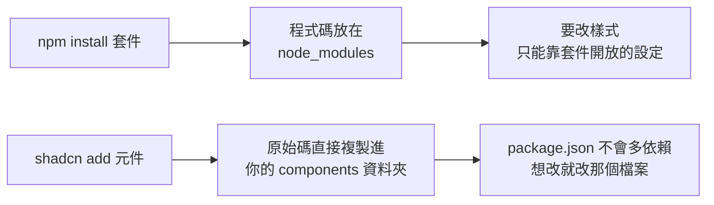

# 用 shadcn registry 做一個「假的 Claude Code」:brainless 把終端機介面變成可改的 React 元件

> 整理自 YouTube 頻道 **YAHA学堂**〈[我做了一个假的 Claude Code,官方看了都会愣一下|一行命令装进网页,版本号我说了算](https://www.youtube.com/watch?v=A2i8D66J83U)〉(2026-09-12,約 7.3 分鐘,自動字幕)。
> ⭐ 本文**已 clone 原始碼 [theswerd/brainless](https://github.com/theswerd/brainless) 核實**(MIT,作者 Ben Swerdlow),clone 讀完已刪除。
> ⚠️ 影片結尾的「Hype 按鈕」「訂閱」屬頻道自我推廣,未納入。該片只有自動字幕,「Cloud」皆為 Claude 的同音誤聽(下文一律寫 Claude)。

---

## 一句話總結

> **brainless 是一個 shadcn/ui「registry」(元件清單),用一行 `shadcn add` 就把 Claude Code / Codex / Grok 的終端機介面,以「原始碼」形式複製進你的 Next.js 專案。它不是 npm 套件,所以你可以直接改檔案(例如把品牌色改綠、版本號寫 9.9.0)。** 官方作者自己做的示範是 Silicon Valley 影集的 Pied Piper 註冊流程,用途是文件、Demo、產品介紹頁,不是拿來騙人。

---

## 一、為什麼「registry」跟「npm 套件」差這麼多

影片後半最重要的一件事,是釐清兩者:

- 影片示範:`npm i brainless` 會裝到一個**無關的舊套件**(Brainfuck 語言直譯器,2022 年後沒更新)。因為 brainless 根本不是 npm 套件,而是 registry——「一份程式碼清單」,shadcn CLI 照清單把原始碼複製進專案。
- 實測效果:把 `claude-header` 檔頂端寫死的橘色常數改成綠色,邊框、標題、logo 一次全變;不必等任何人發新版,也不必找有沒有主題設定。
- ✅ 核實(repo):`registry/brainless/` 下依品牌分 `claude/`、`codex/`、`grok/`,每個元件是獨立 `.tsx`;`registry.json` 列約 40 個項目;`public/r/*.json` 是 CLI 讀取的建置產物。

## 二、影片的操作流程

| 步驟 | 內容 |
|---|---|
| 1 | 在現成 Next.js 專案貼上一行 add 指令,幾秒完成,在 `components/` 下產生 `.tsx`,**不動 package.json** |
| 2 | `app/page.tsx` 清空,放進 `<ClaudeHeader …/>`;外層 `main` 給深色背景 |
| 3 | 啟動本機開發環境:這是**瀏覽器網頁而非終端機**,文字可選取、語意正確(標題框是真的 `fieldset` + `legend`,螢幕閱讀器念得出來) |
| 4 | 改 props:使用者名稱、`version`、`cwd`、`tips`、`whatsNew`(陣列,塞幾條顯示幾條)。版本寫 9.9.0、命令叫「摸魚」都行,因為只是普通 React 參數 |
| 5 | 裝完整的 `claude-session`:一條命令、六個新檔,依賴元件自動拉進來。使用者訊息、待辦清單打勾、讀檔的工具呼叫、綠加紅減的 diff、「選 1 還是 2」的權限框、旋轉思考動畫全都有 |
| 6 | 註冊簡稱:`registry add @brainless=https://brainless.swerdlow.dev/r/{name}.json`,之後 `add @brainless/<名稱>`;`{name}` 是佔位符 |
| 7 | 同樣方式裝 Grok、Codex(影片稱 11 個檔,整套進來) |
| 8 | 沒有專案時:`create-next-app` 全部按預設(Tailwind 預設開啟,別關,元件樣式全靠它)→ `shadcn init`(預設設定,生成 `components.json`)→ `shadcn add` |

⚠️ 站上實際寫的是 `bunx shadcn@latest …`(核實自官網),影片用 npm 系列指令,等價,擇一即可。

### 互動不是畫出來的(✅ repo 核實)

- 工具呼叫用原生 `
`:鍵盤 Tab 過去按 Enter 即可展開(`claude-tool-call.tsx`)。
- 權限確認框是 `role="radiogroup"`:方向鍵選、Enter/Space 確認(`claude-permission.tsx`);斜線選單是 `role="listbox"`。
- 三家的差別在互動邏輯,不只配色(影片舉例,**未逐一核對**):Claude 的 diff 嵌在對話裡;Codex 的是接管全螢幕的翻頁器;Grok 先把工作寫成 Plan 並提供「批准 / 要求修改 / 留言 / 退出」,且多了頂端狀態列、快捷鍵彈窗、設定面板、專案選擇器。repo 中確實有 `grok-plan`、`grok-status`、`grok-shortcuts`、`grok-settings`、`grok-project-picker`、`codex-diff` 等檔。

## 三、那個「彩蛋」:Pied Piper 註冊流程

✅ 核實:`registry/brainless/blocks/pied-piper-onboarding.tsx` 存在。內容是:綠色邊框的 `fieldset`、自己的 logo(1-bit 像素笛子 SVG)、"Welcome to Pied Piper"、"compression · middle-out"(Silicon Valley 影集的壓縮演算法梗)、版本 `v3.1.4`,以及可互動的 typewriter 對話:先問名字、再問「你在找什麼」,最後 "compression so good, it feels illegal"。

作者的用意是示範「用同一套積木拼出自己品牌的 Agent 介面」。看名字就知道是玩笑:用途是 Demo,不是冒充官方。

## 四、另一條路:把說明書丟給 Claude Code

站上有一段「寫給 AI 讀的說明書」(Copy agent prompt):含安裝指令、import 路徑、用法與限制(✅ 官網核實,並提醒保留 `details`、`listbox`、`radiogroup` 等語意角色)。整段貼進 Claude Code,它自己讀、自己裝、自己改,你一行命令都不用打——影片的說法是「用 Claude Code 裝了一個假的 Claude Code」。

---

## 應用案例

1. **產品文件的互動 Demo**:你做 CLI 型 Agent 產品,文件站不想放截圖(無法選取、無法無障礙)。用 `claude-session` 的結構,換成自己的色彩、logo、`whatsNew`,讀者可點開工具呼叫、用鍵盤操作。
2. **教學簡報**:講「Agent 的權限確認長什麼樣」,直接嵌 `claude-permission`,講師現場改文案與選項,比錄影彈性。
3. **內部品牌 Agent 前端**:把 Pied Piper 範例當模板,換掉 logo 與提示字,做公司內部「類終端機」註冊或 onboarding 流程。
4. **避免誤用**:仿製介面放在公開頁面時,應明示是 Demo/示意,不要宣稱官方,也不要拿來製作看似真實的截圖當證據(影片也強調用途不是騙人)。

## 核實狀態

- ✅ 已核實:registry 性質、MIT、作者、元件分品牌、`details`/`radiogroup`/`listbox` 語意、pied-piper 區塊與其文案、站上 agent prompt 與 `bunx` 指令。
- ⚠️ 未逐一核對:影片稱「11 個檔」「六個新檔」的精確數量、Codex 全螢幕翻頁器的實作細節。
- 字幕還原(推定,皆為同音):Cloud=Claude、Brainlist/Brainfork 語境=registry/Brainfuck、Shadkin=shadcn、Grag/Groc=Grok、Claudex=Codex。

## 來源

- [我做了一个假的 Claude Code,官方看了都会愣一下 — YAHA学堂](https://www.youtube.com/watch?v=A2i8D66J83U)(2026-09-12;該片無官方字幕,使用自動字幕,可能有同音字誤差)
- [theswerd/brainless — GitHub](https://github.com/theswerd/brainless)(MIT;clone 讀 `registry/`、`registry.json`、`public/r/`)
- [brainless 官網](https://brainless.swerdlow.dev)、[shadcn registry 目錄](https://shadcnregistry.com/)
- 延伸:本庫 [[ai-website-building-claude-code]]
