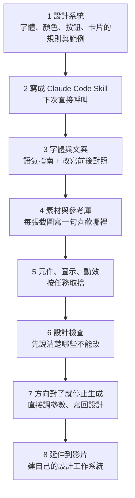

# 別再叫 Claude「做專業一點」:把設計規則寫成 Skill,25 個技巧串成工作流

> 整理自 YouTube 頻道 **YAHA學堂**〈[别再跟Claude说"做专业一点" | 15分钟把设计规则写成 Skill，25个技巧一次讲透](https://www.youtube.com/watch?v=63_Y_8Cw7_U)〉(2026-10-24,約 15 分鐘,英文自動字幕 `en-orig`)。
>
> ⚠️ **素材性質**:說明欄註明「本期素材整理自 Jay E | RoboNuggets《25 Tricks to Level Up Claude Design》」([原片](https://www.youtube.com/watch?v=_SVU3oC4JX8)),本片是**二次整理**。說明欄未見聯盟連結或業配。
>
> ✅ 已對照 Anthropic 官方說明〈Set up your design system in Claude Design〉,補上影片沒點名的 `/design-sync` 指令與方案限制,見第八節。

---

## 一句話總結

網頁換了配色還是一股 AI 味,問題通常不在模型,而在**你沒先給它設計規則**。你只說「做專業一點」,它就自己決定字體、顏色、版面,甚至猜首頁要寫什麼,結果看似完整、卻和你的產品無關。解法是:**先建設計系統(一本帶例子的說明書)、寫成可重複呼叫的 Skill,再按任務挑素材與元件,最後在方向對了之後停止生成、改成直接調參數。**

---

## 一、整體工作流



---

## 二、設計系統:給 Claude 一本帶例子的說明書

聽起來複雜,其實就是:標題用哪個字體、內文多大、哪些顏色用來強調、按鈕和卡片長什麼樣。

**例子:團隊排班工具**。首頁介紹產品、儀表板顯示行事曆、說明頁放操作指引。任務不同,但字體、按鈕、顏色規則要讓人看出是同一個產品。

**規則從哪來:**

| 情況 | 做法 |
|---|---|
| 有品牌素材 | Claude Design 可從品牌素材、截圖、簡報或程式碼萃取規則。⚠️ **一定要檢查**:參考資料裡偶然出現的樣式,不該變成整個產品的標準 |
| 沒有現成規範 | 參考 **Refero Styles** 這類風格庫(把網站的顏色、字體、間距、元件整理成 AI 易讀的文件) |
| 已有成熟元件程式碼 | 官方文件提供從 Claude Code 同步設計系統的方式(見第八節的 `/design-sync`),不必每次重新描述外觀 |

**不要只給產業名稱**:「教育」底下的兒童學習工具和教師管理後台,設計需求天差地別。更有效的做法是**說清楚使用者是誰、主要任務是什麼**,讓 Claude 給三個候選方向、附參考連結和選擇理由,再挑最適合任務的那個。

**最常見的錯誤**:丟一堆好看的截圖叫它「混合一下」,結果每張的裝飾元素都留下,完全失去統一感。⇒ **先定一個主方向,再少量借細節**(例如字體取 A、配色取 B,並明確告訴它各取哪一部分)。

**Claude Design(網頁)還是 Claude Code(本機)?** 看素材在哪:只有品牌素材和幾張參考圖,從網頁開始;要整合本機專案、改程式碼,Claude Code 更貼近工作流。⚠️ 不論哪個入口,**都要實際提供素材並確認存取範圍**,不能因為資料夾在你電腦上就假設它讀過了。

---

## 三、字體與文案:最容易被忽略的兩件事

### 字體

- 依產品個性挑好字體,再把**字體名稱或檔案**交給 AI,不要用 AI 隨機挑的。
- 找字體:**Fontshare**、**Fontesk**;比較標題與內文搭配:**Fontjoy**。用你**自己的實際標題和內文**去試,不要只看字體網站上的漂亮樣字。
- ⭐ 中文頁面:**把中文、英文、數字放在一起看**。英文標題好看,不代表中文內文也好看。
- ⚠️ **「免費下載」不等於「可免費商用」**,尤其 Fontesk 這種聚合網站,每個字體授權不同,要逐一看隨附說明。

### 文案

文案也會影響設計。排班工具首頁寫「賦能團隊,專注協作」,讀完還是不知道它解決什麼問題;如果產品真的支援,改成「**讓員工自己提出換班申請**」資訊就具體多了。

- **研究競品文案**:請 Claude 找 5 個相關產品,分析它們怎麼解釋、怎麼回應使用者疑慮、按鈕上寫什麼動作。要學的是表達方式;**不要抄別人的客戶數、效能承諾或功能**,那些不屬於你的產品。
- **語氣指南(tone-of-voice)**:列出認可的句子、要避免的常見說法、一組改寫前後對照。例如把「提升工作流程效率」改成「少花時間在不同試算表之間切換找人」。**給清楚的範例,比給「不要像 AI」這種模糊指令有效。**
- 技術內容可參考 Google 開發者文件風格指南、Apple 寫作指南、簡化技術英語(Simplified Technical English)規則,重點是清楚、一致、減少歧義。
- ⭐ **自我檢查**:把產品名遮住,這段頁面描述能不能原封不動放到任何競品網站?能的話,先補產品事實,再考慮裝飾。

---

## 四、素材與參考庫:別讓每個專案從空白開始

- 做過滿意的專案,新專案可重用它的設計系統與資源。Claude Design 可以把既有專案當參考;Claude Code 可以給它可存取的專案或工作紀錄。
- **不要只說「照上次那樣做」**,要指明重用的是字體、導覽列,還是某張圖,並確認它真的拿到了對應素材。
- **建自己的參考庫**:存截圖時**寫一句到底喜歡哪裡**(標題一眼就懂?複雜內容整理得好?)。這句話把一張好看的圖變成之後可用的判斷依據。
- 需要生成圖片或影片時,要分清**規劃圖片、呼叫服務生成、把圖放進頁面**是三個不同階段;接哪個服務、怎麼計費、能存取什麼,都要事先講清楚。

**反直覺的問題**:參考庫越多,頁面不一定越好。排班後台可能根本不需要華麗背景,員工只想快點看到明天的班表。⇒ 判斷一個素材值不值得加,問:**它幫使用者理解或完成什麼?** 答不出來就先別加。

---

## 五、元件、圖示、動效:按任務取捨

| 類型 | 資源 | 注意 |
|---|---|---|
| 介面元件 | **21st**(社群元件庫) | 整合後仍要檢查顏色字體是否符合規範、手機版是否正常、按鈕是否對應真實業務動作 |
| 動效元件 | **React Bits**(動態文字、背景、互動元件) | 適合比較單點效果,別把目錄裡所有效果塞進同一頁 |
| 視覺特效 | **Canvas UI**(液體、玻璃、粒子) | 部分效果用到實驗性瀏覽器能力,要在真實瀏覽器裡看,不能只看預覽 |
| 圖示 | **Iconify**、Flaticon | 同一專案統一風格(線條粗細、實心或線框);把選定的圖示與用法寫進設計系統 |
| 動態圖示 | **Lordicon**(可匯出 Lottie) | Lottie 是描述動畫的資料格式,需要對應的播放器或元件,**不是把 SVG 改副檔名就有** |
| 網頁動畫 | **GSAP** + ScrollTrigger | 先想清楚為什麼要動:流程說明可以依序出現,但使用者趕著送出的表單不需要每個欄位都動 |

**AI 生成圖示**:可以要求輸出 **SVG**,縮放不糊、顏色形狀好改。但「格式好編輯」不代表「圖設計得好」:圖示是否清楚傳達意思、小尺寸下線條是否還看得清,仍需要人審。

**處理順序**:結構不清 ⇒ 先找合適的介面元件;圖示不一致 ⇒ 先統一圖示風格;真的需要表達變化 ⇒ 再考慮動畫;最後才做設計檢查。

---

## 六、設計檢查:先說清楚哪些不能改

**Impeccable** 是一組輔助 AI 設計的 skill 與工具,可檢查並改善資訊層級、排版與無障礙(本庫已有 [[impeccable-frontend-design-skill-ai-slop]])。

⚠️ **一定要先告訴 AI 什麼必須保留**(品牌色、業務文案、既有功能),否則「全面優化」很容易把你已經滿意的設計也改掉。

| ❌ 模糊 | ✅ 具體 |
|---|---|
| 「幫我全面優化這頁」 | 「這頁最重要的數字不夠突出,請調整層級,但保留資料與互動方式不變」 |

**無障礙的白話版**:有人只用鍵盤、有人看不清低對比文字、有人對大幅動態敏感。你的設計能不能照顧這些用法?

**別只檢查內容完整的頁面**:空列表、表單送出失敗、使用者不知道下一步要做什麼,這些狀態介面都要處理。

做 Apple 平台的 app 可參考 **Apple 人機介面指南**。它是平台慣例的指南,不是在任何網站套一層「蘋果風」就算完成。

---

## 七、方向對了就別再生成

方向已經對、只是標題大了一點或間距寬了一點,就該**直接調參數**,而不是一直重新生成。

- Claude Design 支援微調。
- 也可以請 Claude Code 為當前頁面做一個**臨時的調整面板**。⚠️ 這是你自己請它做的工具,不是所有環境都有的官方功能。
- 調到滿意後,**把定稿數值寫回設計**,結束這一輪。

> 說明欄特別點出:很多人在「該停止生成、改調參數」這一步反覆浪費時間。

### 延伸到影片與自己的工作系統

- 已錄好講解的話,先用 **Whisper** 產出帶時間戳的逐字稿,再讓 Claude 判斷哪裡該加畫面(例如講三個步驟的關係時,動畫要剛好在那幾句出現),用 **HyperFrames** 做按時間組織的圖形片段。順序很關鍵:**先有講解內容與時間,再決定畫面怎麼對齊。** 自動辨識的字詞和時間戳仍要人工確認,動畫也要遵守既定的字體、顏色與圖形風格。
- 成果累積後,可以做個小 app 索引已完成的設計、圖片、影片、SVG 與參考,讓 Claude 在授權範圍內搜尋重用。一開始不必複雜:**存有用的東西、記下用途,之後再加搜尋和分類。**

**25 個技巧的共同點:讓你自己的判斷留在作品裡,下次還能再用。**

---

## 八、核實與補充

**✅ 對照 Claude 官方說明〈Set up your design system in Claude Design〉:**

- 設計系統可從**程式碼庫或元件庫、簡報或文件、原型與截圖、單一素材(logo、色票、字體規格)**萃取;一個來源就能開始。官方也說:**真實範例(例如做好的 landing page)比規格更能傳達品牌感**,與影片「帶例子的說明書」一致。
- ⭐ 影片說「官方文件提供從 Claude Code 同步設計系統的方式」但沒點名:**已有 React 元件的話,在 Claude Code 跑 `/design-sync`**,直接讀取 token 與元件。
- ⭐ 方案限制(影片沒講):設計系統在 Pro、Max、Team、Enterprise 為 **beta**;Pro/Max/Team 預設開啟,**Enterprise 要擁有者在組織設定 > Artifacts 開啟**。Team/Enterprise 由設計師或品牌負責人設定一次,全組織共用;要打開「Published」開關,新專案才會套用。
- 官方的驗證建議:建一個測試專案,試「產品 landing page」「儀表板」「團隊常做的一頁簡報」,看輸出是否符合品牌;不符就補不同素材再迭代。

**⚠️ 自動字幕誤聽與無法確認的名稱:**

- 字幕的「Cloud / CloudDesign / CloudCode」= Claude / Claude Design / Claude Code;「RefralStyles」= Refero Styles;「Impactable」= Impeccable;「Camui」= Canvas UI(依說明欄還原)。
- 「TBLEO」「CreatorstoBox」「Kii 提供的圖片與影片模型 API」三者**無法從字幕或說明欄確認是哪個網站或服務**,本筆記不推測。
- 「Claude Code 也提供官方設計入口,把想法變成可編輯畫布」:影片沒給指令或文件連結,本筆記未核實具體入口。

---

## 九、應用案例

### 案例 1:為排班 SaaS 寫一個設計規則 Skill

```markdown
---
name: shiftly-design
description: Shiftly 排班工具的設計規則。做任何 Shiftly 頁面、元件或簡報前先讀。
---

## 使用者與任務
- 主要使用者:門市店長(排班)、兼職員工(查班、換班)
- 員工最常做的事:30 秒內看到明天的班

## 必守規則
- 字體:標題 Satoshi(Fontshare,可商用),內文 Noto Sans TC;中英數字混排先截圖確認
- 主色 #2F6FEB 只用於主要動作按鈕;警示用 #D94841
- 按鈕文案寫動作:「申請換班」,不寫「提交」
- 圖示:Iconify 的 Lucide 線框組,線寬 2px,不混用實心圖示

## 語氣
- ✅「讓員工自己提出換班申請」
- ❌「賦能團隊,專注協作」
- 檢查:遮住產品名,這句話能不能放到競品網站?能就重寫

## 修改時不能動
- 行事曆的資料與互動方式
- 法遵要求的薪資計算說明文字

## 參考
- references/landing-v3.png:喜歡「標題一眼看懂在做什麼」
- references/dashboard-v2.png:喜歡「班表用色塊區分早晚班」
```

之後只要說「用 shiftly-design 做換班申請頁」,不必每次重講規則。

### 案例 2:把「做專業一點」改寫成可執行的需求

| ❌ 原本 | ✅ 改寫 |
|---|---|
| 「幫我做一個專業的排班工具首頁」 | 「使用者是連鎖咖啡店店長,首頁要在 5 秒內讓他知道:能自動排班、員工能自己換班、能匯出薪資工時。先給三個視覺方向,各附參考網站和理由,不要寫客戶數或效能數字。」 |
| 「讓它好看一點」 | 「方向就是第二版。標題從 48px 改 40px、卡片間距從 32 改 24,其他不動。」 |
| 「全面優化」 | 「跑一次設計檢查,只看資訊層級與對比度;品牌色、文案、行事曆互動都不要改。」 |

### 案例 3:決定要不要加一個素材

情境:參考庫裡有一個很漂亮的粒子背景(Canvas UI)。

1. **它幫使用者理解或完成什麼?** 排班後台的使用者要快速看班表 ⇒ 粒子背景不幫忙 ⇒ 不加。
2. 換成產品宣傳 landing page 的首屏 ⇒ 可以表達「自動化、流動」的品牌感 ⇒ 可考慮。
3. 決定加的話:在 Chrome、Safari、手機上實測(實驗性瀏覽器能力)、確認不影響載入速度、檢查對動態敏感使用者是否有減少動態的設定。

---

## 相關筆記

- [[claude-design-review]]:Claude Design 本身的評測,以及設計師的核心競爭力往哪移動。
- [[impeccable-frontend-design-skill-ai-slop]]:本片提到的設計檢查 skill。
- [[ai-website-building-claude-code]]:用 Claude Code 做網站的完整流程。

---

## 來源

- YouTube:YAHA學堂〈别再跟Claude说"做专业一点" | 15分钟把设计规则写成 Skill，25个技巧一次讲透〉 https://www.youtube.com/watch?v=63_Y_8Cw7_U (2026-10-24,英文自動字幕)
- 原始素材:Jay E | RoboNuggets〈25 Tricks to Level Up Claude Design〉 https://www.youtube.com/watch?v=_SVU3oC4JX8
- Claude 說明中心,〈Set up your design system in Claude Design〉: https://support.claude.com/en/articles/14604397-set-up-your-design-system-in-claude-design
- Claude Design: https://claude.com/product/design
- Refero Styles: https://styles.refero.design/
- Fontshare: https://www.fontshare.com/ ;Fontesk 授權說明: https://fontesk.com/license/ ;Fontjoy: https://fontjoy.com/
- 21st: https://21st.dev/ ;React Bits: https://reactbits.dev/ ;Canvas UI: https://canvasui.dev/
- Iconify: https://iconify.design/ ;Lordicon: https://lordicon.com/
- Impeccable: https://github.com/pbakaus/impeccable
- Apple 人機介面指南: https://developer.apple.com/design/human-interface-guidelines
- GSAP ScrollTrigger: https://gsap.com/docs/v3/Plugins/ScrollTrigger/
- HyperFrames: https://hyperframes.app/docs/1-startup/1-introduction
