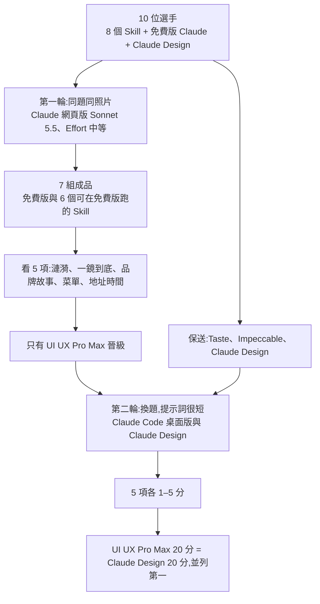
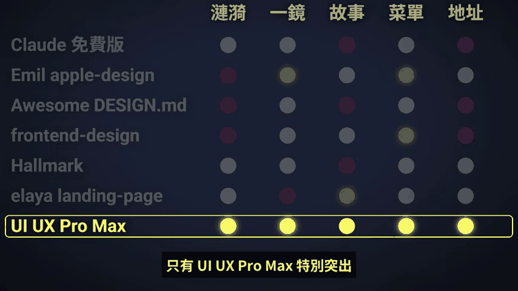
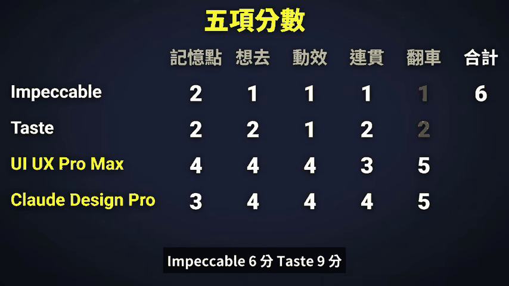

# Claude 做網頁該裝哪個 Skill?10 位選手兩輪實測:免費版不裝就夠用,要裝就裝 UI UX Pro Max

**主題分類:** 科技 / 應用 AI — AI 網頁設計 Skill 選型
**來源:** YouTube〈Claude 做網頁該裝哪個 Skill?實測 8 款:第一名「免費版」就能用!〉(P & H,2026-11-07,12 分 54 秒;[影片連結](https://www.youtube.com/watch?v=GfYDsJvDQoc))
**逐字稿:** 該片無可用字幕(字幕下載被 HTTP 429 擋下),**逐字稿以 faster-whisper `large-v3-turbo` 轉錄,非官方字幕**;專有名詞已對照說明欄與畫面校正(見 §8)。
**核實對象:** 說明欄列出的 7 個 GitHub repo、[UI UX Pro Max 的 `SKILL.md`](https://github.com/nextlevelbuilder/ui-ux-pro-max-skill/blob/main/.claude/skills/ui-ux-pro-max/SKILL.md)、Claude Code 官方 [Skills 文件](https://code.claude.com/docs/en/skills)
**整理日期:** 2026-11-08

> 📌 本庫已有 [[impeccable-frontend-design-skill-ai-slop]](Impeccable 深度解析)與 [[ai-website-building-claude-code]](Claude Code 零程式碼做網站)。本篇的價值是**把多個設計 Skill 放在同一題上橫向比**,以及「Skill 不是裝越多越好」的成本說明。
> ℹ️ 說明欄沒有業配或贊助揭露;頻道在片尾只說明這是「我們頻道的看法」。

---

## 1. 一句話結論

| 你的情況 | 影片建議 | 我的補充 |
|---|---|---|
| 用 Claude **免費版** | 直接用,**不裝任何 Skill**,品質不差 | 第一輪免費版是 7 組中「普通」的那一檔,不是最好;只是沒翻車 |
| 想**裝 Skill** | 裝 **UI UX Pro Max** | 兩輪都是唯一穩定拿高分的 Skill(第一輪獨自晉級、第二輪並列第一) |
| 用**付費版** | 直接用 **Claude Design**(影片稱 Pro 版) | 只在第二輪出賽,且是「保送」,沒有與其他 6 個 Skill 在第一輪同題比 |
| 任何情況 | **別裝一堆** | 見 §4:每個 Skill 的說明每輪對話都佔額度 |

⚠️ 這是**單一題目(一家虛構咖啡店)、兩位評審的主觀打分**,不是客觀 benchmark。見 §5。

## 2. 比賽怎麼進行

- **為什麼 Taste、Impeccable、Claude Design 保送(8:02,[連結](https://www.youtube.com/watch?v=GfYDsJvDQoc&t=472s)):** 第一輪的目的是看免費版能做到什麼;Taste 與 Impeccable 不適合在免費版跑,Claude Design 要付費。
- **第一輪題目(2:22,[連結](https://www.youtube.com/watch?v=GfYDsJvDQoc&t=132s)):** 台南老宅咖啡店「木日 Kibi」品牌網站;四個要求:第一屏 WebGL 液態咖啡 + 游標漣漪、往下捲一鏡到底(店外走到吧台)、內容(故事、招牌品項、地址時間、訂位按鈕)、附上的照片與 logo 都要用。
- **第二輪題目(8:02,[連結](https://www.youtube.com/watch?v=GfYDsJvDQoc&t=472s)):** 開店一週年活動網站,提示詞只講「全品項第二杯半價、11 月 20 日」,其餘文案與設計交給選手;每組一次做完、不追加修改。
- 完整提示詞在說明欄,可直接複製重跑(見 §6 案例)。

### 十位選手與出處(星數與授權為 2026-11-08 查詢 GitHub API)

| 選手 | 出處 | ⭐ | 授權 | 一句話(我讀 README 的結果) |
|---|---|---|---|---|
| UI UX Pro Max | [nextlevelbuilder/ui-ux-pro-max-skill](https://github.com/nextlevelbuilder/ui-ux-pro-max-skill) | 146,798 | MIT | 本機可搜尋的設計資料庫 + Python 搜尋腳本 |
| Taste | [Leonxlnx/taste-skill](https://github.com/Leonxlnx/taste-skill) | 111,912 | MIT | 美術指導、參考圖與瀏覽器檢查 |
| Impeccable | [pbakaus/impeccable](https://github.com/pbakaus/impeccable) | 105,975 | Apache-2.0 | 設計詞彙:`polish`、`bolder`、`critique`、`audit` 等 |
| Awesome DESIGN.md(片中用 Apple 那份) | [VoltAgent/awesome-design-md](https://github.com/VoltAgent/awesome-design-md) | 126,118 | MIT | **不是 Skill**,是 DESIGN.md 設計檔收藏;丟進專案根目錄讓 agent 照風格做 |
| Emil apple-design | [emilkowalski/skills](https://github.com/emilkowalski/skills) | 54,634 | MIT | Emil Kowalski(自述曾在 Vercel、Linear 工作)的動畫與設計工程 Skill 集 |
| Hallmark | [Nutlope/hallmark](https://github.com/Nutlope/hallmark) | 50,709 | MIT | 反「AI 味」設計 Skill;50 個主題、瀏覽器 lint;Together AI 出品 |
| elaya landing-page-design | [elayadesign/ai-design-skills](https://github.com/elayadesign/ai-design-skills) | 14,927 | MIT | 從訪談問題、頁面結構到文案與視覺系統的 landing page 流程 |
| frontend-design | [anthropics/skills](https://github.com/anthropics/skills/tree/main/skills/frontend-design) | (未查) | — | Anthropic 官方 Skill;Claude 設定頁可直接搜尋新增 |
| 免費版 Claude | — | — | — | 不裝 Skill 的基準 |
| Claude Design | claude.ai | — | — | 付費版功能 |

> 星數很高不代表在這個題目表現好:星數第三、第四的 Taste 與 Impeccable 在決賽排最後兩名(星數第二的 Awesome DESIGN.md 在第一輪被評為風格斷掉)。

## 3. 結果:兩輪各自怎麼分

### 3.1 第一輪(7 組,看 5 個面向)

*畫面來源:影片 6:40;黃燈 = 該項突出,紅燈 = 該項扣分,灰 = 普通,白 = 該項最好。*

影片的逐項文字評語(依逐字稿 4:25–6:32 整理):

| 選手 | 漣漪 | 一鏡到底 | 其他 |
|---|---|---|---|
| 免費版 | 還算自然 | 普通 | 故事平淡;地址時間最陽春 |
| Emil apple-design | 太大不自然,沒經過的地方也起波紋 | 不錯,每一鏡都有小細節展開 | 故事寫進一鏡到底、菜單橫向排列 |
| Awesome DESIGN.md | 更大 | 尚可 | 色調中途從咖啡色跳到灰白,風格斷掉 |
| frontend-design | 拖尾太長 | 普通,但左下角文字介紹是亮點 | 設計感「目前最好」;地址時間背景圖紙感不佳 |
| Hallmark | 拖尾也太長,但有牛奶般淡紋路 | 普通 | 故事只有兩句;按鈕用藍色與配色不合 |
| elaya landing-page-design | 尚可,也有淡紋路 | **七組最普通** | 故事內容最豐富,但節奏拖 |
| **UI UX Pro Max** | **七組最好**,最像液態咖啡 | **最好**,有走進店裡的感覺 | 菜單、地址時間設計感也是七組最好 |

### 3.2 第二輪(4 組,5 項各 1–5 分)

*畫面來源:影片 10:04;五項為「記憶點、想去、動效、連貫、翻車」。畫面上 UI UX Pro Max 只有 4+4+4+3+5 = 20,Claude Design Pro 是 3+4+4+4+5 = 20,我自己加總核對無誤。*

| 選手 | 耗時(8:56,[連結](https://www.youtube.com/watch?v=GfYDsJvDQoc&t=526s)) | 影片評語 | 總分 |
|---|---|---|---|
| Claude Design | 約 4 分鐘 | 第一幕展示區是四組最好;沒有炫技 | 20 |
| UI UX Pro Max | 約 6 分鐘 | 特效不誇張、看起來舒服;小瑕疵:「第二杯半價」的架子沒有完全顯示、頁面偏長 | 20 |
| Impeccable | 約 9 分鐘 | 門上貼紅紙條很怪;**用 Chrome 開有一段照片出不來,整個畫面只剩一行字、其他全黑**(在 Claude Desktop 裡正常) | 6 |
| Taste | 約 73 分鐘 | 「AI 感比較少」但設計感一般、沒有印象點;耗時是因為一直反覆跑自己的檢查 | 9 |

## 4. 「Skill 不是裝越多越好」:影片說法 vs. 官方文件

影片 12:14([連結](https://www.youtube.com/watch?v=GfYDsJvDQoc&t=724s))說:Claude Code 官方文件寫得很清楚,每個 Skill 就算沒用到,說明每輪對話都佔額度;裝太多,有些說明會被省略,AI 更難找到;Skill 是由 AI 自己判斷要不要用,所以裝了不代表會用到,要確定有用到,最好在提示詞點名或打斜線直接選。

我讀官方 Skills 文件的結果:

| 影片說法 | 官方文件 | 狀態 |
|---|---|---|
| 每個 Skill 的說明每輪都佔額度 | 「Every skill in the skill listing adds to your context on every turn, whether or not Claude ever uses it.」;預設 Skill 的 description 為「Always in context」 | ✅ 已核實 |
| 完整內容不會一直佔 | 「a skill's body loads only when it's used」 | ✅ 已核實(補充) |
| 說明太長會被省略 | `description` 與 `when_to_use` 合計在 Skill 清單中**截斷在 1,536 字元**,所以「重點放最前面」 | ✅ 已核實(**單一 Skill 的上限**) |
| 裝太多時整份清單的說明會被省略 | 文件有一節「Skill descriptions are cut short」,但**我抓取時該段被截斷,沒能讀到總預算數字** | ⚠️ 未能核實總預算 |
| AI 自己判斷要不要用 | 「Claude uses this to decide when to apply the skill」;description 決定何時套用 | ✅ 已核實 |
| 打斜線直接選 | 訊息**開頭**打 `/skill-name` 會直接執行;夾在句中只是提示,「Nothing runs directly」,要不要用由 Claude 從措辭判斷 | ✅ 已核實(補充:位置有差) |
| (影片沒提)不想讓模型自動套用 | frontmatter `disable-model-invocation: true`:description 不進 context,只在你 `/name` 時載入 | ✅ 已核實 |

**實務含意:** UI UX Pro Max 的 description 我實測為 **495 字元**(列出 80 種風格、192 組色盤、74 組字體配對、120 條 UX 指引、22 種技術棧等,見其 `SKILL.md` frontmatter),沒有超過 1,536 字元的單一上限,但每個 Skill 都是這種量級時,清單成本是**每一輪都付**的固定開銷:裝 10 個就是約 5,000 字元的常駐說明。

## 5. 批判性閱讀

1. **樣本只有一題。** 咖啡店品牌站強調 WebGL 與捲動敘事,偏好有「特效、敘事」的 Skill;後台、dashboard、表單密集的 UI 不一定同樣排名。
2. **評分是兩位評審的主觀感受。** 影片自己也說「好不好看是很直觀的感受,每個人都不一樣」。第一輪沒有數字分數,只有燈號。
3. **兩輪環境不同。** 第一輪用 Claude 網頁版,第二輪改用 Claude Code 桌面版與網頁版 Claude Design;Claude Design 只在第二輪出賽,影片也沒說明第二輪各組是否使用同一組照片與 logo(提示詞只寫「附上店的 logo 和相關照片」)。
4. **保送造成不對等。** Taste、Impeccable、Claude Design 沒跑第一輪;第二輪只有 4 組,「最後兩名」不能推論它們在第一輪會輸給免費版。
5. **Impeccable 的翻車可能是環境問題。** 影片說「在 Claude Desktop 裡看是正常,Chrome 才壞」,這是**輸出檔在瀏覽器裡的相容性**問題,不一定代表該 Skill 的設計能力差,但對只會用瀏覽器開檔的使用者確實是翻車。
6. **耗時差異很大**(4 / 6 / 9 / 73 分鐘):若你按用量付費,Taste 的 73 分鐘(因反覆自檢)是成本;若重視品質,自檢可能是優點,影片沒有量化兩者。
7. **虛構店家**,所以沒有真實轉換率或使用者測試。分數反映「評審覺得好看」,不是「能賣更多咖啡」。

## 6. 應用案例

**案例 A:自己跑一次比較。** 複製說明欄的第二輪提示詞,把店名換成自己的客戶,分別在「不裝 Skill」與「裝 UI UX Pro Max」兩個乾淨 session 跑,各看 5 項(記憶點、想去、動效、連貫、翻車)給 1–5 分。這個簡短提示詞特別能看出 Skill 的「預設審美」。

**案例 B:只裝一個,並確保它真的被用。** 依 §4:裝 UI UX Pro Max 後,提示詞寫「請使用 ui-ux-pro-max skill 為……設計網站」,或訊息開頭打 `/ui-ux-pro-max ……`。影片也說他們試錯時遇過「Skill 開好了、提示詞沒提到就沒用」。

**案例 C:手動安裝 repo 型 Skill(影片 1:36–2:19 的流程)。** 整包 zip 上傳 Claude 網頁版會被擋(錯誤原因:專案裡有很多檔案與連結);要**只壓縮那一個 Skill 資料夾**再上傳。依我讀 repo,UI UX Pro Max 的 Skill 資料夾位於 `.claude/skills/ui-ux-pro-max/`(內含 `SKILL.md`、`data/*.csv`、`scripts/search.py`)。

**案例 D:要審查而非新做。** 影片最後提醒:有些 Skill 擅長「審查網頁」不是「做網頁」。例如 Impeccable 有 `critique`、`audit`,Hallmark 有 `/hallmark audit <path>`,這類用途這支影片並沒有比。

## 7. UI UX Pro Max 實際是什麼(讀 `SKILL.md`)

- **定位:** 本機可搜尋的「設計知識庫」,不是一份長篇規範。`SKILL.md` 說規則依優先序 1→10:無障礙(CRITICAL)、觸控與互動(CRITICAL)、效能、風格選擇、版面響應式、字體與顏色、動畫、表單、導覽、圖表。
- **流程:** 新專案先用 `--design-system` 生成整套設計系統;針對單一問題用 `--domain`;已知技術棧用 `--stack`。查詢要「2–5 個詞、一個主要意圖」,結果要驗證領域與前幾筆是否符合產品,**查不到就說沒驗證到,不要把未驗證輸出寫進專案**。
- **依賴:** 需要 Python 3(無外部套件);如果找不到 `python`,試 `python3`、`py -3`。
- **範圍聲明:** 它自己說不處理純後端、API/資料庫、非視覺的效能工作、基礎設施;也不安裝套件、不改作業系統。
- **為什麼可能贏:** 它把「配色/字體/風格」變成**查表**(CSV 資料 + 推理規則),而不是靠模型即興;這個設計與影片觀察「色彩一致、特效不誇張」相符。**但這是我讀完 `SKILL.md` 後的推測,影片沒有拆解它為何勝出。**

## 8. 逐字稿校正與未核實項目

| Whisper 寫法 | 校正為 | 依據 |
|---|---|---|
| 末日 KB、木日 KB | **木日 Kibi** | 說明欄 |
| Cloud、Cloud Design、Cloud Code | **Claude**、Claude Design、Claude Code | 說明欄 |
| Sunnet 5.5 | **Sonnet 5.5** | 畫面與上下文 |
| Scale | **Skill** | 上下文 |
| 連衣、联姨、联谊 | **漣漪** | 第一輪題目與畫面欄位 |
| 猴入程度 | **投入程度**(Effort) | 上下文 |
| Impactable | **Impeccable** | 說明欄 |
| Harmark、Eliya | **Hallmark**、**elaya** | 說明欄 |

**未能核實:**
- 免費版 Claude 是否永久開放 Skills 功能、Claude Design 的價格與方案名稱(影片稱 Pro 版;**本篇未查官方定價**)。
- 官方文件「Skill descriptions are cut short」一節的總預算數字(抓取被截斷)。
- 7 個作品成品本身(只看了影片畫面,**沒有自己跑一次**);§3 所有「好不好看」都是影片評審的判斷。
- frontend-design 的最新星數與內容(只確認它在 anthropics/skills 的路徑為影片連結,未讀)。

## 來源

- [影片:Claude 做網頁該裝哪個 Skill?(P & H)](https://www.youtube.com/watch?v=GfYDsJvDQoc)(說明欄含完整提示詞與 7 個 repo 連結)
- [nextlevelbuilder/ui-ux-pro-max-skill](https://github.com/nextlevelbuilder/ui-ux-pro-max-skill) · [SKILL.md](https://github.com/nextlevelbuilder/ui-ux-pro-max-skill/blob/main/.claude/skills/ui-ux-pro-max/SKILL.md)
- [Leonxlnx/taste-skill](https://github.com/Leonxlnx/taste-skill) · [pbakaus/impeccable](https://github.com/pbakaus/impeccable) · [VoltAgent/awesome-design-md](https://github.com/VoltAgent/awesome-design-md) · [emilkowalski/skills](https://github.com/emilkowalski/skills) · [Nutlope/hallmark](https://github.com/Nutlope/hallmark) · [elayadesign/ai-design-skills](https://github.com/elayadesign/ai-design-skills) · [anthropics/skills — frontend-design](https://github.com/anthropics/skills/tree/main/skills/frontend-design)
- [Claude Code 官方文件:Skills](https://code.claude.com/docs/en/skills)
- 逐字稿:faster-whisper `large-v3-turbo` int8 轉錄,非官方字幕
