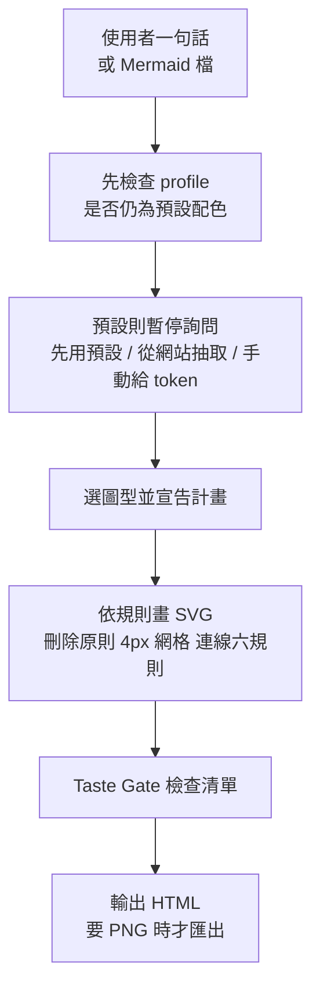

# diagram-design:Claude Code 畫圖 Skill 為什麼沒有「AI 味」——答案在規則,不在模型

**主題分類:** 應用 AI / 設計 —— Agent Skill 的規則設計
**來源影片:** YouTube〈GitHub 冲榜第一的 Claude Code 画图 Skill,翻开源码才知道它凭什么没有AI味〉(YAHA学堂,2026-09-03,約 8 分 20 秒)
**核實對象:** [cathrynlavery/diagram-design](https://github.com/cathrynlavery/diagram-design)(MIT,已 `git clone --depth 1` 讀 `SKILL.md`、`commands/`,最新 commit 2026-11-03)
**整理日期:** 2026-11-06

> **立場揭露:** 說明欄只有開源 repo、官方安裝指令與 Claude Code / Playwright 連結,**無聯盟連結、無業配聲明**。結尾請求「Hype」為 YouTube 曝光機制。
> **字幕品質:** 自動字幕(簡體),術語如「Scale / Skill」「珊琬色=珊瑚色」「指底=紙底(paper)」「Taste Gate」已校正。

---

## 0. 一句話總結

> **同一個模型,裝了這個 Skill 畫出來就不一樣;差別不在模型,而在 `SKILL.md` 裡寫死的「不可談判」規則與一份出圖前的檢查清單。**
> 影片最有價值的是第 5 分鐘那段:拿來檢視自己寫的 Skill 有沒有任何一條「不可談判」規則。

## 1. 它是什麼(以 repo 現況為準)

- 一個 Agent Skill,輸出是**單一自含的 HTML + inline SVG**(可再匯出 SVG / PNG)。README 自述「45 diagram types. No shadows. No Mermaid slop.」(影片錄製時的星數約 2.6 萬;**2026-11-07 以 `gh api repos/cathrynlavery/diagram-design` 查詢為 65,494**,影片的數字已過時)。
- 兩種安裝:`npx skills add cathrynlavery/diagram-design`(多宿主),或 Claude Code 內 `/plugin marketplace add cathrynlavery/diagram-design` → `/plugin install diagram-design@diagram-design`(含斜線指令)。
- 斜線指令在 `commands/`:`import-mermaid`、`import-drawio`、`import-excalidraw`、`export-diagram`、`profile`、`doctor`(影片所說「Diagram Design 開頭的命令」)。
- 影片示範的五種情境:讀專案程式碼畫架構圖、從網址抽品牌色、Mermaid 整批翻新、產品經理用的四象限圖、PNG 匯出進 PPT。

## 2. 影片的關鍵操作(實用層)

| 步驟 | 內容 | repo 對照 |
|---|---|---|
| 品牌化 | 給一個公開網址,抓首頁 CSS 變數,映射成 5 個角色(紙底、墨色、次要文字、強調、連結),做 WCAG 對比檢查 | `SKILL.md §0` 與 `references/onboarding.md`;語義 token 為 `paper / ink / muted / accent / link` |
| 存檔 | 配色寫在**外掛目錄內**,更新外掛可能被覆蓋 → 另存成 **profile**;專案根目錄放 `.diagram-design` 單行檔,自動切換 | `commands/profile.md`、`references/profiles.md`(第一步先解析 `.diagram-design` marker) |
| Mermaid 翻新 | 先跑**解析腳本**把 Mermaid 拆成表(節點數、邊數、入口、終點、最多連線節點),不渲染、不連網、不執行內容;再畫 | `commands/import-mermaid.md`(支援 `.mmd` 與 Markdown 內 fenced mermaid;預設 `--detail=balanced`) |
| 批次 | 直接說「整個目錄」,流程圖 / 時序圖 / 狀態機自動辨識 | 同上 |
| PNG 匯出 | 沒裝 Playwright 時**停下、不自動安裝** | `commands/export-diagram.md` 第 35 行:「PNG requested but Playwright not installed → surface the install instruction from the reference verbatim and stop. Do **not** auto-install.」;`references/export.md` 的 Detection 段給的提示文字本身**不含安裝指令**,只說明 Playwright 須由宿主環境準備。**已核實**(規格);影片畫面與規格的差異見下方延伸一節 |
| 倍率 | 1000x640 的 viewBox 輸出 2000x1280(2x) | 規格:`references/export.md` 預設 `device_scale_factor=2`,數學上 1000×2=2000、640×2=1280 **符合規格**;未實跑出 PNG |

## 3. 「規則」才是主角:影片點名的五條,逐一對原始碼

| 影片說法 | `SKILL.md` 原文 / 位置 | 結果 |
|---|---|---|
| 最高質量的動作通常是**刪除**;永遠一起出現的兩個節點就是一個節點;版面已看得出的關係把線刪掉 | 「The highest-quality move is usually deletion.」「Two nodes that always travel together are one node.」「If the relationship is obvious from layout, remove the line.」(§1) | 已核實 |
| 超過 9 個節點大概是兩張圖;目標密度 4 成 | 「Target density: 4/10…Above 9 nodes, it's probably two diagrams.」 | 已核實 |
| 任何元素不准有陰影 | 反模式表:「Shadow on any element — Shadows are out. Borders are in.」 | 已核實 |
| 圓角有上限 | 「`rounded-2xl` on boxes — Max radius 6–10px or none」 | 已核實 |
| 強調色一張圖最多 2 個元素 | 「accent 1–2 focal elements per diagram」「if you're tempted to accent 4 things, you haven't decided what's focal yet」 | 已核實 |
| 連線 6 條規則「不可談判」,斜線直接不合格 | §6「Non-negotiable」:orthogonal only(圓角直角彎 r=8,r=6 為緊湊下限)、標籤間隙、不重疊、扇出連接點、不穿過非端點方塊、標籤遮罩在節點之前。另於 **§4 反模式表**:「Any breach of the six §6 connector rules」對應「Automatic fail」 | 已核實 |
| 座標 / 字號 / 間距必須是 4 的倍數 | 「Structural geometry sits on a 4px grid」——但注意:**字型大小依角色階梯,不是 4px 網格**(影片說「字號」也是 4 的倍數,**不精確**) | 需修正 |
| Taste Gate「30 幾條」勾完才准交圖 | §9 Pre-Output Checklist,我數到 **38 個勾選項**(`- [ ]`) | 已核實(影片的「30 幾」成立) |

> **影片沒講、但值得知道的設計:** repo 還附了可執行的檢查腳本(`scripts/verify-geometry.py`、`verify-contrast.py`、`lint-render.py` 等,以及許多圖型專屬 `verify-*.py`),也就是把「不可談判」做成**可機器驗證**,而不只是寫在提示詞裡。這才是「規則」真正硬的地方。

## 4. 對寫自己 Skill 的啟示

1. **把審美寫成可判定的規則**:「別太花」無法執行;「強調色最多 2 個」「斜線直接 fail」可以。
2. **用刪除當第一原則**:給模型的不是「加什麼」,而是「還能刪什麼」。
3. **出圖前有檢查清單**(Taste Gate),並盡量配**腳本驗證**。
4. **邊界感**:缺依賴時只提示、不擅自安裝(Playwright 例)。
5. **品牌狀態要抽離到可存檔的 profile**,避免外掛更新蓋掉。

可對照:[[impeccable-frontend-design-skill-ai-slop]](前端設計 Skill 反 AI 味)、[[claude-design-25-tricks-design-rules-skill]](Claude Design 的規則型 Skill)、[[anatomy-skill-object-is-the-explanation]](Skill 本身就是說明)、[[building-claude-skills]](Skill 製作基礎)。

## 5. 應用案例

1. **舊專案的 README 圖更新**:資料夾有 20 張 Mermaid 流程圖,看起來全是預設紫色方塊。裝好 Skill 後說「把 docs/ 裡所有 Mermaid 重畫」,它先逐檔解析節點與邊,再依規則畫;超過 9 個節點的圖會被建議拆成兩張(總覽 + 細節)。
2. **替客戶出架構圖**:每個客戶存一個 profile(配色、字型),各專案根目錄放 `.diagram-design` 指向對應 profile,同一句話「畫出這個專案的架構圖」就自動套客戶品牌。
3. **PM 的優先級四象限**:提供七個功能與大概位置,加一句「焦點放最值得先做的」;依「強調色只用 1–2 處」的規則,整張只有一個珊瑚色象限,避免所有象限都在喊「重要」。
4. **簡報用圖**:`/export-diagram` 匯出透明背景 PNG(2x 像素),沒裝 Playwright 時它會停下來貼安裝指令,由你決定是否裝。

## 延伸閱讀與深度補充(2026-11-07 核實增補)

**① 影片畫面核實(時間點皆取自 `transcript_tools.py find` 輸出)**

- **[6:42] 缺 Playwright 時的實際行為。** 畫面中 Claude Code 執行 `python3 -c "import playwright"`,回傳 `ModuleNotFoundError: No module named 'playwright'`;接著查其他 Python 環境、確認都沒有後**不自動安裝**,先產出 SVG,再回報 PNG 受阻。這與 `references/export.md` 規格一致。
- **[6:47]「他把安裝命令貼給你」——與畫面不完全相符(需修正)。** 本次擷取的 [6:42] 畫面中只看到「不自動安裝、先出 SVG」,**未見 AI 貼出安裝命令**;規格的提示文字也不含命令。影片此處的描述不能當成規格行為。
- **[7:00] 作者手動安裝。** 作者的畫面是 `python3 -m pip install --break-system-packages playwright`,之後 `python3 -m playwright install chr…`(指令未完整錄到)。「兩行命令」大致屬實,但 `--break-system-packages` 會直接改系統 Python,與影片同段「不想動系統的話先建虛擬環境」的建議矛盾;照做時建議先用 venv。
- **[4:09] 起的批次示範。** 畫面的批次輸出寫「三份源圖都落在 balanced(≤12) 與 §7 預算內」——這和下一點的規格衝突。

**② 規格內部不一致(未能判定哪個為準)**

- `SKILL.md` §7 寫 **Max nodes 9**;但 `references/output-spec.md` 的 `balanced` 寫 **≤12 節點**,並說「`balanced` and `simplified` sit inside the standard complexity budget (SKILL.md §7)」。
- 影片說「九個節點在預算內」,畫面卻寫「balanced(≤12)」。讀者若以為 9 是硬上限,匯入時可能到 12 才察覺不符。這點我只能指出矛盾,作者意圖未查 issue,標「未能核實」。

**③ 畫面揭露、影片沒講的「規則會頂撞品牌」實例**

- 影片 [2:33] 命名為 FreeTapis 後,onboarding 報告(畫面可讀)列出三件事:① `JetBrains Mono 被破例`——§4 反模式表與 §9 Typography 都禁止 JetBrains Mono,但因為是品牌真實字體,AI 選擇例外並在 `style-guide.md` 寫 override 說明;② `link` 與 `accent` 同色,AI 把 link 映射成獨立色,理由是 API 箭頭與強調線之後要能區分;③ 沒有暗色主題,不是品牌素材,需要使用者決定。
- 含意:Taste Gate 在 onboarding 階段就會覆寫使用者的品牌素材,而且是**以 AI 判斷的例外**進行,不是純機械驗證。

**④ 機器驗證(本機實跑)**

- `python -I scripts/verify-geometry.py skills/diagram-design/assets/example-flowchart.html`:`1 file(s) checked, 0 finding(s).`
- `python -I skills/diagram-design/scripts/self_check.py skills/diagram-design/assets/example-flowchart.html`:`OK`
- 以上只證明**官方範例**通過檢查,不代表影片作者那張圖通過;連線六規則確實可機器驗證,但需要對每張圖各跑一次。

**⑤ 外部一手來源**

- Playwright Python 文件(https://playwright.dev/python/docs/intro):抓取結果列出 `pip install pytest-playwright` 與 `playwright install`;頁面未直接給出只裝 `playwright` 套件的指令,也未提及 `chromium` 參數。影片用的 `playwright install chromium` 形式**未能完全核實**。

## 核實狀態

- **已核實:** 安裝指令(README 的 `npx skills add` 與 `/plugin marketplace add` / `/plugin install`)、斜線指令清單(`commands/` 六檔)、刪除原則、密度與 9 節點規則、無陰影、圓角上限、強調色 1–2、連線六規則(§6 與 §4 反模式表)、不自動安裝 Playwright(`commands/export-diagram.md` 與 `references/export.md`)、Taste Gate 條數(§9 共 38 個 `- [ ]`)、2x 預設倍率、授權、星數(2026-11-07 為 65,494)、畫面上 6:42 的缺 Playwright 行為。
- **需修正:**
  - 「字號也必須是 4 的倍數」:`SKILL.md` §7 明確寫「Type sizes follow the role ramp … not the grid」。
  - 「貼出安裝指令」:規格未要求、畫面 [6:42] 也未見,影片此處描述與來源不符。
  - 「九個節點在預算內」:與 `output-spec.md` 的 `balanced ≤12` 互相矛盾(見延伸②)。
- **未能核實:** 影片中的耗時比較(Figma 30 分鐘 vs 1 分多鐘)、三項渲染修正(CSS 撐寬、位移多兩行、紙色底)為作者實測,我未重跑;`playwright install chromium` 的完整指令形式;「balanced ≤12」與「§7 九節點」哪個為作者真正意圖。

## 來源

- 〈GitHub 冲榜第一的 Claude Code 画图 Skill…〉YAHA学堂,2026-09-03:https://www.youtube.com/watch?v=rq4EHbqaaAk (自動字幕,簡體,非官方人工字幕)
- cathrynlavery/diagram-design(MIT):https://github.com/cathrynlavery/diagram-design(2026-11-07 shallow clone 讀取:`skills/diagram-design/SKILL.md`、`references/export.md`、`references/output-spec.md`、`commands/export-diagram.md`、`README.md`)
- Playwright Python 文件:https://playwright.dev/python/docs/intro
