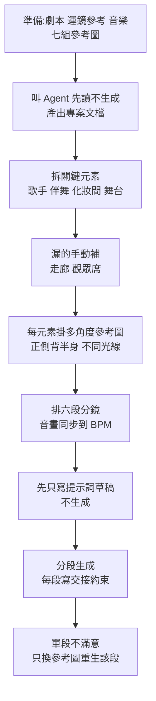

# YAHA 影音 AI 工具:Filmora 16、Topview、Flova(Seedance 2.5)的可複用方法論

**主題分類:** 應用 AI / 設計 —— AI 剪輯與 AI 影片生成工作流
**頻道:** YAHA学堂
**整理日期:** 2026-11-06

> ⚠️⚠️ **商業立場揭露(請先讀):**
> | 影片 | 揭露情形 |
> |---|---|
> | Filmora 16 兩支(2026-10-08、10-23) | 說明欄的 Filmora 官網連結是 **go.link 短連結**(典型的推廣追蹤連結形式),片尾「連結在下方和置頂留言,強烈推薦」;**頻道未明示是否業配或分潤**,視為**疑似推廣**。我未見價格或授權比較。 |
> | Topview(2026-09-17) | 說明欄 Topview 連結帶 **`?via=yahaclass`**,是**聯盟 / 推薦參數**;片中並鼓勵觀眾「現在安裝外掛可領多次免費生成額度」。 |
> | Flova + Seedance 2.5(2026-08-26) | 說明欄與片尾**明講「本視頻由 Flova 贊助」**,並附帶 `refCode` 推薦連結與「送 100 點數」的促銷;作者聲稱「工具自己從頭跑完才推薦,覺得沒用評論區可以噴我」。 |
>
> **本文不轉述額度、折扣、套餐促銷等推廣內容,也不背書任何產品**,只整理三者共通、可遷移的**工作流方法**,並標出可用公開資料核實的部分。
> **字幕品質:** 以上皆為自動字幕(簡繁混雜),產品名如「Philmora / Felmora=Filmora」「Toboville / top view=Topview」「Flower / 老五=Flova」已校正。

---

## 0. 一句話總結

> 三支的共通心法:**把「重複勞動」交給 AI,把「決定要拍什麼、節奏怎麼走」留給自己;生成前先寫計畫、先算帳、先鎖定一致性元素,出問題只改單一鏡頭,不重來整片。**

涵蓋影片:

- Filmora 16 AI 媒體分析:https://www.youtube.com/watch?v=51z1s4rrkdg
- Filmora 16 調色:https://www.youtube.com/watch?v=5gHSazZA2OU
- Topview 拆解三鏡頭電商廣告:https://www.youtube.com/watch?v=CV7HX6qFglc
- Flova + Seedance 2.5 角色一致性:https://www.youtube.com/watch?v=ahb8kfsZmIk

## 1. Filmora 16(剪輯軟體,疑似推廣)

只留功能機制,不評價優劣:

| 功能 | 操作要點(影片自述) | 取捨 |
|---|---|---|
| **AI 媒體分析** | 素材上右鍵 →「AI 媒體分析」,可單選或批次;單支分析**消耗 2 點積分**(影片所述);結果在「媒體資訊」頁籤:關鍵詞、主體、場景、影片描述、剪輯建議、素材評分;另可自加 TAG,在媒體庫搜尋 | 解決「5T 素材找不到」的索引問題;**要付積分、需上傳分析**,隱私與成本需自行評估(影片未說明資料處理方式,**未能核實**) |
| **攝影機追蹤** | 屬性面板「追蹤」→ 攝影機追蹤,範圍可選頭部 / 身體 / 自訂,自動裁切成人物特寫 | 影片提醒:**關掉「自動裁切」與「模糊背景」會出現黑邊與背景移動,建議保持開啟** |
| **運動跟蹤** | 在畫布上框出目標 → 開始跟蹤 → 另加矩形(只留邊框、長度拉到與片段一致)→ 把矩形設為「連接元素」才會跟著目標走 | 適合讓文字、貼紙、馬賽克、標註框跟隨目標 |
| **軌道遮罩** | 文字做遮罩層,影片勾選「軌道遮罩」並選該文字 | 文字入場動畫 + 遮罩 = 片頭字卡效果 |
| **自動調色** | 顏色面板勾選,近即時;可存成**預設**套用同機位其他片段 | 影片自述「大部分按預設處理,可控性有限」,適合初學 |
| **色彩遮罩** | 手繪 / 矩形 / 橢圓 / **AI 遮罩**(智慧筆刷、自圓、主體);只在遮罩範圍內調色 | 局部調色(例:天空調藍、植物調綠) |

**看不懂參數怎麼辦(最可遷移的一招):** 把畫面截圖、再把「基礎」與「HSL」面板截圖,一起丟給 ChatGPT,說明「只想調上半部分」,請它給各參數建議值,再回軟體手動輸入並看預覽微調。說明欄也強調「給一個調整起點,仍要手動看預覽」。

> 影片的**驗收三問**值得直接借用:膚色自然嗎?第一眼看得到主角嗎?亮部與暗部還看得清細節嗎?

## 2. Topview 外掛:先算帳、再生成(聯盟連結)

**核實:** Topview 公開外掛原始碼在 [topviewai/plugins](https://github.com/topviewai/plugins)(已 clone 閱讀 `skills/canvas-agent-workflows` 等 markdown)。可查證的部分:

- 影片稱原始碼規則是「**禁止 Agent 為了省事把你的需求做小**」。對照 `references/workflow-routing.md`:「Do not infer permission to omit story beats, collapse a full episode into a teaser, remove dialogue, or replace reusable assets with prompt-only descriptions… approval to 'make it' is not approval of an Agent-authored condensed prompt.」**已核實。**
- 影片稱「先把帳算給你看再問批不批,可選自動推進或逐步審批」。對照 `operate-topview-canvas/references/canvas-mcp-api.md`:第一次消耗 credit 的 `submit_topview_canvas_generation_task` 之前,必須讓使用者在 `confirm_each_submit`(逐步請求審批)與 `autonomous` 之間單選,且不得跳過。**已核實。**
- 影片的 **「Identity Lock」** 段落(寫死杯子顏色、插畫位置、蓋子形狀):講者確實說了此詞(使用者 2026-11-07 聽原片確認),但我在公開外掛 repo 內搜尋不到這個字樣:**講者原話,repo 未見**,應是 Agent 實際產出的計畫內容或內部命名。
- 該片的使用範圍:稱只能在 Work 模式使用、需先選 Topview 外掛才會走它——來自影片自述,未重現。

**可遷移的做法(與廠商無關):**

1. 複雜需求**先拆成施工圖**:每個場景幾秒、台詞、畫面文字、運鏡。
2. **鎖定身份**:產品顏色、圖案位置、外型幾何寫成明文,三個鏡頭才不跑偏。
3. **先審批再花錢**:第一次用選逐步審批,看清每一步的成本。
4. **局部修改**:哪個鏡頭不對只改那一個(影片例:第一鏡頭結尾文字壓在亮廚房背景上看不清 → 只改該鏡頭的字:白字、描邊、襯底,其他鏡頭不動)。

## 3. Flova + Seedance 2.5:30 秒一鏡到底的角色一致性(贊助)

作者實測流程(自述,未重現),重點在**流程設計**而非畫面好壞:

要點:

- **元素分類**:Agent 自己把元素分成「跨鏡頭必須一致」與「只出現一次但不能搞混」,作者說這是他自己沒想到的區分。
- **「先別生成」是省錢閘門**:作者說不加這句,Agent 會順手把參考圖也生成一遍(白花點數),且直接生成 30 秒會耗掉「900 多點數」(其點數單位為該平台計價,**未能核實**)。提示詞草稿是文字,**生成才計費**。
- **交接寫法三句**:`CONTINUITY`(接上一段結束狀態)、`DO NOT`(不要做什麼)、`KEEP UNCHANGED`(保持哪些元素)。
- **定點除錯範例**:第五段出現憑空麥克風架與扛攝影機的人。回頭查發現是**參考圖(探照燈那張)本身就含有麥架和攝影師**,模型照圖畫。解法是**提示詞一個字不動,只換參考圖**重生該段,其他五段不動。教訓:**畫面錯誤先查參考圖,再怪提示詞**。
- **說明欄補充的實戰規則(作者自述):** 每個角色至少四視角參考圖;**參考圖不能全來自同一段素材**(內容太像,相鄰兩鏡會生成得幾乎一樣);每段提示詞開頭寫清上一段最後一幀。
- **音畫對齊**:Agent 在排分鏡時就把音訊層(118 BPM、人聲在 6.5 秒進入,對齊第三段開頭)定好,而不是留到剪輯。音樂參考僅作風格參考,成片要用原創曲。
- 平台自述支援 Seedance 以及 MiniMax、可靈、Gemini 的 Omni 等多個模型、4 到 30 秒、最高 1080p——**來自影片與贊助方說法,未獨立核實**。
- **把整套流程存成 Skill**:當你反覆做同一類片子(系列短劇、系列廣告)或有固定鏡頭語言偏好才值得;只生成一張圖或一段影片不用折騰。

## 4. 三者對照與評析

| 面向 | Filmora 16 | Topview | Flova |
|---|---|---|---|
| 定位 | 傳統剪輯軟體加 AI 輔助 | 外掛(Codex / Claude Code / Cursor 等)驅動的 Canvas 生成 | Agent + Canvas 的生成式短片平台 |
| AI 角色 | 索引、追蹤、調色建議 | 拆需求、鎖身份、分鏡生成 | 拆元素、排分鏡、分段生成 |
| 成本機制 | 單次分析扣積分 | credits;首次付費生成前須選審批模式 | 點數;提示詞草稿免費、生成扣點 |
| 揭露狀態 | 疑似推廣 | 聯盟參數 | 明示贊助與推薦碼 |

**共同風險:** (1) 三者皆為作者單方面演示,沒有第三方基準或失敗率;(2) 一致性「零崩壞」是**單次成功案例**;(3) 計價隨時調整,選方案請以官方當下頁面為準。

## 5. 應用案例

1. **電商保溫杯 30 秒廣告(Topview 流程)**:三個場景(廚房、雪場、攝影棚)各 10 秒;先出施工圖與身份鎖定(杯色、插畫位置),選「逐步審批」看清成本;第一鏡文字太淡時只改該鏡頭。
2. **自媒體素材庫整理(Filmora 流程)**:幾年累積的素材先批次做 AI 媒體分析、加 TAG,之後用自然語言搜「賽車遊戲錄屏」找片段;時間軸素材用色卡標記類型。
3. **演唱會短片(Flova 流程)**:歌手 7 張多角度參考圖 + 6 段分鏡 + 音訊對齊;若某段多出不該有的人,先檢查該段參考圖。
4. **自己的小品:口播調色**:自動調色打底、存預設套給同機位片段,天空 / 植物用 AI 遮罩的「主體」分區調,參數不懂就截圖問 ChatGPT。

相關:[[blender-previz-mcp-ai-video]](另一條用 3D 預覽當參考影片的 AI 影片流程,同樣含廠商外掛立場揭露)。

## 核實狀態

- **已核實:** Topview 外掛的「不得縮小需求」與「付費審批模式」規則(原始碼 markdown);贊助與聯盟揭露(說明欄原文)。
- **未能核實:** Filmora 與 Flova 皆無公開原始碼可對;所有功能操作、點數數字、成效對比皆為影片自述。「Identity Lock」為講者原話(使用者確認),公開 repo 中找不到。

## 來源

- YAHA学堂〈別再手動整理5T素材!實測用Filmora 16 AI媒體分析直接搜畫面〉2026-10-08:https://www.youtube.com/watch?v=51z1s4rrkdg
- YAHA学堂〈Filmora 16 调色根本不用动脑?…〉2026-10-23:https://www.youtube.com/watch?v=5gHSazZA2OU
- YAHA学堂〈我让AI Agent做视频,它居然拒绝直接生成?实测Topview拆解3镜头电商广告〉2026-09-17(含聯盟連結):https://www.youtube.com/watch?v=CV7HX6qFglc- YAHA学堂〈AI视频角色一致性总是崩?Flova+Seedance 2.5…〉2026-08-26(贊助):https://www.youtube.com/watch?v=ahb8kfsZmIk
- topviewai/plugins:https://github.com/topviewai/plugins
- 以上皆非官方人工字幕:逐字稿為 YouTube 自動字幕,可能有同音字誤差。
