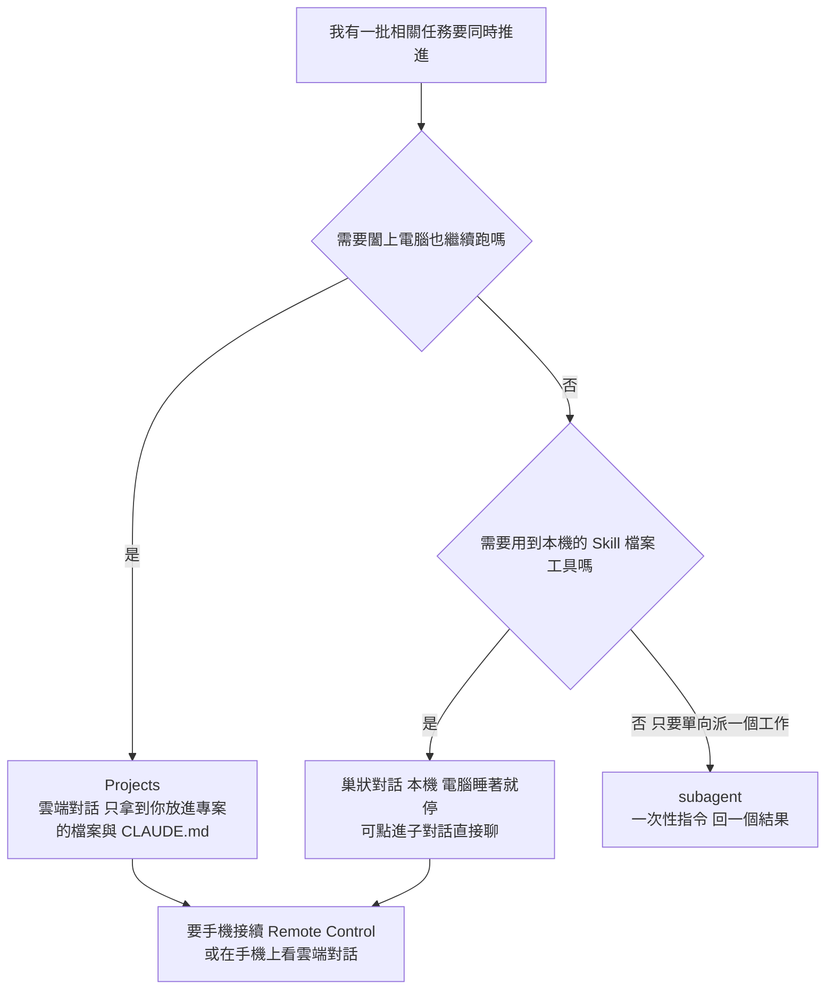

# 「Claude 2.0」是什麼:一個對話管所有對話——巢狀對話、Projects、側聊與三個省額度的指令(Andy Lin 林玉堂整理 RoboNuggets × Ben AI)

**主題分類:** 科技 / Claude Code 維運 — 桌面 App 改版與功能選型
**來源:** YouTube 頻道 **Andy Lin 林玉堂**〈Claude 2.0 是什麼?一個對話管全部對話|RoboNuggets × Ben AI〉(2026-11-03,約 9 分鐘)https://www.youtube.com/watch?v=oH0j8HYeMAM
**影片性質:** 這支是**二次整理**:作者看完兩位創作者的教學後做成中文摘要,原素材為 RoboNuggets〈Anthropic Just Shipped Claude 2.0 (Master it in 17 minutes)〉https://youtu.be/yMnFHFf43Qg 與 Ben AI https://youtu.be/J5EbL1UaqG8。畫面右上標註「影片來源:RoboNuggets」或「Ben AI」,中文為旁白加燒錄字幕。
**無官方字幕**:逐字稿以 CPU **faster-whisper large-v3-turbo(int8,附詞表提示)** 轉錄、非官方字幕。中文旁白與英文原聲交疊,VAD 切掉不少片段,所以逐字稿有缺口(例如側聊段落);下表的錯字與缺口都用**影片截圖**校正。揭露:未見業配或聯盟連結,片尾只有按讚訂閱;兩位原創作者是否另有付費社群,本篇未查。
**整理日期:** 2026-11-08

> ⚠️ **先講一個關鍵:「Claude 2.0」不是新模型,也不是官方名稱。** 影片開頭就說是有 Anthropic 工程師把這幾個月分批推出的 App 大改版叫「Claude 2.0」。本文沿用影片用語,內容全是 **Claude Code 桌面 App 的功能**,下面每一項都對照官方文件核實過。

---

## TL;DR

| 功能 | 一句話 | 官方文件核實 |
|---|---|---|
| **巢狀對話**(nested sessions) | 一個主對話開出子對話,子對話排在它底下、做完回報;每個子對話是側欄裡**真的可以點進去聊**的對話,不是一次性的 subagent | ⚠️ 官方文件**沒用「巢狀」這個詞**,但有同樣行為(Start 按鈕、側欄列在目前對話底下) |
| **Projects** | 一個主對話替你開並追蹤一群**雲端**對話,闔上電腦也繼續跑 | ✅ 公開測試版(Pro / Max / Ultra),**Team / Enterprise 還沒有**,逐步開放 |
| **手機遠端接著做** | 每個本機對話有 Remote Control 開關,手機或網頁接續 | ✅ 文件確認 |
| **Context 卡片** | 看這個對話的脈絡被什麼吃掉(訊息、記憶檔、Skill、MCP) | ✅ |
| **側聊** | 工作做到一半想問一句,不打斷主任務 | ✅ 快捷鍵 `Cmd+;` / `Ctrl+;` 或 `/btw` |
| **`/doctor`** | 掃設定檔與 Skill 找過時、衝突、浪費 token 的指令 | ✅ 內建 Skill;`prompt-audit` 子命令需 v2.1.283 以上 |
| **`/advisor`** | 平常用便宜模型,關鍵決定才請更強的模型 | ✅ 實驗性,配對規則見下 |
| **Mods** | 用說的就能改 Claude Code 介面,例如顯示額度與快取冷熱 | ✅ 已在 [[claude-code-mods-explained]] 核實 |

---

## 1. 巢狀對話 vs subagent vs Projects(影片 [0:36] 起、[1:58] 起)

影片畫面([0:38])燒錄字幕寫的是「**巢狀對話**」,Whisper 把它聽成「潮狀對話」。三者差在**能不能點進去聊、跑在哪裡**:

| | subagent | 巢狀對話 | Projects |
|---|---|---|---|
| 互動 | 「單向命令」:主對話給提示,你拿回一個結果;可以看進度但不能像聊天一樣插話 | 每個都是側欄裡**真正的對話**,點進去看全部、直接對話,做完回報主對話 | 主對話替你開許多雲端對話並追蹤 |
| 跑在哪 | 在目前對話裡 | **你的電腦**:電腦睡著就停,但能用本機所有 Skill、檔案與工具 | **雲端**:闔上電腦也繼續 |
| 本機設定 | — | 全部可用 | 雲端對話**不會**自動拿到你本機的 Claude Code 設定,要加進專案;官方文件寫只帶 repository 的 `CLAUDE.md`,不帶 repository 的 skills、`.claude/settings.json`、`.mcp.json`(影片說法「需要先加進去」方向一致) |
| 資料 | 本機 | 本機 | 上傳到雲端專案的檔案進入 Anthropic 管理的基礎設施(影片 [3:00] 前後特別提醒) |

影片的行銷活動範例:一個主對話開子對話寫銷售頁、另一個寫 email、另一個做廣告。

**官方文件怎麼說**(https://code.claude.com/docs/en/desktop.md):Claude 看到值得另外做的事會建議成任務,**Start** 按鈕「在另一個 session 啟動任務」,側欄把啟動的 session 列在目前 session 底下;Claude 也能列出、讀取、傳訊、改名、封存你 Code 分頁的其他 session,但**只看得到本機、SSH、WSL 的 session,看不到雲端 session 與終端機 CLI session**。這就是影片說的「一個對話找出其他對話正等你決定的事」的依據,也順帶說明:**主對話管不到 Projects 的雲端對話**(兩種管理路線不通)。

## 2. Projects(影片 [1:58] 起)

官方文件(https://code.claude.com/docs/en/claude-projects.md)補了影片沒講的限制:

- **公開測試版,Pro / Max / Ultra 方案,逐步開放;Team 與 Enterprise 還沒有。** 開放順序先從用過雲端 session、且沒有既有 claude.ai 專案的帳號開始。看不到的話到側欄 **More** 找,再沒有就是還沒輪到,可加入候補。✅(影片只說「測試版、部分功能可能看不到」)
- 一個專案是一場持續的對話,Claude 替每個任務開一個**執行緒**,通常是雲端 session;**需要你電腦才有的東西**時,可請 Claude 改在你的電腦上跑(透過 Remote Control),此時該執行緒只在電腦醒著時跑——這**修正了**影片把「雲端 vs 本機」切太乾淨的印象。
- 雲端執行緒可處理 GitHub repository、以及你上傳到專案的檔案、資料夾、Google Drive 資料夾;**用量走同一份方案額度,而且「用得更快」**。
- 專案不需要你管理 context window:執行緒自動 compact,對話靠近期訊息、近期執行緒與**專案記憶**運作。
- 不適合:每個任務都需要你電腦的工作(本機資料庫、裝置模擬器、VPN 後的 API),文件建議用本機 session 或 agent view。

## 3. 手機接續、Context 卡片(影片 [3:09]、[3:53])

- 桌面 App 每個本機對話有 **Remote Control** 開關(影片畫面右側面板可見),或輸入 `/remote-control`。連上後在 claude.ai/code 與 Claude 手機 App 看得到。Claude **一直在你的電腦上跑**,程式執行與檔案存取都留在本機。✅ 官方:https://code.claude.com/docs/en/remote-control.md
- ⚠️ Dispatch 是另一個功能(手機發任務到 Cowork,推播通知),**需 Pro / Max / Ultra,Team / Enterprise 沒有**。別和 Remote Control 混為一談。已在 [[claude-app-nine-hidden-settings-memory-skills-dispatch]] 另有說明。
- **Context 卡片**(影片 [3:53] 起,畫面 4:35 附近):RoboNuggets 示範的一個對話顯示 **28% 已用、281k / 1M**,分項為訊息 18.7%(187.2k)、記憶檔 4.2%(41.9k)、系統工具 1.7%、MCP 工具 1.1%、Skills 1.0%、系統提示 0.9%、自動 compact 緩衝 3.3%、剩餘 68.6%。重點:**第一個提示送出前,記憶檔、Skill、MCP 就已經佔掉額度**(影片標題「什麼吃掉你的額度」)。官方:卡片標頭顯示百分比,展開看分項;`/context` 在對話裡印出每類佔用。"一百萬 token 約四本哈利波特" 是講者比喻,不是官方說法。
- 提示快取:影片稱「過一小時快取變冷,下一則訊息要整段重讀」。官方文件:**Claude 訂閱方案且在方案額度內時,主對話用 1 小時 TTL;改用額度點數(usage credits)、API key 或雲端供應商時預設是 5 分鐘;subagent 與 compact 等「其他請求」預設 5 分鐘。** 所以「一小時」只在特定條件成立(https://code.claude.com/docs/en/prompt-caching.md)。查看方式:`/usage` 的 `Prompt cache (main)` 行(v2.1.251 以上)。

## 4. 側聊(影片 [4:42] 起)

官方(desktop.md):`Cmd+;`(macOS)/ `Ctrl+;`(Windows)或在輸入框打 `/btw`。側聊使用目前 session 的脈絡,**但不會把任何東西加回主對話**;可讀主對話到那個時點的全部內容。只適用本機、SSH、WSL session,**雲端 session 不支援**;桌面 App **不把側聊存到磁碟**,關掉 App 就回不去。影片畫面是從右上角「三個點」開啟,與快捷鍵為不同入口。

## 5. 三個省額度的東西(影片 [6:22]、[7:05]、[7:36])

### `/doctor`(影片 [6:24],Ben AI 最推薦)
- 官方:內建 **Skill**,「執行設定檢查,診斷安裝、設定、擴充與 `CLAUDE.md` 的問題,提出修正建議,**經你確認後才套用**」;別名 `/checkup`;`prompt-audit` 子命令(只審指令文件)需 Claude Code v2.1.283 以上。
- 畫面([5:00] 燒錄字幕與 Ben AI 截圖)的實測結果:**檢查 404 個檔案(CLAUDE.md、skills、commands、output styles、settings),找到 312 個問題:高 73、中 154、低 85**,每個發現附修正差異(before/after)。⚠️ 這是 **Ben AI 自己的一套設定**,不代表一般使用者;問題內容是「針對 5.5 模型已過時或互相衝突的指令」(例如「think step by step」「ALWAYS double check」這類新模型已內建的規則,每次載入還在耗 token)。
- ✅ 這與本庫 [[claude-md-cut-82-percent-and-maintain-it]] 的主張一致:舊 CLAUDE.md 指令對新模型是負擔。

### `/advisor`(影片 [7:04])
官方(https://code.claude.com/docs/en/advisor.md、API 文件 https://platform.claude.com/docs/en/agents-and-tools/tool-use/advisor-tool):
- **實驗性**,只在 Anthropic API(Bedrock、Vertex、Foundry 等不支援);伺服器端執行,**由 Claude 決定何時呼叫**,你決定誰當 advisor。advisor 讀完整對話與每個工具結果,回傳策略性建議。
- 開啟:`/advisor opus`(也可 `fable`、`sonnet`、完整模型 ID)、`advisorModel` 設定、`--advisor` 旗標;關閉 `/advisor off`。
- ✅ 影片的說法「平常 Sonnet,遇關鍵決定才請 Opus 甚至 Fable」成立:例如 Sonnet 5.5 主模型可配 Fable / Opus 5 以上 / Sonnet 5.5。**advisor 必須不低於主模型**;Fable 主模型只能配 Fable。
- 補充影片沒講的:**advisor 的 token 照 advisor 模型費率計**,訂閱方案算進額度(Fable advisor 在部分方案走額度點數);不是「不花額度」,而是**用在決策點、通常比整場跑強模型便宜**。啟停 advisor **不會讓主對話的提示快取失效**。短任務、每回合都要最強模型的工作價值較低。

### Mod:Ribbon(影片 [7:36])
講者自製的 mod,在輸入框上方顯示本週剩餘用量與「提示快取是熱或冷」。Mods 機制本身見 [[claude-code-mods-explained]](官方文件與範例原始碼已核實);**Ribbon 這個具體 mod 的程式碼影片沒公開**,功能只能就畫面描述,**未能核實其資料來源**。

## 6. 字幕還原(Whisper 錯字,以畫面校正)

| Whisper 寫成 | 正確 | 依據 |
|---|---|---|
| 潮狀 / 潮撞 / 直代理 對話 | **巢狀對話**、子代理 | 畫面燒錄字幕 [0:38]、「巢狀對話 vs 子代理」標題 |
| Cloud Code / Cloud 2.0 / Anthropix | **Claude Code / Claude 2.0 / Anthropic** | 英文原聲,與官方名稱對照 |
| Lan AI | **Ben AI** | 畫面標註 |
| Robo Nuggets | **RoboNuggets** | 畫面標註 |
| 置地模組 | **自製模組(mod)** | 前後文與官方 mods 文件 |
| 轉按 | **手機遠端控制**(推定) | 前後文 [2:04];該句在逐字稿有缺口 |

⚠️ 逐字稿缺口:約 3:15–3:36(手機遠端示範)、4:31–5:30(側聊、文件、簡報、設計)旁白被 VAD 切掉,這幾段以畫面與官方文件為準,不引用逐字稿原文。

## 應用案例

- **每週客戶報告(RoboNuggets 範例)**:一個主對話 + 每個客戶一個巢狀對話,逐一起草、最後「對照試算表檢查每個數字」。適合本機資料、需要你的 Skill 與連接器時;**只要不需要闔上電腦繼續,就用巢狀對話而非 Projects**。
- **多個 repository 套同一項改動**:官方 Projects 的典型用法,一個執行緒一個 repo、各自產出 PR,Overview 看哪個可以審。
- **月初跑一次 `/doctor`**:把 312 個問題這類結果當「清單」而非「必改」,逐項看是否真的過時;與模型升級同時做效果最大。
- **長任務用 `/advisor opus`**:大型重構或反覆出現的錯誤,讓 Sonnet 做例行工作、Opus 在計畫與完成前把關。

## 核實總表

| 項目 | 狀態 | 備註 |
|---|---|---|
| 「Claude 2.0」不是新模型也不是官方名稱 | ✅ 影片自述 | 為社群稱呼 |
| 巢狀對話行為(Start、列在底下) | ✅ 核實;⚠️ 官方無「巢狀」一詞 | desktop.md |
| 主對話只看得到本機/SSH/WSL session | ✅ | 影片沒講,Projects 的雲端對話不在其中 |
| Projects 雲端、測試版、方案範圍 | ✅ | Pro/Max/Ultra;Team/Enterprise 無 |
| Projects 執行緒可改在本機跑 | ✅ 補充 | 影片說法過於二分 |
| 側聊快捷鍵與不存檔 | ✅ | |
| Context 卡片各分項數字 | ✅ 畫面(RoboNuggets 一場實例) | 非通則 |
| 1M token ≈ 四本哈利波特 | ❓ 講者比喻 | |
| 「快取一小時後變冷」 | ⚠️ 需修正 | 僅訂閱且額度內的主對話為 1 小時;API key/額度點數預設 5 分鐘 |
| `/doctor`、`prompt-audit` | ✅ | v2.1.283 以上 |
| 404 檔 / 312 問題 | ✅ 畫面;❓ 非通則 | Ben AI 個人設定 |
| `/advisor` 配對與計費 | ✅ | 補充:advisor token 另計 |
| Ribbon mod 的實作 | ❓ 未能核實 | 程式碼未公開 |
| 手機 Dispatch 與 Remote Control 的方案差異 | ✅ | Dispatch 無 Team/Enterprise |

## 來源

- 影片:https://www.youtube.com/watch?v=oH0j8HYeMAM(逐字稿為 faster-whisper large-v3-turbo 轉錄、非官方字幕;錯字依畫面校正)
- 原素材:https://youtu.be/yMnFHFf43Qg 、https://youtu.be/J5EbL1UaqG8(本篇未逐支重看,只依 Andy Lin 的整理與其畫面)
- Claude Code 桌面 App 文件:https://code.claude.com/docs/en/desktop.md(讀到 10 萬字元,後段未讀)
- Projects:https://code.claude.com/docs/en/claude-projects.md
- Remote Control:https://code.claude.com/docs/en/remote-control.md(只讀開頭與摘要)
- Advisor:https://code.claude.com/docs/en/advisor.md 與 https://platform.claude.com/docs/en/agents-and-tools/tool-use/advisor-tool.md(後 1.7 萬字元未讀)
- 提示快取:https://code.claude.com/docs/en/prompt-caching.md
- 指令參考:https://code.claude.com/docs/en/commands.md
- 相關筆記:[[claude-code-mods-explained]]、[[claude-app-nine-hidden-settings-memory-skills-dispatch]]、[[claude-code-2026-feature-timeline]]
