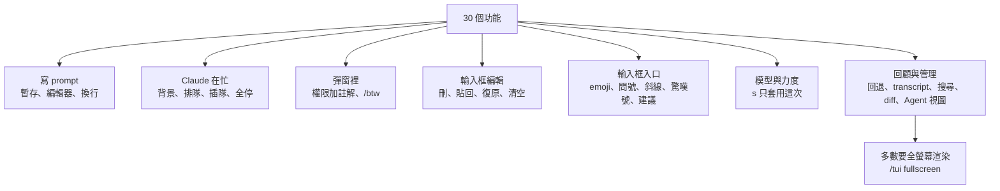

# Claude Code 30 個藏得最深的快捷鍵與功能:暫存、插隊、回退與 Agent 視圖

> 整理自 YouTube 頻道 **YAHA學堂**〈Claude Code 教程:30个隐藏最深功能,有些你一次都没用过〉(2026-10-17,約 16 分鐘)。作者錄影時用的是 Claude Code v2.1.296。
>
> **立場揭露:** 說明欄寫這支影片是作者「用 Opus 製作」的。作者在片尾說自己的 Claude 帳號被封,之後會轉向 Codex 等其他工具。說明欄沒有聯盟連結。
>
> **核對方式:** 本文每個按鍵都已逐一對照官方文件:[Interactive mode](https://code.claude.com/docs/en/interactive-mode)、[Keybindings](https://code.claude.com/docs/en/keybindings)、[Model config](https://code.claude.com/docs/en/model-config)、[Fullscreen](https://code.claude.com/docs/en/fullscreen)、[Agent view](https://code.claude.com/docs/en/agent-view),2026-10-18 查核。補正與平台差異以 📌 標出。
>
> **整理日期:** 2026-10-18

---

## TL;DR

1. **prompt 寫到一半被打斷:** `Ctrl+S` 暫存、`Ctrl+G` 用編輯器改長 prompt、`Ctrl+J` 換行不送出。
2. **Claude 在忙時不用乾等:**
   - `Ctrl+B` 把工作丟到背景。
   - 直接 `Enter` 會排隊;`Ctrl+X Enter` 在有自動完成候選時也能排隊。
   - `Ctrl+Enter` 或 `Ctrl+X Ctrl+S` 立刻插隊。
   - `Ctrl+X Ctrl+K` 一次停掉所有背景子 agent。
3. **輸入框是 readline 那一套:** `Ctrl+W` 刪到前一個空白、`Ctrl+Y` 貼回、`Ctrl+_` 復原、`Esc Esc` 清空(會存進歷史)。
4. **只對這次 session 生效:** `/model`、`/effort` 裡按小寫 `s`,不會改到預設值。
5. **很多功能要先開全螢幕渲染**(`/tui fullscreen`):transcript 裡的 `?` 說明、`{` `}` 跳 prompt、`Ctrl+R` 切搜尋範圍、diff 面板、`PgUp` 捲動。
6. **最實用的是 Agent 視圖:** 空輸入框按 `←`,所有 session 依狀態排好,可以分組、置頂、搜尋、改名。



---

## 1. prompt 寫到一半被打斷(1–3)

| # | 按鍵 | 作用 | 📌 對照官方文件 |
|---|---|---|---|
| 1 | `Ctrl+S` | **暫存**目前輸入、清空輸入框,右下角出現 stash 提示 | 官方寫法是「在空輸入框**再按一次** `Ctrl+S` 還原」,而且連游標位置、貼上的內容、輸入模式都一起還原,例如暫存的 `!` 指令會回到 shell 模式。影片示範的是送出問題後暫存內容**自動回填**,官方文件沒有寫這個行為,以實測為準 |
| 2 | `Ctrl+G` 或 `Ctrl+X Ctrl+E` | 用外部編輯器(讀 `$EDITOR`)開啟 prompt,存檔離開後內容填回輸入框 | ✅ `Ctrl+X Ctrl+E` 是 readline 原生按法。`/config` 開 **Show last response in external editor**,會把 Claude 上一則回覆以 `#` 註解放在 prompt 上方 |
| 3 | `Ctrl+J`,或行尾 `\` 加 `Enter` | 換行不送出 | ✅ 兩種都是「任何終端機免設定」。Shift+Enter 要看終端機設定 |

> 編輯器小提醒:Nano 用 `Ctrl+X`、`Y`、`Enter` 存檔離開;Vim 用 `Esc` 加 `:wq`。

---

## 2. Claude 在忙時不用乾等(4–9)

| # | 按鍵 | 作用 | 📌 對照官方文件 |
|---|---|---|---|
| 4 | `Ctrl+B` | 把正在跑的 Bash 指令或 agent 轉到背景,輸入框馬上空出來;跑完 Claude 會收到通知再告訴你 | ✅ **tmux 使用者要按兩次**,因為 `Ctrl+B` 是 tmux 前綴鍵。也可用 `Ctrl+X Ctrl+B` |
| 5 | 忙碌中直接 `Enter` | 訊息**排隊**,不打斷目前這輪 | ✅ 若 Claude 正在跑工具,排隊的訊息會在工具跑完後、**同一輪內**就交給 Claude |
| 6 | `Ctrl+X` 放開,再按 `Enter` | 有自動完成候選彈出時,`Enter` 會先選中候選;這個和弦**照樣把整句排進隊列** | ✅ 官方 action 是 `chat:queueSubmit`,需 v2.1.247 以上。和弦每一鍵要在**前一鍵 3 秒內**按下 |
| 7 | 排隊後按 `↑` | 把排隊中的訊息收回輸入框,改完再排 | ✅ 要從輸入框**第一行**按 |
| 8 | `Ctrl+Enter` 或 `Ctrl+X Ctrl+S` | **插隊**:立刻送出排隊的訊息。能轉背景的工作(測試、子 agent)會自動轉背景繼續跑,Claude 先回答你 | ✅ 需 v2.1.275 以上。不支援擴充按鍵的終端機會把 `Ctrl+Enter` 當成一般 `Enter`(變成排隊),所以 **`Ctrl+X Ctrl+S` 是哪裡都能用的保底按法** |
| 9 | `Ctrl+X Ctrl+K` | **緊急煞車**:停掉這個 session 所有背景子 agent。第一次按會問確定嗎,3 秒內再按一次執行 | 📌 官方補充:它同時會**關掉這個 session 剩下時間的 artifact 自動回覆** |

**`Ctrl+Z` 暫停整個 Claude Code(第 10 個):** 回到一般 shell,用完打 `fg` 回來,畫面原樣恢復。
- 📌 **只有 macOS 與 Linux(Unix)能用**,Windows 沒有。
- 習慣按 `Ctrl+Z` 復原的人要改用 `Ctrl+_`(見第 12 個)。

---

## 3. 彈窗裡藏的鍵(11 與 /btw)

**第 11 個:權限提示框上按 `Tab` 加註解**
- Claude 要動檔案前會問你同不同意。在 **Yes** 或 **No** 上按 `Tab`,會開一個註解欄,可以補一句修改意見。影片示範的是先照原計畫建檔,再依意見修改,省掉重新描述需求那一輪。
- 開著 **auto** 等自動模式時不會跳這個框,先用 `Shift+Tab` 切回手動(`default`)。
- 📌 Windows 上若 Node 或 Bun 沒開 VT 輸入模式,切換模式的鍵是 `Alt+M`。

**`/btw` 順便問一句:**
- 答案顯示在浮層,不寫進對話紀錄。它只根據已有的對話內容回答,**沒有工具**,不會讀檔或跑指令。Claude 正在工作時也能用,不會打斷主流程。
- 浮層裡的鍵:

| 鍵 | 作用 |
|---|---|
| `c` | 把答案以原始 Markdown 複製到剪貼簿,比滑鼠選取乾淨 |
| `f` | 把這組問答**分岔成背景子 agent**,帶著完整對話繼續做,而且可以用工具 |
| `Shift+←` / `Shift+→` | 在之前的 `/btw` 答案間切換 |
| `x` | 清掉之前的 `/btw` 列表 |

---

## 4. 輸入框編輯(12–19)

| # | 按鍵 | 作用 | 📌 對照官方文件 |
|---|---|---|---|
| 12 | `Ctrl+_`(實際按 `Ctrl+Shift+-`) | **復原**上一次輸入編輯,游標也回原位 | ✅ 兩種寫法都是官方預設 |
| 13 | `Ctrl+W` | 往回刪到**上一個空白**,所以 `src/utils/foo.ts` 一次刪光 | ✅ 只想刪一個字,macOS 用 `Option+Delete`、Windows 用 `Ctrl+Backspace`(標點會切字) |
| 14 | `Ctrl+Y` | 貼回剛才用 `Ctrl+W`、`Ctrl+U`、`Ctrl+K` 刪掉的文字 | ✅ 接著按 `Alt+Y` 可以輪替更早刪掉的內容。📌 **macOS 要先把終端機的 Option 設成 Meta** |
| 15 | `Ctrl+U` / `Ctrl+K` | 刪到行首 / 刪到行尾,刪掉的內容都會先存起來 | 📌 影片字幕這段聽不清,依官方是這兩個鍵。macOS 的 iTerm2 與 Terminal.app 把 `Cmd+Backspace` 對應到 `Ctrl+U` |
| 16 | `Esc` `Esc`(有字時) | 連按兩下清空輸入框,**草稿存進歷史**,用 `↑` 叫得回來 | ✅ 兩下要連著按 |
| 17 | `Ctrl+C`(沒在跑東西時) | 清空輸入框;在空輸入框按 `↑` 找回草稿 | ✅ 找回功能需 v2.1.288 以上。⚠️ **再按一次 `Ctrl+C` 會直接退出 Claude Code** |
| 18 | `:rocket:` | 打完整 shortcode 自動變成 🚀;打 `:` 加兩個字母會跳候選,`Tab` 插入 | ✅ 需 v2.1.217 以上。shortcode 必須在開頭或空白之後,所以網址裡的 `:` 不會觸發。整段貼上不會轉換。可用 `emojiCompletionEnabled: false` 關掉 |

> 📌 readline 這套按鍵自 **v2.1.261** 起是預設行為,舊的 `keybindingFlavor` 設定已失效。

---

## 5. 輸入框裡的入口(19–22)

| # | 操作 | 作用 | 📌 對照官方文件 |
|---|---|---|---|
| 19 | 空輸入框按 `?` | 列出快捷鍵清單 | ✅ 輸入框有字時,`?` 就只是打出問號 |
| 20 | 句子中間打 `空白` 加 `/` | 一樣會跳斜線指令補全,`Tab` 補上 | ✅ 官方:在單獨的句中 `/` 按 `Tab` 會列出所有指令。**只有放在開頭才會真的執行**,放中間只是文字,Claude 看得到你提了它 |
| 21 | 開頭打 `!` | **Shell 模式**:直接跑終端機指令,輸出進對話,Claude 會順手看結果 | ✅ shell 模式下按 `Tab` 會從**這個專案跑過的 `!` 指令**補全;路徑含 `/` 時會跳檔案補全。Windows 也用 `/`。空輸入框按 `Esc`、`Backspace` 或 `Ctrl+U` 離開 |
| 22 | 灰字建議按 `Tab` 或 `→` | Claude 回完後猜你下一步要說什麼,接受後再 `Enter` 送出;直接打字就消失 | 📌 官方補充:每個建議都是**用同一模型發的背景請求,會計入用量**。快到用量上限時會自動不出,也可能預設關閉 |

---

## 6. 模型與思考力度(23–25)

| # | 操作 | 作用 | 📌 對照官方文件 |
|---|---|---|---|
| 23 | `Option+P`(macOS)/ `Alt+P`(Windows、Linux) | prompt 寫到一半直接跳模型選擇器,輸入框的字不會被清掉 | 📌 **macOS 要把終端機的 Option 設成 Meta 才有效**(官方 terminal-config 有各終端機設定方式) |
| 24 | 選擇器裡 `←` `→` 調思考力度;`Enter` 或 **`s`** | `Enter` 會**存成以後所有新 session 的預設**;小寫 `s` **只套用這次 session** | ✅ `/model <名稱>` 直接打等同 `Enter`。`s` 需 v2.1.257 以上 |
| 25 | `/effort` 不帶參數 | 跳出力度滑桿,`s` 只套用這次;**`Tab` 切換 Ultracode** | ✅ Ultracode 是設定而非力度檔位,切換時力度不變。滑桿的 Tab 開關需 v2.1.284 以上。影片說開了之後每個任務會自動安排多個 agent 一起做、用量多很多,與官方「讓 Claude 自己決定要不要開工作流」的說法一致 |

---

## 7. 翻舊帳、找東西、管 session(26–30)

| # | 操作 | 作用 | 📌 對照官方文件 |
|---|---|---|---|
| 26 | 空輸入框 `Esc` `Esc` | 打開**回退選單**:列出你送過的每則訊息,選一則就把對話與程式碼還原到那之前 | ✅ 官方叫 rewind,還能選「摘要」 |
| 27 | `Ctrl+O` | transcript 詳細紀錄:每個工具呼叫、指令、每則回覆用的模型與時間 | 📌 在裡面按 `?` 看說明、`{` `}` 跳到上一個或下一個 prompt、`v` 用編輯器開整段對話、`[` 把整段寫進終端機原生捲動區,**這些都要全螢幕渲染**。`/` 搜尋也在這裡 |
| 28 | `Ctrl+R` | 搜尋以前送過的 prompt,`Enter` 填回輸入框可再修改 | 📌 **`Ctrl+S` 切換範圍(這個 session、這個專案、所有專案)只在全螢幕渲染有效**;一般渲染器的行內搜尋固定搜所有專案 |
| 29 | `PgUp` / `PgDn`,MacBook 用 `Fn+↑` / `Fn+↓` | 一次捲半屏。捲上去後新輸出不會把你拉回底部,底部出現 `Jump to bottom` | 📌 外接鍵盤 `Ctrl+Home` / `Ctrl+End` 跳到開頭或最新。⚠️ **Mac 鍵盤的 `Ctrl+End` 傳不到 Claude Code**,官方建議點按鈕、滾到底或自行改綁 `scroll:bottom` |
| 29b | `/diff` 加 `Ctrl+X B` | 旁邊打開改動面板,列出改了哪些檔、加減幾行;`Ctrl+X B` 切換比較基準:這個 session、所有未提交改動、整條分支 | 📌 面板需要**全螢幕渲染、git repo、終端機至少 110 欄、v2.1.287 以上**;會記住每個 repo 選的基準 |
| 30 | 空輸入框按 `←` | 進入 **Agent 視圖**:所有 session 依狀態排好,哪個在等你、哪個在跑、哪個跑完一眼可見;原本的 session 轉背景繼續跑 | ✅ 視圖裡:`Ctrl+S` 切換依狀態或依目錄分組、`Ctrl+T` 置頂、`Ctrl+F` 依名稱找、`Ctrl+R` 改名(後兩者需 v2.1.288)。📌 置頂也會讓該 session 閒置時**繼續保持執行**;在視圖裡按 `Ctrl+X` 是停止 session,兩秒內再按會刪除,要小心 |

> 📌 **全螢幕渲染怎麼開:** 執行 `/tui fullscreen`,會在保留對話的情況下重啟;`/tui default` 切回。2026-05-06 之後才開始用 Claude Code 的人多半預設已是全螢幕。它還在 research preview 階段。

---

## 8. 應用案例

### 案例一:長任務跑測試時順便問問題

你叫 Claude 跑一組 30 秒的整合測試,同時想問「這個 API 的 timeout 預設多少」:

1. 正在寫的長需求先按 `Ctrl+S` 暫存。
2. 打問題後按 `Ctrl+Enter`;終端機不支援就按 `Ctrl+X Ctrl+S`。測試自動轉背景,Claude 先回答你。
3. 回答完,在空輸入框再按 `Ctrl+S` 把剛才的長需求叫回來。

如果只是想確認對話裡講過的東西,例如「剛剛那個設定檔叫什麼」,改用 `/btw`,不佔主對話的 context。

### 案例二:Claude 改壞了,要倒回去

Claude 連改三個檔後測試全紅:

1. 在空輸入框按 `Esc` `Esc` 打開回退選單,選「請它重構 auth」那則訊息之前,對話與程式碼一起還原。
2. 如果開了一堆背景子 agent 而方向錯了,先按兩次 `Ctrl+X Ctrl+K` 全部停掉,再回退。

### 案例三:同時開五個 session 做不同 repo

1. 每個 session 開工後,空輸入框按 `←` 進 Agent 視圖。
2. `Ctrl+S` 改成依目錄分組;用 `Ctrl+R` 把 session 改名成「前端-登入頁」「後端-計費」這類好記的名字。
3. 最常回來看的那個用 `Ctrl+T` 置頂。
4. 「Needs input」那一組有東西時才切過去處理,其他讓它們在背景跑。

### 案例四:Windows 使用者的對照

照著 Mac 影片學時,要換成這樣:

| 影片(macOS) | Windows |
|---|---|
| `Option+P` | `Alt+P` |
| `Ctrl+Z` 加 `fg` | 沒有這個功能,另開一個終端機分頁 |
| `Option+Delete` 刪一個字 | `Ctrl+Backspace` |
| `Shift+Tab` 切模式 | 一樣;若沒反應,改用 `Alt+M` |

其餘 `Ctrl` 開頭的鍵、`Ctrl+X` 和弦兩邊都一樣。安裝相關的坑見 [[claude-code-windows-native-install-troubleshooting]]。

### 案例五:把常用鍵改成自己的習慣

執行 `/keybindings` 開啟 `~/.claude/keybindings.json`,存檔後免重啟生效。例如不想讓 `Ctrl+S` 被暫存佔走:

```json
{
  "bindings": [
    { "context": "Chat", "bindings": { "ctrl+s": null, "ctrl+e": "chat:externalEditor" } }
  ]
}
```

`Ctrl+C`、`Ctrl+D` 等是保留鍵,不能改。

---

## 延伸閱讀(本庫)

- [[claude-code-mods-explained]]:Claude Code 的 mod 機制;diff 面板就是內建 mod `cc-plugin-diff` 畫的。
- [[claude-code-2026-feature-timeline]]:2026 年各功能上線時間軸。
- [[claude-code-windows-native-install-troubleshooting]]:Windows 原生安裝的坑(同為 YAHA學堂)。

---

## 來源

- YouTube:[Claude Code 教程:30个隐藏最深功能,有些你一次都没用过](https://www.youtube.com/watch?v=Lx22N9R_0As)(YAHA學堂,2026-10-17)
  - 該片只有自動字幕;自動字幕連續 3 次 HTTP 429,改以 CPU 版 Whisper(faster-whisper)轉錄,非官方字幕,可能有少量聽寫誤差。按鍵名稱一律以官方文件為準。
- 官方文件(2026-10-18 查核):
  - [Interactive mode](https://code.claude.com/docs/en/interactive-mode)
  - [Customize keyboard shortcuts](https://code.claude.com/docs/en/keybindings)
  - [Model configuration](https://code.claude.com/docs/en/model-config)
  - [Fullscreen rendering](https://code.claude.com/docs/en/fullscreen)
  - [Agent view](https://code.claude.com/docs/en/agent-view)
  - [Setup](https://code.claude.com/docs/en/setup)
- Claude Code 官方 repo:<https://github.com/anthropics/claude-code>
