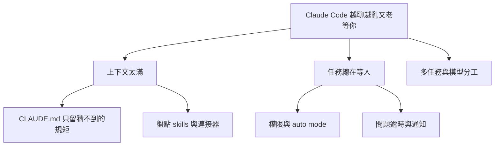

# Claude Code 進階配置清單:先減上下文負擔,再減「停下來等你」(逐項對照官方文件)

> 整理自 YouTube 頻道 **YAHA学堂**〈[14 分鐘掌握Claude Code最新的14個進階配置](https://www.youtube.com/watch?v=qZOtyc6gWWI)〉(2026-10-21,約 14.6 分鐘,自動字幕;字幕「Cloud」=Claude、「紫代理」=子代理、「全線」=權限、「鉤紫」=hooks、「另排」=token、「SONIT」=Sonnet)。
> ⭐⭐ 已對照官方 [Settings 參考](https://code.claude.com/docs/en/settings-reference.md)、[Model 設定](https://code.claude.com/docs/en/model-config.md)、[Prompt caching](https://code.claude.com/docs/en/prompt-caching.md)。影片刻意不報精確版本與指令名,故多項只能核實到「設定鍵存在」;**官方頁面只讀到前段,未讀到的標「未核實」**。
> 與本庫既有〈[[claude-md-cut-82-percent-and-maintain-it]]〉〈[[claude-md-from-zero-to-mastery]]〉〈[[claude-code-hooks-complete-guide]]〉互補,此處不重講 CLAUDE.md 寫法。

---

## 一句話總結

> **先檢查它每天「帶著什麼開工」(減上下文負擔),再處理「為什麼老停下來等你」(減中斷),最後才談多任務與模型分工。** 影片的收尾行動:停用一個用不上的 skill、補一條它最容易忽略的驗收要求。

## 一、減上下文負擔

| # | 配置 | 影片重點 | 核實 |
|---|---|---|---|
| 1 | **CLAUDE.md 只寫「光看程式碼猜不到」的規矩** | 例:改功能要補測試、某舊介面不可換、發布前誰檢查。目錄結構/依賴名稱它自己找得到,不必每輪重讀。判斷一條留不留:「刪掉它會做錯什麼?」答不出具體後果就刪 | 觀念;本庫既有筆記已詳述 |
| 2 | **互動式初始化** | 先問要產生哪些檔、需要哪些 skills 與 hooks,再了解專案。skill=遇特定任務才拿出的做事方法;hook=事件發生自動執行的固定動作(例如寫完檔自動格式檢查) | 開關為環境變數,影片未報名稱;**未核實** |
| 3 | **匯入其他編程助手的設定** | 可選說明檔、工具連線、skills 遷移;規則是否適合新專案仍要自己檢查 | 未核實 |
| 4 | **設定審計**:找過時或互相衝突的指令 | 模型升級後值得查一次;**只清失效指導,業務約束與驗收標準要留** | 未核實(官方頁未讀到) |
| 5 | **Skills 盤點** | 技能面板顯示上下文成本與使用情況,可依 token 占用排序。一般對話**先載入名稱與描述,呼叫時才讀全文**,所以裝很多不代表全文都在,但那串介紹仍有成本。建議先停用「低頻且高占用」者,別把半年用一次的發布檢查刪掉 | 機制與本庫〈agent-skill-three-layer-run-do-verify〉相符;介面細節未核實 |
| 6 | **關閉 claude.ai 連接器的自動接入** | 你在 Claude 應用接過的知識庫/訊息工具可能被 Claude Code 帶入。只關這條渠道,**單獨設定的 MCP 不受影響** | ✅ `disableClaudeAiConnectors: true`;單次可用環境變數 `ENABLE_CLAUDEAI_MCP_SERVERS=false`;**任一範圍設為 true 即生效**,專案層的 false 蓋不掉使用者層 true;`--mcp-config` 的伺服器不受影響;個別封鎖用 `deniedMcpServers` |
| 7 | **關閉 Artifact 發布工具** | 它把工作結果發布成私有網頁;只做本機程式碼就不需要。關掉後仍可寫一般網頁程式碼 | ✅ `enableArtifact: false`,任何檔案可關、**沒有任何檔案能再打開**;舊鍵 `disableArtifact` 已棄用 |

關完後要檢查兩件事:**實際占用有沒有變**、**常用任務有沒有少了必要工具**。

## 二、減中斷:別讓它停在那等你

先分清它在等**權限**還是等你**回答問題**,處理法不同。

| # | 配置 | 影片重點 | 核實 |
|---|---|---|---|
| 8 | **auto mode 設定** | 由額外分類器評估工具操作風險;可參考專案與近期對話起草「環境資訊」讓你審後儲存(例:某位址是公司內部倉庫還是外部網站) | ✅ `autoMode`(僅使用者/受管範圍)有 `environment`、`allow`、`soft_deny`、`hard_deny` 陣列;陣列中寫 `"$defaults"` 可保留內建規則;多檔案會串接;`autoMode.classifyAllShell`(≥ v2.1.193)為 true 時所有 shell 指令都過分類器 |
| 9 | **減少權限提示功能** | 掃過去常用的唯讀指令與工具呼叫,整理成專案允許規則;但「讀」也可能碰敏感內容,規則範圍要看清楚;發布、刪除、改共享系統的動作仍保留確認 | ✅ 本環境確有名為 `fewer-permission-prompts` 的內建 skill,描述為「掃描逐字稿中常見唯讀 Bash/MCP 呼叫並把優先排序的允許清單加進專案 `.claude/settings.json`」 |
| 10 | **問題逾時自動繼續** | 一般選擇題逾時後關閉並提交已選項,Claude 知道你可能離開,自行判斷能否繼續。選項:1 分鐘、5 分鐘、10 分鐘、一直等 | ✅ `askUserQuestionTimeout`:`"60s"`/`"5m"`/`"10m"`/`"never"`(預設 `never`),範圍為使用者或受管;`/config` 有「Question auto-continue timeout」 |
| 11 | **等待通知** | 任務完成或權限請求等待時提醒你;響鈴/桌面通知還取決於終端機與通知設定 | 官方 `inputNeededNotifEnabled`(預設 false)是 **Remote Control 連線時推到手機**,與影片描述的桌面通知不完全是同一件事;未核實是否為影片所指 |

⚠️ **最容易想錯**:權限彈窗與計畫批准**不會**因為你沒回答就自動通過;背景會話、遠端控制連線、螢幕閱讀器模式不啟動這個計時;終端機視窗保持焦點時計時暫停。真缺關鍵資訊時仍得回來答。(影片說法,官方 `askUserQuestionTimeout` 條目只讀到基本定義,排除條件指向工具參考頁,**未核實**。)

## 三、計畫與多任務

| # | 配置 | 影片重點 | 核實 |
|---|---|---|---|
| 12 | **接受計畫時「清空上下文再執行」** | 登入方案討論過程中被放棄的路線不再汙染。前提是計畫本身完整(介面限制、驗收條件、哪些檔不能動);檢查法:給一個沒參與討論的人只讀這份計畫,能不能接著做 | 觀念 |
| 13 | **計畫檔位置** | 預設在使用者設定目錄,可改到專案內資料夾方便協作;是否 commit 仍由團隊決定 | ✅ `plansDirectory`(相對專案根目錄,預設 `~/.claude/plans`;指向專案根之外或 macOS/Linux 路徑含反斜線會回退預設) |
| 14 | **Branch / Fork / Subtask 的差別** | Branch=替當前對話開分支,你自己走進去;Fork=把當前對話複製成**獨立背景會話**,你留在主會話;Subtask=啟動繼承完整對話的子代理,完成後把結果帶回當前會話。普通子代理有自己的上下文,不能默認知道主對話的細節。**對話分開不代表檔案隔離**,先確認工作目錄與分工,避免兩邊改同一處 | 部分 ✅:官方說 fork 子代理繼承父層系統提示、工具與完整歷史,所以首個請求可讀父層快取;`/fork` 複製會話。指令名稱與分支功能細節影片未報,**未核實** |
| 15 | **會話之間傳訊** | 一個研究介面、一個做前端,前端可問負責介面的會話欄位;訊息通常等對方工具呼叫之間才被讀;各會話原有權限邊界仍有效,不能靠另一個會話繞過被拒絕的動作 | 官方設定頁有 `crossSessionInbound`(`accept`<`hold`<`refuse`)等鍵;影片所指功能細節未核實 |

## 四、輸出呈現

| # | 配置 | 影片重點 | 核實 |
|---|---|---|---|
| 16 | **五種輸出風格** | 預設、主動(對常規決定少猶豫)、簡潔(快速知道結果)、解釋(理解為什麼這麼改)、學習(自己也動手寫一小部分)。主動不擴大工具權限;簡潔不代表任務少做幾步 | ✅ `outputStyle` 存在,可用名稱如 `Explanatory`;切換後從下一則訊息生效(≥ v2.1.251),且不破壞快取。本庫另有〈[[output-style-communication-not-intelligence]]〉 |
| 17 | **顯示思考摘要** | 只是給你的摘要,不是完整內部推理紀錄 | ✅ `showThinkingSummaries`(預設 false);true 時 `Ctrl+O` 展開思考可看摘要 |
| 18 | **專注模式** | 把視圖壓縮成:你最後的提示、一行工具呼叫摘要加編輯 diffstat、最終回答。只改顯示,不減少工作量 | ✅ `viewMode: "focus"`(需要全螢幕渲染器);設定後覆蓋 `/focus` 選擇與 `verbose` |

## 五、開發 AI 應用者:評估與爬山式優化

只看應用能開、按鈕能點,判斷不了模型回答好不好:知識庫問答流暢卻引用錯條款,要靠**評估**抓。建評估功能可準備測試題,之後用同一套題比較;爬山式優化是圍繞既有評分反覆嘗試、以分數留存方案。重點是**評分標準要對**:只獎勵「答得長」,答案會越改越長但不更準;應把正確性、引用依據、不知道時怎麼處理寫成可檢查的要求。涉及模型呼叫會耗 API 費用且多輪累積,啟動前先弄清楚題量與預算;沒接模型的一般應用仍需傳統軟體測試。(功能名稱與入口影片未報,**未核實**。)

## 六、模型分工

- **Opus Plan**:計畫模式用 Opus、執行階段轉 Sonnet(✅ 官方 `opusplan` 別名;要兩階段都用 1M 上下文用 `opusplan[1m]`,≥ v2.1.265)。影片稱「平衡能力與用量,節省多少看任務」。
- ⚠️ **影片漏講的快取代價**(✅ 官方 Prompt caching 文件):`opusplan` 下**每次切換計畫模式都等於一次模型切換,各模型有各自快取,因此會重新建立快取**——長對話反覆進出計畫模式可能比預期貴。這與本庫〈[[token-saving-three-moves-context-control]]〉的快取結論一致。
- **子代理預設模型**:可設,但單一子代理定義或啟動時指定的模型可能優先;`CLAUDE_CODE_SUBAGENT_MODEL` 環境變數確實存在(✅ 官方 Model 設定頁列為子代理模型控制之一),優先序詳情在 sub-agents 頁,**未讀到**。繼承完整對話的 fork 子代理可能跟隨主會話模型,所以要看運行中的代理實際用了哪個模型。
- 簡單查找與複雜判斷是否該用同一模型,也值得分開考慮。

## 七、輸入框小功能(未核實,影片說法)

`Ctrl+S` 暫存目前提示、再按恢復;刪除快捷鍵剪掉的文字用 `Ctrl+Y` 取回;`Ctrl+_` 復原上一次輸入編輯。**這些只管輸入框文字,不是撤銷程式碼修改**。內建 Power-Up 提供帶動畫的互動小課。可參考本庫〈[[claude-code-30-hidden-shortcuts]]〉比對。

---

## 應用案例

1. **後端專案瘦身**:專案只寫 API,卻長期掛著一批只在剪輯影片用的 skill。先用技能面板按 token 排序,停用低頻高占用者(保留檔案,需要再恢復);再在 `~/.claude/settings.json` 設 `"disableClaudeAiConnectors": true`,最後比對 `/context`(或啟動後占用)有無下降。
2. **下班前交付長任務**:設 `"askUserQuestionTimeout": "10m"`,選擇題逾時會以預設選項繼續;但權限彈窗仍等人。所以先用「減少權限提示」把唯讀查詢規則化,把中斷留給「發布、刪除」這類有後果的決定。
3. **計畫交接檢查**:計畫寫好後,問自己「沒參加討論的同事只讀這份,能接著做嗎?」能,才選「清空上下文再執行」;不能就補上限制與驗收條件。
4. **成本控管**:想用 `opusplan` 省額度,但你常在計畫與執行間來回切——先以 `/usage` 看快取命中,若每次切換都出現重建,改成「計畫一次、批准後專心執行」。

## 核實狀態摘要

- ✅ 已核實:6(`disableClaudeAiConnectors`)、7(`enableArtifact`)、8(`autoMode`)、10(`askUserQuestionTimeout`)、13(`plansDirectory`)、16–18(輸出風格/思考摘要/focus)、`opusplan` 與其快取副作用、`CLAUDE_CODE_SUBAGENT_MODEL` 存在、fork 繼承父層歷史。
- ⚠️ 未核實:2–5(初始化流程、匯入、審計、skills 面板細節)、11 與官方鍵的對應、14–15 的指令與細節、第五節評估功能、第七節快捷鍵。無法確認的名稱未追加 TRANSCRIPT-PENDING(皆為功能名稱缺口而非字幕聽寫疑點)。

## 來源

- [14 分鐘掌握Claude Code最新的14個進階配置 — YAHA学堂](https://www.youtube.com/watch?v=qZOtyc6gWWI)(2026-10-21;使用自動字幕,可能有同音字誤差)
- [Settings reference — Claude Code 官方文件](https://code.claude.com/docs/en/settings-reference.md)、[Model configuration](https://code.claude.com/docs/en/model-config.md)、[How Claude Code uses prompt caching](https://code.claude.com/docs/en/prompt-caching.md)
- 本庫延伸:[[claude-md-cut-82-percent-and-maintain-it]]、[[claude-code-hooks-complete-guide]]、[[claude-code-30-hidden-shortcuts]]、[[output-style-communication-not-intelligence]]、[[token-saving-three-moves-context-control]]
