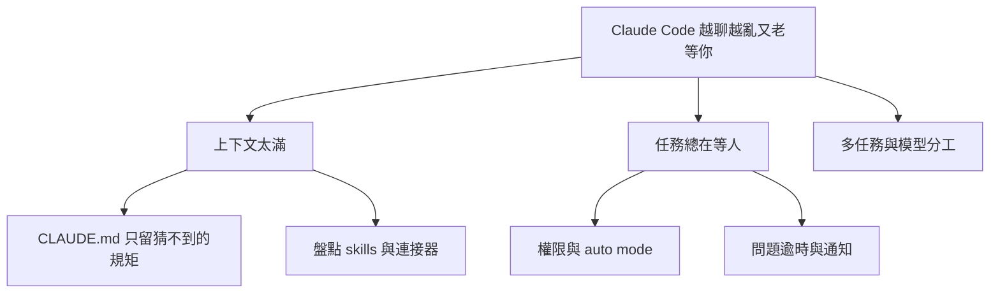

# Claude Code 進階配置清單:先減上下文負擔,再減「停下來等你」(逐項對照官方文件)

> 整理自 YouTube 頻道 **YAHA学堂**〈[14 分鐘掌握Claude Code最新的14個進階配置](https://www.youtube.com/watch?v=qZOtyc6gWWI)〉(2026-10-21,約 14.6 分鐘,自動字幕;字幕「Cloud」=Claude、「紫代理」=子代理、「全線」=權限、「鉤紫」=hooks、「另排」=token、「SONIT」=Sonnet)。
> ⭐⭐ 已對照官方 [Settings 參考](https://code.claude.com/docs/en/settings-reference.md)、[Model 設定](https://code.claude.com/docs/en/model-config.md)、[Prompt caching](https://code.claude.com/docs/en/prompt-caching.md)。影片刻意不報精確版本與指令名,故多項只能核實到「設定鍵存在」;**官方頁面只讀到前段,未讀到的標「未核實」**。
> 與本庫既有〈[[claude-md-cut-82-percent-and-maintain-it]]〉〈[[claude-md-from-zero-to-mastery]]〉〈[[claude-code-hooks-complete-guide]]〉互補,此處不重講 CLAUDE.md 寫法。

---

## 一句話總結

> **先檢查它每天「帶著什麼開工」(減上下文負擔),再處理「為什麼老停下來等你」(減中斷),最後才談多任務與模型分工。** 影片的收尾行動:停用一個用不上的 skill、補一條它最容易忽略的驗收要求。

## 一、減上下文負擔

| # | 配置 | 影片重點 | 核實 |
|---|---|---|---|
| 1 | **CLAUDE.md 只寫「光看程式碼猜不到」的規矩** | 例:改功能要補測試、某舊介面不可換、發布前誰檢查。目錄結構/依賴名稱它自己找得到,不必每輪重讀。判斷一條留不留:「刪掉它會做錯什麼?」答不出具體後果就刪 | 觀念;本庫既有筆記已詳述 |
| 2 | **互動式初始化** | 先問要產生哪些檔、需要哪些 skills 與 hooks,再了解專案。skill=遇特定任務才拿出的做事方法;hook=事件發生自動執行的固定動作(例如寫完檔自動格式檢查) | 開關為環境變數,影片未報名稱;**未核實** |
| 3 | **匯入其他編程助手的設定** | 可選說明檔、工具連線、skills 遷移;規則是否適合新專案仍要自己檢查 | 未核實 |
| 4 | **設定審計**:找過時或互相衝突的指令 | 模型升級後值得查一次;**只清失效指導,業務約束與驗收標準要留** | 未核實(官方頁未讀到) |
| 5 | **Skills 盤點** | 技能面板顯示上下文成本與使用情況,可依 token 占用排序。一般對話**先載入名稱與描述,呼叫時才讀全文**,所以裝很多不代表全文都在,但那串介紹仍有成本。建議先停用「低頻且高占用」者,別把半年用一次的發布檢查刪掉 | 機制與本庫〈agent-skill-three-layer-run-do-verify〉相符;介面細節未核實 |
| 6 | **關閉 claude.ai 連接器的自動接入** | 你在 Claude 應用接過的知識庫/訊息工具可能被 Claude Code 帶入。只關這條渠道,**單獨設定的 MCP 不受影響** | ✅ `disableClaudeAiConnectors` 鍵存在(官方索引:「Turn off claude.ai connectors so Claude Code doesn't fetch them」);[4:11] 附近畫面可見 `~/.claude/settings.json` 寫入 `"disableClaudeAiConnectors": true`。⚠️ 單次環境變數 `ENABLE_CLAUDEAI_MCP_SERVERS=false`、「任一範圍設為 true 即生效、專案層 false 蓋不掉」、`--mcp-config` 不受影響,**官方頁未核實**(僅第三方文章與 issue 提及);`deniedMcpServers` 存在(官方:「Block specific MCP servers by URL, command, or name」) |
| 7 | **關閉 Artifact 發布工具** | 它把工作結果發布成私有網頁;只做本機程式碼就不需要。關掉後仍可寫一般網頁程式碼 | ✅ `enableArtifact: false`,任何檔案可關、**沒有任何檔案能再打開**;舊鍵 `disableArtifact` 已棄用 |

關完後要檢查兩件事:**實際占用有沒有變**、**常用任務有沒有少了必要工具**。

## 二、減中斷:別讓它停在那等你

先分清它在等**權限**還是等你**回答問題**,處理法不同。

| # | 配置 | 影片重點 | 核實 |
|---|---|---|---|
| 8 | **auto mode 設定** | 由額外分類器評估工具操作風險;可參考專案與近期對話起草「環境資訊」讓你審後儲存(例:某位址是公司內部倉庫還是外部網站) | ✅ `autoMode`(官方:User or managed 範圍,「Add your own allow and deny rules to the auto mode classifier」)與 `autoMode.classifyAllShell` 存在(官方:「Send every shell command through the auto mode classifier, even ones a narrow allow rule matches」)。⚠️ `environment`/`allow`/`soft_deny`/`hard_deny` 子結構、`"$defaults"` 保留內建規則、多檔串接、`classifyAllShell` 版本 ≥ v2.1.193:**僅第三方與 GitHub issue 來源,官方條目未讀到** |
| 9 | **減少權限提示功能** | 掃過去常用的唯讀指令與工具呼叫,整理成專案允許規則;但「讀」也可能碰敏感內容,規則範圍要看清楚;發布、刪除、改共享系統的動作仍保留確認 | ✅ 本環境確有名為 `fewer-permission-prompts` 的內建 skill,描述為「掃描逐字稿中常見唯讀 Bash/MCP 呼叫並把優先排序的允許清單加進專案 `.claude/settings.json`」 |
| 10 | **問題逾時自動繼續** | 一般選擇題逾時後關閉並提交已選項,Claude 知道你可能離開,自行判斷能否繼續。選項:1 分鐘、5 分鐘、10 分鐘、一直等 | ✅ 鍵存在、範圍為使用者或受管(官方索引:「Let an unanswered question auto-continue after idle time」)。⚠️ 可用值 `"60s"`/`"5m"`/`"10m"`/`"never"`、預設 `never`、需 v2.1.200+、`/config` 項目名稱,**僅第三方文章(classmethod.jp、timonweb.com)提及,官方詳細條目未讀到** |
| 11 | **等待通知** | 任務完成或權限請求等待時提醒你;響鈴/桌面通知還取決於終端機與通知設定 | ✅ 官方 `inputNeededNotifEnabled` 存在,描述為「Get a push notification when Claude is waiting on you」。索引中**未見**「僅 Remote Control 連線時」的限定語,預設值也未讀到;與影片所述桌面通知是否同一機制,**未核實** |

⚠️ **最容易想錯**:權限彈窗與計畫批准**不會**因為你沒回答就自動通過;背景會話、遠端控制連線、螢幕閱讀器模式不啟動這個計時;終端機視窗保持焦點時計時暫停。真缺關鍵資訊時仍得回來答。(影片說法,官方 `askUserQuestionTimeout` 索引只讀到基本定義,排除條件**未核實**。)

## 三、計畫與多任務

| # | 配置 | 影片重點 | 核實 |
|---|---|---|---|
| 12 | **接受計畫時「清空上下文再執行」** | 登入方案討論過程中被放棄的路線不再汙染。前提是計畫本身完整(介面限制、驗收條件、哪些檔不能動);檢查法:給一個沒參與討論的人只讀這份計畫,能不能接著做 | 觀念 |
| 13 | **計畫檔位置** | 預設在使用者設定目錄,可改到專案內資料夾方便協作;是否 commit 仍由團隊決定 | ✅ `plansDirectory` 存在(官方:「Choose where plan mode writes plan files」)。相對專案根、預設 `~/.claude/plans`、越界回退等細節官方索引未見,**未核實** |
| 14 | **Branch / Fork / Subtask 的差別** | Branch=替當前對話開分支,你自己走進去;Fork=把當前對話複製成**獨立背景會話**,你留在主會話;Subtask=啟動繼承完整對話的子代理,完成後把結果帶回當前會話。普通子代理有自己的上下文,不能默認知道主對話的細節。**對話分開不代表檔案隔離**,先確認工作目錄與分工,避免兩邊改同一處 | ✅ 官方 prompt-caching 頁:fork「inherits the parent's system prompt, tools, and conversation history exactly, so its first request reads the parent's cache」;`/fork` 可複製會話。「Branch」指令與分支功能細節影片未報,**未核實** |
| 15 | **會話之間傳訊** | 一個研究介面、一個做前端,前端可問負責介面的會話欄位;訊息通常等對方工具呼叫之間才被讀;各會話原有權限邊界仍有效,不能靠另一個會話繞過被拒絕的動作 | ✅ 官方設定頁有 `crossSessionInbound`,三種行為為「傳送」、「只顯示通知不傳送」、「拒絕」;影片所指的訊息讀取時機與指令細節**未核實** |

## 四、輸出呈現

| # | 配置 | 影片重點 | 核實 |
|---|---|---|---|
| 16 | **五種輸出風格** | 預設、主動(對常規決定少猶豫)、簡潔(快速知道結果)、解釋(理解為什麼這麼改)、學習(自己也動手寫一小部分)。主動不擴大工具權限;簡潔不代表任務少做幾步 | ✅ `outputStyle` 存在,可用名稱如 `Explanatory`;切換後從下一則訊息生效(≥ v2.1.251),且不破壞快取。本庫另有〈[[output-style-communication-not-intelligence]]〉 |
| 17 | **顯示思考摘要** | 只是給你的摘要,不是完整內部推理紀錄 | ✅ `showThinkingSummaries`(預設 false);true 時 `Ctrl+O` 展開思考可看摘要 |
| 18 | **專注模式** | 把視圖壓縮成:你最後的提示、一行工具呼叫摘要加編輯 diffstat、最終回答。只改顯示,不減少工作量 | ✅ `viewMode` 可設 default/verbose/focus(官方索引)。「需要全螢幕渲染器」與「覆蓋 `/focus` 選擇」**未核實** |

## 五、開發 AI 應用者:評估與爬山式優化

只看應用能開、按鈕能點,判斷不了模型回答好不好:知識庫問答流暢卻引用錯條款,要靠**評估**抓。建評估功能可準備測試題,之後用同一套題比較;爬山式優化是圍繞既有評分反覆嘗試、以分數留存方案。重點是**評分標準要對**:只獎勵「答得長」,答案會越改越長但不更準;應把正確性、引用依據、不知道時怎麼處理寫成可檢查的要求。涉及模型呼叫會耗 API 費用且多輪累積,啟動前先弄清楚題量與預算;沒接模型的一般應用仍需傳統軟體測試。(功能名稱與入口影片未報,**未核實**。)

## 六、模型分工

- **Opus Plan**:計畫模式用 Opus、執行階段轉 Sonnet(✅ 官方 `opusplan` 別名;要兩階段都用 1M 上下文用 `opusplan[1m]`,≥ v2.1.265)。影片稱「平衡能力與用量,節省多少看任務」。
- ⚠️ **影片漏講的快取代價**(✅ 官方 Prompt caching 文件):`opusplan` 下**每次切換計畫模式都等於一次模型切換,各模型有各自快取,因此會重新建立快取**——長對話反覆進出計畫模式可能比預期貴。這與本庫〈[[token-saving-three-moves-context-control]]〉的快取結論一致。
- **子代理預設模型**(✅ 官方 sub-agents 頁「Choose a model」):解析順序為 ①呼叫時的 `model` 參數 → ②子代理定義 frontmatter 的 `model`(`inherit` = 主會話模型)→ ③環境變數 `CLAUDE_CODE_SUBAGENT_MODEL` → ④主會話模型。該變數本身是「預設值」,官方說明它「is a default」;要蓋過前兩者需另設 `CLAUDE_CODE_SUBAGENT_MODEL_FORCE=1`。v2.1.251 之前環境變數排第一、會覆蓋前兩者。官方亦說明 FORCE 模式下 fork 子代理仍跑主會話模型。所以要看運行中代理實際用了哪個模型,不能只看設定檔。
- 簡單查找與複雜判斷是否該用同一模型,也值得分開考慮。

## 七、輸入框小功能(未核實,影片說法)

`Ctrl+S` 暫存目前提示、再按恢復;刪除快捷鍵剪掉的文字用 `Ctrl+Y` 取回;`Ctrl+_` 復原上一次輸入編輯。**這些只管輸入框文字,不是撤銷程式碼修改**。內建 Power-Up 提供帶動畫的互動小課。可參考本庫〈[[claude-code-30-hidden-shortcuts]]〉比對。

---

## 應用案例

1. **後端專案瘦身**:專案只寫 API,卻長期掛著一批只在剪輯影片用的 skill。先用技能面板按 token 排序,停用低頻高占用者(保留檔案,需要再恢復);再在 `~/.claude/settings.json` 設 `"disableClaudeAiConnectors": true`,最後比對 `/context`(或啟動後占用)有無下降。
2. **下班前交付長任務**:設 `"askUserQuestionTimeout": "10m"`,選擇題逾時會以預設選項繼續;但權限彈窗仍等人。所以先用「減少權限提示」把唯讀查詢規則化,把中斷留給「發布、刪除」這類有後果的決定。
3. **計畫交接檢查**:計畫寫好後,問自己「沒參加討論的同事只讀這份,能接著做嗎?」能,才選「清空上下文再執行」;不能就補上限制與驗收條件。
4. **成本控管**:想用 `opusplan` 省額度,但你常在計畫與執行間來回切——先以 `/usage` 看快取命中,若每次切換都出現重建,改成「計畫一次、批准後專心執行」。

## 核實狀態摘要

- ✅ 已核實(官方頁):7(`enableArtifact` 與舊鍵棄用)、6 與 8 與 10 與 13 與 15–18 的**鍵存在與範圍**、16 的 `outputStyle` 與切換時機(v2.1.251)、`opusplan` 與其快取副作用、`opusplan[1m]` 與 v2.1.265、`CLAUDE_CODE_SUBAGENT_MODEL` 解析順序、fork 繼承父層歷史與快取、畫面 [4:11] 的 `disableClaudeAiConnectors` 寫法。
- ⚠️ 僅第三方或未核實:`ENABLE_CLAUDEAI_MCP_SERVERS` 與連接器任一範圍優先規則(官方環境變數頁前段未見,第三方提及);`askUserQuestionTimeout` 可用值與版本;`autoMode` 子結構與 `$defaults`;2–5(初始化流程、匯入、審計、skills 面板細節)、11 的 Remote Control 限定、14 的分支指令、15 的訊息時機、第五節評估功能、第七節快捷鍵。無法確認的名稱未追加 TRANSCRIPT-PENDING(皆為功能名稱缺口而非字幕聽寫疑點)。

## 延伸閱讀與深度補充(2026-11-07 核實增補)

**畫面核對**(影片截圖,以逐字稿精確時間為準):
- [4:11] 附近:`/mcp` 畫面分兩區,「Claude 應用連接器(知識庫、團隊消息)→ 自動接入」與「單獨配置的 MCP(github、postgres)」;下方 `~/.claude/settings.json` 寫入 `"disableClaudeAiConnectors": true`。與影片「只關這條渠道、單獨配置的 MCP 不受影響」一致。
- [5:01] 附近:狀態列 `Waiting for your input · 已等待 4:03`,即「它在等你」的實際樣子。
- [10:25] 附近:「會話互發消息」示意,訊息標示「等工具調用之間再讀」,並寫明「每個會話原有的權限邊界仍有效」。
- [12:36] 附近:「API 費用隨輪數累積」,與「啟動前弄清調用量和預算」一致。

**影片漏講的快取機制**(依官方 [How Claude Code uses prompt caching](https://code.claude.com/docs/en/prompt-caching.md)):
- **每個模型各有快取**。`/model` 切換後下一個請求讀不到快取;只有在快取仍溫時,終端機才會請你確認(v2.1.238 起)。`opusplan` 每次進出計畫模式都是一次模型切換,因此每次都重建快取。
- **主對話 TTL**:Claude 訂閱且在方案內預設 1 小時;API key、雲端供應商,或超出方案改用 usage credits 時預設 5 分鐘。可用 `promptCacheTtl` 或 `CLAUDE_CODE_PROMPT_CACHE_TTL` 設 `5m`/`1h`。
- **CLAUDE.md 編輯不即時生效**:會話開始時讀一次,中途改不會套用,要 `/clear`、`/compact` 或重啟才載入。這不會破壞快取,但也代表「剛改完馬上測」可能測到舊版。
- **Deny 規則的成本差異**:裸工具名(如 `WebFetch`)的 deny,若 tool search 未啟用,會移除工具定義而使快取失效;`Bash(rm *)` 這類有範圍的 deny,以及 allow/ask 規則,不改工具清單。實務上要「減負擔」,範圍化的 deny 比整個禁工具更划算。
- **MCP 中途連線**:tool search 啟用時(支援的模型預設)延遲載入,連線或斷線不擾動快取;未啟用時新增工具定義會使快取失效。
- **Fork 與一般子代理**:普通子代理有自己的 system prompt 與工具集,首個請求讀不到父層快取;fork 則完整繼承父層,首請求讀得到父層快取。

**子代理模型解析順序**:見上方「模型分工」,來源為官方 [Sub-agents「Choose a model」](https://code.claude.com/docs/en/sub-agents.md)。

**第三方來源與待確認**:
- `askUserQuestionTimeout` 的值與版本:[classmethod.jp 調查文](https://dev.classmethod.jp/en/articles/claude-code-ask-user-question-timeout/) 與 [timonweb](https://timonweb.com/ai/make-claude-code-wait-for-your-answer-again/) 一致指出僅讀取使用者層設定、值為 `"60s"`/`"5m"`/`"10m"`/`"never"`。未見官方條目,**未核實**。
- `autoMode.classifyAllShell`:有 [GitHub issue](https://claudeissues.com/issue/71456-docs-auto-mode-settings-docs-omit-automode-classifyallshell) 指官方文件曾遺漏此鍵,而官方索引現已列出;版本細節以該 issue 為準,**未核實**。
- 連接器全域停用的優先規則:[第三方指南](https://dev.to/rulestack/claude-code-settings-precedence-which-of-your-five-settings-files-actually-wins-5133) 與 [claudeissues #81660](https://claudeissues.com/issue/81660-feature-disable-individual-claude-ai-connectors-at-user-scope-not-just-per-proje) 提及,**未核實**。

## 來源

- [14 分鐘掌握Claude Code最新的14個進階配置 — YAHA学堂](https://www.youtube.com/watch?v=qZOtyc6gWWI)(2026-10-21;使用自動字幕,可能有同音字誤差)
- [Settings reference — Claude Code 官方文件](https://code.claude.com/docs/en/settings-reference.md)、[Model configuration](https://code.claude.com/docs/en/model-config.md)、[How Claude Code uses prompt caching](https://code.claude.com/docs/en/prompt-caching.md)、[Sub-agents](https://code.claude.com/docs/en/sub-agents.md)、[Environment variables](https://code.claude.com/docs/en/env-vars.md)(官方前段未見 `ENABLE_CLAUDEAI_MCP_SERVERS`)
- 第三方(未核實):[classmethod.jp](https://dev.classmethod.jp/en/articles/claude-code-ask-user-question-timeout/)、[timonweb](https://timonweb.com/ai/make-claude-code-wait-for-your-answer-again/)、[claudeissues #71456](https://claudeissues.com/issue/71456-docs-auto-mode-settings-docs-omit-automode-classifyallshell)
- 本庫延伸:[[claude-md-cut-82-percent-and-maintain-it]]、[[claude-code-hooks-complete-guide]]、[[claude-code-30-hidden-shortcuts]]、[[output-style-communication-not-intelligence]]、[[token-saving-three-moves-context-control]]
