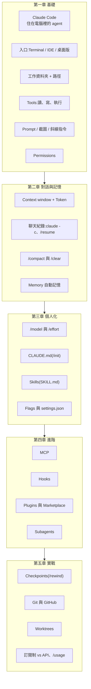

# Claude Code 新手觀念地圖:從 Terminal 到 Worktree,一次認清 25 個名詞

> 整理自 YouTube 頻道 **Gary Chen(@garychenai)**〈[借我 40 分鐘,讓我告訴你關於 Claude Code 你需要知道的所有觀念](https://www.youtube.com/watch?v=29F96QJEf6o)〉(2026-10-22,約 40 分鐘,官方 zh-TW 字幕)。
>
> ⭐ 片中提到的指令、旗標與機制已**比對 Claude Code 官方文件**([CLI reference](https://code.claude.com/docs/en/cli-reference)、[Checkpointing](https://code.claude.com/docs/en/checkpointing)、[Memory](https://code.claude.com/docs/en/memory)、[Permissions](https://code.claude.com/docs/en/permissions),2026-10-23 查閱)。補正與補充見第七節,重點兩處:**擋讀檔不一定被 Bash 繞過**,以及**自動記憶是「本機、按 repo」**。
>
> ⚠️ **立場揭露**:作者在片頭、片中、片尾三度推廣自家 **Skool 付費社群**,並說「本片完整文章與提示詞模板放在 Skool」。本筆記只整理公開影片內容,不轉述付費素材。

---

## 一句話總結

這是一支給「技術小白」的名詞地圖,不教進階技巧,而是讓你**認得每個名詞在系統裡的位置**:Terminal 是入口,Tools 是手腳,Context 是短期記憶,CLAUDE.md 與 Skills 是工作守則和操作手冊,MCP 接外部服務,Subagent 分身做事,Checkpoint / Git / Worktree 管版本。**不需要第一天就全部學會**,先認得名詞,遇到痛點再深入。

---

## 一、整張地圖



---

## 二、第一章:基礎知識

| 名詞 | 白話 | 作者的提醒 |
|---|---|---|
| **Claude Code** | Anthropic 推出、住在你電腦裡的 agent;交代的任務會變成電腦上的實際操作 | 名字有 Code,但也能整理資料、處理文件。比網頁版方便,也更危險 |
| **Terminal** | 用文字指令操作電腦的黑視窗 | 不用背指令;會打 `claude` 啟動、按 `Esc` 中斷就好 |
| **IDE** | 開發用的介面,如 VS Code(可裝 Claude Code 擴充套件) | Terminal、IDE、桌面版只是不同入口,本質相同 |
| **工作資料夾** | 想讓 agent 看到什麼,就在那個資料夾召喚它 | `cd` 切換資料夾;先把相關資料集中,再明確說讀哪些、結果放哪 |
| **Tools** | 模型是大腦、沒有手腳;讀檔、寫檔、執行指令都靠工具 | 「執行 → 看錯誤 → 修改 → 再執行」就是 **agentic loop** |
| **Prompt** | 你輸入的要求 | 越具體越好;也可以請 Claude **先問你**沒想清楚的細節 |
| **截圖** | Claude Code 看得懂圖片 | 參考圖要說明你在意的是字體、留白還是排版,不然它得用猜的 |
| **斜線指令** | `/` + 名稱,呼叫特定功能 | 忘了就打 `/` 看選單,`/help` 看說明 |
| **Permissions** | 決定哪些動作直接做、哪些先問你 | ⭐ **看不懂就先拒絕,再問 Claude「你剛剛想做什麼?」**,邊做邊累積知識 |

**Prompt 的例子(影片原例):**

- ❌「幫我做一個網站」——太籠統,留太多細節給它猜。
- ✅「幫我做一個週末攝影課的報名頁,放上課程時間、地點和作品範例,報名按鈕連到我現有的表單。目的是讓第一次看到的人也能判斷這堂課適不適合自己。」——**有元素、有目的**。

---

## 三、第二章:對話與記憶管理

**三者要分清楚:**

| | 是什麼 | 怎麼管 |
|---|---|---|
| **Context window** | 當下的短期記憶:你的要求、讀進來的文件、工具結果 | 容量有上限;**換不相關的工作就開新對話** |
| **聊天紀錄** | 過去的對話過程,自動存在本機 | `claude -c` 接最近一次;`/resume` 挑更早的 |
| **Memory** | 消化整理過的經驗筆記 | 可請它列出、修正、移除;要定期維護 |

**Token:** context 用 token 計量,一個 token 不一定等於一個中文字或英文單字。**讀進來的資料(input)和產出(output)都算**,所以「整理這十份訪談」一句話,實際會用掉不少額度。

> 作者的觀點:提示詞太簡單,模型會胡思亂想、反而多花 token;太詳細又限制模型的能力與創意。

**`/compact` vs `/clear`:**

- `/compact`:把前面對話濃縮成摘要,保留目標、關鍵決定、進度。**同一件事要繼續做**時用。可以主動加指示,例如「保留剛確認的大綱、資料來源與寫作要求」。
- `/clear`:清空當前上下文、開全新對話。**換完全不相關的任務**時用。
- 兩者都**不會刪除你存好的實體檔案**。
- ⭐ 摘要一定會省略細節,**重要內容另外存成檔案**(大綱 + 進度),下次指定它讀。

---

## 四、第三章:個人化設定

### 模型與 effort

- **Haiku**:快、處理簡單工作;**Sonnet**:均衡、日常多數任務;**Opus / Fable**:旗艦、深度推理。
- 新手先用預設模型。熟悉後,拿同一個指令給不同模型跑,**比的不是速度,是交出來的東西能不能直接用**——弱模型單次便宜,但重做好幾次不一定划算。
- `/model` 切模型;`/effort` 調推理投入程度。改檔名不需要高 effort,追反覆出現的 bug 才需要。**effort 高不代表答案一定對**,不必每個任務都開最高。

### CLAUDE.md vs Memory vs Skills

| | 用途 | 何時載入 |
|---|---|---|
| **CLAUDE.md** | 白紙黑字、從頭到尾都要遵守的指引(用中文回答、檔案放哪) | 每次開工都讀 |
| **Memory** | Claude 自己在工作中慢慢累積的經驗 | 每次開工讀一部分 |
| **Skills** | 某一類工作的完整操作手冊(`SKILL.md` + 範例 + 小程式) | **先只看簡介,需要時才載入全文**(Progressive Disclosure) |

- `/init` 會依專案現況產生初版 CLAUDE.md,**產出後要親自看過、補上你在意的要求**。
- **層級**:個人層級放通用原則(「一律用中文回答」),專案層級放專案特有的事(客戶品牌名、原始資料路徑),**避免把上一家客戶的規格帶到下一個專案**。
- **Skills 的例子**:把「先看段落邏輯 → 找不順的句子 → 逐字抓錯字」的修稿流程寫成 Skill。跑出來不對,就回頭改 `SKILL.md`。

### Flags 與檔案存取限制

- `claude -c`:接回最近一次對話。
- `--verbose`:顯示詳細的逐輪執行紀錄。**增加的是系統過程資訊,不是讓回答變長。**
- `--dangerously-skip-permissions`:跳過權限詢問。作者自己只在**測模型或空白 demo 專案**用;新手請只在可以砍掉重練的環境(虛擬機、空白資料夾)用。
- `settings.json`:可限制 Claude 讀取特定檔案(資料庫密碼、客戶隱私資料)。不會寫就請 Claude 先列出建議排除清單並說明做法,你確認後再套用。
- 作者最推薦新手的做法:**把這次需要的資料集中到一個乾淨的資料夾。**

---

## 五、第四章:進階功能

| 名詞 | 是什麼 | 和誰容易搞混 |
|---|---|---|
| **MCP** | 讓 AI 工具對接外部資料與功能的標準協定;接上一個 MCP server = 多一包工具 | **Skill 是工作流程,MCP 是取得資料的工具**。只寫 Skill,Claude 不會突然能登入你的行事曆 |
| **Hooks** | 特定事件發生時自動執行設定好的動作 | **Skill 教大腦怎麼做事,Hook 在流程裡埋自動機關**。判斷句子順不順交給 Skill;存檔就掃禁用標點交給 Hook |
| **Plugins** | 把 Skills、Hooks、MCP 打包成一鍵安裝的套件 | **Marketplace** 是列出 Plugin 的目錄 |
| **Subagents** | 有獨立 context window 的小助手,做完回報精華 | 不是每件小事都值得派;交代、啟動、整合都要成本 |

**MCP 能做多深?** 完全取決於該 MCP 服務提供了哪些工具,以及你放行哪些權限。例如行事曆服務只有「查詢」工具,就只能總結行程;有「建立」工具又授權了,才能幫你排會議。新手先接一個最常用的服務。

**Subagent 的關鍵:規定交回什麼。** 只說「把這份資料看完」,它可能把整份原文貼回主對話,context 照樣塞爆。要明確說:**只回傳條列重點、資料來源、發現的矛盾**。

- 互不影響的工作可以平行派多個,例如三個小助手各查一家競品,最後由主對話整理成比較表。
- Skill 與 Subagent 可以搭配:**Skill 提供方法,Subagent 是照方法做事的工人。**

---

## 六、第五章:實戰應用與費用

### Checkpoints、Git、Worktrees

| | 用途 | 範圍 |
|---|---|---|
| **Checkpoints**(`/rewind`) | 當次工作搞砸時快速反悔;可選只還原檔案、只退回對話,或兩者都退 | 只涵蓋 Claude 用**檔案編輯工具**改的內容 |
| **Git** | 長期、正式的版本歷史;每個 **commit** 是一張附說明的快照 | 你主動請它 commit 才會存,不是自動的 |
| **GitHub** | 微軟旗下的線上服務,放 Git 專案、協作 | Git 可以只在本機用 |
| **Worktrees** | 同一個 Git 專案長出多個獨立工作資料夾,各走一條分支 | **只隔離本機檔案**;連同一個雲端資料庫的話,資料庫的變更不會被隔離 |

- Checkpoint 救不回的:透過**終端機指令**改的檔案、其他軟體改的檔案、已經透過 API 送到外部服務的資料。
- Worktree 的情境:兩個 Claude 視窗,一個改首頁版面、一個修報名表單 bug,各自在 A、B 資料夾,做完再合併。**新手一次只做一件事時用不到**。
- 作者的做法:Checkpoint 和 Git 搭配用,「但最重要的還是 Git」。

### 費用:訂閱制 vs API

| | 訂閱制(Claude Pro 等) | API 計量 |
|---|---|---|
| 計費 | 固定月費換一定額度 | 依模型等級與 token 實報實銷 |
| 限制 | **有上限與限速,不是吃到飽** | 用多少算多少 |
| 關係 | **兩筆帳完全分開**——買了 Pro 不代表可以免費呼叫 API | |

- Subagent 也照算 token,甚至因為來回溝通花更多。
- 評估成本要看**整個任務的總成本**,還要算進做錯重跑的試錯成本。
- `/usage`:查看當次對話累積的費用、方案剩餘用量與活動統計。

---

## 七、核實與補正

**✅ 已核實(官方文件):**

- `claude -c` 載入**目前資料夾**最近一次對話;`--resume` / `-r` 可依 ID 或名稱接續,或開選單挑選。
- `--verbose` 是「顯示完整逐輪輸出」的詳細紀錄。
- `--dangerously-skip-permissions` 等同 `--permission-mode bypassPermissions`。
- `--effort` 可選 `low` / `medium` / `high` / `xhigh` / `max`,**可用等級依模型而定**。
- `/rewind`(或輸入框空白時按兩下 `Esc`)可選「還原程式碼與對話」「只還原對話」「只還原程式碼」,還多了「從這裡開始摘要」等選項。
- Checkpoint 只追蹤檔案編輯工具的修改,官方明說「不能取代版本控制」。
- 用 `-w` / `--worktree` 可直接在 `<repo>/.claude/worktrees/<name>` 建立隔離的 git worktree 啟動。

**⚠️ 需補充 / 修正:**

1. **「擋了讀檔工具,Bash 還是能讀」只對一半。** 官方文件:Read / Edit 的 deny 規則**也會套用到 Claude Code 認得的 Bash 檔案指令**(`cat`、`head`、`tail`、`sed`、`tee`)和重新導向(`> file`、`< file`)。**擋不住的**是沒有直接點名檔案的指令(在該資料夾執行 `grep -r pattern .`),以及間接讀寫檔案的子程序(例如 Python、Node 腳本)。要真正隔離,得搭配 sandbox。作者「不要以為萬無一失」的結論仍然成立。
2. **自動記憶的範圍比「跟專案綁定」更精確。** 官方:存在 `~/.claude/projects/<project>/memory/`,`<project>` 由 **git repo** 推導,**同一個 repo 的所有 worktree 與子資料夾共用一份**;而且是**本機的**,不會跨機器或雲端環境同步。每次開工只載入 `MEMORY.md` 的**前 200 行或前 25KB**。
3. **Checkpoint 的細節:** 每次你送出開始一輪的提示就建一個 checkpoint;一個 session 保留最近 100 個的檔案快照,預設約 30 天後清除(可用 `cleanupPeriodDays` 調整)。**Subagent 的編輯通常不會被 checkpoint 捕捉**,要靠 Git 還原。另外,若 Claude 已經用編輯工具改過某檔案,之後 Bash 對同一檔案的修改**也能被 rewind 還原**;只被 Bash 改過的檔案才不會被追蹤。
4. **CLAUDE.md 長度:** 官方建議每個 CLAUDE.md **控制在 200 行以內**,太長會吃 context、降低遵循度;只跟部分程式碼有關的規則可以拆到 `.claude/rules/` 按路徑載入。
5. **CLAUDE.md 不是強制設定。** 官方說 CLAUDE.md 與自動記憶都只是 context;要**無論 Claude 怎麼判斷都擋下**某個動作,得用 `PreToolUse` hook 或權限規則。

---

## 八、應用案例

### 案例 1:行政人員第一次用 Claude Code 整理訪談

1. 在桌面建 `訪談專案/`,把 10 份逐字稿放進 `raw/`。
2. `cd 訪談專案` 後輸入 `claude`。
3. 輸入:「讀 `raw/` 裡的 10 份訪談,整理成一份報告存到 `output/summary.md`。先問我報告要依受訪者分段還是依主題分段。」
4. 跳出權限詢問看不懂 → 先拒絕,問「你剛剛想執行什麼?為什麼?」
5. 做到一半要下班:請它把大綱與進度存成 `progress.md`;明天回來 `claude -c`,或指定讀 `progress.md` 接著做。

### 案例 2:用「名詞分工」設計一個修稿流程

| 需求 | 放哪裡 |
|---|---|
| 一律繁體中文、口語化 | CLAUDE.md(每次都要知道) |
| 修稿三步驟:邏輯 → 順句 → 錯字 | Skill(修稿時才載入) |
| 存檔就掃禁用標點 | Hook(死板的檢查交給程式) |
| 從 Notion 撈這週會議紀錄 | MCP(取得外部資料的工具) |
| 同時查三篇參考文獻 | 三個 Subagent,只回傳重點與出處 |

### 案例 3:同時開兩條戰線

情境:首頁改版與報名表單 bug 要同時進行。

```bash
# 視窗 A
claude -w homepage-redesign
# 視窗 B
claude -w fix-signup-form
```

兩個 Claude 各自在 `.claude/worktrees/` 下的獨立資料夾工作,做完各自 commit 再合併。⚠️ 若兩邊都連同一個開發資料庫,資料表的變更不會被隔離,先準備兩份測試資料庫或只讓一邊碰資料庫。

---

## 九、相關筆記

- CLAUDE.md 深入:[[claude-md-from-zero-to-mastery]]、[[claude-md-cut-82-percent-and-maintain-it]]
- Hooks 深入:[[claude-code-hooks-complete-guide]]
- 快捷鍵與隱藏功能:[[claude-code-30-hidden-shortcuts]]
- 2026 年功能時間線:[[claude-code-2026-feature-timeline]]

---

## 來源

- YouTube:Gary Chen〈借我 40 分鐘,讓我告訴你關於 Claude Code 你需要知道的所有觀念〉 https://www.youtube.com/watch?v=29F96QJEf6o (2026-10-22,官方 zh-TW 字幕)
- Claude Code CLI reference: https://code.claude.com/docs/en/cli-reference
- Claude Code Checkpointing: https://code.claude.com/docs/en/checkpointing
- Claude Code Memory(CLAUDE.md 與 auto memory): https://code.claude.com/docs/en/memory
- Claude Code Permissions: https://code.claude.com/docs/en/permissions
