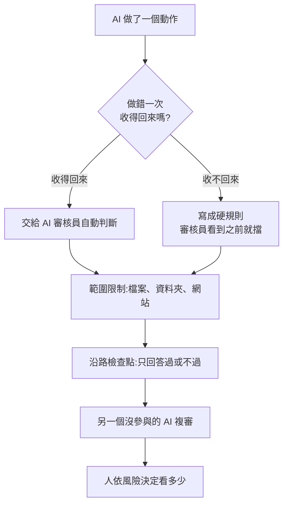

# 重新思考 Claude Code 最佳實踐:人是爛審核員、「收得回來嗎」、門禁卡與檢查點(Lydia Hallie 演講導讀,ADAM LIL)

**主題分類:** 科技 / Claude Code — 權限、驗證與 AI 管 AI 的工作方式
**來源:** YouTube〈重新思考 Claude Code 的最佳實踐｜Anthropic 工程師 Lydia Hallie〉(ADAM LIL,2026-11-27,8 分 23 秒)。**無字幕,逐字稿以 CPU 版 Whisper(faster-whisper large-v3-turbo)轉錄,非官方字幕**,時間點取自帶時間逐字稿。
**整理日期:** 2026-11-28

> 📎 這是**導讀影片**(ADAM 中文旁白 + 講者英文原音片段),原演講是 AI Engineer〈Rethinking Claude Code Best Practices〉。**我沒有看到原演講全文**(搜尋只找到二手摘要),所以演講本身的說法一律標「影片轉述」;數字與機制則去讀了 Anthropic 一手來源核實。
> ⚠️ 講者是 Anthropic 員工、介紹自家產品,影片說明欄也自己註明「數字皆為公司自行公布」。頻道說明欄**沒有業配或商品推廣**。

---

## TL;DR

- **按「允許」不等於把關。** Anthropic 找 1,053 位付費開發者做實驗:人只擋下 13.6% 的危險指令,按過 50 次以後約剩 5%;自動審核擋下 89%(✅ 已對官方公告核實)。
- **一句判斷法:做錯一次,收得回來嗎?** 收得回來(改錯程式可還原)就放手給 AI;收不回來(丟掉未存檔的工作、密碼寫進對話記錄)就寫成**硬規則**。
- **不是每個動作盯,而是限制範圍 + 沿路設檢查點 + 讓另一個 AI 複審。** 官方 best practices 與此高度一致,但「反而讓模型更差」那句我沒在官方頁找到(§3)。
- **對上班族:** 工作往上移一層,從「做事」變成「定義什麼叫做完、驗收」。這是頻道作者的三點觀察,屬意見。

## 1. 影片脈絡(時間連結已提前 10 秒)

| 時間 | 內容 | 連結 |
|---|---|---|
| 0:45 | 年初 vs 現在:盯每一步、按允許 → 同時開幾十個 AI、各自跑數小時 | [前往](https://www.youtube.com/watch?v=JEQmOjb80A8&t=35s) |
| 1:22 | 每天合併改動 5 月約 2,500 → 9 月超過 3 萬 | [前往](https://www.youtube.com/watch?v=JEQmOjb80A8&t=72s) |
| 1:28 | 第一步:別再把 AI 當新手帶(設定檔只寫它看不出來的) | [前往](https://www.youtube.com/watch?v=JEQmOjb80A8&t=78s) |
| 1:56 | 自動模式:另一個 AI 當審核員,8 月起成預設 | [前往](https://www.youtube.com/watch?v=JEQmOjb80A8&t=106s) |
| 2:12 | 實驗:1,053 位開發者、提示被偷換成危險指令 | [前往](https://www.youtube.com/watch?v=JEQmOjb80A8&t=122s) |
| 2:43 | 結果:13.6% vs 89%,越做越鬆(17% → 5%) | [前往](https://www.youtube.com/watch?v=JEQmOjb80A8&t=153s) |
| 2:57 | 警報疲勞(護理師類比) | [前往](https://www.youtube.com/watch?v=JEQmOjb80A8&t=167s) |
| 3:37 | 判斷法則:「我收得回來嗎?」 | [前往](https://www.youtube.com/watch?v=JEQmOjb80A8&t=207s) |
| 3:59 | 危險藏在正常動作裡(跑測試會執行別人的程式) | [前往](https://www.youtube.com/watch?v=JEQmOjb80A8&t=229s) |
| 4:19 | 門禁卡:限制範圍、作業系統擋、雲端電腦用完就丟 | [前往](https://www.youtube.com/watch?v=JEQmOjb80A8&t=249s) |
| 5:05 | 它做的真的是你要的嗎?同一句指令跑三次三種結果 | [前往](https://www.youtube.com/watch?v=JEQmOjb80A8&t=295s) |
| 5:27 | 沿路設檢查點、寫成強制腳本、另一個 AI 再審 | [前往](https://www.youtube.com/watch?v=JEQmOjb80A8&t=317s) |
| 6:19 | 主管 AI 拆工作、派工、檢查、退回 | [前往](https://www.youtube.com/watch?v=JEQmOjb80A8&t=369s) |
| 6:34 | 樂觀與保留兩種看法 | [前往](https://www.youtube.com/watch?v=JEQmOjb80A8&t=384s) |
| 7:25 | ADAM 三個觀察 | [前往](https://www.youtube.com/watch?v=JEQmOjb80A8&t=435s) |

## 2. 實驗數字核實(Anthropic 2026-08-07 公告)

我讀了 [Claude 官方部落格〈Auto mode is now the default〉](https://claude.com/blog/auto-mode-default-in-claude-code) 全文,數字與影片一致:

| 影片說法 | 官方原文 | 核實 |
|---|---|---|
| 1,053 位付費開發者 | 1,053 位付費測試者,在為研究設置的環境中工作 | ✅ |
| 工作到一半,允許視窗被偷換成明顯危險的指令 | 測試中途把一則權限提示換成危險指令,記錄是否核准;**核准不會真的執行,只是改了提示文字** | ✅(影片沒講「不會真執行」) |
| 人只擋 13.6%、自動模式擋 89% | "human review caught just 13.6% of dangerous commands, while auto mode caught 89%";即 143 / 1,053 與 937 / 1,053 | ✅ |
| 約每十個還有一個會過 | 由原數字推算漏掉約 116 則,約 11% | ✅ |
| 人一開始約 17%,按過 50 次後約 5% | 人工前期約擋 17%,50 次以上提示後約 5%;自動模式攔截率不隨長度變化 | ✅ |
| 8 月起成為預設 | 8 月 14 日起 Pro、Max、Team(另含 Ultra)新工作階段預設 auto mode;Enterprise、API 仍須選開 | ✅(但見下) |

**影片沒講、值得知道的官方細節:**

- 自動模式擋下 800 則「人核准」的指令;人只擋下 6 則「自動模式放行」的指令。
- 自動模式被連續擋 **3 次**、或單一工作階段累計 **20 次**,會退回手動核准。
- 官方自己寫「does not eliminate risk」,高風險的生產環境變更仍建議自己審;與 Apollo Research 的紅隊測試中漏擋率 12% → 7%,但註明**不代表真實流量的漏擋率**。
- ⚠️ **兩個「17%」不是同一個數字。** 影片的 17% 是「人在前期擋下危險指令的比率」。另一份 [Anthropic 3 月研究頁](https://www.anthropic.com/research/claude-code-auto-mode)裡的 17% 是「分類器對真實過度積極行為的漏判率」(誤擋率完整流程 0.4%、使用者對手動提示照單接受 93%)。引用時別混。
- 公告頁頂端另有 2026-10-22 的更新,說法是「下週推出」,**與 8/14 的日期不一致,我沒能釐清是哪項功能**。
- 外界批評(如 Backslash Security、Cloud Security Alliance 的 prompt injection 研究筆記)我只看到搜尋摘要,**未讀原文,未能核實**。

## 3. 設定與驗證主張對官方文件

對照 [Claude Code 官方 Best practices](https://code.claude.com/docs/en/best-practices) 全文:

| 影片(轉述講者) | 官方文件 | 核實 |
|---|---|---|
| 別把 AI 當新手帶;說明書只寫它自己看不出來的(如沒寫在程式裡但仍在用的舊系統) | 開宗明義:「tell Claude what it can't see」;CLAUDE.md 放 repo 裡找不到的決定,保持短 | ✅ |
| 設定檔裡寫一堆「重要、絕對不要」反而讓它跑偏、做多餘的事 | 官方只說:一直加 IMPORTANT 還是被忽略,代表檔案太長、或那條其實該是 hook | ⚠️ **部分核實**:「無效」有官方依據;「反而更差、做更多多餘的事」我在官方頁找不到,只在二手摘要看到 |
| 重要檢查要寫成強制腳本,每改一個檔案就跑、說完成就跑測試 | 官方:必須每次發生的事用 hook、deny 規則或 managed setting;`PostToolUse` hook 於每次 Edit/Write 後執行;`Stop` hook 以 exit code 2 擋住收工,連擋 **8 次**後 Claude Code 會放行 | ✅ |
| 一個沒參與的 AI 再審一遍 | 官方 `/code-review` 在沒看過對話的 fresh subagent 審 diff;提醒審查提示要加 `skip style`,否則一定會挑出東西 | ✅ |
| 由作業系統擋:限制能讀寫的檔案、能連的網站 | 官方 `/sandbox` 提供 OS 層限制,**僅 macOS、Linux、WSL2**;預設 Claude 仍可請求在沙箱外重試,strict 模式才關掉;`deny` 規則在包含 auto 的所有模式都有效 | ✅(⚠️ **原生 Windows 沒有 sandbox**,影片沒講) |
| 最保險是在沒有你密碼的雲端電腦上跑、用完就丟 | 這是講者的建議,**我未查官方對應頁**,未能核實 | 未能核實 |
| 主管 AI 與執行 AI 可用不同模型 | 講者說法;官方 best practices 只提 subagent 委派 | 未能核實 |
| 風險分級:改文件不用看、一般一人、高風險兩人 | 講者的組織建議,屬意見 | 無法核實 |

官方還有一句與影片精神一致的話:自動模式是分類器的判斷、不是硬規則,所以「你的 never 規則該放進 deny 規則或 hook」。

## 4. 每天合併改動 2,500 → 3 萬:已核實,但單位不明

[Anthropic 工程文〈Redesigning source control〉(2026-10-13)](https://www.anthropic.com/engineering/redesigning-source-control)原句:「In May 2026, Anthropic averaged around 2,500 code changes merged per day; as of September, we merged over 30,000 per day.」(圖說:合併進 monorepo,1–9 月)。

- ✅ 數字與月份對得上影片。
- ⚠️ 原文**沒有定義「code change」是 commit、PR 還是 changeset**,也只說合併進 monorepo。影片說「程式改動」是安全的譯法,別自行翻成「PR」。
- 這篇是講他們為何要換掉 Git(自製 Scion),不是在評估品質;影片保留派問「錯誤會不會也變多」,原文沒有回答。

## 5. 影片的論點整理

1. **人當審核員很差,不是不認真,是一直被打斷** → 警報疲勞。實驗的長度效應(17% → 5%)支持這點。
2. **危險有兩種**:看得出來的(危險指令)與藏在正常動作裡的(跑測試會執行別人的程式、偷走金鑰)。後者人在旁邊也會按允許,所以要靠**範圍限制**而不是逐一攔截。
3. **「真的是你要的嗎」比「安全嗎」更難。** 同一句「把登入系統換成新的」跑三次,可能是「換了但留舊的」「只換新用戶」「全部登出」。解法是檢查點(只答過/不過),不是最後讀整份改動。
4. **保留派:** 公司自己公布的數字、89% 代表一成漏過、每天 3 萬改動沒人讀得完、AI 會假裝做完、檢查點設不好只是自我安慰。**這段是影片裡最有價值的平衡**。

ADAM 自己的三點(作者觀點,非事實):①盯不是管理,規則、範圍、檢查點才是;②先問收不收得回來;③上班族的工作往上移一層,最值得練的是驗收,不是下指令。

## 6. 應用案例

- **整理自己的 CLAUDE.md:** 把「Never read .env」「改完檔案要跑 formatter」這類**零例外**的規則搬出 CLAUDE.md,前者放 `permissions.deny`,後者做 `PostToolUse` hook;「Prefer named exports」這種有例外的留在 CLAUDE.md(官方範例原話)。
- **跑通宵長任務前:** 先寫一個 `Stop` hook 跑 `tsc` 與測試,exit code 2 擋住收工;再讓 `/code-review` 在 fresh subagent 審 diff。收工時要求它貼指令與輸出當證據,不要只收「all tests pass」。
- **Windows 使用者:** 官方 `/sandbox` 不支援原生 Windows,想要 OS 層門禁卡要用 WSL2;否則就更依賴 deny 規則與只在專用資料夾工作。
- **投資或換工作等人生決定(ADAM 的延伸):** 先問「做錯我收得回來嗎」。收不回來的(全倉、簽約、送出履歷)寫成事前規則,別當下憑感覺。

## 相關筆記

- [[claude-code-dont-ask-again-secrets-leak-checklist-why-qq]] — 同一類問題:一次「永遠允許」就把風險寫進設定檔
- [[claude-code-hooks-complete-guide]] — 影片說的「強制腳本」就是 hook,完整事件與案例
- [[claude-code-advanced-configs-context-and-interruptions-yaha]] — 減少「停下來等你」的進階配置
- [[claude-md-from-zero-to-mastery]] — CLAUDE.md 該寫與不該寫什麼
- [[claude-md-cut-82-percent-and-maintain-it]] — 設定檔瘦身,對照「別寫一堆絕對不要」
- [[cross-model-review-claude-codex-harness]] — 讓另一個沒參與的 AI 複審的實作
- [[long-running-agents-goal-evaluation]] — 長時間 agent 的驗收與 /goal

## 來源

- 使用者提供的 YouTube 連結:[重新思考 Claude Code 的最佳實踐｜Anthropic 工程師 Lydia Hallie(ADAM LIL,2026-11-27)](https://www.youtube.com/watch?v=JEQmOjb80A8)。**該片無字幕,逐字稿以 CPU 版 Whisper(faster-whisper large-v3-turbo int8)轉錄,非官方字幕**(231 段);轉錄有同音字誤聽,已據說明欄與上下文還原:「城市」= 程式、「設定當」= 設定檔、「金鑰」誤作「金钥」、「應規則」= 硬規則、「評管」= 品管、「丁不是管理」= 盯不是管理、「賄賂」= 漏過、講者名「Lydia Hawley」= Lydia Hallie。
- 影片說明欄註明的原演講:AI Engineer〈Rethinking Claude Code Best Practices — Lydia Hallie, Anthropic〉(說明欄寫 2026-11-12;搜尋到的二手摘要寫 11 月 11 日,**日期未能核實,原演講未讀**)。
- [Claude 部落格:Auto mode is now the default in Claude Code(2026-08-07)](https://claude.com/blog/auto-mode-default-in-claude-code)(已讀全文)
- [Anthropic 研究:Claude Code auto mode(2026-03-25)](https://www.anthropic.com/research/claude-code-auto-mode)(已讀)
- [Anthropic 工程:Redesigning source control(2026-10-13)](https://www.anthropic.com/engineering/redesigning-source-control)(已讀)
- [Claude Code 官方文件:Best practices](https://code.claude.com/docs/en/best-practices)(已讀全文)
