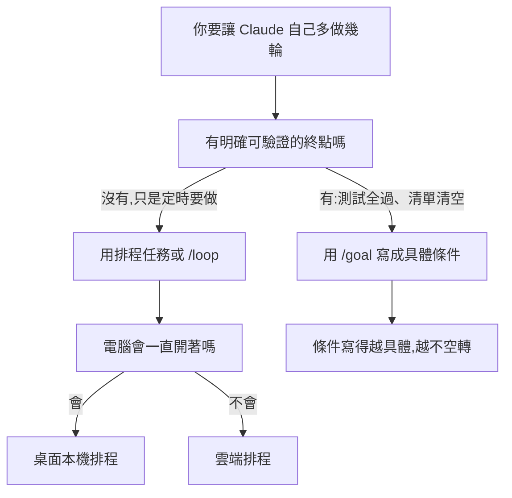

# Claude 近期十個更新怎麼分:新手只要先做三件事(JayLuxAI + 官方文件核實)

**主題分類:** 科技 / Claude Code — 新手選型地圖
**來源:** YouTube 頻道 **JayLuxAI | AI 系統導入**〈Claude 最近 10 個大更新,新手一定要會的 3 個〉(2026-11-10,8 分 34 秒)https://youtu.be/byCdyKQRe9A
**逐字稿:** 該片只有機器翻譯的自動字幕(原音是中文,字幕語言列為 zh-Hant/en-orig 的自動翻譯,不是真實語音),所以**一律改用 CPU faster-whisper large-v3-turbo(int8)轉錄**(294 段,非官方字幕)。Whisper 把 Claude 聽成「Cloud」、Mods 聽成「Modes」,下面「字幕還原」列出。
**整理日期:** 2026-11-11

> ⚠️ **立場揭露**:作者在片尾推廣自家**免費 Skool 社群**(影片提到的 PDF 摘要要加入社群才能下載)與**一對一付費諮詢**(連結在說明欄 [7:52](https://youtu.be/byCdyKQRe9A?t=462) 起)。說明欄另有商業合作信箱。本筆記只整理公開影片內容,不轉述社群裡的 PDF。
>
> 📌 **這支是「概念地圖」不是教學**:每個主題講 20–40 秒。價值在於「哪個功能放在哪個場景」的取捨。細節請看文末連到的既有深度筆記。

---

## TL;DR

1. 新手直接用 **Claude 桌面 App 內建的 Claude Code 介面**,不必再先開 VS Code(作者自己的立場改變,見 [0:00](https://youtu.be/byCdyKQRe9A?t=0))。
2. **真正吃 token 的是「讀進去的東西」**(檔案、指令、對話),所以 context 一滿就開始忘東忘西。
3. 長期規則用 **CLAUDE.md(當地圖,不是百科)**;重複流程用 **Skill**;串外部工具用 **Connector**;改 Claude Code 本身用 **Mod**。
4. **一件事一個 Session**;做到一半想問用 `/btw`。
5. **`/goal`** 給終點、**排程任務** 給時間;兩者都靠「寫得具體」才不空轉。
6. 三個台灣暫時用不到的:**Claude Duet**(僅美國 waitlist)、**Dashboards**(付費方案 beta)、**Motion**(僅 Team / Enterprise beta)。
7. 如果只做三件事:①寫一份高品質 CLAUDE.md ②把最常做的一件事做成第一個 Skill ③試一次 `/goal`,終點寫清楚([7:31](https://youtu.be/byCdyKQRe9A?t=441))。

---

## 1. 十個觀念對照表(影片說法 → 官方文件核實)

核實標記:✅ 已讀官方文件確認;🔶 只讀到二手報導(未讀 Anthropic 原頁);❓ 未能核實。

| # | 主題 | 影片怎麼說 | 核實與補充 |
|---|---|---|---|
| 1 | 介面 | Chat 與 Code 合併,Claude Code 有自己的 Tab,可看檔案、進度、同開多個對話,右側顯示 Context([0:32](https://youtu.be/byCdyKQRe9A?t=22)) | ❓ 本次沒另開官方頁核對畫面;桌面 App 改版的功能清單見 [[claude-app-redesign-nested-sessions-projects-side-chat]](該篇已對照官方 desktop 文件) |
| 2 | Token 與 Context | token 是用量單位;大部分 token 花在「讀」不在「寫」;context 滿了品質下降([1:21](https://youtu.be/byCdyKQRe9A?t=71)) | ❓「大部分 token 花在讀」沒有找到官方數字,只能當經驗法則。方向一致的官方說法:CLAUDE.md 太長會「消耗更多 context、降低遵循度」(見 #3) |
| 3 | Memory 與 CLAUDE.md | Memory 是 Claude 自己寫的筆記;CLAUDE.md 是你寫的規則,每次開對話都讀,寫太長就吃 token,所以要像地圖([2:07](https://youtu.be/byCdyKQRe9A?t=117)) | ✅ 官方 [Memory 頁](https://code.claude.com/docs/en/memory):CLAUDE.md 每個 session 都載入;**建議每個 CLAUDE.md 少於 200 行**;只和部分程式碼有關的規則改放 path-scoped rules,只在碰到對應檔案時載入。Auto memory(Claude 自己學到的)每個 session 只載入前 200 行或 25KB |
| 4 | Skills | 做過兩次的事就做成 Skill;打斜線叫出;Claude 平常只看一小段描述,要用時才讀全文,所以不怕 Skill 多([3:00](https://youtu.be/byCdyKQRe9A?t=170)) | ✅ 官方 [Skills 頁](https://code.claude.com/docs/en/skills):一般 session 中 **skill 描述常駐 context,全文只在被呼叫時載入**;`description` 與 `when_to_use` 合併後在列表中**截到 1,536 字元**,所以重點要放前面。「做兩次就做成 Skill」是作者的經驗法則,不是官方規則 |
| 5 | Connector / Plugin / Mod | Connector 讓 Claude 直接接 Gmail、Notion、Slack,背後是 MCP;Plugin 是 Skill + Connector + 指令打包;Mod 能改 Claude Code 本身([3:36](https://youtu.be/byCdyKQRe9A?t=206)) | ✅ Mod 的事件關卡、三種動作與**無沙箱**的安全警告,已在 [[claude-code-mods-explained]] 對官方文件與範例原始碼核實。影片沒提的重點:**mod 用你的權限執行**,安裝前要先 `claude plugin validate` |
| 6 | Sessions 與 `/btw` | 一件事一個 session;`/btw` 開側邊對話,不塞回主對話([4:33](https://youtu.be/byCdyKQRe9A?t=263)) | ✅ 官方 [Interactive mode](https://code.claude.com/docs/en/interactive-mode):`/btw` 用目前對話已有的內容回答,**問答不進對話歷史**;終端機以可關閉的 overlay 顯示,關閉 Claude Code 就消失;之後的側問會看到最近 20 組先前的側問。補充:雲端 session 不支援,見 [[claude-app-redesign-nested-sessions-projects-side-chat]] |
| 7 | Artifacts | Docs、Slides、Design 免費方案都能用,可分享([5:19](https://youtu.be/byCdyKQRe9A?t=309)) | 🔶 tbreak 報導 Anthropic 2026-10-08 公告:Docs、Slides、Design 已脫離 beta,所有方案含 Free 可用;獨立的 Claude Design 將於 12 月 14 日關閉。未讀 Anthropic 原公告 |
| 8a | Claude Duet | Anthropic 最新 agent App,像傳訊一樣對話,幫你看信、看行程、先擬回覆;只開放美國,要排候補([5:51](https://youtu.be/byCdyKQRe9A?t=341)) | 🔶 [Engadget(2026-10-21)](https://www.engadget.com/2293646/claude-duet-is-anthropics-answer-to-meta-muse-and-):美國訂閱者可加入 waitlist。其他報導稱預覽版在 iOS/Android 與 claude.ai,付款、簽署、刪除前會先徵求同意。同賽道比較見 [[personal-agent-muse-meta-google-race]]、[[always-on-agent-grok-bot-lee-robinson]] |
| 8b | Dashboards | 用講的,直接用資料做儀表板,自動更新;付費方案 beta([6:06](https://youtu.be/byCdyKQRe9A?t=356)) | 🔶 [tbreak](https://tbreak.com/claude-dashboards-motion-beta/):2026-10-08 beta;連 Redshift、BigQuery、ClickHouse、Databricks、Snowflake 等資料平台或 Salesforce 等 CRM;**每個數字可點開看背後的查詢**;Enterprise 需管理員先在 Organization settings > Artifacts 開啟 |
| 8c | Motion | 一句話生成動畫解說影片,可下載 MP4;僅 Team 與 Enterprise([6:16](https://youtu.be/byCdyKQRe9A?t=366)) | 🔶 同 tbreak:**不是影片生成模型**,而是 Claude 寫程式讓文字、圖表、形狀動起來,所以每個字、數字、時間都能改,再匯出 MP4;beta,Team / Enterprise。影片沒提這點,也因此不會有 AI 生成的人物 |
| 9 | `/goal` | 給一個終點,它一直做到條件達成;終點太模糊(「幫我做好」)就會空轉燒 token,要用數字等具體條件([6:27](https://youtu.be/byCdyKQRe9A?t=377)) | ✅ 官方 [/goal 頁](https://code.claude.com/docs/en/goal):每輪結束後**另一個模型**判斷條件是否成立,沒成立就再跑下一輪;**條件成立、模型判定不可能達成、或遇到需你處理的錯誤時自動清除**。適合「有可驗證終點」的大工作(遷移到新 API 且測試全過、依設計文件到驗收條件全滿足)。評估用的是設定的小型快速模型(可由 `ANTHROPIC_DEFAULT_HAIKU_MODEL` 改),官方稱其花費通常遠小於主回合。因為評估器屬於 hooks 系統,**受 hooks 同樣的信任規則限制**,`disableAllHooks` 為 true 時不可用 |
| 10 | 排程任務 | 設定每天早上、每週一,時間到自己跑;電腦必須開著;可直接用講的設定([6:58](https://youtu.be/byCdyKQRe9A?t=408)) | ✅ 官方 [Desktop 排程頁](https://code.claude.com/docs/en/desktop-scheduled-tasks):**本機排程只在桌面 App 開著、電腦醒著時執行**,睡眠時錯過的那次會被**跳過**(可開「Keep computer awake」,但闔上筆電蓋仍會睡)。影片沒提:另有**雲端排程**,電腦關機也會跑,還能由 API 呼叫或 GitHub 事件觸發 |

### `/goal` 與相近機制的分別(官方文件對照)

官方把三種「讓目前 session 在 prompt 之間繼續跑」的方法放在一起比:`/goal`(上一輪結束就續跑,直到條件成立)、`/loop`(依時間間隔重跑)、Stop hook(自己寫評估邏輯)。深入的評估與停止條件見 [[long-running-agents-goal-evaluation]]、[[claude-code-loop-types-official]]。

---

## 2. 字幕還原(Whisper 轉錄的校正)

| 逐字稿寫法 | 還原為 | 依據 |
|---|---|---|
| Cloud、Cloud Code | Claude、Claude Code | 全片一致,上下文明確 |
| Modes(4:20 與 3:37) | Mods | 說明欄寫 Skills、Mods、/goal;功能描述是「改 Claude Code 本身」 |
| Slash Go、斜線 Go、質疑 | `/goal`、指令 | 說明欄寫 /goal |
| 排成任務 | 排程任務 | 說明欄 |
| Score 設計、Score Search、School | Skool 社群 | 說明欄 skool.com 連結 |
| Entropy、Aging App、Enterchrist | Anthropic、agent App、Enterprise | 上下文 |
| Code Word(1:04) | 推定為 **Cowork**(「給不用寫程式的工作用」) | 推定;功能分別見 [[claude-cowork-vs-chat-four-questions]] |
| `Showbox`(4:43)、「簽簡」(3:15)、「Contemplation」(3:21) | **未能確定**(作者自己的工作流程名詞) | 沒有畫面可對,未猜測 |

---

## 3. 應用案例

1. **整理個人知識庫的 CLAUDE.md**:規則從 400 行縮到 150 行,只留「資料放哪、命名慣例、什麼時候讀哪個資料夾」;細節拆到 `.claude/rules/` 或 Skill。每個 session 的常駐 context 變小。做法見 [[claude-md-cut-82-percent-and-maintain-it]]。
2. **把「做過兩次」變 Skill**:例如每週把影片逐字稿整理成固定格式的筆記。第一次手動、第二次發現流程一樣,就寫成 Skill;之後只打 `/名稱`,平常只佔一小段描述的 context。作者自己的剪片流程就是這樣串成多個 Skill。
3. **`/goal` 的好壞寫法**:壞:「幫我把這個做好」。好:「`npm test` 結束碼為 0,且測試輸出已貼在對話裡;最多 20 輪」。因為評估器看的是對話內容,終點要是對話裡看得到的證據。
4. **排程任務**:每天早上 9 點跑一個整理 Skill。若不想電腦一直開機,改建雲端排程;若要用本機檔案,就開 Keep computer awake。
5. **一件事一個 Session**:寫腳本、做 PDF、除錯分三個 Session 並行;中途忘了做到哪,在寫腳本的 Session 用 `/btw` 問「我剛剛決定的標題格式是什麼」,答案不會汙染主對話。

---

## 4. 我的判讀(與既有筆記的關係)

- 這支和 [[claude-code-beginner-concept-map-gary]](25 個名詞、40 分鐘)同屬「新手地圖」,但取捨不同:Gary 的偏 Terminal 到 Worktree 的基礎概念;本片偏**近一個月新功能該先學哪個**,並給出「只做三件事」的順序。兩篇互補。
- 作者的 AI 系統導入與資料夾式工作流(他稱 AIOS)見 [[ai-operating-system-aios]]。
- 省 token 的實務招式見 [[token-saving-three-moves-context-control]]。
- **台灣可用性**:片中說 Duet、Dashboards、Motion「台灣目前還用不到」。我讀到的報導只寫 Duet 限美國 waitlist、Dashboards 與 Motion 依方案分級,**沒有看到各地區的開通說明**,所以「台灣用不到」這點未能核實,以帳號實際介面為準。

---

## 來源

- 影片:JayLuxAI | AI 系統導入〈Claude 最近 10 個大更新,新手一定要會的 3 個〉https://youtu.be/byCdyKQRe9A (2026-11-10);逐字稿為 CPU faster-whisper large-v3-turbo(int8)轉錄,非官方字幕。
- Claude Code 官方文件:
  - https://code.claude.com/docs/en/goal
  - https://code.claude.com/docs/en/interactive-mode
  - https://code.claude.com/docs/en/desktop-scheduled-tasks
  - https://code.claude.com/docs/en/skills
  - https://code.claude.com/docs/en/memory
- 二手報導(未讀 Anthropic 原頁):
  - https://tbreak.com/claude-dashboards-motion-beta/(Dashboards、Motion、Docs/Slides/Design 方案與日期)
  - https://www.engadget.com/2293646/claude-duet-is-anthropics-answer-to-meta-muse-and-(Duet 美國 waitlist,2026-10-21)
