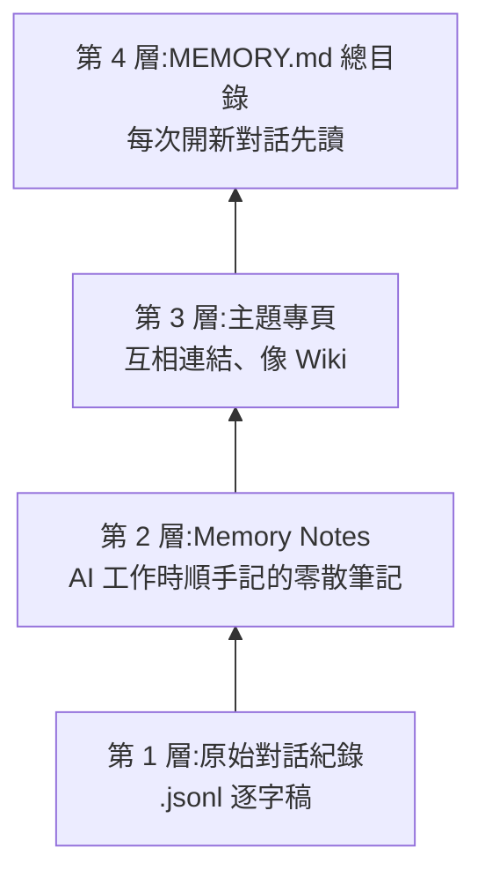
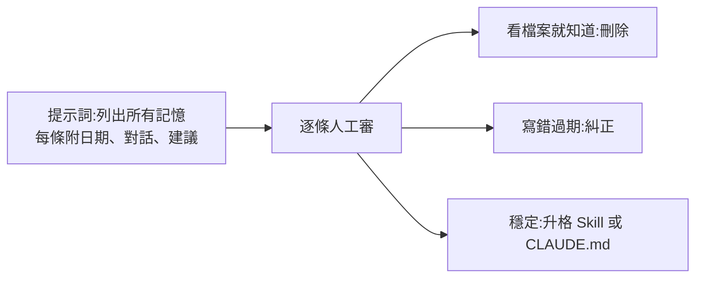

# Claude 的「做夢」:記憶四層、三個老化問題與手動整理法(Gary Chen + Anthropic 原文核實)

> ⚠️ **推廣揭露**:Gary Chen 說明欄與片尾推廣自己的 Skool 付費社群「AI 實戰營」,並提到影片的提示詞模板放在社群文章(需加入)。本筆記不含該模板。
>
> 影片:[AI 開始會做夢了?Claude 記憶拆解!睡覺後就越來越好用?](https://youtu.be/ZJkfmrbmuFg)|Gary Chen|2026-11-11|14:20
> 一手來源:Anthropic 工程文〈[The components of agent memory](https://anthropic.com/research/components-of-agent-memory)〉(2026-11-06,已讀全文)、[Claude Code Memory 官方文件](https://code.claude.com/docs/en/memory)(已讀相關段)。

## TL;DR

- 影片的主軸對:Claude 的記憶就是**檔案**,「做夢」是把檔案與 context 整理自動化,趁閒置在背景做([12:54](https://youtu.be/ZJkfmrbmuFg?t=764)–[13:19](https://youtu.be/ZJkfmrbmuFg?t=789))。
- 但有三處口徑要修正(見 §5):①官方文章沒有「四層架構」這個說法,是 Gary 的歸納;②官方列的 dreaming 用途不只三件;③「auto dream 滿 24 小時且 5 個對話才觸發」**不在官方文章或官方文件裡**,只有社群文章這樣寫。
- 最實用的是 Gary 的判斷標準:**記憶只收「光看現在的檔案猜不到、不記下次一定再犯」的東西**([9:44](https://youtu.be/ZJkfmrbmuFg?t=574)–[10:41](https://youtu.be/ZJkfmrbmuFg?t=631));並用「請列出每條記憶 + 日期 + 建議留/改/刪/升格」的提示詞定期審([11:51](https://youtu.be/ZJkfmrbmuFg?t=701))。

## 1. 記憶放在哪(影片 0:57–3:04)

| 項目 | 影片說法 | 時間 |
|---|---|---|
| 位置 | 家目錄 `.claude/projects/<專案>/` 下有 `.jsonl` 對話紀錄與 `memory/` 資料夾 | [1:36](https://youtu.be/ZJkfmrbmuFg?t=86)–[1:51](https://youtu.be/ZJkfmrbmuFg?t=101) |
| 寫入方式 | 另開一份筆記檔,再到 `MEMORY.md` 目錄檔加一行連結 | [1:28](https://youtu.be/ZJkfmrbmuFg?t=78)–[1:33](https://youtu.be/ZJkfmrbmuFg?t=83) |
| 新對話 | 先讀 `MEMORY.md`,需要時順連結開專頁 | [2:12](https://youtu.be/ZJkfmrbmuFg?t=122)–[2:16](https://youtu.be/ZJkfmrbmuFg?t=126) |
| 本質 | 模型本身沒有記憶,是 harness 讓它寫檔再讀檔 | [2:25](https://youtu.be/ZJkfmrbmuFg?t=135)–[2:34](https://youtu.be/ZJkfmrbmuFg?t=144) |
| 與 CLAUDE.md 差別 | CLAUDE.md 是人寫的「員工手冊」(少變的鐵律);MEMORY.md 是 AI 自己的隨手筆記 | [2:48](https://youtu.be/ZJkfmrbmuFg?t=158)–[3:04](https://youtu.be/ZJkfmrbmuFg?t=174) |

官方文件對照(已核實):`MEMORY.md` 與各 topic 檔放在專案的 auto memory 目錄;**每次對話開頭只載入 `MEMORY.md` 的前 200 行或前 25KB(先到者為準)**,topic 檔不在啟動時載入,Claude 需要時再用一般檔案工具讀;超過上限的寫入不會失敗,但 Claude Code 會回錯誤要求重寫索引([官方文件](https://code.claude.com/docs/en/memory))。影片只講「200 行」,漏了 25KB 這個條件。

## 2. 影片的「四層」與官方的對應

- 時間:第 1 層 [3:33](https://youtu.be/ZJkfmrbmuFg?t=203)、第 2 層 [3:58](https://youtu.be/ZJkfmrbmuFg?t=228)、第 3 層 [4:05](https://youtu.be/ZJkfmrbmuFg?t=235)、第 4 層 [4:52](https://youtu.be/ZJkfmrbmuFg?t=282)。
- 專頁互相連結等同 Progressive Disclosure([4:32](https://youtu.be/ZJkfmrbmuFg?t=262));並類比 Knowledge Graph 與 Karpathy 的 LLM Wiki([4:46](https://youtu.be/ZJkfmrbmuFg?t=276)),本庫對應筆記見 [[llm-wiki-karpathy]]。
- 官方文章其實講的是:日誌/逐字稿 → memory notes → 以 dreaming 建出的記憶表示(例如 wiki)→ 預載進每次對話的頂層。與影片的四層大致可對上,**但官方沒有把它稱為「四層架構」**,四層是 Gary 的整理。

### 應用案例:你的客戶窗口換人

第 3 層放「客戶 A.md」與「報價單規範.md」,前者寫「報價見〈報價單規範.md〉」。Claude 讀客戶 A 時順連結帶到報價規則,不必把報價細節塞進每次都載入的 `MEMORY.md`。

## 3. 用久了的三個問題

| 問題 | 層 | 影片例子 | 時間 |
|---|---|---|---|
| 記憶過期或寫錯,AI 自己不會發現 | 筆記 | 窗口王經理換成李經理,記憶沒改,下次信寄給舊窗口 | [5:37](https://youtu.be/ZJkfmrbmuFg?t=327)–[6:17](https://youtu.be/ZJkfmrbmuFg?t=367) |
| 越寫越亂、同一件事散在多處 | 專頁 | 三個月後客戶 A 的事散落五處 | [6:20](https://youtu.be/ZJkfmrbmuFg?t=370)–[6:41](https://youtu.be/ZJkfmrbmuFg?t=391) |
| 總目錄過長,超過 200 行讀不到,還吃 context | 頂層 | 舊記憶燒錢又拉低表現 | [6:41](https://youtu.be/ZJkfmrbmuFg?t=391)–[6:57](https://youtu.be/ZJkfmrbmuFg?t=407) |

官方原文對應的案例(已核實):在 Pokémon Red 測試中,Claude 把寶可夢中心位置寫錯(寫成在月見山東側),宣告「Mt Moon DONE」後掉下單向岩壁、回到原路線。未修正的筆記下掉下三次,最後退回上一個城鎮,沒有抵達下一座城市;跑一次 dreaming 用逐字稿核對後改正筆記,Claude 回洞穴並抵達下一座城市([官方文章](https://anthropic.com/research/components-of-agent-memory))。

## 4. 做夢在做什麼:影片 vs 官方

影片說做夢做三件事([7:21](https://youtu.be/ZJkfmrbmuFg?t=431)):

1. 拿原始對話核對筆記,改掉過期與記錯的([7:27](https://youtu.be/ZJkfmrbmuFg?t=437))。
2. 把散亂筆記合併成 wiki 並補連結([7:42](https://youtu.be/ZJkfmrbmuFg?t=452))。
3. 把重要資訊往上提、細節往下放,讓 `MEMORY.md` 保持精簡([7:56](https://youtu.be/ZJkfmrbmuFg?t=466))。

官方文章(已核實)除了這三項,還列了:

- **針對目標調校記憶**:合約任務一開始讓多個 agent 寫同一張共用條款表,57 項事實只留下 41 項(72%)(多 agent 互相覆蓋);改成每份合約一個頁面、逐字引用條款後,57 項全部保留(100%)。
- **補洞**:wiki 常連到尚未建立的頁面,第二輪 dreaming 在一個任務中發現 9 個指向缺頁的連結並改指向既有頁面,另外補了 3 頁,包含索引。

官方量化結果(自建評測,官方自己的資料):

| 評測 | 結果 |
|---|---|
| Stainless 內部文件約 35 萬檔、約 4.2 億 tokens,25 題 | 做夢從 2 次擴到 128 次,僅用 wiki 的分數從 13% 升到 48% |
| 同上,wiki + 搜尋 vs 只搜尋 | 54% 升到 61%,只搜尋為 53%;每題省約 2 萬 tokens |
| 併購文件 24 題 | 需整合多份文件的題目,用 wiki 87%,只搜尋 73% |
| 某個 Harvey LAB 任務 | wiki 無明顯增益;另一任務 wiki 比原始文件還大 |
| Pokémon:Sonnet 3.7 vs Fable 5 | 413 個記憶檔 / 225 個資料夾、1 枚徽章 vs 9 個檔 / 2 個資料夾 + `global.md`、4 枚徽章(各一次執行) |

這些是 **Anthropic 自己的實驗**,而且 Pokémon 比較是各一次、跨模型世代,不能直接推論「少記就一定更好」。官方本身也提醒:dreaming 要花算力,頂層注入的錯誤筆記會帶進每個 session。

### Gary 提的「auto dream」(24 小時 + 5 個對話)

影片說翻 Claude Code 程式會看到 auto dream:距上次整理超過 24 小時、且期間至少開過 5 個對話就在背景跑,步驟包含合併重複、把「昨天」換算成確切日期、刪矛盾舊紀錄、把 `MEMORY.md` 修剪到 200 行內([8:10](https://youtu.be/ZJkfmrbmuFg?t=480)–[8:38](https://youtu.be/ZJkfmrbmuFg?t=508))。

- 我查了:官方 Claude Code memory 文件**沒有** `auto dream` 或 `/dream`。官方工程文章也只說 dreaming 是一個「過程」,並提到 Managed Agents 與 cookbook,沒給 24 小時與 5 個對話。
- 社群文章(例如 [implicator.ai](https://www.implicator.ai/anthropic-adds-auto-dream-to-claude-code-fixing-memory-decay-between-sessions/)、[claudefa.st](https://claudefa.st/blog/guide/mechanics/auto-dream))都寫了相同門檻,並說是漸進推出、受伺服器端旗標控制,且 `/dream` 是未文件化指令。我只讀到搜尋摘要,**未逐篇讀全文**。
- 結論:門檻**無法由官方來源核實**,版本與是否已對你的帳號開啟要看 `/memory` 設定;不要把 24 小時 / 5 個當成保證行為。

## 5. 驗證表

| 影片說法 | 狀態 | 說明 |
|---|---|---|
| Anthropic 發文談 dreaming,借用海馬迴重播 | ✅ 已核實 | 官方文章開頭即此類比,並引用 Letta 與 UC Berkeley 的 sleep-time compute |
| 約 200 萬觀看、超過一萬收藏 | ⚠️ 未能核實 | 屬 X 平台數字,我未取得 |
| 記憶四層架構是 Anthropic 提出 | ⚠️ 需修正 | 官方有同樣元件,沒有「四層」命名 |
| 做夢主要做三件事 | ⚠️ 需修正 | 官方至少還有調校目標與補洞 |
| `MEMORY.md` 只載入前 200 行 | ⚠️ 需修正 | 還有 25KB 上限,先到者為準 |
| auto dream 24 小時 / 5 個對話 | ⚠️ 未能核實 | 只有社群文章,官方文件沒有 |
| auto dream 不碰 CLAUDE.md 與 Skill,只標註衝突 | ⚠️ 未能核實 | 官方文章未提;屬 Gary 解讀 |
| 「記憶是 AI 沒做夢就越用越亂」 | 屬觀點 | 官方也承認過度記錄會讓記憶過時(Pokémon 例) |

## 6. 該記什麼、怎麼整理(Gary 的做法,屬個人經驗)

**判斷標準**([9:41](https://youtu.be/ZJkfmrbmuFg?t=571)–[10:41](https://youtu.be/ZJkfmrbmuFg?t=631)):記憶的唯一目的是讓未來的 AI 不再踩同一個坑、不再被你糾正第二次。

- **不該記**:資料夾結構、剛改了哪個檔案這類看檔案就知道的現況,過兩天就變假消息。
- **該記**:你糾正過的習慣、來回試錯才找到的坑、為什麼選 A 不選 B 的原因,這些不會出現在程式碼裡。

**為什麼還需要獨立的記憶**:經驗邊工作邊長出來,你不會每次糾正就停手去改 CLAUDE.md,也不敢讓 AI 隨手改 CLAUDE.md,所以 memory 是「第一線草稿本」,驗證後再**升格**:固定流程搬進 Skill,所有工作都要遵守的死規矩搬進 CLAUDE.md([11:20](https://youtu.be/ZJkfmrbmuFg?t=670)–[11:48](https://youtu.be/ZJkfmrbmuFg?t=698))。

**他的流程**([11:51](https://youtu.be/ZJkfmrbmuFg?t=701)–[12:38](https://youtu.be/ZJkfmrbmuFg?t=748)):

新模型出來時會做一次;也可設定排程讓 Claude 夜間跑清單,隔天幾分鐘審完([12:24](https://youtu.be/ZJkfmrbmuFg?t=734))。

### 應用案例:給自己用的審查提示詞(自擬,非 Gary 原文)

> 列出你目前所有的 memory 條目。每條包含:內容、記下的日期與來源對話、是否能從目前檔案直接看出、建議(留/改/刪/升格到 Skill 或 CLAUDE.md)與理由。不要修改任何檔案,先給清單。

回傳後,先刪「看檔案就知道」的條目,再處理過期的。這個提示詞是我依 Gary 描述的流程自擬,他的模板在付費社群。

### 本庫經驗對照

本庫的 CLAUDE.md 精簡與維護方法見 [[claude-md-cut-82-percent-and-maintain-it]];Markdown 記憶的通用設計見 [[markdown-agent-memory]];記憶形式與功能的學術綜述見 [[agent-memory-survey-forms-functions-dynamics]];同一篇 Anthropic 文章的週報版見 [[ai-morning-news-weekly-2026-11-05-to-11-10-juya]] §1.4。Gary 先前的概念圖見 [[claude-code-beginner-concept-map-gary]]。

## 來源

- 影片:[AI 開始會做夢了?Claude 記憶拆解!](https://youtu.be/ZJkfmrbmuFg)(Gary Chen,2026-11-11)。逐字稿:YouTube 自動字幕(zh-Hant,帶時間,非官方字幕);抓取時有 429,最終寫出檔案並已全程讀完。說明欄含 Skool 社群連結 [https://www.skool.com/gary-chen](https://www.skool.com/gary-chen)(推廣,未加入)。
- Anthropic:[The components of agent memory](https://anthropic.com/research/components-of-agent-memory)(2026-11-06,Lance Martin;已讀全文)。
- Claude Code 官方文件:[Memory](https://code.claude.com/docs/en/memory)(已讀 CLAUDE.md 與 auto memory 段落)。
- 社群報導(僅讀搜尋摘要):[implicator.ai](https://www.implicator.ai/anthropic-adds-auto-dream-to-claude-code-fixing-memory-decay-between-sessions/)、[claudefa.st](https://claudefa.st/blog/guide/mechanics/auto-dream)。
