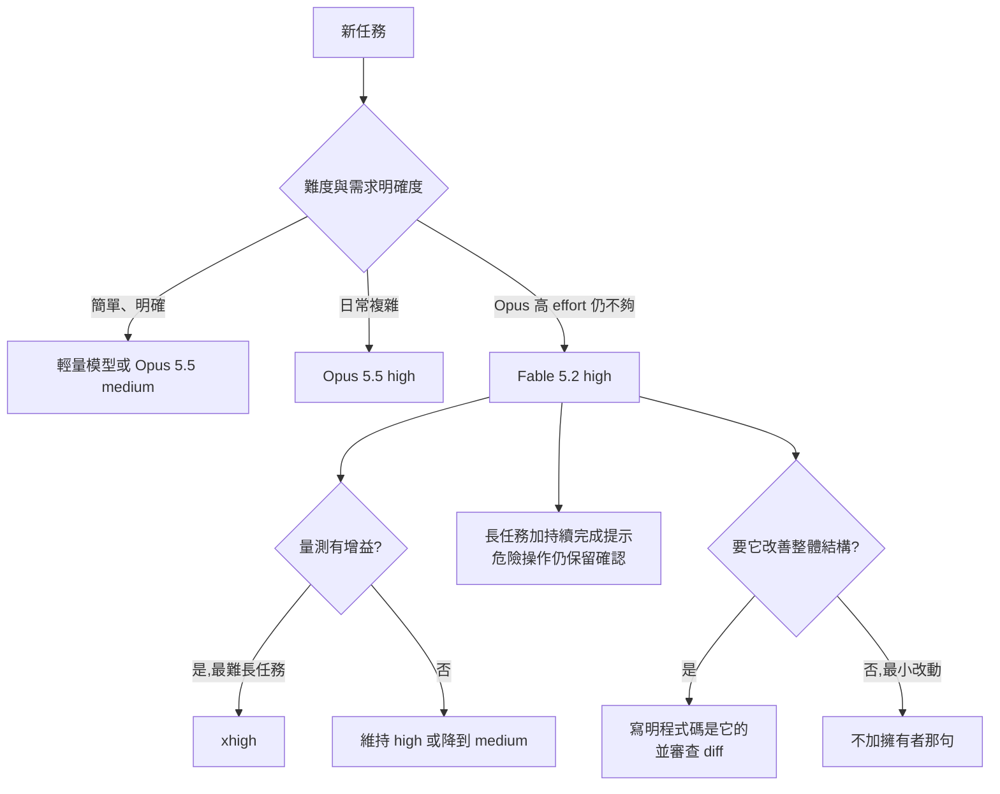

# Fable 5.2 該怎麼下提示:Anthropic 官方提示指南的十項調整與影片漏講的細節(Why QQ + 官方文件對照)

> **來源影片:** Why QQ(為什麼叫 QQ)〈Fable 5.2 越用越…?1M 上下文 | 任務 | 推理〉(標題字幕亂碼,以影片頁為準),12 分 39 秒,2026-11-13 上傳。官方簡體字幕已讀,時間點全取自帶時間字幕(連結已提前 10 秒)。
> **立場與利益揭露:** 逐字稿中沒有業配或聯盟口播;說明欄未逐字檢查。
> **本篇做了什麼:** 影片講的「官方提示工程指南」我直接讀了 Anthropic 文件〈Prompting Claude Fable 5.2〉與〈What's new in Claude Fable 5.2〉全文(2026-11-14 讀取),逐項核對影片的數字與建議。**影片大多正確**,但有三處歸屬不準、兩處漏掉重要限制,見 §3。
> 相關既有筆記:[[claude-fable-5-2-1000-agents-os-fermat-harness-why-qq]](同一模型的發布、基準分數與 1000 Agent 實驗核實)、[[claude-md-cut-82-percent-and-maintain-it]](CLAUDE.md 瘦身)、[[fable-5-1-usability-over-capability]](先用 Opus 的選型脈絡)、[[claude-memory-dreaming-four-layers-gary]](記憶累積的老化問題)。

## TL;DR

1. **選型:** 官方原話是「多數工作先用最新 Opus,等 Opus 在較高 effort 仍達不到需求,再換 Fable 5.2」。價格 Fable 5.2 是 8/40,Opus 5.5 是 4/20(美元/百萬 token),正好兩倍 ✅。
2. **effort:** API 預設是 `high`,**官方叫你從 high 開始,再跑 medium 與 xhigh 對照**。「只開最大」不是建議。
3. **最容易被忽略的一條:** 這個模型對「誰擁有程式碼」極敏感。一句「你是這個程式碼庫的擁有者與長期維護者」,合併重複程式碼的比例從不到 10% 升到約 75%,代價是輸出 token 多 70–80%,還會做你沒要求的改動。**影片漏講:前面寫了「不要順手重構」也壓不住這句**(超過一半的跑次仍會合併)。
4. **「別提早收工」提示詞有效但有代價:** 提前結束的未完成工作約減半,輸出 token 約多 30%;**官方同時提醒,有了它,危險操作的確認要自己保留**。
5. **自建 harness 的人必看:** Fable 5.2 的 thinking block 綁定歷史,**改了前面的 system、tools 或舊訊息再繼續對話會得 400 錯誤**;影片只講到「追加式歷史」,漏了官方給的 `drop_block` 逃生口與其代價。
6. ⚠️ 影片把「tests.json / progress.txt」「Claude Code 官方建議不必加驗證提醒」說成 Anthropic 的建議,這兩項**不在這份指南裡**,我標未能核實(見 §3)。

## 1. 影片逐項重點與官方對照

| 時間 | 影片說法 | 官方對照 |
|---|---|---|
| [0:54](https://www.youtube.com/watch?v=3CQsXeGSWTI&t=44s) | 1M 上下文、最大輸出 128k、自適應推理一律開啟 | ✅ What's new:「1M token context window (default and maximum) and 128k max output tokens」;「adaptive thinking is always on」 |
| [1:55](https://www.youtube.com/watch?v=3CQsXeGSWTI&t=105s) | API 輸入輸出單價都是 Opus 5.5 的兩倍;多數開發者先用 Opus 5.5 | ✅ 官方 Pricing:Fable 5.2 8/40、Opus 5.5 4/20;What's new:「start with the latest Claude Opus model」 |
| [1:06](https://www.youtube.com/watch?v=3CQsXeGSWTI&t=56s)–[1:31](https://www.youtube.com/watch?v=3CQsXeGSWTI&t=81s) | FrontierCode 2.0 Xhigh 49.1% 對 Opus 5.5 45.5%;FrontierSWE v2 69.9% | ✅ 已在 [[claude-fable-5-2-1000-agents-os-fermat-harness-why-qq]] 對發布頁核實;注意官方表格是「各模型最高 effort」,並非同檔位比較 |
| [2:15](https://www.youtube.com/watch?v=3CQsXeGSWTI&t=125s) | High effort 接近 Opus 5.5 最高成績、單任務成本更低 | ✅ 同上既有筆記已核實,官方限定為早期測試 |
| [2:39](https://www.youtube.com/watch?v=3CQsXeGSWTI&t=149s) | 五個 effort 等級;Claude Code 預設 Medium | 五級 ✅;**「Claude Code 預設 Medium」這份指南沒寫,指南寫的是 API 預設 `high`**,Claude Code 的預設我沒核實,標未能核實 |
| [3:05](https://www.youtube.com/watch?v=3CQsXeGSWTI&t=175s) | 先從 High 評測,再比 Medium 與 Xhigh | ✅ 「Where to start」第 1 步:設 `high`,再跑 `medium` 與 `xhigh` |
| [4:14](https://www.youtube.com/watch?v=3CQsXeGSWTI&t=244s) | 「長期維護者」提示:合併重複從不足 10% 到約 75%;輸出 +70–80%;可能改你沒要求的功能 | ✅ 全部吻合;**漏掉的限制見 §3-1** |
| [5:09](https://www.youtube.com/watch?v=3CQsXeGSWTI&t=299s) | CLAUDE.md 寫「所有任務必須委派 Subagent」要重新檢查;單檔修改、需共享狀態的工作直接做更快 | 官方:重新檢查「standing instructions to delegate」✅;「直接做更快」是影片自己的推論 |
| [5:35](https://www.youtube.com/watch?v=3CQsXeGSWTI&t=325s) | Fable 做關鍵判斷、Sonnet 或 Haiku 做搜尋與整理 | 官方只說「subagent 可能佔掉一大部分成本,先確認 subagent 預設用哪個模型」,**分工配置是影片自己的建議**,官方沒寫 |
| [5:52](https://www.youtube.com/watch?v=3CQsXeGSWTI&t=342s) | 1000 Agent、28.7 小時、60 個命題、47 條引理的費馬 Lean 形式化 | ✅ 已在既有筆記對官方文章核實;影片說「早期版本的 Fable 5.2」,官方文章同樣限定 |
| [6:45](https://www.youtube.com/watch?v=3CQsXeGSWTI&t=395s) | 低、中 effort 下可能提前結束,要明確要求持續推進;危險操作保留人工確認 | ✅ 見 §2-2 |
| [7:19](https://www.youtube.com/watch?v=3CQsXeGSWTI&t=429s) | 加入持續完成指令後,未完成的會話減少約一半,token 也增加 | ✅ 「about half as many sessions ended with unfinished work」、輸出約 +30%(情境:以 medium 重放某編碼產品的錄製會話) |
| [7:43](https://www.youtube.com/watch?v=3CQsXeGSWTI&t=453s) | 模型會主動自我驗證,Claude Code 官方建議不必重複加泛泛的驗證提醒 | **這份指南沒有這句**,未能核實(可能出自 Claude Code 文件,我沒讀) |
| [8:22](https://www.youtube.com/watch?v=3CQsXeGSWTI&t=492s) | Anthropic 建議用 tests.json、progress.txt、統一啟動腳本、Git 做跨視窗狀態 | **不在這份指南或 What's new 裡**,未能核實出處;做法本身合理,但別當成這份指南的官方條文 |
| [9:03](https://www.youtube.com/watch?v=3CQsXeGSWTI&t=533s) | CLAUDE.md 累積的互相衝突規則要清理 | ✅ 官方「Keep caution from piling up」與「Rules, notes, and memories that have built up」 |
| [10:24](https://www.youtube.com/watch?v=3CQsXeGSWTI&t=614s) | 自建 Agent loop 要注意 preserved thinking,改前文會 400 | ✅ 見 §2-5 |

另外影片 [0:28](https://www.youtube.com/watch?v=3CQsXeGSWTI&t=18s) 說「顯示 token 預算可能讓模型花更多」:✅ 官方「A token budget shown to the model」:在 `high` 與 `xhigh` 的編碼任務上,拿掉一個大預算降低了成本且表現相當。**這是 prompt 文字,不是 API 的 task budgets(beta)**,官方明說該測試沒涵蓋後者。

## 2. 官方指南的實際內容(影片沒講全的部分補在這裡)

### 2-1 effort 對照

| 檔位 | 官方定位 |
|---|---|
| `low` | 快速來回、規格明確的任務、高量子代理;編碼評測上 Fable 5.2 的 low 接近 Fable 5.1 在更高 effort 的成績 |
| `medium` | 互動式編碼、聊天、日常知識工作 |
| `high`(API 預設) | 難的編碼、研究、agent 工作、長時間無人看顧;「most of the capability gain」已在 high |
| `xhigh` | 只用在你量過有增益的最難長任務;內部編碼評測小幅提升、token 多很多 |
| `max` | 測模型上限,或科學探索與數學這類時間與 token 不重要的開放題 |

重點補充:①**high 以上幾乎每次回覆前都會思考,連打招呼也會**;②「請直接回答不要思考」這類指令在 medium 以上**擋不住**思考,要降 effort 才有效;③effort 對回覆長度影響很小,長短要靠提示;④同一流程可混用檔位(先用 medium 規劃,長時間無人段再升),用 per-message effort(beta)可保住 prompt cache。

### 2-2 「別提早收工」與核准(Approvals)

官方提供的 `# Finishing work` 提示詞重點:別在還欠使用者工作時停下;遇到錯誤、逾時、鎖檔、空結果要先診斷、用手上權限繞過;**被明確設為硬性阻擋的(標記不可動的檔案、刻意不給的權限、安全護欄)要停手並說明**;「這不覆蓋危險或破壞性操作需要確認的原則」。

**影片漏講的核准細節:** 叫模型繼續時,回覆要具體(「對,在 staging 資料庫跑 migration」),不要只回「go」。若在 system prompt 寫核准規則,要精確列出動作:官方測試中,把「對對話外的人發訊息」列為需核准項,模型就把**約一半**對同事與其他團隊的例行請求都扣住不發。

### 2-3 誰擁有程式碼

- 沒提擁有權,或把程式碼說成別人的:模型傾向在既有結構上追加,即使重複。
- 說「你是擁有者與長期維護者,設計由你決定」:合併重複程式碼從 <10% 的跑次升到約 **75%**,有時順手修相關問題。
- 代價:輸出 token +70–80%、做了沒要求的事(很多是新增測試與文件)、有時改了既有功能行為,而且**結尾 PR 摘要常漏掉小改動**,要看 diff 不要只看摘要。
- ⚠️ 擁有者不是你(使用者擁有、要求最小改動)就別加這句;**「No drive-by refactors, renames or cleanups」寫在前面也壓不住**,超過一半跑次仍合併。

### 2-4 子代理與累積的謹慎

- 委派程度取決於 harness:在最小子代理工具的短任務很少委派;在 prompt 邀請委派的編碼產品裡會積極委派。xhigh/max 下會用子代理審查自己的成果。
- 只在「開太多子代理」時才改工具描述;官方測試:在 high 下,一段著重成本說明的較長描述讓子代理數量約減半。
- 累積的謹慎(記憶、筆記、指令檔):刪掉過期的、**列出可自由執行的例行步驟**、檢查「第一個錯誤就停下檢視」這類條件、**把含 never 的絕對規則改成帶範圍的**(例:「刪檔前要核准」取代「永不刪檔」),因為模型把 never 當絕對。

### 2-5 preserved thinking 與自建 harness

- 在 Fable 5.2,請求若沒通過 **prefix check**(system、tools、任何前面訊息自模型產出 thinking block 後被動過),得 **400**,訊息「The block is bound to a different conversation」。
- 用 Claude Code、claude.ai、Managed Agents、Agent SDK 組請求的,**不受影響**;自己組請求的才要處理。
- 規則:`system` 與 `tools` 全程不變;`messages` 只追加不改、不重排、不刪;每個 assistant 回合**原樣**(每個 block、同順序)送回。
- 要縮短歷史:用 context editing 或「摘要之後不留舊回合」的 compaction;要中途改指令:放在最新一回合,或用 mid-conversation system message。
- 逃生口:beta header `thinking-binding-controls-2026-08-01` 加 `thinking.block_binding.prefix_mismatch_behavior: "drop_block"`,會丟掉失效的 block 並在 `input_transformations` 列出;但**每回合都丟的最壞情況下,模型要重想、輸出 token 變多**,官方定位為「修好編輯前的權宜之計」。
- 切換模型:Fable 5.2 的 thinking block 只有 Fable 5.2、Mythos 5.2 讀得到;轉去 Opus 5.5 或 Fable 5.1 等其他模型,那幾回合的推理會遺失(API 會丟掉不讀的 block,不計費)。

### 2-6 影片沒提的三項

1. **進度更新不顯示的坑:** 模型在工具呼叫之間寫的進度更新以 `thinking` block 回傳,預設 `thinking.display: "omitted"` 時文字是空的,只渲染 `text` 的客戶端會看起來整段沉默。要設 `"updates"`(beta)或 `"summarized"`。
2. **最終報告要能獨立看懂:** 官方給 `# Communicating clearly` 提示詞(讀者沒看過你的工具呼叫、重點放前幾句、不用自己發明的術語、近似 ASD-STE100 簡化技術英語)。官方也警告:「一句 20 字以內」這類硬性風格規則會讓文字變得破碎。
3. **拒答(refusal):** 分類器可能回 `stop_reason: "refusal"`,類別含 `cyber`、`bio`、`frontier_llm`、`reasoning_extraction`、`general_harms`。若你的 prompt 要求模型把推理寫進回覆,會觸發 `reasoning_extraction`,要移除,改用 `display: "summarized"` 讀 thinking。善意的資安與生命科學工作也可能被擋,要走官方驗證計畫;**Mythos 5.2 與 Fable 5.2 能力相同,但只給通過驗證的組織**。

## 3. 影片與官方的出入

1. **漏掉的限制(重要):** 擁有者提示壓不住的是「只寫範圍限制」,而且摘要會漏報小改動。實務上兩種模式的切換要靠不同 prompt,而不是同一份 prompt 再加一句禁止。
2. **歸屬不準:**
   - 「Claude Code 預設 Medium」:指南寫的是 API 預設 high,Claude Code 的預設我沒查到,**未能核實**。
   - 「tests.json、progress.txt、統一啟動腳本」與「Claude Code 官方建議不必加驗證提醒」:兩者都不在這兩份官方文件裡,影片說是 Anthropic 建議,我找不到出處。
   - 「Fable 做關鍵判斷、Sonnet/Haiku 做搜尋」:官方沒有這個分工建議,只說要檢查子代理的預設模型。
3. **漏掉的重要細節:** `drop_block` 逃生口及其成本;核准規則要精確列出動作;進度更新預設是空的;報告提示詞;拒答分類。
4. **時效:** 官方指南的提示詞範例與測試數字(30%、70–80%、約一半)都是 Anthropic 自己的小型測試,**不是通用保證**,官方也要求「在你自己的任務上量測」。

圖說:整合影片 [11:36](https://www.youtube.com/watch?v=3CQsXeGSWTI&t=686s) 的固定流程與官方「Where to start」。選型路徑出自官方 What's new 與 Pricing,「是否加擁有者提示」出自指南 §2-3。

## 4. 應用案例

**案例一:升級到 Fable 5.2 前的「提示審計」。** 照官方清單把自己的 system prompt、skills、agent 檔、記憶檔掃一遍:①有沒有「所有任務都委派」②有沒有「直接回答不要思考」③有沒有顯示 token 預算 ④有沒有「never」開頭的絕對規則 ⑤有沒有硬性字數限制。逐條問「它解決什麼問題、現在還存在嗎」,刪或改成帶範圍的寫法。這與 [[claude-md-cut-82-percent-and-maintain-it]] 的做法同向。

**案例二:兩個 prompt 模式。** 修線上 Bug 時用「精準維護」(不加擁有者那句,並要求只動必要檔案);季度技術債清理時用「長期維護」(加那句,預期輸出多 70–80%,結束後審查 diff 並對照 PR 摘要有沒有漏報)。不要把兩者混成一份 prompt。

**案例三:自建 agent loop 的上線檢查。** 寫三條測試:①連續多回合後 `system` 與 `tools` 是否位元組相同 ②每個 assistant 回合是否原樣回傳 ③壓縮歷史用的是 compaction 還是手改舊訊息。任何一條不過,Fable 5.2 會回 400;先修好,別一開始就用 `drop_block`。

**案例四:長任務的終止條件。** 要讓 Agent 通宵做遷移:加「別提早收工」提示詞(預期輸出 +30%)、明列不需核准的例行步驟、把「遇第一個錯誤就停」改成「先診斷再繞過,硬阻擋才停」,並把刪除、改生產環境、強制推送留給人工確認。

**案例五:給非工程師同事的報告。** 把官方 `# Communicating clearly` 貼進 system prompt,並移除既有的「每句 20 字」之類硬性規則,避免破碎文字。

## 5. 核實總表

| 項目 | 結果 |
|---|---|
| 1M 上下文、128k 輸出、adaptive thinking 一律開啟 | ✅ What's new |
| 價格 8/40 對 Opus 5.5 的 4/20(兩倍) | ✅ 官方 Pricing |
| 先用 Opus、不夠再換 Fable | ✅ What's new |
| API 預設 high;先 high 再比 medium、xhigh | ✅ 指南與 What's new |
| 擁有者提示 <10%→約 75%、輸出 +70–80% | ✅ 指南(Anthropic 小型編碼任務測試) |
| 持續完成提示:未完成會話約減半、輸出約 +30% | ✅ 指南(medium 重放某編碼產品會話) |
| 顯示 token 預算增加花費 | ✅ 指南(限 prompt 文字,不含 task budgets) |
| 改前文觸發 400、追加式歷史 | ✅ What's new 與指南 |
| FrontierCode/FrontierSWE 與 1000 Agent 實驗 | ✅ 見既有筆記 |
| 「Claude Code 預設 Medium」 | 未能核實 |
| tests.json / progress.txt 為 Anthropic 建議 | 未能核實(不在這兩份文件) |
| 「Claude Code 官方建議不加驗證提醒」 | 未能核實 |
| Fable/Sonnet/Haiku 分工 | 影片自己的建議,官方未寫 |

## 來源

- 影片:Why QQ〈Fable 5.2 提示工程指南(1M 上下文 / 任務 / 推理)〉,https://www.youtube.com/watch?v=3CQsXeGSWTI(官方簡體字幕,非 Whisper)
- Anthropic〈Prompting Claude Fable 5.2〉:https://platform.claude.com/docs/en/build-with-claude/prompt-engineering/prompting-claude-fable-5-2
- Anthropic〈What's new in Claude Fable 5.2〉:https://platform.claude.com/docs/en/models/fable-5-2/whats-new-fable-5-2
- Anthropic〈Pricing〉:https://platform.claude.com/docs/en/about-claude/pricing
- Preserved thinking prefix check:https://platform.claude.com/docs/en/build-with-claude/preserved-thinking/prefix-checks
- Effort 文件(本篇未讀,僅作延伸入口):https://platform.claude.com/docs/en/build-with-claude/effort
