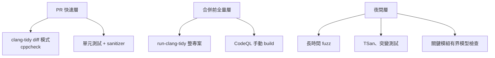

# 穩定開發大型 C/C++ 的工具箱:契約、靜態分析、形式驗證、fuzz 與 CI 分層(2026)

> 研究日期:2026-11-01。方法:網路蒐集標準委員會報告、官方文件、GitHub、arXiv。**抓取工具回傳頁面摘要而非全文**;P2900R14 PDF 抓取失敗(二進位),所以 `pre` / `post` / `contract_assert` 與評估語意**不是**讀原文得來。
>
> 相關:[[spec-driven-development-landscape-2026]]、[[code-to-spec-reverse-engineering-legacy-codebase]]、[[5g-nr-to-6g-modem-spec-to-code-flow]]、[[spec-code-flow-overview-greenfield-brownfield]]。

---

## 一句話總結

> **對大型既有 C++,最立即有效的不是新語法,而是「重新編譯即得」的改進(C++26 對未初始化讀取的處理、硬化標準庫)加上外部工具鏈(sanitizer、fuzz、靜態分析)。** 形式化驗證(CBMC、Frama-C WP)適合關鍵模組的**有界**證明,不是全程式。C++26 Contracts 已進標準但意見分裂,Profiles 延到 C++29。

---

## 一、語言層:契約與安全子集

### C++26 現況(Herb Sutter 2026-03 倫敦會議報告,已讀)

- C++26 技術工作在 2026-03 完成;最終投票 **114 贊成 / 12 反對 / 3 棄權**;2025-02 納入工作草案時是 100/14/12。Sutter 指不一致主因是 contracts 有「sustained technical concerns」。下一步是 DIS 國際投票,ISO 出版日期頁面未給。
- **Contracts(P2900R14)留在 C++26**。DevClass(2026-04)報導 Stroustrup 公開批評(稱「not minimal, it's not viable」並表示會建議不要使用),並指目前不支援 virtual functions;Contracts 曾於 2019 自 C++20 草案移除。(後兩點只有 DevClass,Sutter 報告未提。)
- **Profiles 不在 C++26**,安全 profile 工作是「targeting C++29」(Sutter 報告)。至於 Safe C++ 在 ISO 被放棄、改走 Profiles 的投票數(19/9/11/6),**只有 InfoWorld 搜尋摘要,未核實**。
- **重編譯即得的改進**(Sutter 報告):讀未初始化的區域變數不再是 UB;硬化標準庫平均約 **0.3%** 效能開銷;Google 報告修掉逾 1,000 個 bug、production segfault 率降 30%。cppreference 將此列為 erroneous behavior(P2795R5)。
- cppreference 的編譯器表 contracts 欄位只顯示 "16",我**推測**為 GCC 16,頁面沒有標明。

### 其他

- **C++ Core Guidelines** I.6 / I.8:`Expects()` / `Ensures()` 表達前後置條件,理由是「讓工具能使用」。
- **MISRA C++:2023**(2023-10 發布、合併 MISRA C++:2008 與 AUTOSAR C++14、約 179 條、基於 C++17):只有 Parasoft 等廠商文章,**未讀 MISRA 官方,未核實**。

---

## 二、形式化規格與驗證:能做到什麼規模

| 工具 | 做什麼 | 規模限制(來源說明) |
|---|---|---|
| **ACSL + Frama-C WP** | ACSL 是 C 的行為規格語言;WP 用 Hoare-style weakest precondition 證明性質,Eva 輔助 | 需寫註解;官方頁未提工業規模 |
| **CBMC** | C/C++ bounded model checker,支援 C89 到 C23 | **證明需把輸入限制在有界大小,保證僅涵蓋這些輸入**;官方訓練頁稱用於「十幾個工業專案」並接 CI |
| **ESBMC** | CBMC v2.9 的分叉,多前端、k-induction | 頁面稱 43 個競賽獎項(2012–2026) |
| Infer | Meta 的靜態分析,對 C/C++/Java 等,每次變更在 CI 驗證 | — |
| **TLA+** | 建模並行 / 分散系統;TLC 模型檢查、TLAPS 證明 | 產業案例與 Apalache **未核實** |
| seL4 | 從高階規格到二進位的機器檢查證明 | 假設組合語言、開機碼、硬體、DMA 正確;**規模數字沒取得** |

### LLM 補驗證證明

- AutoVerus(2409.13082):150 個證明任務,>90% 正確;Vericoding(2509.22908):12,504 份規格,成功率 Dafny 82% / Verus 44% / Lean 27%。
- **目標都是小到中型程式,不是大型 C**。

---

## 三、動態與測試

| 工具 | 要點(已讀) |
|---|---|
| **ASan** | 典型變慢約 2x,stack 記憶體最多約 3x |
| **TSan** | 約 5x–15x 變慢,記憶體 5x–10x;32 位元平台有問題 |
| **libFuzzer** | 官方文件寫明**進入維護模式**,原作者轉做 Centipede(Centipede 成熟度未核實);常搭 ASan/UBSan |
| **AFL++** | stable 分支 5.04a;persistent mode 該頁未提 |
| **OSS-Fuzz** | README(2025-05)稱逾 13,000 個漏洞、50,000 個 bug、約 1,000 專案 |
| **RapidCheck** | C++ 的 QuickCheck 風格 property-based testing,自動 shrinking,支援 stateful 測試,整合 GoogleTest |
| **Mull** | LLVM 基礎的 C/C++ 突變測試;README 沒更深入 |
| MC/DC | DO-178C Level A、ISO 26262 ASIL D 相關;**只讀到維基百科,標準原文為付費,C/C++ 專屬覆蓋率條文未核實** |

---

## 四、靜態分析與 CI 閘門

- **clang-tidy**:`run-clang-tidy.py` 平行跑 compilation database;**`clang-tidy-diff.py` 只回報變更行,不加速,可能漏掉別處受影響的問題,官方建議大改動合併前跑整個專案**。→ PR 用 diff 模式,合併前或夜間跑全量。
- **cppcheck**:目前 2.22;MISRA 與 CERT 各版本屬開源版或 Premium 版,頁面看不出,**未核實**。
- **Polyspace**:Bug Finder 與 Code Prover 兩種;頁面是廠商行銷,證明範圍與假設沒說明。
- **CodeQL**:C/C++ 預設設定「不需要 build」(none 模式,不分析生成碼);manual build 精度最佳。
- **Coverity**:沒取得官方頁,未核實。

---

## 五、建置與架構

- **Bazel**:遠端快取以 action 為粒度命中;環境變數與工作區外工具會造成未命中;hermetic 讓遠端 worker 不必匹配開發者主機軟體。
- **CMake**:Presets 用來分享 configure/build/test 設定給團隊與 CI;`UNITY_BUILD` 加速編譯但「可能導致 ODR 錯誤」,官方建議由開發者以 `CMAKE_UNITY_BUILD` 決定,專案勿強制開啟。
- **Abseil**:"live at head",全部從原始碼在 head 編譯就不會有 diamond dependency;頁面稱 Google 程式庫「over 250M lines of C++」,**未談 ABI 穩定**。
- **ABI 穩定、C++ modules 增量編譯實測、monorepo 對 C++ 的實證研究**:未核實。

---

## 六、LLM × C/C++

- **OSS-Fuzz-gen**:LLM 產生 fuzz harness。README 稱已回報 **30** 個新 bug / vulnerability;Google 2024-11-20 部落格稱 **26** 個新漏洞(含 OpenSSL CVE-2024-9143)、272 個 C/C++ 專案獲覆蓋增益。**兩邊原文都讀到了,但沒有解釋差異**(推論:統計母體與時間不同)。引用時請標來源與日期。
- **AI 產生 C 的風險**:FormAI-v2(arXiv 2404.18353):331,000 個可編譯 C 程式、九個 LLM,**至少 62.07%** 有漏洞。這是零樣本提示加 bounded model checking 的結果,不等於真實開發情境;另有搜尋摘要寫 265,000 / 63.47%,與 arXiv 摘要衝突,以 arXiv 為準。
- **DARPA TRACTOR**:見 [[code-to-spec-reverse-engineering-legacy-codebase]]。

---

## 七、應用案例

### 案例 1:為一個 100 萬行 C++ 程式庫設計 CI 分層

| 層 | 何時 | 內容 |
|---|---|---|
| 快速層 | 每個 PR | clang-tidy diff 模式、cppcheck、單元測試 + ASan/UBSan |
| 全量層 | 合併前 | `run-clang-tidy` 整專案、CodeQL manual build |
| 夜間層 | 每晚 | 長時間 fuzz、TSan、突變測試、關鍵模組 CBMC |

這個分層是本篇依各工具官方限制做的**推論**,不是某個來源的現成配方。

### 案例 2:只對關鍵模組做形式驗證

例如協定編解碼的邊界檢查:用 CBMC 在**有界訊息長度**內證明無越界,CI 每次跑;其餘模組靠 fuzz + sanitizer。CBMC 官方明講證明只涵蓋限定的輸入大小,所以要在文件中寫明「證明的範圍」。

### 案例 3:用契約表達規格

C++26 之前:用 `Expects()` / `Ensures()` 或自家 assert 巨集把前後置條件寫成程式;之後可評估 C++26 Contracts——但因意見分裂與編譯器支援尚未核實,**不要在 2026 年把 Contracts 當成唯一的安全網**。

---

## 八、核實與保留

**✅ 已讀原文:** Sutter 2026-03 報告(兩次確認)、cppreference C++26 頁、Core Guidelines I.6、ACSL / Frama-C / CBMC / Infer / seL4 頁、ASan / TSan / libFuzzer / AFL++ / RapidCheck / Mull / OSS-Fuzz 頁、clang-tidy / cppcheck / Polyspace / CodeQL 頁、Bazel / CMake / Abseil 頁、OSS-Fuzz-gen README 與 Google 部落格、TRACTOR 頁。

**⚠️ 保留 / 未核實:** P2900R14 內文語意、Safe C++ 投票數、MISRA 官方、Coverity、DO-178C / ISO 26262 條文、ABI 穩定與 monorepo 實證、TLA+ 產業案例、Centipede 成熟度。

---

## 來源

- Sutter 倫敦報告:https://herbsutter.com/2026/03/ (月份存檔頁);Kona 報告:https://herbsutter.com/2025/11/10/trip-report-november-2025-iso-c-standards-meeting-kona-usa/
- DevClass:https://www.devclass.com/development/2026/04/01/contracts-are-in-c26-despite-disquiet-over-their-value/5213555
- cppreference:https://en.cppreference.com/w/cpp/26 ;Core Guidelines:https://isocpp.github.io/CppCoreGuidelines/CppCoreGuidelines
- ACSL:https://frama-c.com/html/acsl.html ;CBMC:https://github.com/diffblue/cbmc 、 https://model-checking.github.io/cbmc-training/ ;ESBMC:https://github.com/esbmc/esbmc ;Infer:https://fbinfer.com/docs/about-Infer ;seL4:https://sel4.systems/Verification/ ;TLA+:https://lamport.azurewebsites.net/tla/tla.html
- AutoVerus:https://arxiv.org/abs/2409.13082 ;Vericoding:https://arxiv.org/abs/2509.22908 ;FormAI-v2:https://arxiv.org/abs/2404.18353
- ASan:https://clang.llvm.org/docs/AddressSanitizer.html ;TSan:https://clang.llvm.org/docs/ThreadSanitizer.html ;libFuzzer:https://llvm.org/docs/LibFuzzer.html ;AFL++:https://github.com/AFLplusplus/AFLplusplus ;RapidCheck:https://github.com/emil-e/rapidcheck ;Mull:https://github.com/AlexDenisov/mull ;OSS-Fuzz:https://github.com/google/oss-fuzz ;OSS-Fuzz-gen:https://github.com/google/oss-fuzz-gen ;Google 部落格:https://security.googleblog.com/2024/11/leveling-up-fuzzing-finding-more.html
- clang-tidy:https://clang.llvm.org/extra/clang-tidy/ ;cppcheck:https://cppcheck.sourceforge.io/ ;Polyspace:https://www.mathworks.com/products/polyspace.html ;CodeQL:https://docs.github.com/en/code-security/code-scanning/creating-an-advanced-setup-for-code-scanning/codeql-code-scanning-for-compiled-languages
- Bazel:https://bazel.build/remote/caching 、 https://bazel.build/basics/hermeticity ;CMake:https://cmake.org/cmake/help/latest/manual/cmake-presets.7.html 、 https://cmake.org/cmake/help/latest/prop_tgt/UNITY_BUILD.html ;Abseil:https://abseil.io/about/philosophy
- MC/DC(維基,非權威):https://en.wikipedia.org/wiki/Modified_condition/decision_coverage
- InfoWorld(僅搜尋摘要):https://www.infoworld.com/article/4065702/safe-c-proposal-for-memory-safety-flames-out.html
