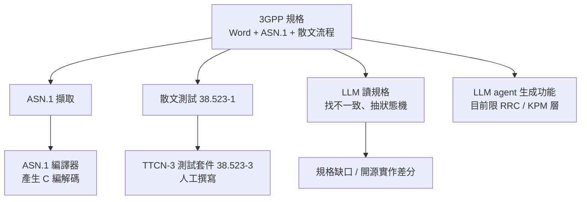

# 5G NR Modem 到 6G Modem:3GPP 規格如何變成程式碼,以及反過來

> 研究日期:2026-11-01。方法:3GPP 官方頁、ETSI、GitHub、arXiv abs 頁。**抓取工具回傳頁面摘要而非全文**。證據分三級:**【已讀】**抓到原頁、**【搜尋】**僅搜尋摘要、**【推論】**無一手來源的本篇推論。**modem 韌體的 real-time / 記憶體預算 / 追溯鏈等實務,找不到公開一手來源,全部標【推論】。**
>
> 相關:[[spec-driven-development-landscape-2026]]、[[code-to-spec-reverse-engineering-legacy-codebase]]、[[cpp-large-codebase-stability-toolbox]]、[[spec-code-flow-overview-greenfield-brownfield]]。通訊背景可參考 [[wifi-how-it-works]]。

---

## 一句話總結

> **通訊規格(3GPP)是「自然語言 + ASN.1 + 流程文字」的混合體,而且版本與 Release 持續疊加。** 目前成熟的 spec-to-code 只有 **ASN.1 → 編解碼器** 與 **人工撰寫的 TTCN-3 測試**;LLM 能做的是**找規格不一致**與**RRC / O-RAN 層的功能生成**(早期、案例少);**PHY / MAC 層從規格自動產碼,本次找不到任何一手證據。** 6G 的 Rel-21 時程決定了 ASN.1 凍結點,是 codec 回歸的關鍵節點。

---

## 一、規格長什麼樣:3GPP 結構與版本

【已讀】3GPP Portal 與系列說明:

| 系列 | 內容 |
|---|---|
| 38 series | NR 無線電(TS 38.2xx PHY、38.3xx MAC/RLC/PDCP/RRC 等);官方說明為 "Radio technology beyond LTE" |
| 24 series | 終端到網路的 stage 3 信令協定(如 24.501 NAS) |
| 36 series | LTE 無線 |

- **TS 38.331(NR RRC)**:RAN2 負責;各 Release 最新版本——Rel-19 **19.4.0**、Rel-18 **18.11.0**、Rel-17 **17.18.0**、Rel-16 **16.22.0**。頁面備註:支援 Rel-16 的廠商應使用 16.2.0 以上、Rel-17 應使用 17.2.0 以上——**Rel-N 的初期版本有已知問題**。
- 官方 FTP 放的是 **Word 檔(ZIP 內 .docx)**,**ASN.1 嵌在 Word 文件裡**,不是獨立的機器可讀來源。
- 【推論】因為如此,業界做法應是先擷取 ASN.1 再餵編譯器;擷取流程的自動化程度各廠不一,**無公開來源**。

### Release 時程(官方頁,Rel-21 我已親自重讀確認)

| Release | 重點 |
|---|---|
| Rel-15 | 2017 年底 NSA、2018 年完成,「first full set of 5G standards」 |
| Rel-19 | 「second 5G-Advanced release」;完整可實作規格於 2025-12 底完成 |
| **Rel-20** | Stage 1 2025-06 凍結;Stage 2 final freeze 2026-09;Stage 3 目標 2027-03;**ASN.1/OpenAPI freeze 2027-06**;6G 為**研究**:TR 22.870(使用案例與需求,已核准)、TR 38.914(RAN 情境與需求,2026-03 時完成 60%);頁面未列 6G work item |
| **Rel-21** | 「first normative 6G release」,也含大量 5G-Advanced 工作;2026-06 TSG#112 同意的時程:Stage-1 freeze 與套件核准 **2027-03**、Stage-2 80% **2028-03**、Stage-2 freeze **2028-06**、**Stage-3 freeze 2028-12**、**ASN.1/OpenAPI freeze 2029-03** |

**意涵**【推論】:Stage-3 凍結後約 3 個月才 ASN.1 凍結,RRC / NGAP 編解碼要等這個節點才穩定。每個 Release 的 ASN.1 凍結點,是 codec 層的回歸點:把「規格版本 → 產生碼 → golden vector」做成 CI。

---

## 二、規格 → 程式碼:現有技術的成熟度

| 層面 | 成熟度 | 證據 |
|---|---|---|
| ASN.1 → codec | **成熟(確定性編譯)** | asn1c README【已讀】:輸出 C,BSD-2-Clause,支援 BER/DER、OER、**UPER**、XER;**APER 不支援**。【推論】5G RRC 用 UPER、NGAP 用 APER,故 NGAP 常需其他編譯器——此處未讀到來源 |
| 規格 → 測試 | 成熟但人工撰寫 | ETSI 頁【已讀】:測試套件在 TS 38.523-3,由 RAN5 制定;稱為「standardized reference implementation」,並「verified against different types of commercially available UEs」;對應散文測試案例 38.523-1 |
| 規格 → 狀態機(LLM) | 研究 | SpecGPT(arXiv 2510.14348)從 3GPP 抽狀態機,評估 NAS、NGAP、PFCP;摘要無數字(搜尋摘要稱 NAS 狀態 F1 100%,**未核實**) |
| 規格 → 缺陷 / 不一致 | 研究,已有實證 | 見下表 |
| 規格 → 功能碼(agent) | 早期,限 RRC / KPM | GENESIS,見下 |
| **規格 → PHY / MAC 碼** | **未找到任何一手證據** | 搜尋沒有此類論文 |

### LLM × 3GPP 論文(已讀 arXiv abs 頁)

| 論文 | 重點 |
|---|---|
| Telco-RAG(2404.15939) | 針對 3GPP 的開源 RAG 框架;Globecom 2024 |
| TSpec-LLM(2406.01768) | 涵蓋 Rel-8 到 Rel-19 文件;naive RAG 讓 GPT-3.5 44%→71%、Gemini 1.0 Pro 46%→75%、GPT-4 51%→72% |
| **CellularLint**(2407.13742,USENIX Security 24) | 對 4G/5G NAS 與安全規格找出 **157 個不一致**,準確率 **82.67%**,用開源實作與 17 台商用裝置驗證 |
| 以 CR 精煉規格(2507.04214) | 用 Change Request 當資料,CR-Eval 含 200 個安全測試案例;GPT-o3-mini 於 5 次內找出超過 127 個弱點案例 |
| LLM 版 RRC 模擬(2505.16821) | 8B 模型 + LoRA,把 RRC 當 DSL;median cosine similarity 0.97 |
| **SpecLens**(2609.38752,2026-09-30) | 把規格建模成「部分指定的通訊狀態機」中的缺口;36 個程序、6 個 3GPP / O-RAN 協定;專家接受 197 項發現中的 **185** 項,其中 **60** 項在 **OAI 與 srsRAN 的差分測試中造成可觀察的行為分歧**。引文:"ASN.1 message syntax with natural-language handling procedures" |
| **GENESIS**(2605.27360) | agent 從規格條文合成 RAN 功能並做 OTA 驗證:SpecAnalyzer → CodeAnalyzer(IMPLEMENTATION_PLAN 需人工核准)→ CodeWriter → TestRunner(RFSIM、通道模擬、OTA)→ Analyzer。目標是 OAI;**作者自稱實作新功能「100% 成功」,但案例只有 3 個(KPM、CHO、anti-ping-pong xApp),屬 RRC / O-RAN 層,且多處人工關卡**,不宜外推到 PHY / MAC。文中引用的背景:5G 堆疊功能從首次改碼到合併進穩定分支平均 **74 天**,P90 為 **207 天** |

SpecLens 的 60 項分歧是個重要證據【推論】:**以任何單一實作當規格都會繼承它的解讀偏差**,所以 code-to-spec 的驗證要靠多實作差分,而不是信任某一套程式碼。

---

## 三、開源實作:當成「可執行的規格參考」

| 專案 | 事實(已讀) |
|---|---|
| **srsRAN_Project** | "Open source O-RAN 5G CU/DU solution";**該 repo 已 archived,開發於 2025-12 移到 OCUDU**(搜尋:Linux Foundation 接手並更名,**未核實**)。語言與授權首頁沒寫,不當作已核實 |
| **OpenAirInterface** | Apache-2.0;34,269 commits;程式碼已搬到 GitHub(duranta-project) |
| **Sionna**(NVlabs) | v2.2.0,Apache-2.0;PHY(link-level)、RT(ray tracing)、SYS(系統級);需 Python 3.11+ 與 PyTorch 2.9+;**研究用可微分 PHY,不是商用 modem 的 code** |
| **AFF3CT** | C++、MIT;Turbo/Polar/LDPC;SIMD、多執行緒與 MPI |
| **asn1c** | 見上 |

---

## 四、6G 帶來的規格開發挑戰

- 【已讀】Rel-20 研究 6G 的使用案例與需求;AI/ML 空中介面在 5G-Advanced 持續延伸。LCM 論文(arXiv 2507.18538,作者歸納,非 3GPP 官方陳述)指出 Rel-17 到 Rel-20 逐步加入 AI/ML 管理與空中介面支援,缺少標準化生命週期管理(LCM)會導致 model drift 與 vendor lock-in。
- 【搜尋,未核實】Rel-18 TR 38.843、Rel-19 NR_AIML_air、NR_AIML_air_Ph2 的內容與時程,只有搜尋摘要或二手來源。
- 【推論】**brownfield 特性**:modem 產品疊加 2G/3G/4G/5G/6G,6G 不取代舊代,每多一代,共用資源(DSP、記憶體、功耗預算)被進一步稀釋。無一手來源。
- 【推論】**AI-native PHY 改變 spec-to-code 的對象**:從「規格定義的演算法」變成「模型 + LCM」,golden vector 對比失去部分意義,需改用統計 KPI 驗收。這是依 LCM 論文做的延伸,**不是已證實的做法**。

---

## 五、大型 modem 韌體的穩定開發(全部【推論】)

公開資料沒有廠商一手文件,以下是依已讀事實做的合理推論,請當作設計假設而非業界現況:

- **追溯鏈**:以規格章節 / CR 編號當需求 ID,連到程式碼、測試與 TTCN-3 案例;每次 CR 或新 Release 子版本進來,跑 diff 並對受影響模組重跑測試。
- **LLM 輔助 CR 影響分析**:依 2507.04214 的 CR 資料集與 CellularLint 的規格比對方法延伸;但目前公開研究偏向安全弱點,不是 modem 回歸管理。
- **硬即時**:3GPP 以 OFDM 符號數規定 UE 處理時間,HARQ-ACK 時序(K1)可由 RRC 配置(【搜尋】,來源為專利與 arXiv)。可推論規格版本變動會直接改變時序預算——所以時序預算應是可被自動檢查的規格附屬資料,而不只是註解。
- **MATLAB 參考模型 → HDL / C**:MathWorks 的 Wireless HDL Toolbox 與 HDL Coder 可產生 RTL 屬【搜尋】;**5G Toolbox 到 C 程式碼的直接路徑本次未能確認**。

---

## 六、應用案例

### 案例 1:RRC 版本升級的 codec 回歸

1. 新版 38.331 發布 → 擷取 ASN.1 → 與上一版 diff。
2. 重新編譯 codec;用既有 golden vector(編碼後位元組)做回歸。
3. 只有 diff 涉及的 IE(information element)才補新 vector;CI 紅燈代表 ASN.1 變更影響了舊版相容性。
4. 對應的 TTCN-3 案例(38.523-3)作為整合層驗收。

### 案例 2:用 SpecLens 思路找「規格縫隙」

挑一個程序(如 RRC reconfiguration),讓 LLM 讀 ASN.1 與散文程序,列出「未指定的分支」(例如逾時、錯誤順序);再用 OAI 與另一個實作做差分測試,有分歧的就是規格缺口,應向標準組織提 CR 或在內部規格補決策。

### 案例 3:新功能的 agent 流程(GENESIS 縮小版)

規格條文 → 實作計畫(人工核准)→ 程式碼 → RFSIM / 通道模擬 / OTA 三層測試。**把「規格條文必須被檢索片段支撐」當硬規則**(GENESIS 引文:"Every field ... must be grounded in a retrieved chunk"),可以降低 LLM 憑印象補欄位。

---

## 七、核實與保留

**✅ 已讀原文:** 3GPP Rel-15 / 19 / 20 / 21 官方頁(Rel-21 時程我重讀確認)、38.331 Portal 與 FTP、系列說明、ETSI TTCN-3 頁、srsRAN / OAI / Sionna / AFF3CT / asn1c repo 頁、上表各論文 abs 頁、GENESIS 全文前 100,000 字元。

**⚠️ 保留:**

- 日期取自抓取摘要,**正式引用前請人工開 3GPP 頁面比對**(Rel-21 已由我二次確認)。
- **未找到**:PHY / MAC 層 spec-to-code 的任何一手證據;SDL / 狀態表轉碼(3GPP 多為自然語言 + ASN.1);modem 韌體實務的公開一手文件;CR 流程原文(TR 21.900 未開);Rel-20 6G 研究項目的確切名稱與範圍。
- GENESIS 的「100%」是作者自述且案例極少。
- 文件版本碼 `j40` 等對應哪個 Release 未確認,不下結論。

---

## 來源

- 3GPP:https://www.3gpp.org/specifications-technologies/releases/release-15 、 …/release-19 、 …/release-20 、 …/release-21 ;系列說明:https://www.3gpp.org/specifications-technologies/specifications-by-series
- 38.331 Portal:https://portal.3gpp.org/desktopmodules/Specifications/SpecificationDetails.aspx?specificationId=3197 ;FTP:https://www.3gpp.org/ftp/Specs/archive/38_series/38.331
- ETSI TTCN-3:https://ttcn-3.etsi.org/index.php/downloads/publicts/publicts-3gpp/143-3gpp-5g-ue-test-suites
- srsRAN_Project:https://github.com/srsran/srsRAN_Project ;OAI:https://gitlab.eurecom.fr/oai/openairinterface5g ;Sionna:https://github.com/NVlabs/sionna 、 https://arxiv.org/abs/2203.11854 ;AFF3CT:https://github.com/aff3ct/aff3ct ;asn1c:https://github.com/vlm/asn1c
- 論文:Telco-RAG https://arxiv.org/abs/2404.15939 ;TSpec-LLM https://arxiv.org/abs/2406.01768 ;SpecGPT https://arxiv.org/abs/2510.14348 ;CellularLint https://arxiv.org/abs/2407.13742 ;CR 精煉 https://arxiv.org/abs/2507.04214 ;RRC 模擬 https://arxiv.org/abs/2505.16821 ;SpecLens https://arxiv.org/abs/2609.38752 ;GENESIS https://arxiv.org/abs/2605.27360 、 https://arxiv.org/html/2605.27360 ;AI/ML LCM https://arxiv.org/abs/2507.18538
