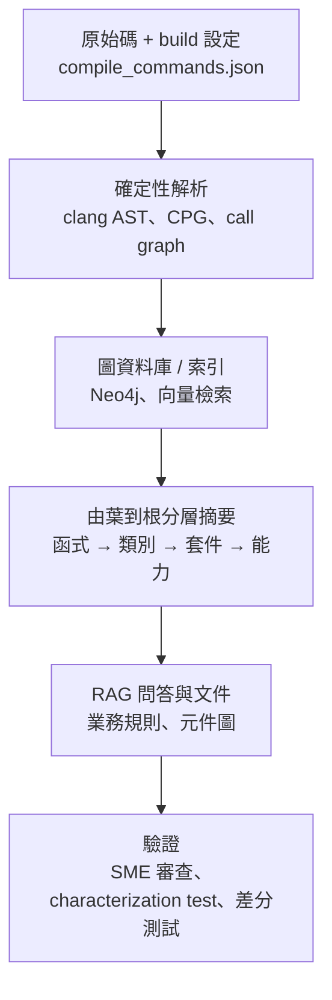

# Code-to-Spec:從既有大型程式碼庫反推規格(CodeConcise、Clang、ACSL、C→Rust)

> 研究日期:2026-11-01。方法:網路蒐集論文(arXiv)、官方文件、Thoughtworks / Martin Fowler 與 AWS 文章。**抓取工具回傳頁面摘要而非全文**;凡寫「未核實」者請勿當事實引用。
>
> 相關:規格 → 程式碼見 [[spec-driven-development-landscape-2026]];C/C++ 驗證工具見 [[cpp-large-codebase-stability-toolbox]];總覽見 [[spec-code-flow-overview-greenfield-brownfield]]。

---

## 一句話總結

> **業界共同架構是「確定性前處理 → 圖/索引 → 由葉到根的 LLM 分層摘要 → RAG 問答」。** 對 C/C++ 還要多一步:先固定一組可重現的 build configuration(macro、條件編譯、include path 都會改變語意)。反推出的規格必須標明「observed behavior(現況)」與「inferred intent(意圖)」,並用 characterization test、golden master 或差分測試釘住,因為 LLM 傾向推「意圖」而不是照抄 bug。

---

## 一、LLM 輔助的逆向工程(已讀原文)

### 1. Thoughtworks CodeConcise(Martin Fowler 網站)

- **做法**:語言專屬 parser 把程式碼轉成 AST forest 存進圖資料庫;邊連到細粒度關係(例如條件分支跳到另一個檔案的程式碼)。這個攝取步驟是**確定性**的,目的是縮減餵給 LLM 的無關程式碼。理解階段對圖做 DFS post-order 走訪,在 method / class / package 層逐層加入 LLM 解釋;Neo4j 存放並支援向量檢索。
- **數字(PoC 估計,不是正式準確度)**:COBOL/IDMS 客戶,每個 10,000 行模組的逆向工程估計由 6 週降到 2 週;全案估計省 240 FTE-years;約 1,500 個模組產出抽象 flowchart。
- **限制**:文中沒有正式 accuracy 指標;承認「沒有一體適用的圖建構準則」;部分問題光靠程式碼答不出來,仍需 SME 驗證。

### 2. 用在 C++:Autoware Universe

Thoughtworks 後續文章把同一方法用到 ROS 2 自駕堆疊 Autoware:

- 靜態解析從通用 parser **改用 Clang(libclang Python bindings)**處理 C++ 複雜度,程式片段與部分語法樹進 Neo4j。
- 以 **CMake build target** 為輸入建 C4 level-3 元件圖;agentic parser 讀 **ROS 2 launch file** 推導 package 關係。
- 困難:context 長度要 workaround、幻覺要靠 prompt 處理、技術未成熟。**頁面沒有量化結果。**

### 3. AWS Transform(mainframe)

- 逆向 COBOL / JCL,每個 program / job 產出含 ID、type、**Given/When/Then 驗收條件**的業務規則;輸出業務文件、data lineage、依 domain 分群的 workload。
- 後續:業務規則分析 → DDD 分析 → spec 生成(需求+驗收條件、API contract、entity model、依賴排序任務);**spec 須由架構師 / SME 驗證才進入 code generation**;產生的程式碼標註來源 rule ID。
- 只針對 mainframe,**沒找到 C/C++ 版**。

---

## 二、傳統靜態工具:結構的確定性來源

| 工具 | 在 C/C++ 的角色 | 來源狀態 |
|---|---|---|
| **Doxygen** | `HAVE_DOT=YES` 後可出 `CALL_GRAPH`、`CALLER_GRAPH`、include 依賴圖;`DOT_GRAPH_MAX_NODES` 等限制圖大小 | 官方手冊已讀;**是否 clang-assisted 未核實** |
| **libclang / LibTooling** | LibClang 是「穩定的高階 C 介面」,官方建議不確定時用它;LibTooling 是 C++ API,可完整控制 AST 但不保證穩定 | 官方 Tooling 頁已讀 |
| **Joern** | 建 code property graph(CPG),Scala DSL 查詢;C/C++ 前端用 Eclipse CDT;缺 build 環境或程式碼不完整也能匯入;內建 taint analysis | 官方文件已讀 |
| **Daikon** | 動態推論 likely invariants,**只在被觀察到的執行上成立**;支援 C、C++ 等 | 官方頁已讀 |
| CodeQL、Understand、ctags/cscope | 本次未查一手頁 | 未核實 |

---

## 三、LLM 產生形式規格:ACSL、JML、狀態機

| 論文 | 重點 | 備註 |
|---|---|---|
| **AutoSpec**(arXiv 2404.00762) | 靜態分析拆解程式 + LLM 提候選規格 + 驗證器每輪過濾;**C + Frama-C**;驗證 79% 的程式、提升 1.592x,並用於真實 X509-parser | 摘要頁沒有「251 programs」,搜尋摘要有此數字,未核實 |
| SpecGen(2401.08807) | 對話生成 + 突變運算子篩出可驗證規格;279/385 個程式 | **Java / JML**,非 C |
| 兩篇 ACSL 論文(2406.15540、2504.21061) | 研究 LLM 產生的 ACSL 反映「意圖」還是「實際行為」(含 bug 的程式) | 都沒有量化數字 |
| **ProtocolGPT**(2405.00393) | 從協定**實作原始碼**推 state machine;六個協定實作 precision 超過 90%、搭配 fuzzing 覆蓋率提升超過 20%、找到 2 個 0-day | 通訊協定相關,見 [[5g-nr-to-6g-modem-spec-to-code-flow]] |
| nl2postcond(2310.01831) | 反方向:意圖 → 後置條件,能抓到 Defects4J 的 64 個真實 bug | Java |

**意涵**:LLM 常「修正」bug 而不是照抄——對 code-to-spec 是好是壞,取決於你要的是「現況規格」(用來做重構的安全網)還是「意圖規格」(用來找 bug)。**兩者必須在文件中分開標示。**

---

## 四、C 的特殊困難與對策

| 困難 | 對策 |
|---|---|
| preprocessor / macro | 先用 compile_commands.json 固定 build configuration,再做 AST |
| 條件編譯(`#ifdef` 多種組合) | 每個 configuration 各產一份,或明確標「僅分析 config X」 |
| 指標別名、函式指標 | call graph 只能近似;標註「間接呼叫未解」 |
| 規模 | 分層摘要 + 以 build target / module 為單位,不要一次餵整個 repo |

C2Rust 的 README 也強調:非 trivial 專案需要 `compile_commands.json`(CMake、Meson、Bear 產生),底層用 libclangTooling——反推與轉譯共用同一個「先固定 build」前提。

---

## 五、C→Rust:code-to-spec 的另一種驗證思路

這幾個案例都**不先寫完整規格**,而是以「原 C 當 oracle」驗證:

- **DARPA TRACTOR**:目標是把 legacy C 自動轉成「熟練 Rust 開發者會寫的品質與風格」,結合靜態 / 動態分析與 LLM;官方頁引文「It's not enough to rely on bug-finding tools.」測評由 MIT Lincoln Lab 做,Battery 01 是刻意受限的 C 子集(避免動態配置與無型別指標),Milestone 0 是 Perlin noise 函式庫、1 是 SPHINCS 密碼學函式庫——**基準偏小型受限 C,不是大型真實專案**。⚠️ 官方頁與二手來源對 PM 姓名不一致,本篇不引用人名。
- **Syzygy**(arXiv 2412.14234):LLM 同時翻譯程式與測試,動態分析提供執行資訊,依相依順序增量翻譯;Zopfli(約 3,000 行、98 個函式),自稱最大的自動、測試驗證 C→safe Rust 翻譯。
- **Google giflib**:僅有 InfoQ 二手摘要(Google 原文只讀到標題與數字):約 3,000 行、保留 export symbols、人類專家修正 pointer ownership、>3,000 萬個 GIF 逐位元比對、差分 fuzzing 六天 2 億次迭代無功能漂移。**CVE 編號說法只見 InfoQ,未核實。**
- **C2Rust**:`transpile` 產出貼近原 C 的 unsafe Rust,首要目標「preserve functionality」;提供 `refactor`(確定性)與 `postprocess`(LLM 清理)。

---

## 六、應用案例

### 案例 1:接手一個沒有文件的 50 萬行 C 程式庫

1. 固定 build:跑出 `compile_commands.json`(CMake 或 Bear)。
2. libclang / Joern 產出 call graph、include 圖、模組依賴;Doxygen 的 `CALLER_GRAPH` 當輔助。
3. 以 build target 為單位,由葉到根讓 LLM 摘要(函式 → 檔案 → 模組),**每份摘要標 observed / inferred**。
4. 對關鍵模組寫 characterization test(輸入 → 現況輸出),LLM 摘要若與測試矛盾以測試為準。
5. SME 審查後才把摘要升級為 `specs/` 內的規格。

### 案例 2:從協定實作反推狀態機

仿 ProtocolGPT:RAG + CoT 讀實作原始碼,輸出 states / message types / transitions;再與規格文件(如 3GPP)的狀態機比對,**差異就是待查項目**(可能是實作 bug,也可能是規格缺口)。

### 案例 3:用差分測試驗證「反推的規格」

以原版(C)當 oracle:同一組輸入餵原版與依規格重寫的版本,逐位元比對。這是 TRACTOR / Syzygy / giflib 案例的共同核心,也是不寫形式規格時最務實的驗證。

---

## 七、核實與保留

**✅ 已讀原文:** CodeConcise 架構與數字、Autoware 方法、AWS Transform 流程、SpecGen / AutoSpec / ProtocolGPT / nl2postcond 摘要、Daikon / Joern / Doxygen / Clang Tooling 頁、C2Rust README、DARPA TRACTOR 官方頁、Syzygy 摘要。

**⚠️ 保留:**

- 「6 週降到 2 週」「240 FTE-years」是 COBOL PoC 的估計,不是 C/C++ 的準確度。
- 兩篇 ACSL 論文都沒有量化結果,本篇結論(LLM 偏向推意圖)是對摘要的解讀。
- giflib 案例僅二手摘要。
- 未核實:AWS re:Post 文章(403)、IBM watsonx Code Assistant、VERT、RepoAgent 的拓撲排序、Microsoft 十億行 C/C++→Rust 計畫(只有二手來源)。
- 缺口:OpenRewrite 沒找到 C++ 支援;characterization test 的 LLM 流程沒找到實證論文,只有部落格。

---

## 來源

- Thoughtworks,*Legacy modernization with GenAI*:https://martinfowler.com/articles/legacy-modernization-gen-ai.html
- Thoughtworks,C++ 汽車程式碼現代化:https://www.thoughtworks.com/en-au/insights/blog/programming-languages/can-AI-help-modernize-legacy-automotive-C-plus-plus-code
- AWS Transform + Claude Code:https://aws.amazon.com/blogs/migration-and-modernization/reimagining-mainframe-applications-with-aws-transform-and-claude-code/
- SpecGen:https://arxiv.org/abs/2401.08807 ;AutoSpec:https://arxiv.org/abs/2404.00762 ;ACSL:https://arxiv.org/abs/2406.15540 、 https://arxiv.org/abs/2504.21061 ;nl2postcond:https://arxiv.org/abs/2310.01831 ;ProtocolGPT:https://arxiv.org/abs/2405.00393
- Daikon:https://plse.cs.washington.edu/daikon/ ;Joern:https://docs.joern.io/ ;Doxygen:https://www.doxygen.nl/manual/diagrams.html ;Clang Tooling:https://clang.llvm.org/docs/Tooling.html
- C2Rust:https://github.com/immunant/c2rust ;DARPA TRACTOR:https://www.darpa.mil/research/programs/translating-all-c-to-rust ;MIT LL:https://www.ll.mit.edu/tractor ;Syzygy:https://arxiv.org/abs/2412.14234
- Google giflib(二手):https://infoq.com/news/2026/09/c-rust-rewrite/
