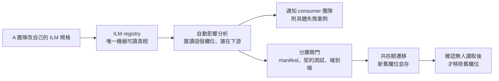
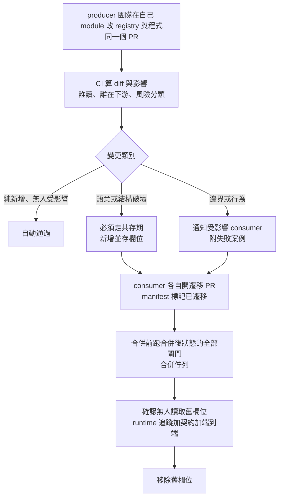
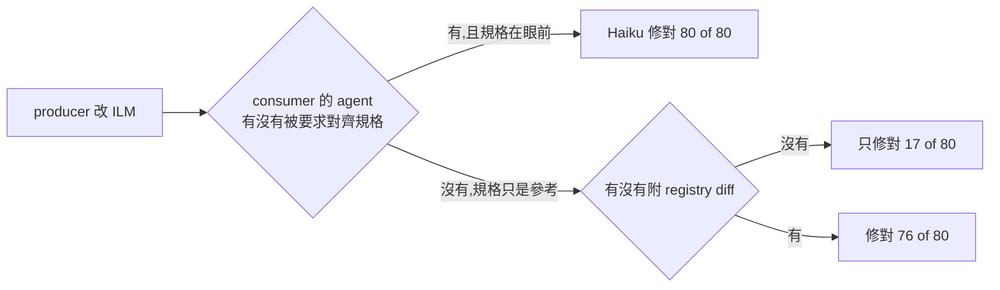

# 多團隊各守一個 module、靠 ILM 溝通時的 Spec ⇄ Code 共同維護流程(含 12,000 次變更模擬)

> **情境(使用者 2026-11-01 提出):** 公司每個 team 有自己的 module 與守護範圍,module 之間透過 API 或 **ILM(Inter-Layer Message)** 溝通,ILM 可跨 5G NR、4G 等各層。問題:**我只改自己這邊的 spec,別人並不知道,而中間牽涉訊息與 API 的變化,要怎麼讓大家配合得上?** 要一套大家能共同維護的 spec-to-code / code-to-spec workflow,並用夠多次的實驗證明它不是剛好在小案例上成立。
>
> **證據分級:** 🟢 本篇模擬實跑的數字 · 🔴 本篇的設計推論(實驗支持其中部分,但不是任何公司的實測)。
> **誠實聲明:** 模擬系統是隨機產生的玩具(沒有任何公司或 3GPP 的真實 ILM 格式);閘門與 ground truth 出自同一套模型,所以**絕對數字不能搬到真實專案**,能搬的是「哪一類變更被哪一層看得到、哪一層看不到」的相對結構。限制見第六節。
> 程式與資料:[`research/ilm-multi-team-sim/`](https://github.com/shooter2062424/Knowledge/tree/main/research/ilm-multi-team-sim)。前置:[[multi-spec-layered-evolution-modem-5g-to-6g]]、[[multi-spec-roundtrip-experiment-python-sim]]、[[spec-code-flow-overview-greenfield-brownfield]]。

---

## 一、結論

1. **「只改自己的 spec」本身不會讓別人知道,也不會自己同步。** 要讓別人配合得上,需要三件事同時成立:**ILM 規格只有一份機器可讀的真相**、**每個 consumer 怎麼用它也能被機器看見**、**破壞性變更必須走新舊並存的共存期**,不能一次切換。
2. 🟢 **最大的坑是「語意變更」而不是「欄位增減」。** 12,000 次隨機變更中,真的會讓別的團隊壞掉的有 7,094 次;其中 **4,367 次(62%)純 schema diff 完全看不到**(單位、縮放、極性、索引基底、預設值、範圍放寬、enum 新增、順序、延遲)。
3. 🟢 **沒有單一閘門夠用。** 各層的抓取率:團隊自己的測試 0%、schema diff 38%(還有 32% 誤報)、manifest 語意比對 95%、consumer 契約測試 85%、端到端 replay 82%;**疊起來 99.7%**,在較差的現實條件下仍有 98.5%。各層的盲點不一樣,所以要疊。
4. 🟢 **破壞性變更用「新增並存欄位 → consumer 逐一遷移 → 確認沒人讀才移除舊欄位」:1,800 次遷移,中間期 0 次出事。** 只靠 AST 找讀取者有 10.9% 在移除時壞掉(全是靜態分析看不到的動態讀取);加上移除前的契約測試/端到端閘門,或用執行期存取追蹤找讀取者,**都降到 0**。
5. 🟢 **LLM agent 當 consumer 團隊成員(實驗三,Haiku,496 次呼叫):能力不是瓶頸,「有沒有被叫起來、有沒有看到 diff」才是。** 明確要求「對齊最新規格」時,80 次會壞的變更 **80/80 修對**(連沒收通知也一樣);但當 agent 在做別的小任務、規格只是放在旁邊當參考時,**沒收通知只修對 17/80(21%),附上 registry diff 則 76/80(95%)**。所以 manifest 通知與 ICR diff 要自動推到 consumer 的工作流裡,不能指望誰順手發現。

---

## 二、為什麼「只改自己的 spec」不夠:四類不同步

| 類別 | 例子 | 純看 schema 抓得到嗎 |
|---|---|---|
| 結構 | 移除、改名欄位;新增必填欄位;位置式訊息重排欄位 | 抓得到(但會誤報沒人用的欄位) |
| 語意 | 時間單位 ms→us、縮放 0.5→0.25 dB、旗標極性反轉、索引從 0 改成 1 起算、enum 值重新編號、可省略欄位的預設值 | **抓不到**(型別沒變) |
| 邊界 | 範圍放寬(consumer 的陣列大小或 cap 假設被打破)、新增 enum 值(嚴格 consumer 直接丟例外) | 抓不到 |
| 行為 | 兩則訊息的送出順序、延遲上限 | 抓不到 |
| 傳遞 | B 把 A 的欄位原樣轉發給 C;A 改了,B 自己的測試仍綠,C 才壞 | 抓不到,而且連 B 的契約測試也抓不到 |

**核心原因:** 團隊自己的測試只驗證「自己的改動跟自己的 spec 一致」。實驗中這一層對跨團隊破壞的抓取率是 0(這是構造上的結果,不是發現,但它說明為什麼不能只靠它)。

---

## 三、Workflow 設計(🔴 設計推論;每個環節對應第四、五節的實驗)

### 3.1 三份資產與誰擁有

| 資產 | 內容 | 擁有者 | 為什麼 |
|---|---|---|---|
| **ILM registry**(機器可讀) | 每則訊息:producer 模組、版本、欄位(型別、**單位、縮放、範圍、enum 對照、預設值、極性、索引基底**)、**送出順序、延遲上限**、穩定度等級 | producer 團隊(各自的訊息);registry 結構與規則由一個輕量的架構/平台小組維護 | 語意屬性寫在 registry 才看得見;寫在人腦或 Word 裡等於不存在 |
| **consumer manifest**(由 code 抽出,不手寫) | 這個模組讀了哪些訊息的哪些欄位、哪些欄位原樣轉發到哪則下游訊息、宣告的假設(單位、cap、是否容忍未知 enum) | consumer 團隊;**由 CI 從原始碼自動抽取**,人只補不能從 code 推出的假設 | 讓「誰在用」變成可查詢的資料,影響分析才算得出來 |
| **module spec**(團隊自己的守護範圍) | 模組內部行為、狀態機、內部決定(時序預算、記憶體) | 該模組團隊 | 內部決定要寫成可執行約束,外部規格或 ILM 一變才知道哪個假設被打破 |

這裡 spec-to-code 與 code-to-spec 各有一個明確位置:

- **spec → code:** 從 registry **產生** producer 的編碼/驗證與 consumer 的解碼常數(單位、縮放、enum 表)。這樣「consumer 手寫常數與 spec 漂移」這一類問題根本不會出現。🔴 推論;實驗只模擬了「consumer 常數自己寫」的情況。
- **code → spec:** 從 consumer 原始碼抽 manifest(本實驗用 Python `ast` 實作;真實 C/C++ 要換 libclang 或 Joern),並比對「宣告的假設」與「實際程式常數」。

### 3.2 變更流程(ILM Change Request,簡稱 ICR)

重點規則(🔴 推論,第五節實驗支持其中「共存期」與「移除前閘門」兩項):

1. **producer 一律不得在原欄位上就地改語意。** 要改單位/縮放/極性/基底,就新增一個新欄位(名字帶版本或單位),舊欄位照舊。
2. **consumer 一律採 tolerant reader:** 不認得的欄位忽略,不認得的 enum 走預設分支,不用「出現未知欄位就丟例外」的嚴格模式。實驗中 1,800 次遷移裡有 900 個 consumer 因為嚴格模式要先放寬才能新增欄位。
3. **移除舊欄位前要三方同意:** manifest 顯示無讀取者、執行期追蹤顯示無讀取者、契約測試與端到端在移除後的狀態是綠的。
4. **預設值、範圍上限、順序、延遲都是契約的一部分,不是註解。** 實驗中這些是 schema diff 完全看不到、但最容易靜默壞掉的類別。
5. **位置式(positional)訊息要保留欄位槽位:** 移除欄位只能標 deprecated 並保留位置,否則後面所有欄位位移。實驗二的遷移流程不處理位置式訊息(第六節)。

### 3.3 閘門分層:誰負責、什麼時候跑

| 閘門 | 查什麼 | 跑在 | 本實驗抓取率 | 主要盲點 |
|---|---|---|---|---|
| G0 團隊自己的測試 | 自己改動與自己 spec 一致 | producer PR | 0% | 看不到別人的假設 |
| G1 schema diff | 欄位增刪改名、型別、enum 值移除/重編號 | registry PR | 38%,誤報 32% | 看不到語意/邊界/行為;無人使用的欄位也報 |
| G2 manifest 語意比對 | consumer 宣告的單位/cap/enum/順序/期限 vs 新規格 | registry PR(秒級) | 95%,誤報 0.3% | 宣告過期(比程式寬鬆)、動態讀取抽不到 |
| G2d 加 dataflow | 沿「原樣轉發」邊傳遞新規格 | registry PR | 95.0%(比 G2 只多 0.1 點,但通知對象多含轉發的下游) | 同 G2 |
| G3 consumer 契約測試 | 用**新規格**產生含邊界的樣本,跑 consumer 自己的解碼 | producer PR 觸發 consumer repo 的測試 | 85%(假設 85% 的訊息有測試) | 缺測試的訊息;轉發給下游的效果看不到 |
| G4 端到端 replay | 固定的典型刺激,整個系統跑一遍 | nightly 與合併佇列 | 82% | 典型值蓋不到邊界、預設值、新 enum;值為 0 時單位錯誤被掩蓋 |
| 疊加 | G2d ∪ G3 ∪ G4 | | **99.7%**(誤報 0.3%) | 剩餘 23 次:預設值 7、新 enum 12、範圍放寬 4 |

### 3.4 agent 在哪裡幫忙,人在哪裡決定

| 環節 | agent | 人 |
|---|---|---|
| 影響分析與通知 | **Impact agent:** 讀 registry diff 與 manifest,列出受影響 consumer 與具體失敗案例,在對方 repo 開 issue | 確認風險分類 |
| 遷移 | **Migration agent:** 對每個 consumer 產一個小 PR(改讀新欄位、更新常數) | consumer owner review、合併 |
| 契約測試 | **Test agent:** 由 registry 的範圍與 enum 產生邊界/性質測試,補 consumer 缺的測試 | 抽查 |
| 關卡品質 | **變異探測 agent**(獨立於實作者):對真實 registry 注入本篇的 18 種變更,看哪一層漏接 | 決定補哪一層 |
| 語意仲裁 | — | **規格有矛盾或含糊時,由 owner 決定。** 承接 [[multi-spec-roundtrip-experiment-python-sim]] 6.2:agent 會誠實回報但各自選不同解,所以決定權不能留給 agent |

原則承接 [[loop-engineering-when-and-how-gary-chen]]、[[agent-skill-three-layer-run-do-verify]]:實作者與驗證者分開;外部基準唯讀。

### 3.5 共同維護的例行工作

- **每週 drift 報告:** 宣告的假設 vs 實際程式常數 vs registry,三者不一致的清單(實驗中「宣告比程式寬鬆」這類過期是造成漏接的主因之一)。
- **季度變異探測:** 在真實 registry 上跑第四節的實驗,看各層抓取率有沒有下滑。
- **owner 表與升級路徑:** 每則 ILM 有 producer owner 與至少一位 consumer 代表;registry 結構本身的變更需要架構小組核准。
- **版本與棄用期:** 並存欄位有明確移除日期,到期前 manifest 與執行期追蹤仍有讀取者就自動升級給 owner。

---

## 四、實驗一:12,000 次隨機變更

**設計(🟢):** 80 個隨機產生的系統(4–8 個模組、每系統 7–27 則 ILM 訊息,中位數 16;約 23% 是位置式編碼;consumer 有嚴格/寬鬆、有 cap、有 enum 對照、有些把欄位原樣轉發給下游模組)。每個系統做 150 次隨機的 producer 端變更,共 12,000 次,涵蓋 18 種變更類型(含一種純文件變更當對照)。**ground truth:** 稠密取樣(含邊界、省略可選欄位、所有 enum 符號)跑整個系統,以物理意義比對 consumer 解碼出的值,有例外或值不符就算壞掉。被判定會壞的 7,094 次(59%),不會壞的 4,906 次。

consumer 是**由模板產生的 Python 原始碼**,manifest 用 `ast` 真的從原始碼抽出(動態 key 讀取抽不到,是刻意保留的盲點)。

### 結果(預設條件:宣告過期 15%、動態讀取 10%、契約測試涵蓋 85%、時序測試 50%)

| 閘門 | 抓到(真會壞的 7,094 次) | 誤報(不會壞的 4,906 次) |
|---|---|---|
| G0 團隊自己的測試 | 0 (0%) | 0 |
| G1 schema diff | 2,727 (38.4%) | 1,550 (31.6%) |
| G2 manifest 語意 | 6,733 (94.9%) | 14 (0.3%) |
| G2d 加 dataflow | 6,742 (95.0%) | 14 (0.3%) |
| G3 契約測試 | 6,049 (85.3%) | 0 |
| G4 端到端 replay | 5,850 (82.5%) | 0 |
| **疊加(G2d ∪ G3 ∪ G4)** | **7,071 (99.7%)** | 14 (0.3%) |

**不同系統之間的差異(80 個系統各自算抓取率):**

| 閘門 | 最低 | 第 10 百分位 | 中位數 | 第 90 百分位 | 最高 |
|---|---|---|---|---|---|
| G1 | 25% | 31% | 38% | 46% | 57% |
| G2 | 77% | 89% | 96% | 99% | 100% |
| G3 | 64% | 76% | 86% | 94% | 100% |
| G4 | 68% | 77% | 82% | 89% | 96% |
| 疊加 | 95% | 99% | 100% | 100% | 100% |

疊加後最差的系統也有 95%,表示結果不是少數幾個容易的系統撐起來的。

### 分變更類型(摘錄;抓到/真會壞)

| 變更 | G1 schema | G2 manifest | G3 契約 | G4 端到端 | 疊加 |
|---|---|---|---|---|---|
| 單位 ms↔us | 0/540 | 533/540 | 453/540 | 266/540 | 540/540 |
| 縮放改變 | 0/549 | 515/549 | 465/549 | 549/549 | 549/549 |
| 旗標極性反轉 | 0/539 | 509/539 | 457/539 | 539/539 | 539/539 |
| 索引基底 0→1 | 0/515 | 485/515 | 444/515 | 515/515 | 515/515 |
| 預設值改變 | 0/499 | 473/499 | 473/499 | **0/499** | 492/499 |
| enum 新增符號 | 0/343 | 273/343 | 261/343 | **0/343** | 331/343 |
| 範圍放寬 | 0/534 | 464/534 | 447/534 | 447/534 | 530/534 |
| 送出順序對調 | 0/249 | 249/249 | 129/249 | 249/249 | 249/249 |
| 延遲上限提高 | 0/449 | 449/449 | 280/449 | 449/449 | 449/449 |
| 移除欄位 | 555/555 | 529/555 | 513/555 | 555/555 | 555/555 |
| 改名欄位 | 559/559 | 543/559 | 526/559 | 559/559 | 559/559 |
| 位置式欄位重排 | 637/637 | 637/637 | 601/637 | 637/637 | 637/637 |
| 新增必填欄位 | 264/264 | 264/264 | 235/264 | 264/264 | 264/264 |
| 新增可選欄位 | 70/220 | 220/220 | 197/220 | 220/220 | 220/220 |
| 範圍縮小、純文件變更 | 全部不會壞 | 全無誤報 | | | |

幾個值得記的觀察:

- **G1 對六種語意/邊界/行為變更完全是 0。** 另一方面它有 1,550 次誤報(31.6%),都是沒人受影響的結構變更,例如移除沒人用的 enum 符號 618 次、新增必填欄位但沒有嚴格 consumer 412 次。團隊會學會忽略它。
- **G4(典型值 replay)對「預設值」與「新 enum 符號」是 0,** 因為典型刺激從不省略可選欄位、也不送新符號。單位變更只抓到一半:分方向看,**單位變細(ms→us)630/630,單位變粗(us→ms)0/612**。推測是範圍縮小後典型值取到 0,而 0 乘任何單位都是 0,所以錯誤被掩蓋(機制未逐筆追蹤確認,方向性結果是實測)。這正是為什麼端到端 replay 的刺激要包含邊界與零值。
- **G3 對送出順序與延遲只有 52–62%,** 因為時序測試比解碼測試難寫(模擬中設為 50% 的模組有)。

### 敏感度:把現實條件調好或調壞

| 條件(每組 40 個系統 × 120 次) | G2 | G3 | G4 | 疊加 |
|---|---|---|---|---|
| 理想:無過期宣告、無動態讀取、測試全涵蓋 | 99.4% | 96.1% | 84.2% | **100%**(誤報 0.5%) |
| 預設 | 94.9% | 85.3% | 82.5% | 99.7% |
| 差:過期 30%、動態讀取 25%、契約測試涵蓋 60%、時序測試 20% | 88.7% | 63.3% | 84.2% | **98.5%** |
| 沒有嚴格模式的 consumer | 94.3% | 85.1% | 82.7% | 99.6% |
| 一半的 consumer 會轉發欄位 | 94.6%(加 dataflow 95.1%) | 79.0% | 84.2% | 99.4% |

- 條件變差時,**單層下滑很多(G3 從 96% 掉到 63%),疊加只掉 1.5 個百分點。** 這是「分層」的價值。
- 轉發比例拉高到一半,**G3 掉到 79%**(它看不到下游),G2 加 dataflow 與 G4 補上。
- 通知對象的精確度:疊加之後被通知的模組有 95% 真的會壞(precision),真會壞的模組有 99% 被通知到(recall)。在差條件下單用 G2d,recall 掉到 83%。

---

## 五、實驗二:破壞語意的變更,怎麼不讓別人壞

**設計(🟢):** 60 個隨機系統,各取 30 個「有 consumer 讀取的欄位」,共 1,800 次。70% 做語意變更(單位、縮放、極性、基底,依欄位種類),30% 改名(enum 欄位只示範改名)。比較四種做法:

- **A 就地改:** producer 直接改規格。
- **B 共存期,用 AST manifest 找讀取者:** 先新增並存欄位 → 被 manifest 看到的 consumer 遷移 → manifest 顯示沒人讀就移除舊欄位。
- **C = B 加移除前閘門:** 移除前再跑契約測試與端到端,被擋就不移除。
- **D 共存期,用執行期存取追蹤找讀取者:** 在系統跑時記錄誰讀了舊欄位(抓得到動態 key),都遷移後確認追蹤上沒人讀才移除。

| 做法 | 做完之後系統壞掉 |
|---|---|
| A 就地改 | **1,800 / 1,800(100%)** |
| B 共存期 + AST | 196 / 1,800(10.9%) |
| C B + 移除前閘門 | **0 / 1,800**(196 次被擋下) |
| D 共存期 + 執行期追蹤 | **0 / 1,800** |

- 新增並存欄位那一步與兩欄並存的中間期:**1,800 次全部無事。**
- B 的 196 次壞掉,**正好等於 196 個有「靜態分析看不到的動態讀取」的案例**——也就是說 B 壞掉的原因只有一種。
- 900 個 consumer 需要先放寬嚴格模式(tolerant reader)才能容納新欄位。**這是共存期的前置成本,要排進計畫。**
- 平均每個欄位有 1.4 個 consumer 要遷移,所以一次語意變更大約是 1(producer 並存)+ 1.4(consumer 遷移)+ 1(移除)個 PR,而不是一個。

---

## 五之二、實驗三:LLM agent 當 consumer 團隊成員(Haiku,496 次呼叫)

**做法(🟢):** 從 12 種語意/結構變更算子中,各挑 8 個「對某 consumer 真的會壞」的案例(共 80 個),另挑 24 個「該 consumer 其實不會壞」的對照案例。每個案例把該 consumer 的 Python 原始碼、最新 registry 條目交給 headless `claude -p --model haiku`(單輪、不給工具、不載入本機設定),要它輸出改好的完整檔案。評分是把改好的 `handle` 換進系統,用稠密取樣(含邊界值)只跑那個 consumer,物理真值全對才算過;另外檢查檔頭的 `ASSUME` 宣告是否同步到新規格。通知程度分三種:

| 條件 | 給 agent 的資訊 |
|---|---|
| N0 沒通知 | 最新 registry 條目,什麼都沒提變更 |
| N1 只通知 | N0 + 一句「你消費的訊息 Mx 更新了」(manifest 比對後的自動通知) |
| N2 附 diff | N1 + registry 條目 old→new 的 unified diff(ICR 內容) |

任務有兩種:**(a) 對齊型**:明確要求「確保 handle 對最新規格正確」;**(b) 無關型**:要它做一個無關的小功能(回傳多一個計數欄位),registry 條目只是「參考」,測 agent 在做別的事時會不會順手發現漂移。

| 任務 / 條件 | 會壞的變更修對 | ASSUME 宣告同步 | 對照組(本來就對)沒被改壞 |
|---|---|---|---|
| (a) 對齊型 N0 | **80 / 80** | 48 / 80 | 24 / 24 |
| (a) 對齊型 N1 | 80 / 80 | 54 / 80 | — |
| (a) 對齊型 N2 | 80 / 80 | **71 / 80** | 23 / 24 |
| (b) 無關型 N0 | **17 / 80(21%)** | 26 / 80 | 24 / 24 |
| (b) 無關型 N2 | **76 / 80(95%)** | 75 / 80 | 23 / 24 |

**怎麼讀:**

- **能力不是瓶頸。** 只要有人叫 agent 去對齊、規格擺在眼前,Haiku 就把 12 種變更全修對(單位換算、極性、index base、enum 重新編號、改名、縮放、default 全包含)。
- **瓶頸是觸發與可見性。** 無關型任務下,沒 diff 時各算子的修對數是 default_change 1/8、enum_remove 0/8、rename_field 0/8、unit_change 1/8、index_base 1/8;只有 range_widen 7/8(推測:放寬上限後多數 consumer 的原檢查剛好沒擋住新範圍,所以不改也過)。附 diff 後除 rename_field 6/8、scale_change 7/8、enum_renumber 7/8 之外都是 8/8。
- **「只通知、沒細節」在對齊型任務就夠,但 ASSUME 宣告同步有差:** 48 → 54 → 71。程式修對了、檔頭宣告沒跟上,會讓下一輪 G2 manifest 比對拿到過期假設。diff 對「宣告與程式一致」的幫助比對「程式修對」的幫助更大。
- **對照組有 1/24 被改壞**(scale_change,兩種任務各一次,同一案例):agent 對一個其實不用改的 consumer 動了手。流程上 agent 的修補仍要過 G3/G4 閘門與人工審,不能直接合併。
- **這給 workflow 的設計含義:** (1) manifest 通知要自動變成各 consumer repo 裡的 issue/PR,把 diff 一起帶上;(2) 要求 agent 在修補 PR 中同步更新 ASSUME/宣告,並讓 G2 在 PR 上檢查「宣告與程式一致」;(3) 不依賴 agent 在做別的任務時順手發現。

**這個實驗的限制(🔴):** 只有 Haiku 一個模型、單輪、一個 consumer 一則訊息;consumer 是 80 行以內的模板 Python,agent 不用找檔案、不用跑測試;對齊型任務的提示裡直接寫了「對齊最新規格」,等於告訴 agent 要檢查什麼。真實 C/C++ 大檔、多檔、多訊息的情況,修對率一定低於這個數字。資料:`research/ilm-multi-team-sim/out/exp3_*`(LLM 輸出無法固定 seed,逐筆結果有存)。

---

## 六、這些實驗沒證明的事(請特別看這節)

- **模型與評分器出自同一套假設。** 變更類型、consumer 的解碼模板、閘門規則是我設計的;G2 能比對的屬性正好是 ground truth 會檢查的屬性。所以 **99.7% 不是「真實專案能抓到 99.7%」**,而是「若 consumer 的假設可以被宣告/抽取,這樣的分層能補到幾乎沒有已知類別的盲區」。真實專案裡未知的盲點類別(例如時序抖動、並行競爭、記憶體佈局、跨訊息狀態)沒有被模擬。
- **consumer 是模板產生的,不是真實 C/C++。** manifest 用 Python `ast`;C/C++ 有 macro、條件編譯、指標別名,抽取難度高很多。
- **「宣告過期」只模擬了比程式寬鬆的一種;** 其他不一致在 baseline 就會被發現,所以不算靜默過期。
- **誤報的來源之一是模型規則太粗:** 位置式訊息改欄位名稱,對嚴格 consumer 的 `known` 名單判定會報,但線上格式其實沒變。
- **實驗二不處理位置式訊息、也不處理被轉發的欄位;** 這兩類在真實 ILM 很常見,需要另外的遷移方式(保留槽位、同步遷移下游)。
- **執行期追蹤只看得到被執行到的路徑。** 模擬中用稠密取樣所以抓得完整;真實系統的罕見分支(錯誤處理、特殊頻段)追蹤到不到,取決於測試與流量覆蓋。
- **沒有並行變更。** 兩個團隊同時改相關的訊息,各自都過閘門、合併後才壞的情況沒模擬(流程中以合併佇列對應,但沒驗證)。
- **LLM agent 實驗只做了最簡單的一環。** 實驗三只測「單一 consumer、單一訊息、收到通知後改碼」,用 Haiku、單輪、模板產生的短 Python;沒測 agent 當 producer、沒測它會不會繞過閘門或亂改別人的碼、沒測 Sonnet/Opus、沒測真實大型 C/C++。結果只能說明「通知內容夠具體時 agent 修得動」,不能說明整個流程可以交給 agent 自走。
- **沒有真實 3GPP 或公司內部 ILM 格式。**

---

## 七、應用案例:RRC 團隊把量測週期欄位從 ms 改成 us

情境化設想(🔴):RRC 團隊的 `MeasConfig.period` 現在以 ms 計(範圍 10–640),他們要改成 us 以支援更細的週期。MAC、PHY 控制、記錄模組三個團隊的程式都在讀這個欄位。

1. **就地改(做法 A):** RRC 改 registry 與自己的程式,自己的測試全綠。MAC 把原始值當 ms 乘 1000,結果少了 1000 倍;PHY 控制把原始值當索引的上限也被撐爆。RRC 的 CI 不會紅,三個團隊要等整合測試才發現。
2. **走本篇流程(做法 C/D):**
   - CI 比對 registry 差異,判定「語意破壞」,導向共存期。
   - RRC 新增 `period_us`,舊的 `period` 不動並標 deprecated。Impact agent 讀 manifest,列出三個讀 `period` 的模組與各自的假設(單位 ms、cap 640),在三個團隊的 repo 各開一個 issue。
   - 記錄模組的程式用動態 key 讀欄位,AST manifest 沒列到它,但執行期追蹤在 nightly 跑時記到它讀了 `period`。Impact agent 因此也通知它。
   - 三個團隊各自開遷移 PR 改讀 `period_us`。若某個模組是嚴格模式,先有一個放寬為 tolerant reader 的 PR。
   - 移除 `period` 的 PR 要通過:manifest 無讀取者、執行期追蹤無讀取者、契約測試與端到端在移除後的狀態是綠的;最後一道要包含值為 0 與最大值的刺激,避免單位錯誤被零掩蓋。

---

## 八、試點工具與下一步

**已做(🟢):** `research/ilm-multi-team-sim/pilot/` 放了可以直接拿去試點的最小工具 `ilm_check.py`(單檔、無外部相依):`manifest` 掃原始碼抽出各模組讀了哪些訊息的哪些欄位(Python 用 `ast`,C/C++ 用可設定的 regex 加上 `const ILM_X *g` 變數宣告反查訊息)、`diff` 做 registry 語意 diff 並分成靜默破壞/結構破壞/相容、`impact` 算每個模組該收到什麼通知、`inject` 對 registry 逐一注入變更並列出每個變更會通知到誰。附 RRC(C)、MAC(C++)、CTL(Python)三個玩具模組和兩則玩具訊息的範例,以及五步試點流程與要記的三個數字。範例已實跑:注入 15 種變更,通知對象符合程式碼實際的讀取關係。**範例是玩具、不是任何公司的真實格式。**

**還沒做、需要你這邊的真實資料才能做(🔴):**

1. **拿真實的 ILM 定義試一次(取決於貴公司資料,無法在本倉庫完成):** 挑兩個真實 module 的 ILM,依 `pilot/README.md` 建 registry 最小版、調 `read_patterns`、抽 manifest、注入變更,並回放 5 個歷史上真的出過事的 ILM 變更。這一步決定本篇數字能不能參考。需要真實 ILM 欄位定義與一份 consumer 原始碼(可去識別)。
2. **C/C++ 的 manifest 抽取:** 試點工具是 regex 加變數反查,巨集、模板、經 helper 轉手的讀取抓不到;下一步用 libclang 抽 AST,manifest 格式不用變。
3. **擴大 agent 實驗:** Sonnet/Opus 對照、agent 當 producer、多檔多訊息的真實 C/C++ consumer、agent 會不會繞過閘門。
4. **並行變更與合併佇列:** 兩個團隊同時動相關訊息,量合併後才壞的比例。

---

## 來源

- 實驗程式與彙整資料:[research/ilm-multi-team-sim](https://github.com/shooter2062424/Knowledge/tree/main/research/ilm-multi-team-sim)(`ilm_sim.py`、`run_exp1.py`、`run_exp2.py`;固定 seed,可重現。`run_exp3.py` 為 LLM agent 實驗,模型輸出不可重現,逐筆結果存於 `out/exp3_*_rows.json`)。試點工具:[pilot/](https://github.com/shooter2062424/Knowledge/tree/main/research/ilm-multi-team-sim/pilot)。
- 前置研究:[[multi-spec-layered-evolution-modem-5g-to-6g]](3GPP 擴充機制本身累加式向下相容)、[[multi-spec-roundtrip-experiment-python-sim]](單一規格往返實驗與 Haiku 實測)、[[spec-driven-development-landscape-2026]]、[[code-to-spec-reverse-engineering-legacy-codebase]]。
- 概念名稱(本篇未重讀原文,僅作查證線索,不作為任何數字的出處):consumer-driven contract testing、tolerant reader、parallel change / expand and contract、schema breaking-change 檢查。
- 使用者情境說明(2026-11-01):ILM 為公司內部對 Inter-Layer Message 的稱呼,跨 5G NR、4G 等層與模組溝通;本篇沒有任何公司內部文件。
