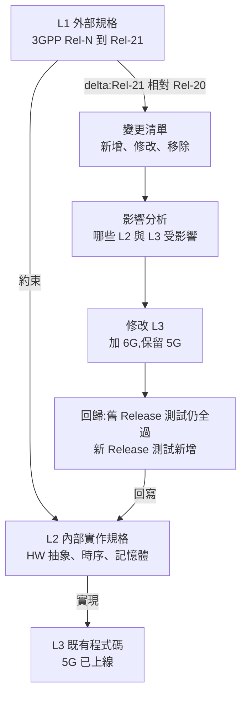

# 多層規格並存下的程式演進:外部公定 spec + 內部實作 spec + 既有 code(5G NR → 6G Modem)

> **情境(使用者 2026-11-01 釐清):** 5G NR 有全球通用的 3GPP 公定規格,公司另有內部實作規格與一份已上線的既有 code。6G 到來時,拿到的是 3GPP 只給大方向的新規格,硬體變動不大,必須**修改既有 code 長出 6G 功能,同時保留 5G(舊規格)能力**。
> 這和 [[spec-code-flow-overview-greenfield-brownfield]] 的「單一規格 → 程式」不同:這裡是**多份規格、多個版本、同一份程式碼長期共存**的問題。
>
> **證據分級:** 🟢 已讀原文/搜尋摘要(附連結)· 🟡 搜尋摘要未讀全文 · 🔴 本篇推論(架構建議,非任何來源的結論)。研究日期 2026-11-01。

---

## 一、先把問題拆成三種「規格」與兩條「版本軸」

| 層 | 例子 | 誰控制 | 變動方式 |
|---|---|---|---|
| **L1 外部公定規格** | 3GPP TS 38.xxx(Rel-15…Rel-20,之後 Rel-21 的 6G) | 標準組織 | 每個 Release 以 CR 修訂,**凍結前會變** |
| **L2 內部實作規格** | 公司的 HW 抽象、時序預算、記憶體配置、演算法選型、客戶客製 | 自己 | 自己決定,**不可違反 L1** |
| **L3 既有程式碼** | 已通過認證、已上線的 5G 實作 | 自己 | 事實上的「現況規格」 |

兩條版本軸(🔴 推論):
- **Release 軸**:Rel-15 / 16 / 17 / 18 / 19 / 20 / 21…。同一份程式要能表達「我支援到哪一版」。
- **產品/硬體軸**:晶片世代、客戶客製、區域頻段。

**核心難題不是「怎麼從規格產碼」,而是「新規格進來時,怎麼知道哪些 code 受影響、怎麼改、改了之後舊規格行為不壞」。**



---

## 二、3GPP 本身已經替你做好「向下相容」——利用它,不要對抗它

### 🟢 事實:協定層的演進機制是**累加式**

- RRC 的 ASN.1 以 `...` 擴充標記為主要的非關鍵擴充手段;訊息尾端用**版本化的 IE 鏈**(如 `RRCMessage-v860-IEs`)延伸,最後以空的 `SEQUENCE {}` 收尾([TS 38.331 附錄 A.4 摘錄](https://itecspec.com/spec/3gpp-38-331-a-4-extension-of-the-pdu-specifications)、[A.3.3](https://www.itecspec.com/3gpp/38.331/s/a.3.3))。
- 關鍵擴充走獨立的 `criticalExtensions` 分支([A.4.2](https://www.itecspec.com/3gpp/38.331/s/a.4.2))。
- PER 編碼對尾端未知擴充省略擴充位元與長度欄位,舊版接收端**靜默忽略**([ITU-T 說明](https://www.itu.int/en/ITU-T/asn1/Documents/Non-critical_3GPP_RRC_message_extensions-rev2.pdf))。
- 真實教訓:Rel-16 有 CR 專門修正「意外刪掉 Rel-15 欄位會讓 Rel-16 ASN.1 無法被 Rel-15 UE 解碼」([3GPP R2 CR](https://3gpp.org/ftp/TSG_RAN/WG2_RL2/TSGR2_111-e/Inbox/Drafts/%5BOffline-013%5D%5BNR16%5D%20RRC%20Misc%20I/R2-200xxxx%2038331%20Rel-16%20ASN1%20corrections%20to%20maintain%20backw%20comp%20Rev1.docx))——即「破壞舊版」在標準層就被當缺陷處理。

> ⚠️ 以上是搜尋摘要與鏡像站(itecspec)節錄,**非 3GPP 官方文件全文**;引用具體措辭前應回官方 38.331 核對。

### 🟡 6G 方向(二手來源,未核實)

- 路透式整理:6G 基線**仍錨定在 5G NR**,沿用 NR 波形、星座、slot 與可縮放 numerology,重點是針對性增強([RCR Wireless 2026-07-01](https://www.rcrwireless.com/20260701/6g/6g-standard-qualcomm)、[Qualcomm](https://www.qualcomm.com/news/onq/2026/06/6g-standardization-release-21-milestones))。
- 對比:2015 年 5G 啟動時曾有「新 RAT、不向下相容」共識,6G 方向相反([arXiv 2412.21077](https://arxiv.org/pdf/2412.21077))。
- ⚠️ 來源是廠商部落格與貿易媒體,**非 3GPP 一手文件**;若 Rel-21 範圍後來改為更大幅度的新空中介面,下列「演進式」策略要重評。

**對你的意義(🔴 推論):** 若 6G 是「錨定 NR 的演進」,你大部分 L3 程式碼**可重用**,工作重心是:①找出 delta;②在不破壞 Rel-15–20 行為下加入 Rel-21 分支。這比「重寫」更接近 brownfield 的 delta 模式。

---

## 三、把「保留舊規格」變成程式碼的一等公民(🔴 推論的架構建議)

### 3.1 規格版本要在程式碼中**有名字**

反模式:到處 `#ifdef NR_6G`、`if (is_6g)`。這會造成**變異性 bug**——Linux 的實證研究顯示,Kconfig、Makefile、`#ifdef` 之間不一致是主要缺陷來源:[Abal 等 ASE 2014 的 42 個變異性 bug](https://www.itu.dk/~brabrand/42-bugs.pdf)、[Nadi 等 MSR 2013 的 variability anomalies](https://cris.fau.de/publications/118685644)、[Linux 4.4.1 的 80 個配置落差,約 2/3 可能造成誤配置](https://arxiv.org/abs/2110.05828?context=cs)。(🟡 皆為搜尋摘要,未讀全文。)

建議做法:

| 手段 | 做什麼 | 取捨 |
|---|---|---|
| **Release 能力表** | 單一資料表宣告「功能 F 自 Rel-N 起、需 HW 能力 H、規格章節 S」;程式讀表而非散落條件 | 要有人維護;但它同時是追溯矩陣 |
| **執行期協商** | 依 UE/網路能力(協定本身就有 capability 機制)決定走 5G 或 6G 路徑 | 保留多版本於同一 binary;代價是 code size、測試組合 |
| **編譯期策略(trait/policy/模板)** | 熱路徑(PHY)以編譯期選型,零執行期成本 | 組合爆炸;需 CI 覆蓋矩陣 |
| **版本化編解碼層** | ASN.1 codec 依 Release 分別產生,delta 以 diff 檢視 | 重新產生需 golden vector 回歸 |
| **功能旗標有壽命** | 每個旗標寫明建立日期、移除條件(如 Rel-21 凍結後) | 沒人清會變技術債 |

### 3.2 三層規格各自該長什麼樣

- **L1:不要複製,要引用並釘版本。** 內部 spec 引用「TS 38.331 v20.x.y §5.3.3.4」而非貼內容;新版進來時用 diff 工具比對 ASN.1 與章節。(承接 [[5g-nr-to-6g-modem-spec-to-code-flow]]:ASN.1 嵌在 .docx、可擷取、可重新產生 codec。)
- **L2:寫成「相對於 L1 的決定與限制」。** 例:「38.213 允許 X,本產品選 Y,因為 HW 限制 Z」。這類決定在 6G 最容易被忽略,因為 HW 不變 ⇒ 舊限制多半仍成立;**把它們寫成可檢查的約束**(如時序預算、記憶體上限),6G 新功能才不會把它們吃掉。
- **L3:用特徵化測試釘住。** 先對 5G 現況建立 characterization test 與 golden vector(見 [[code-to-spec-reverse-engineering-legacy-codebase]]),之後的任何重構、6G 加入都必須讓它們維持綠燈。

### 3.3 以 OpenSpec 式 delta 管理「這次 6G 改了什麼」

OpenSpec 的 delta spec 概念(見 [[spec-driven-development-landscape-2026]])剛好對應:不重寫整份規格,只寫「新增 / 修改 / 移除」。對 modem:

```text
change: rel21-xxx-feature            # 一個 6G 功能 = 一個 change
  L1 引用: TS 38.xxx Rel-21 §x.y(釘版本)
  ADDED:    新訊息/欄位/程序
  MODIFIED: 5G 既有程序的哪個行為(引用舊規格版本)
  REMOVED:  (6G 若淘汰某 5G 功能)——保留 Rel-20 路徑,僅在 Rel-21 設定下停用
  L2 影響:  時序/記憶體/HW 抽象 是否被打破
  舊版保證: 以下 Rel-15–20 測試必須維持通過 [清單]
```

---

## 四、受影響範圍分析:新規格進來,先回答「改哪裡」

(🔴 推論的流程,工具來源見 [[code-to-spec-reverse-engineering-legacy-codebase]])

1. **規格 diff**:擷取 Rel-21 與 Rel-20 的 ASN.1、程序章節 diff,產出變更清單。
2. **追溯矩陣**:`規格章節 ⇄ 內部需求 ID ⇄ 函式/模組 ⇄ 測試案例`。既有 code 若沒有這張表,**先用 code-to-spec 方法反推出初版**(LLM 輔助,但標「推定」待人工確認——LLM 傾向推測意圖,見該篇)。
3. **影響分析**:變更章節 → 矩陣 → 受影響模組;再用 call graph/CPG(libclang、Joern)找出未標註的間接相依。
4. **衝突檢查**:新功能對 L2 約束(時序、記憶體)的衝擊;這步 LLM 幫不上忙,需要量測。
5. **多實作差分**:SpecLens 發現 OAI 與 srsRAN 有 60 項行為分歧([見 modem 篇](./5g-nr-to-6g-modem-spec-to-code-flow.md)),提醒**單一實作不能當規格的終局**;對 6G 初期規格模糊處,與另一實作或參考模型差分,比讀規格更可靠。

---

## 五、驗證:舊規格不能壞,新規格要能證

| 層 | 對舊規格(5G) | 對新規格(6G) |
|---|---|---|
| 單元/協定 | 既有測試全跑,每個 PR 都是 | 為每個 delta 補測試,連回規格章節 |
| 編解碼 | golden vector 位元級一致(Rel-15–20 版本分支) | 新 IE 的 encode/decode round-trip + 與舊版接收端互通(舊版應靜默忽略新擴充) |
| 一致性 | TTCN-3 38.523-3 一致性測試套件持續跑 | 等 6G 測試規格成熟前,用自建 + 差分 |
| 效能/時序 | 5G 時序預算量測當基準,**回歸不可退** | 6G 新增路徑的預算 |
| CI | PR 快速層 + 夜間矩陣(Release × 產品 × HW);見 [[cpp-large-codebase-stability-toolbox]] | 同 |

---

## 六、應用案例(🔴 情境化設想,非真實專案)

**案例:Rel-21 在某 RRC 訊息新增一個 6G 專用欄位,並修改 5G 既有的測量回報行為。**

1. 擷取 38.331 Rel-21 與 Rel-20 的 ASN.1,diff 顯示:`MeasurementReport` 的 `nonCriticalExtension` 鏈新增 `-v2100-IEs`(新增),`reportConfig` 內某欄位語意擴充(修改)。
2. 重新產生 codec:Rel-20 分支 golden vector **位元級不變**(驗證沒破壞舊版);Rel-21 分支新增欄位的 round-trip 測試通過。
3. 追溯矩陣顯示 `measurement_handler.c` 與 `l3_report.c` 受影響;call graph 找出一個未登錄的間接呼叫者 `handover_prep()`。
4. 寫 delta:ADDED 新欄位處理;MODIFIED 測量回報的觸發條件——**用 Release 能力表選路徑**,不在函式內加 `#ifdef`。
5. L2 檢查:新路徑每次回報多 N µs,對照時序預算尚餘 M µs(需實測,此處數字為假設)。
6. 回歸:Rel-15–20 的 TTCN-3 子集 + 內部測試全綠後才合併;6G 路徑旗標預設關,待 Rel-21 凍結才開。

---

## 七、已核實 / 需修正 / 未能核實

- **已核實(搜尋摘要層級):** RRC ASN.1 以擴充標記與版本化 IE 鏈維持向下相容;舊版靜默忽略尾端未知擴充;Rel-16 有專門修正破壞相容的 CR;Linux 變異性 bug 的幾篇實證研究存在且結論一致(`#ifdef`/Kconfig 不一致是主因)。
- **需注意:** 6G「錨定 NR」來自二手來源(RCR、Qualcomm);itecspec 為鏡像站。
- **未能核實:** Rel-21 的實際範圍是否維持演進式;3GPP 規格逐 Release 的 CR 維護流程(TR 21.900)細節;任何業界 modem 廠商**如何**維護多 Release code 的一手公開文件——**找不到**,第三節整套架構建議皆為本篇推論。
- **未證明:** LLM 能否自動完成第四節的影響分析與 delta 修改——本篇沒有任何一手證據。

⚠️ 非投資建議不適用(本篇為技術筆記)。

---

## 來源

- [TS 38.331 附錄 A.4 擴充規則(itecspec 鏡像)](https://itecspec.com/spec/3gpp-38-331-a-4-extension-of-the-pdu-specifications)
- [TS 38.331 A.3.3](https://www.itecspec.com/3gpp/38.331/s/a.3.3)、[A.4.2](https://www.itecspec.com/3gpp/38.331/s/a.4.2)
- [ITU-T:Non-critical 3GPP RRC message extensions](https://www.itu.int/en/ITU-T/asn1/Documents/Non-critical_3GPP_RRC_message_extensions-rev2.pdf)
- [3GPP R2 Rel-16 ASN.1 backward-compat 修正 CR](https://3gpp.org/ftp/TSG_RAN/WG2_RL2/TSGR2_111-e/Inbox/Drafts/%5BOffline-013%5D%5BNR16%5D%20RRC%20Misc%20I/R2-200xxxx%2038331%20Rel-16%20ASN1%20corrections%20to%20maintain%20backw%20comp%20Rev1.docx)
- [RCR Wireless:3GPP 2026-06 全會決議對裝置廠的意義](https://www.rcrwireless.com/20260701/6g/6g-standard-qualcomm)
- [Qualcomm:Release 21 里程碑](https://www.qualcomm.com/news/onq/2026/06/6g-standardization-release-21-milestones)
- [arXiv 2412.21077:3GPP 5G 到 6G 十年回顧](https://arxiv.org/pdf/2412.21077)
- [Abal 等:42 variability bugs(ASE 2014)](https://www.itu.dk/~brabrand/42-bugs.pdf)
- [Nadi 等:Linux Variability Anomalies(MSR 2013)](https://cris.fau.de/publications/118685644)
- [arXiv 2110.05828:Linux 4.4.1 配置落差分析](https://arxiv.org/abs/2110.05828?context=cs)
- 本庫相關:[[spec-code-flow-overview-greenfield-brownfield]]、[[spec-driven-development-landscape-2026]]、[[code-to-spec-reverse-engineering-legacy-codebase]]、[[5g-nr-to-6g-modem-spec-to-code-flow]]、[[cpp-large-codebase-stability-toolbox]]
