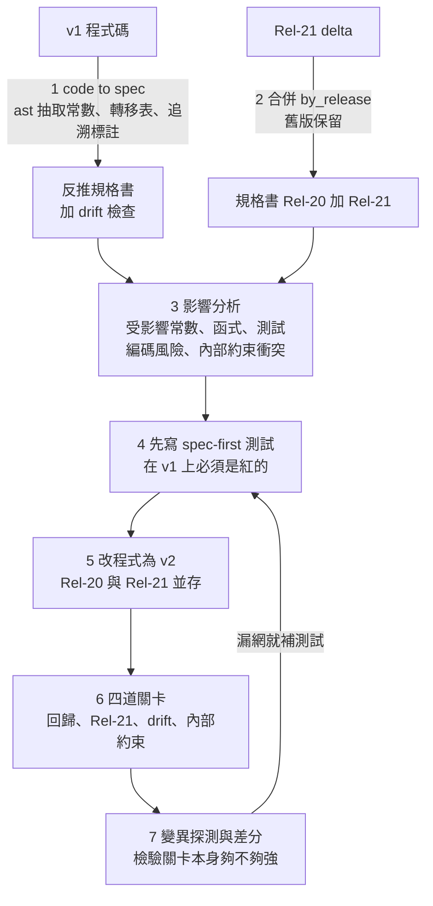

# 實驗:外部公定 spec + 內部 spec + 既有 code,新 Release 來時的完整往返流程(Python 模擬)

> **目的:** 驗證 [[multi-spec-layered-evolution-modem-5g-to-6g]] 的設想——外部規格(不可改)、內部規格(可協商)、既有程式,在 Rel-21 新規格到來時,能不能走完「code → spec → 合併 delta → 影響分析 → 改 code → 驗證」的閉環,以及哪些環節可以交給 agent 顧著。
>
> **誠實聲明(先看這裡):**
> - 實驗是**玩具規模**:3 個模組、約 150 行 Python,規格數值全是**模擬值,不是真實 3GPP**。
> - 「改程式」這一步是**我(Claude)手寫**的,**沒有量測 LLM 自動改對的成功率**。實驗驗證的是**關卡與流程設計**能不能抓到錯,不是 AI 能不能全自動。
> - 規格是**機器可讀的 JSON**(有條目 ID、參數名與程式常數同名)。真實世界的 3GPP 是 Word + ASN.1,這層對映需要額外工程,見第六節。
> - 程式碼與腳本:[`research/spec-code-roundtrip-sim/`](https://github.com/shooter2062424/Knowledge/tree/main/research/spec-code-roundtrip-sim)(含重現指令)。

---

## 一、實驗設計

| 項目 | 內容 |
|---|---|
| 程式 v1(Rel-20) | `codec`(MeasurementReport 位元打包+擴充旗標)、`fsm`(RRC 狀態機+內部重試)、`sched`(處理時間預算) |
| L1 外部規格 | `ext_spec.json`:7 條需求(R-*),**by_release 結構**,舊版內容永遠保留 |
| L2 內部規格 | `internal_spec.json`:3 條決定(D-INT-*),每條帶**可執行的約束式**(例如「最壞情況處理成本 ≤ 預算」) |
| 新規格 | `delta_rel21.json`:2 條 MODIFY + 3 條 ADD。鄰區上限 8→16(**前 8 筆佈局不變,其餘放擴充**)、新增 beam 清單、新增 SUSPENDED 狀態與 T_RESUME |
| 刻意埋的遺留問題 | T304 程式=150、規格=200;一個引用不存在 ID 的標註;一個完全沒標註的函式 |
| 凍結基準 | 40 筆 Rel-20 golden vector(用 v1 產生,之後禁止重產) |

---

## 二、實驗結果(全部是實際跑出來的輸出)

### 步驟 1:code → spec(對 v1)

抽出 17 個常數、14 個函式、10 個測試,產出反推規格書(每條 R-*/D-* 列出常數、實作函式、覆蓋測試)。同時自動揪出:

- ❌ **`T304_MS`:規格=200,程式=150**(遺留偏離,工具不會知道是故意還是 bug ⇒ 需人判斷)
- ⚠️ 殘留標註 `R-MR-99`(規格中不存在)
- ⚠️ 未標註函式 `codec.pack_bits_debug`

### 步驟 2:合併 delta + 影響分析(改程式之前)

- 5 條變更逐條列出受影響的常數、函式、既有測試;3 條 ADD 標為「全新,需新增程式」。
- 🚨 **編碼風險旗標:** `MODIFY R-MR-03` 的條目帶有 `NEIGH_COUNT_BITS`、`PCI_BITS` 兩個位元寬度常數 ⇒ 工具警告「不得更動,否則 Rel-20 golden vector 會破」。
- ❌ **兩個內部決定與新外部規格衝突**(外部不可改 ⇒ 內部必須重談):
  - `D-INT-01` 鄰區處理上限 8 < 外部新上限 16。
  - `D-INT-02` 處理預算:最壞情況成本 = 5+3×16 = 53 µs > 預算 50 µs(模擬值)。負責單位標為 HW/時序小組。

### 步驟 3:對照組——「天真修改」(只把數字改大)

把 `NEIGH_COUNT_BITS` 4→5、`NEIGH_MAX` 8→16:**四道關卡全紅**。其中最關鍵的是 golden vector 不再位元級一致:同一則訊息,Rel-20 期望 `a0d390f29ac0`,天真修改編出 `a0d391e53580`。

> 🔴 推論:若只靠「編碼後再解碼」的往返測試,天真修改會自洽通過(編解碼同步改寬),**只有凍結的外部基準(golden vector、舊版解碼器)才抓得到佈局被改**。本實驗中天真修改同時因缺功能而紅,所以這點是推理,不是單獨實測。

### 步驟 4:正確修改(v2)

- 鄰區總數 16,但**前 8 筆沿用原位置,第 9–16 筆與 beam 清單放進擴充**(v2100 擴充);Rel-20 路徑位元佈局不動。
- 狀態機用 `TRANSITIONS_ADD` 只在 `release>=21` 生效;`T304_MS` 修正為 200(並標註為遺留偏離修正,需簽核)。
- 內部決定重談:`NEIGH_CAP` 8→16;`D-INT-02` 修訂成「第 9 筆起走批次路徑,每筆 2 µs」⇒ 最壞成本 45 µs ≤ 50 µs。**這個修訂只是提案,真實世界必須由 HW 小組確認批次路徑可行**。
- 四道關卡全 PASS。

### 步驟 5:舊規格是否真的還在

| 檢查 | 結果 |
|---|---|
| v2 在 Rel-20 模式 vs 凍結的 v1,隨機 5000 筆編碼 | **不一致 0** |
| Rel-21 編碼→解碼往返,隨機 5000 筆(含 0–16 鄰區、0–16 beam) | **失敗 0** |
| Rel-20 解碼器解 Rel-21 訊息 | 前 8 筆鄰區正確、擴充被略過,**0 失敗** |

### 步驟 6:關卡本身夠強嗎?變異探測

對 v2 手工注入 10 種典型錯誤(off-by-one、數值錯、Rel-21 洩漏到 Rel-20、舊解碼器不略過擴充、批次成本偏高、內部上限小於外部上限、重試計數錯…):

- 第一輪 **9/10 抓到**。**漏網的是 M01:beam 計數被取模(只在 beam=16 時失真)**——我依 delta 手寫的測試只用了 3 個 beam。
- 補上「beam 數=上限、值=6 位元最大」的邊界測試後 **10/10**。

---

## 三、這個實驗發現的六件事

1. **code → spec 的產出品質取決於程式碼有沒有追溯標註。** 有標註的部分能自動反推並比對;沒標註的只能列「待人工判斷」。工具能發現「規格 200、程式 150」,**但無法判斷哪個才是意圖**。
2. **外部規格不可改 ⇒ 衝突解決方向是固定的**:衝突一律落在內部決定上,而且要在**改程式之前**就被約束式抓出來,不是改完測試才發現。
3. **「相容」要拆成可執行的檢查**:凍結 golden(舊版輸出不變)+ 舊解碼器略過新擴充(舊接收端不壞)+ 差分(新舊同輸入同輸出)。三者缺一,天真修改都可能蒙混。
4. **由 delta 先寫的測試能擋掉「沒做完」**(v1 上 3 個紅),但**邊界值常漏**——需要邊界/性質測試與變異探測當第二意見。
5. **drift gate 必須「知道 Release」。** 實測:同一份 v2 對 Rel-20 跑 drift 會報 `NEIGH_MAX 規格=8 程式=16`。因為 `NEIGH_MAX` 一個名字在不同 Release 意義不同。解法(🔴 推論):程式裡用**依 Release 的表**(如 `LIMITS = {20: {...}, 21: {...}}`),或把「基礎上限」與「總上限」分名(實驗中的 `NEIGH_BASE_MAX`)。本實驗只對最新 Release 做 drift,這是已知缺口。
6. **規格在 by_release 結構下,舊版從不被覆蓋**——這就是「合併新規格卻保留舊規格資源」的具體形式:新版只記**差異**,有效規格 = 疊加到目標版本。

---

## 四、建議工作流(含 agent 守哪裡)

| # | 步驟 | 可交給 agent | 必須人決定 |
|---|---|---|---|
| 0 | 一次性:為既有程式補追溯標註(R-*/D-*/infra) | agent 依 code-to-spec 草擬標註 | 外部/內部歸類不確定處;**遺留偏離是 bug 還是故意** |
| 1 | 新 Release 釋出:擷取規格 diff,產 delta | **Spec 守望 agent**:定期拉取、diff ASN.1/章節、開 change | 確認 delta 抽取無誤(規格原文為準) |
| 2 | 影響分析 | **影響分析 agent**:讀 delta + 追溯索引,列受影響項、編碼風險 | 審閱;未標註區域的間接相依 |
| 3 | 內部決定衝突 | **約束檢查 agent**:執行約束式,產生 2–3 個修訂方案與數字 | **選方案、HW/時序小組簽核**(數字必須實測) |
| 4 | 先寫測試 | **測試作者 agent**:由 delta 產 spec-first 測試,含邊界與性質測試 | 抽查 |
| 5 | 改程式 | 實作 agent(小範圍、每個 change 一個 PR) | code review |
| 6 | 關卡 | CI 四道關卡 + 差分 | 紅燈時判斷是改碼還是改規格解讀 |
| 7 | 關卡品質 | **變異探測 agent(獨立於實作者)**:注入錯誤看漏網,漏網就要求補測試 | 是否接受殘餘風險 |
| 8 | 回寫 | agent 重新抽取並更新反推規格書;drift 為 0 才合併 | — |
| 常駐 | 看守 | **Janitor agent**:殘留標註、未標註函式、過期功能旗標 | 刪除前確認無呼叫者 |

原則(承接 [[loop-engineering-when-and-how-gary-chen]]、[[agent-skill-three-layer-run-do-verify]]):**實作者與驗證者要分開**;驗證用的外部基準(golden、舊版輸出)**唯讀,agent 不得重產**。

### 要特別注意的事(實驗歸納)

- ⛔ **golden vector 凍結且只讀**:CI 規則禁止在同一 PR 修改 golden 與編碼程式。agent 最容易「讓測試過」的捷徑就是重產 golden。
- ⚠️ **不得更動帶 `*_BITS` 的條目**:影響分析遇 MODIFY + 位元寬度常數就升紅旗,新資料走擴充機制。
- ⚠️ **內部決定要寫成可執行約束**,不然新外部規格進來時沒人知道哪個內部假設被打破。
- ⚠️ **遺留偏離(例如 T304)的修正要獨立簽核**,不要夾在 Rel-21 功能 PR 裡悄悄修。
- ⚠️ **規格模糊或尚未凍結時**:標「推定」,並用另一實作/參考模型差分(見 [[5g-nr-to-6g-modem-spec-to-code-flow]] 的 SpecLens 分歧)。
- ⚠️ **數字(時序、記憶體)只能實測,agent 給的只是提案**。

---

## 五、應用案例:拿這套流程處理下一個 Release

假設 Rel-22 新增一個欄位並把 T300 改為 800 ms:

1. 守望 agent 產 `delta_rel22.json`(MODIFY R-FSM-02;ADD 新欄位)。
2. 影響分析:`T300_MS` 與 `on_t300_expiry`;內部約束 `D-INT-03` 重試上限仍成立;**但**若有其他內部決定假設 T300=1000(例如總重試時間 ≤ 3 s),約束式會當場紅 ⇒ 通知該決定的 owner。
3. 先寫測試 → 改 `T300_MS` 為依 Release 的表 → Rel-20/21 golden 與差分全綠 → 才合併。
4. 反推規格書重新產出,drift = 0。

---

## 六、這個實驗沒證明的事(已核實 / 未核實)

- **已核實(本機實際執行):** 上述所有輸出(關卡紅綠、golden 差異、5000 筆差分、10 個變異)。
- **未證明:**
  - LLM 能否自動寫出正確的 v2。實驗中「改碼」是人工(我)寫的。
  - 真實 3GPP 規格能否轉成這種機器可讀的條目:實際是 Word + ASN.1,**條目 ID、參數與程式常數的對映本身就是大工程**(本實驗用「同名」偷懶)。
  - 規模:真實 modem 是數十萬行 C/C++、有 macro、條件編譯、硬即時;本實驗的 `ast` 抽取對 C/C++ 要換成 libclang/Joern。
  - 時序預算數字全為虛構。
- **設計上的已知缺口:** drift gate 尚未 Release-aware(第三節第 5 點)。

---

## 來源

- 實驗程式與腳本:<https://github.com/shooter2062424/Knowledge/tree/main/research/spec-code-roundtrip-sim>
- 本庫前置:[[multi-spec-layered-evolution-modem-5g-to-6g]]、[[spec-code-flow-overview-greenfield-brownfield]]、[[code-to-spec-reverse-engineering-legacy-codebase]]、[[spec-driven-development-landscape-2026]]、[[cpp-large-codebase-stability-toolbox]]
- 外部依據(ASN.1 擴充向下相容機制)見 [[multi-spec-layered-evolution-modem-5g-to-6g]] 的來源區塊。
