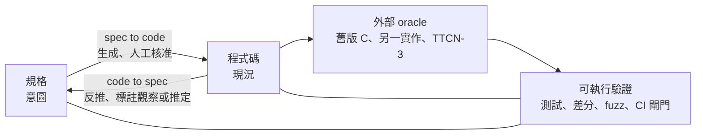
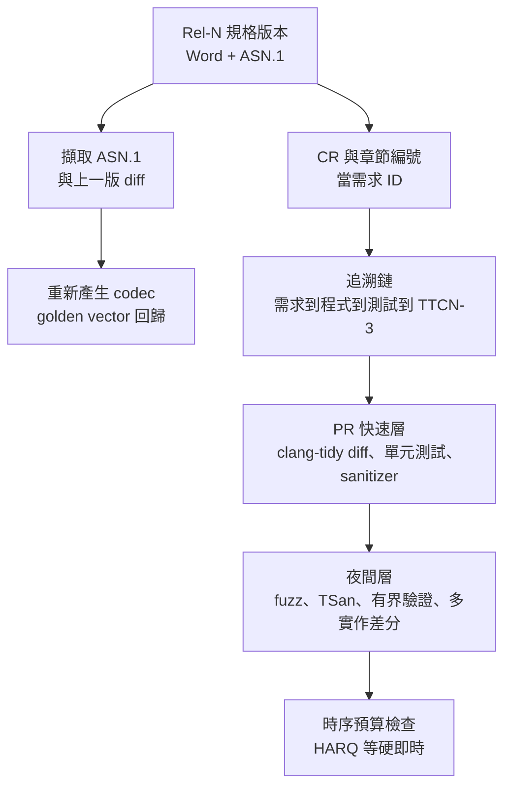

# Spec ⇄ Code 流程總覽:greenfield 與 brownfield 如何穩定開發大型 C/C++(以 5G NR → 6G Modem 為例)

> 本篇是「spec-code-flow」子資料夾的總覽,把四篇研究串起來。**內容分三級:已讀原文的事實、對已讀事實的歸納、純推論**;推論處明確標示。研究日期 2026-11-01。
>
> ⭐ **若你的情境是「外部公定 spec(3GPP)+ 內部實作 spec + 既有 code,6G 要加入又要保留 5G」**,直接看 [[multi-spec-layered-evolution-modem-5g-to-6g]]。
>
> 細節請看:[[spec-driven-development-landscape-2026]](spec → code)、[[code-to-spec-reverse-engineering-legacy-codebase]](code → spec)、[[cpp-large-codebase-stability-toolbox]](C/C++ 工具鏈)、[[5g-nr-to-6g-modem-spec-to-code-flow]](modem 案例)。

---

## 一句話總結

> **兩個方向其實是同一個閉環:** spec → code 負責「把意圖落地」,code → spec 負責「把現況釘住」,中間靠**可執行的驗證**(測試、差分、fuzz、CI)把兩邊綁在一起。greenfield 以前者為主,brownfield 先做後者再做前者。沒有任何一手證據顯示「完整自動」已在大型 C/C++ 或 modem PHY/MAC 上可行;可靠的是**切小、增量、驗證回路、多實作差分**。

---

## 一、greenfield 與 brownfield 對照

| 面向 | greenfield(新專案) | brownfield(既有大型程式庫) |
|---|---|---|
| 起點 | 需求 / 規格 | 程式碼本身(它就是現況規格) |
| 先做什麼 | constitution / 原則 + specify | **先 explore、釘住現況(characterization test)、只寫要動區域的 delta spec** |
| 風險 | 過度規格化、儀式感(Böckeler 評論) | 規格與現況不符;LLM 寫出「看似合理卻漏意圖」的規格 |
| 主要工具 | Spec Kit、Kiro | OpenSpec delta、change-level spec;反推用 clang / CPG / 分層摘要 |
| 證據強度 | 有個案(自述) | **無大型量化實證** |
| C/C++ 特別問題 | 一開始就能選好 build 與契約策略 | macro、條件編譯、指標別名 → 先固定 build configuration |

---

## 二、五層穩定機制(歸納自已讀來源)

| 層 | 做法 | 對應來源 |
|---|---|---|
| 1. 切小 | 每 feature / change 一份規格;task 塞得進一個 context | Allegro、Conductor、OpenSpec |
| 2. 契約 | `Expects/Ensures`、C++26 Contracts(有爭議)、ACSL | Core Guidelines、Sutter 報告 |
| 3. 驗證回路 | tests、sanitizer、fuzz、有界模型檢查、CI 分層 | 工具箱篇 |
| 4. 同步強制 | 規格與程式碼同 PR;drift gate | Allegro、Augment(vendor)、Spec Growth Engine(提案) |
| 5. 外部 oracle | 舊版 C、另一個實作、TTCN-3 測試套件 | TRACTOR / Syzygy、SpecLens、ETSI TTCN-3 |

---

## 三、以 5G NR modem → 6G modem 為例的流程設想

**以下為本篇推論**(來源只涵蓋其中零散事實;modem 韌體實務沒有公開一手文件):

1. **把規格版本當輸入**:新版 38.331 進來 → 擷取 ASN.1 → 與上一版 diff → codec 回歸(已讀事實:ASN.1 嵌在 .docx;Rel-20 ASN.1 凍結 2027-06、Rel-21 為 2029-03)。
2. **greenfield 部分(6G 新功能)**:Rel-21 在 2028-12 Stage-3 凍結前規格仍會變動——所以只能做 spec-anchored(規格與測試並存、CI 擋分歧),不適合 spec-as-source。
3. **brownfield 部分(5G 與舊代)**:先用 libclang / CPG 建 call graph 與元件圖,對協定層用 ProtocolGPT 式的狀態機反推,再與規格狀態機比對;差異當待查項目。
4. **多實作差分**:SpecLens 的 60 項分歧證明單一實作不可信;能與 OAI 或第二套實作做差分的模組,優先自動化。
5. **AI-native PHY(6G)**:驗收從 bit-exact golden vector 轉成統計 KPI(推論,見 modem 篇)。

---

## 四、現階段的明確缺口(誠實列出)

- **PHY / MAC 層從規格自動產碼:無任何一手證據。**
- **大型 brownfield 的量化實證:無。**
- **C++26 Contracts 在主流編譯器的實作狀態:未核實**(cppreference 只顯示 "16")。
- **MC/DC 與 DO-178C / ISO 26262 的 C/C++ 條文:未核實**(標準付費)。
- **modem 韌體(real-time、記憶體預算、追溯鏈)的公開一手文件:找不到。**
- 工具 star 數、版本是 2026-11-01 快照,會變。

---

## 五、延伸閱讀(本庫)

- [[ai-brownfield-codebase-five-steps]]:AI 接手既有程式庫的五步驟。
- [[to-tickets-spec-to-agent-workunits]]:把規格轉成 agent 可執行的工作單元。
- [[ai-native-sdlc-landing-checklist]]:AI 原生 SDLC 落地清單。
- [[agent-skill-three-layer-run-do-verify]]、[[loop-engineering-when-and-how-gary-chen]]:驗證回路與別球員兼裁判。
- [[linus-llm-kernel-patch-vs-gcc-ai-policy]]:大型 C 專案(Linux kernel)對 AI 生成補丁的政策。
