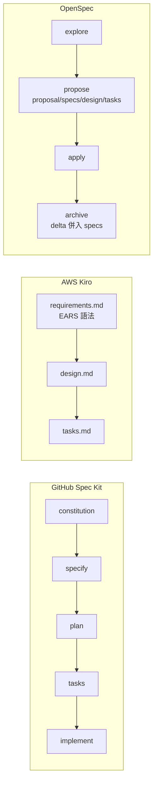

# Spec-to-Code 現況(2026):Spec Kit、Kiro、OpenSpec、BMAD 與大型專案的穩定做法

> 研究日期:2026-11-01。方法:網路蒐集官方文件、GitHub、論文與 Thoughtworks / Martin Fowler 評論,逐項標示來源。**抓取工具回傳的是頁面摘要,不是全文**;引句為短引,數字(stars、版本)是當天頁面所見。
>
> 本篇是「規格 → 程式碼」這一側。反方向見 [[code-to-spec-reverse-engineering-legacy-codebase]];C/C++ 的穩定化工具見 [[cpp-large-codebase-stability-toolbox]];通訊 modem 的具體案例見 [[5g-nr-to-6g-modem-spec-to-code-flow]];總覽與 greenfield / brownfield 對照見 [[spec-code-flow-overview-greenfield-brownfield]]。

---

## 一句話總結

> **規格驅動(SDD)的共識不是「寫更多文件」,而是「把意圖變成可被機器檢查的東西」。** 大型專案穩定的關鍵是:規格切小(每個 feature / change 一份)、驗證回路(測試、CI、Stop hook)、同步變成強制機制而非紀律。greenfield 可以走完整 specify → plan → tasks;**brownfield 業界一致建議增量、change-level、先 explore 再寫,不要一次逆向整個程式庫**——但這個共識目前**沒有大型 brownfield 的量化實證**。

---

## 一、先分級:spec-first、spec-anchored、spec-as-source

arXiv 2602.00180(Piskala,2026-01)把規格嚴謹度分三級:

| 級別 | 意思 | 例子 |
|---|---|---|
| spec-first | 先寫規格釐清,之後規格可能被丟棄 | 寫完 PRD 就開工 |
| **spec-anchored** | 規格與程式碼並存、靠測試維持同步 | BDD、OpenAPI + contract testing |
| spec-as-source | 規格才是原始碼,程式碼是生成物 | Simulink → C(只在已建立信任的領域) |

論文稱 spec-anchored 是「the sweet spot for most production systems」,規則是「用能消除歧義的最小規格嚴謹度」。**限制**:論文自承實證證據仍「nascent」(案例是說明性質);並警告兩種風險——spec rot(除非測試在分歧時失敗)與 false confidence(錯誤的規格會產生「忠實的錯誤程式」)。適用長壽、多維護者、整合密集、受管制、遺留現代化;一次性原型與簡單 CRUD 是過度。

---

## 二、主流工具的流程對照(已讀原文)

| 工具 | 流程與產物 | greenfield / brownfield | 值得注意 |
|---|---|---|---|
| **GitHub Spec Kit** | `constitution → specify → plan → tasks → implement`(頁面所見指令 `/speckit-*`,舊文件為 `/speckit.*`);constitution 放不可變原則(如 Library-First、Test-First、Integration-First Testing);模糊處標 `[NEEDS CLARIFICATION]`;獨立任務標 `[P]` 可平行 | 預設 greenfield;有 existing-project 指引(**我嘗試的 URL 404,內容未核實**) | 頁面讀到 144.2k stars(版本號未讀到);docs 稱 157 個社群 extension、33 個 preset |
| **AWS Kiro** | 每個 feature 三檔:`requirements.md`(bug 為 `bugfix.md`)、`design.md`、`tasks.md`;可 Requirements-First 或 Design-First;執行全部 tasks 時建依賴圖,獨立任務分 wave 並行 | 文件未談 brownfield | EARS 句型例:`WHEN [event] THE SYSTEM SHALL [behavior]`;**可把 requirement 轉成 property-based test**,失敗時縮到最小反例,官方自承「evidence of correctness, not a proof」 |
| **OpenSpec** | `openspec/specs/`(現況 source of truth)+ `openspec/changes/<name>/`(進行中變更);指令 `/opsx:explore → propose → apply → archive` | **自稱 built for brownfield**;**delta spec**:ADDED / MODIFIED / REMOVED,archive 時併回主 spec | 73.5k stars(版本號未讀到),需 Node 22.12+ |
| **BMAD-METHOD** | 多角色 agent 方法;有「Add BMad to an existing codebase」專文 | 有 brownfield 專文 | 54.8k stars,穩定版 v6.12;頁面稱 v7 preview(ETA 2026-10-16),是否已發布**未核實**;各階段檔案格式我未讀到 |
| **Google Conductor** | `setup → newTrack(每 track 一份 spec + plan) → implement`,進度存檔可暫停回復 | 官方稱多數工作在既有程式庫 | 2025-12-17 Gemini CLI preview |
| **Codex ExecPlan** | 單一「living document」`PLANS.md`:Progress、Surprises & Discoveries、Decision Log、Outcomes & Retrospective | 通用 | 作者稱 `PLANS.md` 讓 Codex 單一 prompt 工作超過七小時(自述,頁面標 archived) |
| **Claude Code** | 官方最佳實務:給可執行檢查(tests、typecheck、`Stop` hook、CI);不確定時「Interview me until you could write the spec」寫入 `SPEC.md`;用 subagent 對照 SPEC.md 審 diff | 通用 | 提醒審查者要加「skip style」,否則會製造過度抽象;我只 grep 關鍵行,未通讀此頁 |
| **Tessl** | Debois 文章主張「Version your specs: Use Git」「Too large or too many specs will overload the context window」 | — | `docs.tessl.io` 現在定位是 skills / registry 平台,**未提 spec framework**;Böckeler 2025-10 描述的 Tessl Framework 現況無法確認 |

> 這些都是 2025–2026 快速變動的工具,指令名、版本、star 數會變;**請以當時官方頁為準**。Cursor 與 Microsoft 的官方做法本次沒找到一手來源,未納入。

---

## 三、批評與限制(這部分比工具介紹更重要)

| 來源 | 重點 |
|---|---|
| **Birgitta Böckeler(martinfowler.com,2025-10-15)** | Kiro 修一個小 bug 被拆成 4 個 user stories、16 條 acceptance criteria,像「用大錘敲核桃」;Spec Kit 讓她「寧可 review 程式碼而不是這些 markdown」;3–5 點的功能也「overkill」;agent 無視既有類別而重複生成;**同一份規格多次生成結果不同(非決定性)**;兩工具導入既有程式庫「更費工」,她自述**無法評估 brownfield 實際價值** |
| **Thoughtworks Radar** | SDD 技術條目 Assess(2025-11);**Spec Kit 條目 Assess(2026-04-15)**寫「mostly in brownfield environments」,指 brownfield 返工多源自意圖不明、隱含假設、晚發現的限制;遇 instruction bloat,有團隊把可重用指引移到 skills 按需載入;「資深工程師最能得益」 |
| **Martinelli(2026-10)** | ⚠️ 作者推銷自家 AI Unified Process,利益相關。論點:單行 bug fix 不該觸發完整規格流程;大型既有應用讓 LLM 寫完整規格會超 context |
| **Allegro 實務(2026-06)** | 每 feature 一份規格優於單一巨大規格;plan 拆到每個 task 能在單一 context 內實作並測試;**每 task 開新 session**;每 task 有 acceptance criteria;另一 agent 審查但「support, not a replacement」 |

### 規格漂移(spec drift)的對策

- 實務:Allegro 要求每次變更更新規格;Augment(⚠️ vendor 指南)主張規格與程式碼同 PR 更新。
- 研究提案:Spec Growth Engine(arXiv 2606.27045,單一作者)提出 **drift gate——規格與程式碼分歧時阻擋 merge**,以及限定 ownership path 的 context assembler。**頁面明言沒有實驗數據**,只是提案。
- 本篇歸納(推論):把同步做成 CI 檢查,而不是靠人記得,才是 spec-anchored 的實質。

---

## 四、greenfield 與 brownfield 的差異

| | greenfield(新專案) | brownfield(既有大型程式庫) |
|---|---|---|
| 規格從哪來 | 從需求寫起 | 需要先理解現況;代碼本身就是現況規格 |
| 建議流程 | 完整 constitution → specify → plan → tasks | **每次變更前先 explore → 只寫要動區域的 delta spec → 逐項審 → 重複**;常動區域逐漸變成 greenfield 式 |
| 主要風險 | 過度規格化、儀式感 | 規格與現況不符、LLM 寫出「看似合理」卻漏掉意圖的規格 |
| 工具傾向 | Spec Kit、Kiro | OpenSpec delta、Conductor、change-level spec |
| 證據強度 | 有個案(AWS 3 人 3 週藥物探索 agent,⚠️ AWS 自述;客戶 Rackspace「52 週估算壓到 3 週」為客戶自報) | **無大型量化實證**;共識來自 intent-driven、Augment(vendor)、Martinelli(利益相關)三個非獨立來源 |

「不要一次逆向整個 codebase」的理由:AI 起草的規格「plausible」但漏意圖,大規格難審且會漂移。類比 Michael Feathers 的 characterization tests(先釘住現況行為再改)。這與 [[ai-brownfield-codebase-five-steps]] 的做法一致。

---

## 五、穩定大型專案的技術清單

| 技術 | 做法 | 來源狀態 |
|---|---|---|
| 規格切小 | 每 feature / track / change 一份;task 能塞進單一 context | Allegro、Conductor、Spec Growth Engine(提案) |
| 規格 → 測試 | EARS requirement → property-based test;失敗縮到最小反例 | Kiro 官方文件 |
| 驗證回路 | tests、typecheck、`Stop` hook、CI,讓 agent 能自己檢查完成度 | Claude Code 官方文件;見 [[agent-skill-three-layer-run-do-verify]]、[[loop-engineering-when-and-how-gary-chen]] |
| 任務拆解 | tasks 標示獨立性可平行;Kiro 依賴圖分 wave | Spec Kit `[P]`、Kiro;見 [[to-tickets-spec-to-agent-workunits]] |
| 不變規則 | constitution / steering,但要避免 bloat | Spec Kit;Radar 建議按需載入 skills |
| 同步強制 | drift gate、規格與程式同 PR | 見上節 |
| 可追溯性(traceability)、contract test(Pact)、PBT 原始文件 | **本次沒有一手來源**,不在此展開 | 缺口 |

---

## 六、應用案例

### 案例 1:既有 C 專案要加一個功能(OpenSpec 式 delta)

1. `explore`:請 agent 只讀要動的模組,產出「現況行為」摘要,人工核對。
2. `propose`:寫一份 delta spec——**現況行為、目標行為、不變條件、範圍排除**(Augment 指南的四要素)。
3. `apply`:實作前先寫 characterization test 釘住現況。
4. `archive`:合併進 `specs/`,與程式碼同一個 PR。

### 案例 2:修小 bug 不要走完整流程

Böckeler 與 Martinelli 的共同教訓:單行修正直接修並補測試;只有**跨模組或改行為**才寫規格。可以在 constitution 裡寫明「何時免規格」。

### 案例 3:把規格同步做成 CI 閘門

簡化版 drift gate(本篇推論的最小實作):每個 spec 檔在 front-matter 列出它涵蓋的原始碼路徑;CI 檢查「路徑下有變更但 spec 沒變更」即警告或擋 merge。這是把 Spec Growth Engine 的概念縮到可立即試的版本,**未經任何數據驗證**。

---

## 七、核實與保留

**✅ 已讀原文:** arXiv 2602.00180 三級分類與限制;Spec Kit 與 spec-driven.md 的流程與 constitution;Kiro 三檔、EARS 一型、correctness 頁;OpenSpec 目錄與 delta 語意;BMAD 的 stars 與版本;Conductor 流程;Böckeler 評論;Thoughtworks Radar 兩條;Allegro 實務;Spec Growth Engine 摘要。

**⚠️ 保留:**

- 以上摘要來自抓取工具的頁面摘要,部分引句是短引而非全文比對。
- 工具版本與 star 數是 2026-11-01 的快照;Spec Kit、OpenSpec 的版本號本次**未讀到**。
- brownfield 的建議流程**沒有大型專案的量化實證**;AWS 案例是 greenfield 性質的自述。
- 未找到:Cursor、Microsoft 官方做法;EPAM 的 brownfield 文章(403)。

---

## 來源

- Piskala,*Spec-Driven Development*:https://arxiv.org/html/2602.00180
- GitHub Spec Kit:https://github.com/github/spec-kit 、 https://github.com/github/spec-kit/blob/main/spec-driven.md 、 https://github.blog/ai-and-ml/generative-ai/spec-driven-development-with-ai-get-started-with-a-new-open-source-toolkit/
- Kiro:https://kiro.dev/docs/specs/ 、 https://kiro.dev/docs/specs/feature-specs/ 、 https://kiro.dev/docs/specs/correctness/ 、 https://aws.amazon.com/blogs/industries/from-spec-to-production-a-three-week-drug-discovery-agent-using-kiro/
- OpenSpec:https://github.com/Fission-AI/OpenSpec 、 https://github.com/Fission-AI/OpenSpec/blob/main/docs/concepts.md
- BMAD-METHOD:https://github.com/bmad-code-org/BMAD-METHOD
- Tessl:https://tessl.io/blog/spec-driven-development-10-things-you-need-to-know-about-specs/ 、 https://docs.tessl.io/
- Conductor:https://developers.googleblog.com/conductor-introducing-context-driven-development-for-gemini-cli/
- Claude Code best practices:https://code.claude.com/docs/en/best-practices
- Codex ExecPlan:https://developers.openai.com/cookbook/articles/codex_exec_plans
- Böckeler:https://martinfowler.com/articles/exploring-gen-ai/sdd-3-tools.html
- Thoughtworks Radar:https://www.thoughtworks.com/radar/techniques/spec-driven-development 、 https://www.thoughtworks.com/radar/languages-and-frameworks/github-spec-kit
- Martinelli(利益相關):https://martinelli.ch/why-spec-driven-development-tools-fail-in-the-enterprise/
- Spec Growth Engine:https://arxiv.org/abs/2606.27045
- Allegro:https://blog.allegro.tech/2026/06/spec-driven-development-best-practices
- Brownfield 做法(非權威):https://intent-driven.dev/blog/2026/03/10/spec-driven-development-brownfield/ 、 https://www.augmentcode.com/guides/spec-driven-development-brownfield-codebases (vendor 指南)
