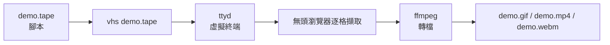

# VHS:把終端機操作寫成腳本,改一行就重新生成 GIF 和 MP4

> 整理自 YouTube 頻道 **YAHA學堂**〈[GitHub2.1萬星神器 VHS 實測：終端機教學不用再重錄！VHS 寫一份腳本，自動生成 GIF 和 MP4｜Mac 免費開源工具](https://www.youtube.com/watch?v=QQqUj0ZB2Ro)〉(2026-10-25,約 5 分鐘,英文自動字幕 `en-orig`)。
>
> ✅ **已 clone [charmbracelet/vhs](https://github.com/charmbracelet/vhs) 讀原始碼核對**(GitHub API:約 21,201 星、MIT 授權)。說明欄未見業配或聯盟連結;素材包下載連結寫著「待補」,影片中的對獎工具是作者自製的教學示範,數據為虛構。

---

## 一句話總結

錄終端機教學最煩的是打錯字就要重錄。**VHS** 把打字、等待、按鍵和畫面樣式寫進一個 **`.tape` 腳本**,執行 `vhs xxx.tape` 就自動「演」一遍並輸出 GIF / MP4。改一個字只要改腳本重跑,不必重新操作。

---

## 一、運作方式



- 兩個外部依賴:**ttyd**(虛擬終端)與 **ffmpeg**(影片轉檔),都要在 `PATH` 上。
- 影片的比喻:tape 就像劇本,VHS 是照劇本演出的「導演兼攝影師」。

---

## 二、第一支 GIF:`vhs new`

```bash
vhs new demo.tape   # 產生範本腳本
vhs demo.tape       # 執行,產生 demo.gif
```

範本內容(✅ 與 repo 的 `examples/demo.tape` 一致):

```elixir
Output demo.gif

Require echo

Set Shell "bash"
Set FontSize 32
Set Width 1200
Set Height 600

Type "echo 'Welcome to VHS!'" Sleep 500ms  Enter

Sleep 5s
```

| 指令 | 作用 |
|---|---|
| `Output` | 輸出檔名與格式;可寫多行同時輸出 `.gif`、`.mp4`、`.webm`,或 `frames/` 輸出 PNG 序列 |
| `Require` | 檢查程式是否存在,**不存在就不錄**,避免錄到一半壞掉;必須寫在檔案最上方 |
| `Set` | 設定 Shell、字體大小、寬高、主題等 |
| `Type "..."` | 一個字一個字打出引號裡的內容 |
| `Sleep 500ms` | 暫停 0.5 秒 |
| `Enter` | 按 Enter;可和 `Type`、`Sleep` 寫在同一行 |

影片:設定、打字、等待、按鍵,這四個最常用。

---

## 三、`Sleep` 和 `Wait` 的差別(影片的核心踩坑)

情境:作者的對獎小工具 `update` 會刻意等 3 秒模擬抓網路資料,完成後才該執行下一個指令。

**第一版:用 `Sleep 1s`** ⇒ ❌ 更新還沒跑完,下一行就觸發了。
影片比喻:Sleep 像站著不動的演員,周圍發生什麼都不管,時間到才動。

**第二版:改成 `Wait /updated/`** ⇒ ❌ 失敗(逾時)。

**原因(✅ 讀原始碼確認)**:`Wait` 的預設範圍是 **`Line`**,只看**最後一行**;預設等待的正規表示式是 `/>$/`(等提示字元出現),預設逾時 **15 秒**(`vhs.go` 的 `defaultWaitTimeout = 15 * time.Second`;`command.go` 每 10 毫秒檢查一次)。「updated」不在最後一行,所以一直等不到。

**第三版:`Wait+Screen /updated/`** ⇒ ✅ 看整個畫面。

```elixir
Wait                    # 等提示字元重新出現(預設 />$/)
Wait /World/            # 最後一行出現 World
Wait+Screen /updated/   # 整個畫面任何地方出現 updated
Wait@10s /done/         # 自訂這次的逾時
Set WaitTimeout 30s     # 改全域預設逾時
Set WaitPattern /\$ $/  # 改全域預設等待樣式(提示字元不是 > 時很有用)
```

> ⭐ 影片說 `Wait` 不帶參數就是「等提示字元重新出現」,正確。但要注意:**預設樣式是 `>` 結尾**。如果你的 shell 提示字元是 `$ ` 或 `❯`,要用 `Set WaitPattern` 改,否則每個裸 `Wait` 都會等滿 15 秒逾時。(影片沒講)

---

## 四、`Hide` / `Show`:準備動作不入鏡

```elixir
Hide
Type "cd invoice" Enter
Show
```

`Hide` 像導演喊「卡」:中間的操作照樣執行,但不會出現在影片裡,直到 `Show`。適合藏掉 `cd`、清畫面、設環境變數這類準備動作。

---

## 五、主題與輸出

- `vhs themes` 列出內建配色。✅ repo 的 `themes.json` 共 **348** 個(與影片一致)。
- 影片用 **Catppuccin Mocha**:暗色、不刺眼。

```elixir
Output invoice.gif   # 分享到社群
Output invoice.mp4   # 直接放進 YouTube 影片
Set Theme "Catppuccin Mocha"
```

兩行 `Output` 會同時產生兩個檔案;影片的完整版約 20 秒生成。

---

## 六、`vhs record`:先操作一次,自動產生腳本

```bash
vhs record > cassette.tape
# 正常操作終端,打 exit 結束
```

VHS 會記錄你的按鍵寫成 tape。⚠️ **錄出來的腳本沒有 `Output` 行**(✅ `record.go` 不產生 Output),要自己補上才能導出,這就是說明欄問的「還要補哪一行」。官方 README 也建議錄完手動編輯,加上 `Set`、`Output` 等設定。

---

## 七、安裝

```bash
# macOS(已裝 Homebrew)— 一併裝好 ttyd 與 ffmpeg
brew install vhs

# Windows
winget install charmbracelet.vhs
# 或 scoop install vhs

# 確認
vhs --version
```

⚠️ README 寫明 VHS 需要 `ttyd` 和 `ffmpeg` 在 `PATH` 上。Homebrew 會一併處理依賴;Windows 和部分 Linux 發行版要確認 ttyd 有裝(Debian/Ubuntu 的 README 範例是從 ttyd GitHub releases 另外安裝)。

---

## 八、影片沒講、但 repo 裡有的功能

| 功能 | 用法 |
|---|---|
| `Source` | 從另一個 tape 引入指令,共用一段設定 |
| `Env` | 設定環境變數:`Env HELLO "world"` |
| `Screenshot` | 擷取當下畫面:`Screenshot out.png` |
| `Copy` / `Paste` | 剪貼簿操作 |
| `Set TypingSpeed` | 調整打字速度 |
| `vhs publish demo.gif` | 上傳到 `vhs.charm.sh` 產生分享連結 |
| `vhs serve` | 內建 SSH 伺服器,可自架讓別人 `ssh` 進來傳 tape 生成 |

**非常實用的一點**:因為 tape 是純文字,可以**放進版控、跟著 CLI 一起更新**。CLI 改了輸出格式,重跑 tape 就能更新 README 動圖。

---

## 九、應用案例

### 案例 1:README 動圖跟著版本自動更新

情境:你維護一個 CLI 工具 `mytool`,README 有一張示範 GIF,每次改版畫面就過時。

```elixir
# docs/demo.tape
Output docs/demo.gif
Require mytool

Set Shell "bash"
Set Theme "Catppuccin Mocha"
Set FontSize 22
Set Width 1000
Set Height 500
Set WaitPattern /\$ $/

Hide
Type "export PS1='$ ' && clear" Enter
Show

Type "mytool init my-project" Enter
Wait+Screen /Project created/
Sleep 1s

Type "mytool status" Enter
Wait
Sleep 3s
```

在 CI 裡加一步 `vhs docs/demo.tape`,每次發版就重新產生 GIF 並提交。

### 案例 2:教學影片裡的終端畫面

情境:錄 YouTube 教學,需要一段「安裝 → 執行 → 看到結果」的終端畫面。

- 同時輸出 `Output demo.mp4`(剪進影片)與 `Output demo.gif`(貼在社群貼文)。
- 用 `Hide` / `Show` 藏掉切目錄、清畫面等準備動作。
- 用 `Wait+Screen` 等真正的完成訊息,而不是猜一個 `Sleep` 秒數;機器變快變慢都不會錯拍。
- 講稿改了、某個參數要換,只改 tape 的一行重跑,不必重新錄音配畫面。

### 案例 3:排查「為什麼 Wait 一直逾時」

| 症狀 | 檢查 | 修法 |
|---|---|---|
| 裸 `Wait` 每次都等滿 15 秒 | 你的提示字元是不是 `>` 結尾? | `Set WaitPattern` 改成你的提示字元 |
| `Wait /done/` 逾時 | 「done」是不是不在最後一行? | 改成 `Wait+Screen /done/` |
| 指令本來就要跑很久 | 是否超過 15 秒? | `Wait@60s /done/` 或 `Set WaitTimeout 60s` |
| 用 `Sleep` 時快時慢錯拍 | 是否依賴網路或磁碟速度? | 改用 `Wait` 等實際輸出 |

---

## 十、核實

**✅ 已讀原始碼核對(charmbracelet/vhs,MIT,約 21.2k 星):**

- `vhs new` 範本內容(`Require echo`、`Set Shell "bash"`、`FontSize 32`、`1200×600`)。
- `Wait` 預設樣式 `/>$/`、預設逾時 15 秒、預設範圍 `Line`;`Wait+Screen` 看整個畫面。
- 內建主題 348 個。
- `vhs record` 產生的腳本不含 `Output`。
- 依賴 ttyd 與 ffmpeg。

**⭐ 補充(影片沒講):** `Set WaitPattern` 與提示字元的關係、`Source` / `Env` / `Screenshot` / `publish` / `serve` 等功能、tape 可放進 CI 自動更新動圖。


---

## 相關筆記

- [[claude-design-25-tricks-design-rules-skill]]:同頻道同日的另一支影片,也談「把重複工作寫成可重用的規則」。

---

## 來源

- YouTube:YAHA學堂〈GitHub2.1萬星神器 VHS 實測：終端機教學不用再重錄！VHS 寫一份腳本，自動生成 GIF 和 MP4｜Mac 免費開源工具〉 https://www.youtube.com/watch?v=QQqUj0ZB2Ro (2026-10-25,英文自動字幕)
- charmbracelet/vhs(已 clone 讀原始碼): https://github.com/charmbracelet/vhs
- VHS 主題列表: https://github.com/charmbracelet/vhs/blob/main/THEMES.md
- ttyd: https://github.com/tsl0922/ttyd
- FFmpeg: https://ffmpeg.org/
- Catppuccin: https://github.com/catppuccin/catppuccin
