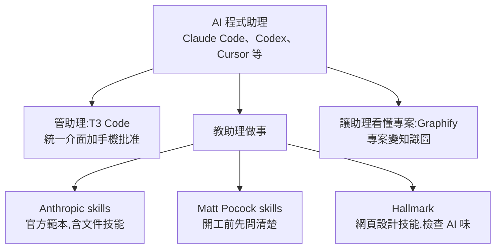

# GitHub 新星週報(2026-11-06 至 11-13):Graphify、Hallmark、Anthropic skills、Matt Pocock skills、T3 Code(辰星說Github)

> 來源影片:辰星說Github〈Github本周前五名:手機遙控 Claude Code、Codex,AI 做的網頁不再有 AI 味〉,2026-11-14 上傳,長度 8:45。
> 影片連結:https://www.youtube.com/watch?v=GzzC5tdJzhY
> 字幕:頻道提供的**人工字幕**(zh-TW),帶時間。
> ⚠️ **影片自己的揭露**:旁白是 AI 語音、配樂是 ElevenLabs 生成;畫面是各專案官方網站、文件、GitHub 頁面與 README 圖片的錄影,**「我們沒有實際安裝執行這五個專案」**;結尾說明欄寫明「僅介紹開源專案,不構成任何安裝或使用建議」。沒有業配標示;結尾只有「訂閱頻道」的一般自我宣傳。
> 排名方法(說明欄):用 GitHub API 在 2026-11-06 與 11-13 的星數快照相減,算約 7 天新增星數;追蹤清單不是全站,且排除盜版、攻擊性資安工具、投資建議、需要高階顯卡或自架伺服器的工具、已封存、灌星空殼與前幾集介紹過的專案,再取前五。
> 核實:我 clone 了五個專案(2026-11-15 讀,`graphify` `52cb282`、`hallmark` `04977e1`、`anthropics/skills` `1780c5e`、`mattpocock/skills` `5863806`、`t3code` `01c84c7c`),讀 README 與目錄,並用 GitHub API 查建立日期與星數。結果在第 7 節。

## 一句話結論

這週前五名「全都在讓 AI 程式助理更好用」,可以分成三類:**管助理**(T3 Code)、**教助理做事**(Anthropic skills、Matt Pocock skills、Hallmark)、**讓助理看懂專案**(Graphify)。我讀完原始碼與 README,影片的事實幾乎都對;只有一處需要修正(Graphify 的影片處理方式),另有幾項是影片沒提的限制。

## 1. 五個專案一覽(依影片順序:第五名 → 第一名)

| 名次 | 專案 | 一句話 | 建立日 | 本週新增星(影片) | 現在總星數(API) | 授權 |
|---|---|---|---|---|---|---|
| 5 | Graphify | 一個指令把專案變成可查詢的知識圖 | 2026-04-03 | 3,754 | 147,642 | Apache-2.0 |
| 4 | Hallmark | 讓 AI 做的網頁不像 AI | 2026-04-27 | 5,132 | 54,894 | MIT |
| 3 | anthropics/skills | Claude 做 Word、PPT、Excel 背後的官方技能 | 2025-09-22 | 5,960 | 194,510 | 各技能不同(多為 Apache-2.0) |
| 2 | mattpocock/skills | 開工前讓 AI 先把你問清楚 | 2026-02-03 | 7,427 | 324,352 | MIT |
| 1 | T3 Code | 一個介面管所有 AI 程式助理,手機也能批准 | 2026-02-08 | 10,072 | 60,386 | MIT |

「本週新增星數」是影片用兩個快照相減的數字,我沒有 11-06 的快照,**未能核實**;總星數與建立日我用 API 查,和影片(14.7 萬、5.4 萬、19.4 萬、32.3 萬、五萬八千多)吻合,T3 Code 影片是五萬八千多,現在已 6 萬多,是時間差。

## 2. 第五名:Graphify([0:40](https://youtu.be/GzzC5tdJzhY?t=30))

影片說法:在助理裡輸入 `graphify`,把程式、文件、PDF 整理成知識圖譜;AI 之後查圖,不用一個檔案一個檔案翻([1:04](https://youtu.be/GzzC5tdJzhY?t=54))。

- 產出三個檔案([1:21](https://youtu.be/GzzC5tdJzhY?t=71)):`graph.html`(瀏覽器裡可點可搜尋的互動圖)、`GRAPH_REPORT.md`(重點報告:核心概念、意外的連結、建議問題)、`graph.json`(完整圖資料,之後可反覆查詢)。
- 每條連線標明是**原始碼直接寫的**(`EXTRACTED`)還是**推論出來的**(`INFERRED`)([1:35](https://youtu.be/GzzC5tdJzhY?t=85)),並可用 `graphify query "問題"` 問、`graphify path A B` 查兩個東西怎麼連。
- 程式碼用 [[tree-sitter|tree-sitter]] 在本機解析、不用大型語言模型、資料不離開電腦([1:10](https://youtu.be/GzzC5tdJzhY?t=60));支援約 40 種語言([1:18](https://youtu.be/GzzC5tdJzhY?t=68))。
- 要注意([1:54](https://youtu.be/GzzC5tdJzhY?t=104)):文件、PDF、圖片的分析會用到助理的模型或你設定的 API 金鑰;需 Python 3.10+;官方套件名是 `graphifyy`(後面兩個 y),其他名稱相近的 PyPI 套件都不是官方的([2:07](https://youtu.be/GzzC5tdJzhY?t=117))。

實測別人怎麼用見 [[graphify-code-knowledge-graph-real-world-test]];程式碼圖譜的兩條路線見 [[codebase-memory-vs-codegraph-two-routes]]。

## 3. 第四名:Hallmark([2:21](https://youtu.be/GzzC5tdJzhY?t=131))

影片說法:由 Together AI 製作,是裝進 Claude Code、Codex、Cursor、OpenCode 的設計技能([2:31](https://youtu.be/GzzC5tdJzhY?t=141))。

- 流程([2:40](https://youtu.be/GzzC5tdJzhY?t=150)):先問你有什麼素材,從 50 種主題挑 3 種給你;依「這頁要讓訪客做什麼」排版(訂位頁放訂位、商店放購買)。
- 做完在真的瀏覽器裡檢查,抓「一看就是機器做的」習慣([2:54](https://youtu.be/GzzC5tdJzhY?t=164)):每個標題上方一行小字、標題只有一個字上色、每頁結尾硬塞電子報訂閱;對比、鍵盤操作、手機版面與「不准編造事實」是底線,沒過就不交件([3:08](https://youtu.be/GzzC5tdJzhY?t=178))。
- 可改造現有頁面,或只出檢查報告([3:17](https://youtu.be/GzzC5tdJzhY?t=187));配圖是 755 張開放授權照片,每張在頁面標註來源([3:22](https://youtu.be/GzzC5tdJzhY?t=192))。
- 要注意([3:30](https://youtu.be/GzzC5tdJzhY?t=200)):瀏覽器檢查要另外裝 Chrome 與 puppeteer,沒裝只做靜態檢查。

這個主題另見 [[claude-web-design-skills-benchmark-pnh]]、[[impeccable-frontend-design-skill-ai-slop]]。

## 4. 第三名:anthropics/skills([3:43](https://youtu.be/GzzC5tdJzhY?t=213))

- 技能是「一個資料夾,裡面有說明檔、腳本和素材,AI 遇到對應的工作才載入」([3:56](https://youtu.be/GzzC5tdJzhY?t=226))。倉庫現有 19 個技能,最受關注的是 `docx`、`pptx`、`xlsx`、`pdf`([4:07](https://youtu.be/GzzC5tdJzhY?t=237)),Claude 建立與編輯文件的能力背後用的就是它們;另有前端設計、Slack 動圖、品牌規範、測試網頁與專門寫新技能的 `skill-creator`([4:21](https://youtu.be/GzzC5tdJzhY?t=251))。
- 在 Claude Code 加入它的外掛市集就能安裝([4:33](https://youtu.be/GzzC5tdJzhY?t=263))。
- 要注意([4:40](https://youtu.be/GzzC5tdJzhY?t=270)):官方寫明技能是**示範與教學用途**,你在 Claude 實際拿到的行為可能不一樣,重要工作要先自己測。

同類盤點見 [[top-skills-for-agents]]。

## 5. 第二名:mattpocock/skills([4:57](https://youtu.be/GzzC5tdJzhY?t=287))

- 作者說這是他每天在用的一套 AI 程式助理技能,給「真正在做工程的人」([5:10](https://youtu.be/GzzC5tdJzhY?t=300))。
- 最受歡迎的 `grill-me`、`grill-with-docs`:開工前讓 AI 反過來一題一題問你,先對齊再動手([5:19](https://youtu.be/GzzC5tdJzhY?t=309));後者還會整理專案用語表(`GLOSSARY.md`)與決策紀錄([5:30](https://youtu.be/GzzC5tdJzhY?t=320))。另有 `tdd`(先寫會失敗的測試再修)、`diagnosing-bugs`(把除錯拆成一關一關)([5:37](https://youtu.be/GzzC5tdJzhY?t=327));每個技能都小,可自己改。
- 第一次用要先跑一次設定,選工單系統與文件放哪([6:00](https://youtu.be/GzzC5tdJzhY?t=350))。要注意([6:04](https://youtu.be/GzzC5tdJzhY?t=354)):用外掛安裝會自動更新,用 skills.sh 複製的檔案要手動更新;兩種**只能擇一**,都裝每個技能會出現兩次。

深入拆解見 [[matt-pocock-skills-teardown]]、[[superpowers-vs-matt-skills-strong-model]]。

## 6. 第一名:T3 Code([6:22](https://youtu.be/GzzC5tdJzhY?t=372))

- 是管理 AI 程式助理的**控制台**:助理都跑在你自己的電腦上,T3 Code 給它們統一的介面([6:35](https://youtu.be/GzzC5tdJzhY?t=385));Claude Code、Codex、Cursor、OpenCode、Grok Build 等十種以上都能接,只要你電腦上裝好、登入過([6:47](https://youtu.be/GzzC5tdJzhY?t=397))。
- 不轉賣 token,用的是你原本的訂閱([7:01](https://youtu.be/GzzC5tdJzhY?t=411));對話中途可換模型,還能讓 Claude 把工作交給 Codex([7:05](https://youtu.be/GzzC5tdJzhY?t=415));桌機、網頁、手機看到同一串對話,iOS 與 Android 都有 App,可透過區網、Tailscale 或官方 T3 Connect 連回電腦([7:11](https://youtu.be/GzzC5tdJzhY?t=421))。
- 每串對話可有自己的 Git 工作區,看完改動一鍵 commit、push、開 Pull Request([7:27](https://youtu.be/GzzC5tdJzhY?t=437));MIT 授權。
- 要注意([7:39](https://youtu.be/GzzC5tdJzhY?t=449)):它本身不含 AI,至少要先裝好並登入一個助理;團隊說審查人力有限,新功能要先在討論區提出、通過才會收([7:47](https://youtu.be/GzzC5tdJzhY?t=457))。

同類工具比較見 [[ai-orchestrators-32-tools-seven-dimensions]]。

## 7. 核實結果

| 影片說法 | 結果 | 依據 |
|---|---|---|
| Graphify:三個輸出檔、EXTRACTED / INFERRED 標籤、`graphify query` 與 `graphify path` | **已核實** | README「Get started」與連線信心標籤段 |
| Graphify:程式碼本機解析、不用 LLM、約 40 種語言 | **已核實** | README:tree-sitter AST,「no LLM, nothing leaves your machine」,~40 languages |
| Graphify:需 Python 3.10+;官方套件是 `graphifyy` | **已核實** | README:Needs Python 3.10+;「Official package: `graphifyy` (double-y)」 |
| Graphify:20 多種助理都能裝 | **已核實** | README:Claude Code、Cursor、Codex、Gemini CLI、GitHub Copilot「and 20+ more」 |
| Graphify:文件、PDF、圖片**和影片**的分析會用到助理的模型或 API 金鑰 | **需修正(部分)** | README 的資料處理段:文件、PDF、圖片送助理做語意抽取;**影片與音訊是用 faster-whisper 在本機轉錄,不離開電腦** |
| Hallmark:Together AI 製作、50 種主題、發 3 種、755 張照片 | **已核實** | README 開頭與「Fifty themes」「755 openly licensed photos」 |
| Hallmark:標題小字、單字上色、結尾電子報等「機器味」檢查 | **已核實** | README 列出的 tells 與影片相符 |
| Hallmark:瀏覽器檢查要裝 Chrome 與 puppeteer,否則只做靜態檢查 | **已核實(補充)** | README:`npm i -g puppeteer-core` 加 Chrome;沒裝時靜態檢查仍會跑;另需 Node 18+ |
| Hallmark:對比、鍵盤、手機版面、不准編造事實是底線 | **未能核實(逐項)** | README 說有「hard floor」與 gates,我沒有逐條讀 gate 內容 |
| anthropics/skills:19 個技能,含 docx/pptx/xlsx/pdf、skill-creator 等 | **已核實** | `skills/` 有 19 個資料夾 |
| anthropics/skills:文件技能是 Claude 建立與編輯文件背後用的 | **已核實(補充)** | README:這些「power Claude's document capabilities under the hood」,且是 Apache-2.0 |
| anthropics/skills:官方寫明示範與教學用途 | **已核實** | README:「provided for demonstration and educational purposes only」 |
| anthropics/skills:Claude Code 加入外掛市集就能安裝 | **已核實** | `/plugin marketplace add anthropics/skills` |
| Pocock:grill-me、grill-with-docs、tdd、diagnosing-bugs;`GLOSSARY.md` | **已核實** | `skills/` 下有這些 SKILL.md;README:更新 `GLOSSARY.md` 與 ADR |
| Pocock:外掛會自動更新、skills.sh 手動、兩者擇一否則重複 | **已核實** | README:「A plugin updates itself… installing both gives you every skill twice」 |
| Pocock:跑一次設定選工單系統與文件位置 | **已核實** | `setup-matt-pocock-skills`:issue tracker、triage labels、domain doc layout |
| Pocock:「讓 AI 講話更精簡」 | **已核實(出處不同)** | README 提到共用語言讓 agent「spends fewer tokens on thinking」 |
| T3 Code:10 種以上助理、不轉賣 token、手機 App、Tailscale 與 T3 Connect、每串對話一個 worktree、MIT | **已核實** | README 對應條目 |
| T3 Code:本身不含 AI、審查人力有限、新功能先開討論 | **已核實** | README:需一個已安裝並登入的 agent;「limited review capacity… Features need an approved discussion first」 |
| 各專案「本週新增星數」 | **未能核實** | 需要 11-06 的快照 |
| 「沒有實際安裝執行這五個專案」 | **影片自己說明** | 所以下面的操作細節都來自 README,不是影片作者實測 |

## 8. 應用案例

1. **接手大型舊專案**:新進一個幾十萬行、沒人講得清楚的專案,先在助理裡跑 `graphify`,把 `GRAPH_REPORT.md` 當導覽、`graphify path A B` 查兩個模組怎麼串起來,再讓助理查圖而不是一個個開檔案。文件很多時留意 PDF 與圖片會走你的模型額度;只要程式碼就加 `--code-only`。
2. **幫自己的作品集做網站**:怕做出「AI 感」的頁面,裝 Hallmark,說明要訂位頁或商店頁,讓它發三種主題挑一個;要檢查現有頁面就用它的審查報告模式。
3. **寫一個團隊自己的技能**:照 anthropics/skills 的資料夾結構(說明檔加腳本加素材),先用 `skill-creator` 起草,再把內部工作流程寫進去。
4. **需求常被 AI 誤解**:每次開工前先跑 `/grill-me`,逼自己把「到底要什麼」說清楚,再讓 `tdd` 先寫失敗的測試。注意外掛與 skills.sh 擇一安裝。
5. **離開座位仍要審批**:桌機開著 T3 Code,同時掛 Claude Code 與 Codex,出門時用手機 App 經 Tailscale 連回家裡電腦批准下一步;風險是遠端批准等於把電腦控制權交給行動裝置,先確認連線方式與裝置安全。

## 來源

- 影片:辰星說Github〈Github本周前五名:手機遙控 Claude Code、Codex,AI 做的網頁不再有 AI 味〉 https://www.youtube.com/watch?v=GzzC5tdJzhY
- Graphify:https://github.com/Graphify-Labs/graphify
- Hallmark:https://github.com/Nutlope/hallmark
- Anthropic skills:https://github.com/anthropics/skills
- Matt Pocock skills:https://github.com/mattpocock/skills
- T3 Code:https://github.com/pingdotgg/t3code
- 本庫相關:[[graphify-code-knowledge-graph-real-world-test]]、[[matt-pocock-skills-teardown]]、[[claude-web-design-skills-benchmark-pnh]]、[[ai-orchestrators-32-tools-seven-dimensions]]
