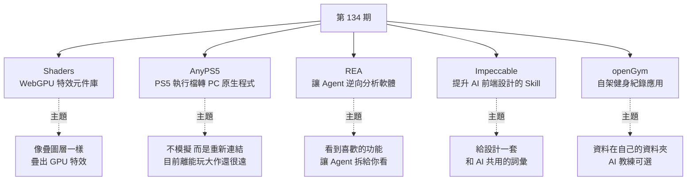
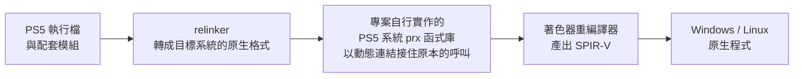

# 第 134 期:WebGPU 特效元件庫(Shaders)、PS5 遊戲移植到電腦(AnyPS5)、讓 Agent 逆向一切(REA)、提升 AI 前端設計的 Skill(Impeccable)與自架健身紀錄(openGym)

> GitHub 一週熱點第 134 期(2026/10/11 發布)。本期一半是**「給 Agent 更好的工具」**:把 WebGPU 特效包成元件、還附 MCP 讓 Agent 安裝修改的 **Shaders**;把 Agent 接上 Hopper / Ghidra / IDA 等分析工具、沒有原始碼也能拆解軟體功能的 **REA**;以及從 Anthropic frontend-design 出發、補上 24 個設計指令的 **Impeccable**。另一半是兩個「自己的東西自己掌握」的專案:把 PS5 執行檔轉成 Windows / Linux 原生程式的 **AnyPS5**,和資料留在自家伺服器的健身紀錄 App **openGym**。

---

## 本期速覽



---

## 1. Shaders —— 把 WebGPU 特效包成元件的開源庫

- **連結:** <https://github.com/shader-effects-inc/shaders>(官網 <https://shaders.com>)
- **Repo 現況(2026-10 查核):** ⭐ 約 4.4k、MIT 授權、TypeScript;2026-09-29 才建立,開源後兩週內衝上熱門。npm 套件名就叫 `shaders`。

**它解決什麼:** 想給網頁加一點質感特效(玻璃、金屬、光線、扭曲、雜訊、轉場、模糊、游標拖尾……),但不想從頭學 WGSL 著色器。Shaders 把 **200 多種 WebGPU 特效**做成宣告式元件,支援 **React、Vue、Svelte、Solid 與純 JavaScript**,各框架 props 一致,支援 SSR。

**用法就像疊圖層:** `<Shader>` 負責建立畫布,它底下的子元件就是一層層的圖層,**由上往下在 GPU 上混合**,可巢狀、可混合、可遮罩。

```jsx
import { Shader, LinearGradient, CursorTrail } from 'shaders/react'

<Shader className="w-full h-64">
  <LinearGradient colorA="#0f172a" colorB="#7c3aed" />
  <CursorTrail />
</Shader>
```

**三種工作方式:**

| 方式 | 說明 |
|---|---|
| 直接寫元件 | `npm install shaders`,照上面範例疊圖層、調 props |
| 視覺化編輯器 | 在 shaders.com 的無限畫布上疊元件、調參數、即時預覽,滿意後 **Export Code** 匯出對應框架的元件樹(登入帳號即可免費使用) |
| CLI | `npx shaders connect` 把專案綁到 Shaders 帳號上的專案、`npx shaders install` 寫出元件檔、`npx shaders update` 同步編輯器的改動 |

**給 AI 用的介面:** `npx shaders skill` 安裝 Agent Skill;`npx shaders@latest install-mcp` 幫 Claude Code、Cursor、Codex、Windsurf、Copilot 等設定 MCP,讓 Agent 能**查找、安裝與修改**你設計的特效;另有 `llms.txt` / `llms-full.txt` 給模型讀完整元件文件。影片作者覺得**設計工具與程式碼之間能接起來**這點特別方便。

**自訂元件:** 用 `defineShader` 宣告名稱、props 與每個像素要畫什麼(可直接寫 WGSL),再用 `<CustomShader>` 掛上。

> ⚠️ **授權要分清楚:** repo 裡的**引擎、所有元件與框架綁定是 MIT**;但 **shaders.com 的編輯器、預設集、網站區塊等平台功能另有條款**。**Pro 付費方案**才有 1,000+ 預設、55+ 網站區塊、**無浮水印的 HD 圖片 / 影片輸出**、Framer 外掛等。

> 💡 週報作者觀點:很適合做作品集、產品展示這類頁面,能省掉不少研究底層圖形程式碼的時間。

---

## 2. AnyPS5 —— 把 PS5 執行檔移植成 Windows / Linux 原生程式

- **連結:** <https://github.com/boykopovar/AnyPS5>
- **Repo 現況:** ⭐ 約 29.9k、**GPL-2.0(僅限第 2 版)**、C++;2026-08 建立,至今仍天天更新。

**它走的路線很激進:** 傳統做法是模擬器(例如 PS4 模擬器 shadPS4 一直在優化指令翻譯效率),AnyPS5 則**不做模擬、也不另開執行期行程**,而是:



可以把它理解成:把程式改寫成**一套能在電腦上運作的系統介面**。手把透過 SDL 對應(含類比搖桿與扳機),鍵鼠可用 `anyps5-input.ini` 設定。

**現況要有正確預期:**

| 遊戲 | Windows | Linux | 實測 |
|---|---|---|---|
| Dreaming Sarah(2D 平台遊戲) | 可進遊戲、可玩 | ?(未驗證) | GTX 1050 Ti + i5-7500 穩定 60 FPS;Intel HD 620 約 36 FPS |
| DOOM Shareware(公開的自製程式) | 可進遊戲,E1M1 及之後的關卡 | 可進遊戲(E1M1) | Linux 上 E1M1 約 35 FPS |

- 60 FPS 是 **2D 遊戲**的結果,不能拿來推估 3D 大作。README 的「系統函式庫完成度」也只是**目前已宣告函式**的比例,不是全部 PS5 系統函式。
- 不支援的狀態一律丟 `std::runtime_error` 並結束行程。

> 📌 **補正:** 影片說測試清單「只有一款遊戲」;目前 `COMPATIBILITY.md` 列了**兩款**——商業遊戲只有 Dreaming Sarah,另一款是公開的自製版 DOOM Shareware。

> ⚖️ **法律界線(README 明列):** 專案定位為互通、研究、保存與相容性用途,**不含也不需要**受版權保護的軟體、韌體、加密金鑰或專有函式庫;你拿來跑的遊戲執行檔必須自己依法取得。

> 💡 週報作者觀點:離「一般玩家隨便跑 PS5 大作」還有很長一段距離,適合做遊戲研究的人關注;但它的爆紅也看得出大家有多想在電腦上玩 PS5。

---

## 3. REA —— Reverse Engineer Anything,讓 Agent 逆向分析軟體

- **連結:** <https://github.com/morluto/rea>(官網 <https://rea.tools>)
- **Repo 現況:** ⭐ 約 102k、**MIT**、TypeScript;npm 套件 `rea-agents`。
- **本庫實操筆記:** [[rea-ai-reverse-engineering-claude-code]](YAHA學堂教學 + 原始碼核實:分工、三類成品、四個案例與五個新手坑)。

**場景:** 你看到某個軟體的搜尋或剪貼簿功能做得很好,想知道它怎麼實作。以前要自己找入口、看呼叫、讀反編譯結果;現在讓 Agent 透過 REA **在沒有原始碼的情況下**檢查應用、解釋功能怎麼運作、**附上證據**,再幫你的專案實作類似功能。

**它是一個 MCP:** Agent 透過 MCP 呼叫 REA 檢查目標、追蹤相關程式碼,REA 回傳「發現 + 證據 + 限制」,Agent 據此追問、解釋或寫出實作並測試。分析**在本機執行**(但結果會送進你的 Agent,模型供應商有它自己的資料政策)。

| 目標 | REA 回傳 | 需求 |
|---|---|---|
| 原生二進位 | 偽程式碼、組合語言、字串、符號、呼叫與參照 | Hopper、Ghidra 或 IDA |
| JavaScript / Electron | 模組、import、source map、路由、IPC、原生 add-on 關係 | 只要 Node.js 與 npm |
| 網站 | 頁面結構、腳本、網路觀察、截圖 | Chrome 系瀏覽器 |
| .NET 組件 | 中繼資料、CIL 指令、原生相依 | 不需額外工具(純靜態) |
| Android APK / 裝置 | Manifest、類別、反編譯方法;程序、log、截圖 | JADX + JDK;adb |
| 其他 | WASM、EVM bytecode、韌體、HAR 封包、Linux crash 紀錄等 | 視目標而定 |

**官方案例:** 追 **Notion(Electron)的剪貼簿橋接**——從渲染程序的剪貼簿 API,經 preload 與 IPC 一路追到主程序;還原 DX-Ball 的音效聲道計算(重建的 C 通過 3,205 個原始 x86 測例);還原 PC-98 遊戲 TH04 的彈幕角度計算。

**安裝:**

```bash
# 需 Node.js 22.19+ / 24.11+ / 26+
npx rea-agents setup        # 選 Agent、審核變更後套用,會備份既有設定;完成後重啟 Agent

# 不經 Agent,直接在終端機分析解開的 Electron 應用
npx -y rea-agents@latest analyze-javascript-application /absolute/path/to/app --json
```

`setup` 支援 Claude Code、Codex、Cursor、Gemini CLI、Grok Build 等,會加上 MCP Server 與對應的工作流程指引(skill)。

> ⚖️ README 聲明:僅供**合法**的逆向研究、分析與重建,使用者自行取得授權並遵守法規;另特別澄清**專案從未發行任何加密貨幣**,冒用 REA 名稱的代幣與專案無關。

> 💡 週報作者觀點:不可能裝個 skill 就恢復全部原始碼;**與其拿來「逆向」,不如拿來學別人的軟體是怎麼實作的**,價值更高。

---

## 4. Impeccable —— 讓 AI 寫前端時更有設計感的 Skill

- **連結:** <https://github.com/pbakaus/impeccable>(官網 <https://impeccable.style>)
- **Repo 現況:** ⭐ 約 79.9k、**Apache-2.0**、JavaScript;2025-11 建立。
- **本庫深度解析:** [[impeccable-frontend-design-skill-ai-slop]](Gary Chen 影片 + 原始碼導讀)。

**它要解決的:** AI 直出的頁面「AI 味」太重——每個模型都吃同一批 SaaS 範本長大,結果處處是同樣的破綻:**全站 Inter 字體、紫到藍的漸層、卡片套卡片、彩色底上的灰字、每個標題上方都放一個圓角方塊圖示**。

**從 Anthropic frontend-design 出發,補了三樣東西:**

1. **一個初始化流程:** `/impeccable init` 盤點專案、只針對缺漏追問,把受眾、目的、使用情境、限制、語氣等「產品事實」寫進 `PRODUCT.md`;視覺系統另記在 `DESIGN.md`。之後的指令都讀得到這些背景。
2. **24 個指令:** 一套和 AI 共用的設計詞彙。
3. **59 條確定性偵測規則:** CLI 與瀏覽器擴充功能**不需 LLM、不需 API Key** 就能跑;另有只靠 LLM 的評論檢查。

| 指令(節錄) | 用途 |
|---|---|
| `critique` | UX 評審:資訊層級、清晰度、情緒感受 |
| `audit` | 技術品質檢查:無障礙、效能、響應式 |
| `distill` | 刪繁就簡,只留本質 |
| `polish` | 出貨前最後一輪整理,對齊設計系統 |
| `bolder` / `quieter` | 太無聊就加強、太花俏就收斂 |
| `typeset` / `layout` / `colorize` | 修字體層級、版面節奏、策略性用色 |
| `harden` | 錯誤處理、i18n、文字溢出等邊界情況 |
| `live` / `generate` | 在瀏覽器裡對元素即時迭代變體 |

**安裝(推薦方式):**

```bash
npx impeccable install      # 在專案根目錄執行;自動偵測 ~/.claude、~/.codex、.cursor 等,選專案或全域安裝
# 之後在 AI 編程工具裡:
/impeccable init
/impeccable critique landing
/impeccable polish settings
```

Claude Code 也可走外掛:`/plugin marketplace add pbakaus/impeccable`。

> 💡 週報作者觀點:之前介紹過 Anthropic 的 frontend-design 和 UI UX Pro Max,Impeccable 是這一類裡相當熱門的一個。像他這種對設計沒太多概念的人,以前只會叫模型「再高級一點」;配合這類 skill 就能**把問題描述得更清楚**。把設計拆成**逐步改進**的流程,是它最好的地方。

---

## 5. openGym —— 可自架的健身與體重紀錄應用

- **連結:** <https://github.com/DuarteSantos8/openGym>(線上 Demo:<https://opengym.ch/demo/>)
- **Repo 現況:** ⭐ 約 9.8k、**AGPL-3.0**、JavaScript;2026-07 建立。

**定位:** 多數健身 App 把資料放在自家伺服器、推你訂閱,公司倒了資料就沒了。openGym 跑在你自己的機器上,資料就是一個你掌控的資料夾——**沒有訂閱、沒有廣告、沒有遙測**,但仍像現代 App:可安裝到主畫面、passkey 登入、離線可用、手機與電腦同步。

**功能重點:**

- **規劃:** 每週每天一套課表,動作庫**超過 5,600 個動作**、附動畫示範,可依身體圖上的肌群與自己有的器材篩選;內建 PPL、上下半身、全身、5×5 四套起手計畫;時間不固定的人可改用 **A→B→C 輪替**,下一次就練還沒練的那套。
- **訓練中:** 重量自動帶入上次紀錄、組間休息計時、即時偵測 PR;支援超級組、熱身組、遞減組、計時動作與有氧;槓片計算機依你擁有的槓片算配重。
- **進度:** 線性 / Greyskull LP / 雙重漸進等漸進規則,停滯會觸發減量週;估算 1RM、肌群地圖(訓練量、恢復中、太久沒練)、體重曲線與前後對比照。
- **資料:** 可從 FitNotes、Strong、Hevy 匯入,隨時匯出成單一 JSON;19 種語言(含繁體中文)。
- **選配(預設關閉):** **AI 教練**會依紀錄草擬一週課表並建議調整,**每項變更都要你核准**,需自備模型金鑰(Anthropic、OpenAI、Gemini 或任何 OpenAI 相容端點,含 Ollama);另有唯讀的本機 MCP Server,讓 Claude Desktop 回答你的訓練歷史問題。

**部署:**

```bash
# 需 Docker + Compose
docker compose pull      # 預建映像,amd64 + arm64
docker compose up -d     # 打開 http://localhost:8080 建立 profile 即可
```

要從手機用 passkey 登入,需要網域與 HTTPS(`RP_ID` 等環境變數)。所有資料存在 `./data`,**備份這個資料夾就等於備份全部**。

> 📌 **和第 123 期的關聯:** 影片作者說這個 App 用的健身資料就是他之前介紹過的資料集。查核 openGym 的 `NOTICE.md`:其中 **1,324 個動作的文字說明**正是透過第 123 期介紹的 **hasaneyldrm/exercises-dataset** 取得(上游為 ExerciseDB v1,MIT)。

> ⚠️ **授權細節:** 程式碼是 AGPL-3.0,但**動作圖片與動畫不在 AGPL 範圍內**——它們是 Gym visual(gymvisual.com)授權**只給 openGym 使用**,非商業 fork 可原樣保留,其他用途要自己向 Gym visual 取得授權。

> 💡 週報作者觀點:「玩到 11 長假才發現要多關心自己的身體。」可以在專案基礎上再加一些符合自己習慣的功能,用起來會更順手。

---

## One more thing:兩份資料

| 資料 | 重點 |
|---|---|
| 《2026 中國企業 AI 組織轉型能力報告》 | 基於 **357 家企業**的調研,討論企業導入 AI 後,**組織到底有沒有跟著改變**——是近期各大會的熱門話題 |
| 中國工業互聯網研究院《工業智能體發展報告》 | 把 AI Agent 放進**研發設計、生產製造、設備運維**等環節,梳理技術架構與應用案例 |

> 兩份報告影片僅口頭提及,未附連結;報告全名依 Whisper 聽寫整理,可能與正式名稱略有出入。

---

## 應用案例 / 怎麼用在自己的工作

1. **產品首頁加一個「有質感但不重」的主視覺:** 先在 shaders.com 編輯器疊出「深藍漸層 + 游標拖尾 + 輕微雜訊」,Export Code 成 React 元件放進 hero 區;之後設計師在編輯器改色,工程師跑 `npx shaders update` 同步。要注意 **WebGPU 在部分舊瀏覽器 / 裝置不支援**,上線前準備靜態圖 fallback;需要無浮水印影片素材才考慮 Pro。
2. **用 REA 學別人的 Electron App 怎麼做剪貼簿 / 搜尋:** 對自己合法安裝的 App,把解開的 `app.asar` 路徑丟給 `analyze-javascript-application`,先看模組與 IPC 關係;再請 Claude Code 依證據寫一個自己專案用的簡化版並寫測試。**只研究、不複製商業程式碼**,遇到有 EULA 禁止逆向的軟體就停手。
3. **讓 AI 生成的後台頁面去掉「AI 味」:** 在專案跑 `npx impeccable install` → `/impeccable init` 寫好 `PRODUCT.md`(例如「給會計人員的報表工具,重資訊密度、少裝飾」),之後每個頁面依序 `critique` → `layout` / `typeset` → `audit` → `polish`。可以把 59 條確定性規則接進 CI,擋住「卡片套卡片」「彩色底灰字」這類回歸。Impeccable 的完整拆解(`init` 怎麼問、`craft-floor` 品質底線、收尾審查 agent)見本庫 [[impeccable-frontend-design-skill-ai-slop]]。
4. **家裡 NAS 架一個全家共用的健身紀錄:** `docker compose up -d` 起 openGym,開啟邀請制註冊給家人各一個 profile;AI 教練接本機 Ollama,讓它依上個月的紀錄草擬下週課表,**每項調整人工核准**。資料夾 `./data` 加進既有的 NAS 備份排程即可。
5. **評估 AnyPS5 這類專案時的正確姿勢:** 看到「60 FPS」先查是什麼遊戲、什麼硬體、哪個 commit——這期就是 2D 遊戲 + 特定 PR 組合的結果。追蹤進度看 `COMPATIBILITY.md` 與 README 的進度圖,而不是社群截圖。
6. **本期的共同模式——「把專業工具包成 Agent 能用的介面」:** Shaders 給 MCP、REA 本身就是 MCP、Impeccable 是 skill、openGym 附 MCP Server。自己做工具時可以照抄:**CLI 先行 → 包 MCP / skill → 附 `llms.txt`**,讓 Agent 和人用同一套能力。

---

## 來源

- 影片:「Github一周热点134期」WebGPU效果组件库、PS5游戏搬到电脑、AI逆向软件、提升AI设计能力和健身记录应用(2026-10-11,約 8 分鐘):<https://www.youtube.com/watch?v=K_2Lu41SEuw>
  - 該片無字幕,講解內容以 CPU 版 Whisper(faster-whisper)轉錄取得,非官方字幕,可能有少量聽寫誤差;專案清單取自影片說明欄,專案細節以各 repo README 與 GitHub API 查核。
- 本期專案:
  - Shaders:<https://github.com/shader-effects-inc/shaders>
  - AnyPS5:<https://github.com/boykopovar/AnyPS5>(相容清單:<https://github.com/boykopovar/AnyPS5/blob/main/docs/user/COMPATIBILITY.md>)
  - REA:<https://github.com/morluto/rea>
  - Impeccable:<https://github.com/pbakaus/impeccable>
  - openGym:<https://github.com/DuarteSantos8/openGym>(授權說明:<https://github.com/DuarteSantos8/openGym/blob/main/NOTICE.md>)
- 延伸(本庫):[Impeccable 深度解析](../applied-ai/design/impeccable-frontend-design-skill-ai-slop.md) · [第 123 期(exercises-dataset)](./issue-123.md) · [第 133 期](./issue-133.md)
