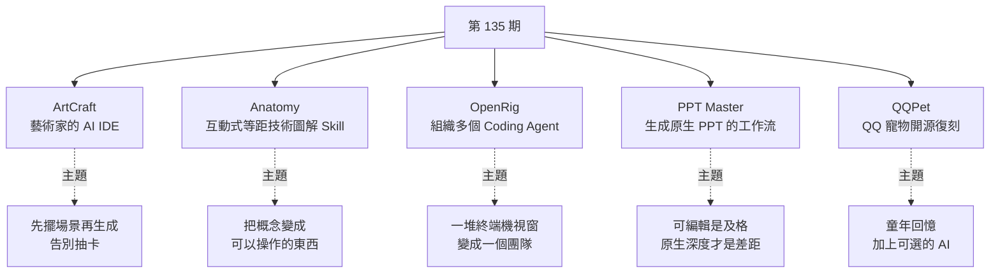
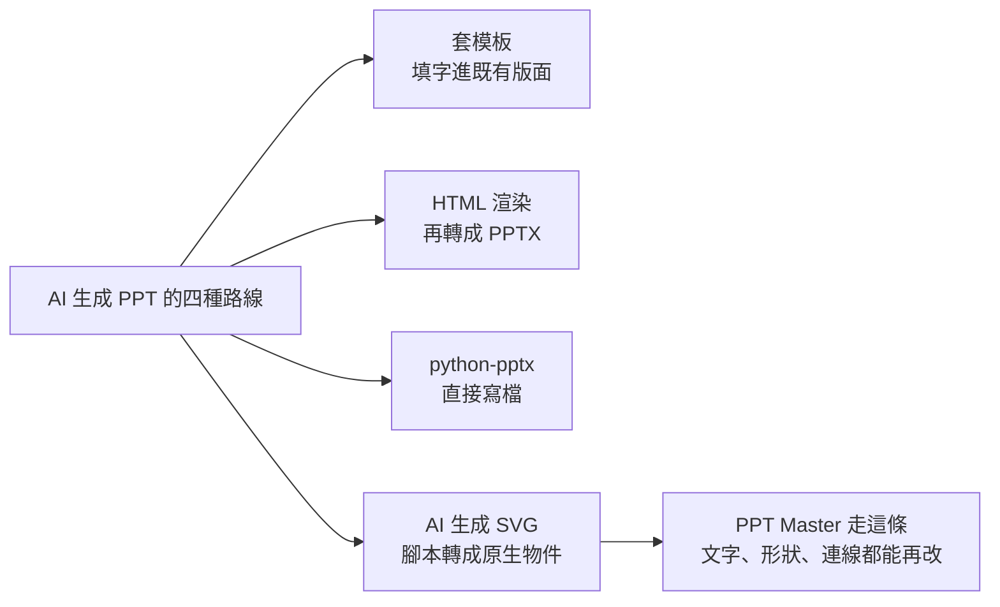

# 第 135 期:藝術家的 AI IDE(ArtCraft)、互動式技術圖解 Skill(Anatomy)、組織多個 Agent 的工具(OpenRig)、生成原生 PPT 的工作流(PPT Master)與復刻 QQ 寵物(QQPet)

> GitHub 一週熱點第 135 期(2026/10/17 發布)。本期主題是**「把結果的控制權拿回來」**,五個專案:
>
> - **ArtCraft:** 先在 2D/3D 場景裡把構圖、人物和鏡頭擺好,再呼叫模型生成,不再靠提示詞「抽卡」。
> - **Anatomy:** 讓 Agent 用程式碼畫出可拆解、可互動的等距技術插圖。
> - **OpenRig:** 用 YAML 把 Claude Code、Codex 的多個工作階段組成有角色、有任務歸屬的團隊。
> - **PPT Master:** AI 先產 SVG,再轉成**原生可編輯**的 PowerPoint 物件。
> - **QQPet:** 一個情懷向的單機復刻版 QQ 寵物,可選接 AI 聊天。

---

## 本期速覽



---

## 1. ArtCraft —— 藝術家的 AI IDE

- **連結:** <https://github.com/storytold/artcraft>(官網與下載 <https://getartcraft.com>)
- **Repo 現況(2026-10-18 查核):** ⭐ 約 3.17 萬、Apache-2.0、Rust;repo 建立於 2022-03,近期仍持續更新。

**它解決什麼:** 用提示詞生成圖片或影片常被戲稱為「抽卡」,因為隨機性太高,文字描述也很難精準表達位置關係。ArtCraft 的思路是**先把場景擺出來再生成**。官方說法是把 prompting 變成 crafting。

**主要功能(依 README):**

| 類別 | 功能 |
|---|---|
| 2D 合成 | 圖層合成、去背、繪圖工具 |
| 3D 場景 | 圖片轉 3D 物件(Image to 3D Mesh),可旋轉、擺放、取景;3D 圖層合成(背景、前景、道具) |
| 人物與鏡頭 | 人物擺姿勢、先定相機位置;用擺好姿勢的人偶引導角色位置(Character Identity Transfer) |
| 同場景多鏡頭 | Image to Location:在同一個房間裡規劃多個鏡頭,維持環境一致 |
| 快速生成 | 文生圖、提示詞改圖、畫布遮罩局部重繪、圖生影片 |

**模型目錄:** README 列了 62 個模型,分成圖片 16、影片 25、音樂與音效 5、3D 網格 11、世界與高斯潑濺 5。例如 Nano Banana、GPT Image、FLUX、Seedream、Seedance、Kling、Veo、Hunyuan 3D、World Labs Marble。也能接 Grok、Midjourney、Sora 等外部帳號。

> ⚠️ **影片也提醒:目錄裡有些模型已停用或受限。** README 用「†」標停用(例如 Veo 2/3、Sora 2、多個 Kling 版本),用「‡」標「桌面版目前不可用」。**開源的是創作工具本身,生成模型要走官方服務或自己的帳號**,實際能用哪些要看當下服務狀態。

> 💡 週報作者觀點:閉源的 AI 創作平台做得很好,但不開源;ArtCraft 是開源方向的好補充。適合做分鏡、產品圖、多鏡頭內容的人研究。

---

## 2. Anatomy —— 生成互動式等距技術圖解的 Skill

- **連結:** <https://github.com/wheresryan22/anatomy>(說明頁 <https://skills.wheresryan.sh/anatomy>)
- **Repo 現況:** ⭐ 約 1.5 萬、MIT、JavaScript。2026-10-08 才建立,10 天破萬星。

**是什麼:** 技術部落格常見一種「看得到頂面和兩個側面」的立體圖,叫**等距插圖**:在 2D 平面上用固定的軸測投影同時呈現三個面。Anatomy 讓 Agent **用程式碼畫出這類細節豐富的插圖**,而且可以互動:拆開零件、拖動視角,邊調數字邊看畫面怎麼變。repo 範例有火箭引擎、漣漪水槽、機械儀表。

- **技術分工:** SVG 負責結構;火焰、水面等效果可以疊 WebGL shader。輸出 HTML、SVG 或 React 元件。
- **安裝:** 透過 skills 安裝工具裝到 Claude Code、Codex 等 Agent。建置需要 Node.js;最後的截圖檢查要用 Chrome。
- **重點:會做詳細的查核**。知識類圖解不能只是漂亮,零件和原理要對。
- **適用範圍:** 機械、工具、機制等「需要解釋的實體系統」,不是所有圖都適合。

> 📌 本庫已有完整拆解:[[anatomy-skill-object-is-the-explanation]]。那篇是 clone repo 讀 SKILL.md 與 CHANGELOG 整理的,包括三種互動模式、查核流程,以及 Figure 已不報時間等補正。

---

## 3. OpenRig —— 把多個 Coding Agent 組成團隊

- **連結:** <https://github.com/mvschwarz/openrig>(官網 <https://openrig.dev>;npm 套件 `@openrig/cli`)
- **Repo 現況:** ⭐ 約 7.7k、Apache-2.0、TypeScript;README 指向 v0.6.8。

**它解決什麼:** 很多人同時開好幾個 Agent:Claude Code 寫功能、Codex 做審查,再開一個跑測試。結果是一堆終端機視窗,誰在做什麼、做到哪裡都靠自己記。OpenRig 的標語是:

> **A harness wraps a model. A rig wraps your harnesses.**(harness 包住模型,rig 包住你的 harness。)

**用法:**
- 用 **YAML 定義團隊**,一個指令啟動。
- 每個成員有角色與任務歸屬,後續任務可以持續派給同一個角色,保留脈絡。
- 有終端儀表板(`rig tui`)看各成員狀態,也有訊息與任務佇列。

**內建三種團隊範本:**

| 團隊 | 對誰下指令 | 組成與用途 |
|---|---|---|
| `starter` | `dev-build@starter` | 一個 Claude Code 建置者 + 一個 Codex 審查者,做一個範圍明確的變更 |
| `workshop` | `orch-lead@workshop` | lead、builder、QA、reviewer,在單一 repo 持續工作 |
| `factory` | `orch-lead@factory` | 更大規模的多團隊協作 |

**架構(影片說法,已對照 README):** 本機常駐 daemon,加上 CLI、TUI 與 MCP server。底層用 **tmux** 管工作階段、用 **SQLite** 做狀態持久化,可選搭配 [[herdr-terminal-runtime-agent-to-agent]] 當終端環境。Whisper 把 tmux 聽成「T-Markz」、SQLite 聽成「Ceclulite」,本文已更正。

**一個容易誤會的細節:** **發訊息不等於任務進了佇列**,要 Agent 自己把任務記進去。想知道它有沒有開工、交付了什麼,要回到具體的任務紀錄裡看。

```bash
npm install -g @openrig/cli
rig setup --dry-run          # 先看設定計畫,不做任何變更
rig setup --providers claude # 只用 Claude Code;用 codex 或兩者皆可
rig send dev-build@starter '實作 <一個變更>,把任務記進佇列並回傳 ID'
rig queue list --destination dev-build@starter
```

> ⚠️⚠️ **安裝前先讀 README 的「What OpenRig changes on your machine」。** 啟動 rig 會寫入 provider 的 hook 與工作區信任設定:
> - 共用設定資源會把 `permissions.defaultMode` 設成 `acceptEdits`,並啟用 Exa / Context7 MCP。
> - `workshop` 套件預設**繞過權限提示**(non-interruptive mode)。
>
> 官方也建議先備份相關設定檔。

**環境需求:** Node.js 22 或 24 加 tmux,支援 macOS 與 Linux。Windows 只支援 WSL2,原生不支援;官方自動測試還沒涵蓋 WSL2。

> 💡 週報作者觀點:前幾期介紹過一些多 Agent 管理工具,OpenRig 相對輕量,適合喜歡 TUI 的人。同類工具橫向比較見 [[ai-orchestrators-32-tools-seven-dimensions]]。

---

## 4. PPT Master —— AI 生成「原生」PowerPoint 的工作流

- **連結:** <https://github.com/hugohe3/ppt-master>(線上範例 <https://hugohe3.github.io/ppt-master-examples/>)
- **Repo 現況:** ⭐ 約 6.3 萬、MIT、Python。2025-12 建立,是本期星數最高的專案。

**核心主張:** 依 README:「可編輯已是基本門檻,拉開差距的是**原生深度**。」交付的是真正的 PowerPoint 物件,包括:
- 投影片母片與版面配置(`p:sldMaster` / `p:sldLayout` 繼承)
- 原生形狀與連接線,可拖的調整控點還能用
- 帶資料的原生圖表與表格
- 轉場與動畫
- 由講者備註產生旁白音訊
- 可套用自己的 `.pptx` 範本

**四種 AI 做 PPT 的路線(影片整理):**



**怎麼用:**
1. 需要 **Python 3.10 以上**,以及一個能讀寫檔案、執行指令的 Agent,例如 Claude Code、Codex。
2. 下載專案後執行 `pip install -r requirements.txt`。也可以到 Releases 抓約 56 MB 的 skill 精簡包。
3. 把 PDF、Word 或其他素材放進專案目錄,告訴 Agent 目標受眾、用途和想講的重點,它就產出一份新的 PPTX。
4. 要 AI 配圖時,優先用 Agent 本身的生圖工具;否則用 `image_gen.py` 搭配圖片供應商的 API key。README 目前推薦 `gpt-image-2`。

**不支援的部分:** SmartArt 是**刻意不做**,不是缺漏。README 另有一份「PowerPoint ↔ SVG 對照指南」,逐項記錄目前支援到哪裡。

> ⚠️ **立場揭露:** README 開頭的贊助區有 Kimi 與多家 API 中轉站(PackyCode、APIKEY.FAN、RunAPI、APIMart),連結都帶 `aff=` 推薦參數,並宣稱「低至官方價 7%」之類的折扣。**專案本身免費開源,但贊助商是商業推廣。** 中轉站的風險見本庫 [[llm-api-relay-stations]]。作者也在 README 推廣自己的專案經濟評估網站。

> 💡 週報作者觀點:專案開源免費,但要自己選合適的大模型與生圖模型。現在模型能力強,直出效果已經很好,再配合一些審美類 skill 就夠用。

---

## 5. QQPet —— QQ 寵物單機復刻版

- **連結:** <https://github.com/AnkioTomas/qqpet>(網站 <https://pet.ankio.net/>)
- **Repo 現況:** ⭐ 約 750、GPL-3.0、TypeScript;2026-10-07 建立。

**是什麼:** 當年在桌面上吃飯、洗澡、打工、上學的 QQ 寵物,現在有人做了跨平台單機復刻。依 README,它是基於 Arctic Penguin T800 逆向重建。

**功能:**
- **養成:** 選蛋領養、成長升級,飢餓、清潔、心情、健康、生病就醫、死亡與復活。
- **日常:** 打工、上學(含升學考試)、全國旅遊。**關掉 App 期間進度照常計時。**
- **活動:** 商城、背包、池塘、農場、密室探險,以及 6 類共 101 個小遊戲。
- **相容性:** 舊的 Flash 內容由 [Ruffle](https://ruffle.rs) 播放;存檔可匯入匯出,也相容原版 `config.json`。
- **AI(可選):** 接任何 OpenAI 相容 API,讓寵物閒聊、改寫台詞、點評或翻譯剪貼簿文字。

**平台:**

| 平台 | 安裝 |
|---|---|
| Windows / macOS / Linux | Releases 下載。完整版約 450–520 MB,精簡版約 120–160 MB,首次啟動再下載內容包 |
| Android(11 以上) | APK,以懸浮窗顯示 |
| HarmonyOS(5 以上) | 未簽名 HAP,用 hdc 安裝。影片沒提到這個平台 |
| iOS(14 以上) | 需要 **TrollStore 或越獄**,限制較多 |

> ⚠️ 桌面安裝包**沒有程式碼簽章**,Windows SmartScreen 與 macOS Gatekeeper 都會攔。README 有逐平台放行步驟,但仍要自行判斷信任度。

> ⚠️ **版權:** 程式碼是 GPL-3.0,但 **QQ 寵物的美術資源與 SWF 版權屬於騰訊**,README 明言僅供學習交流、勿商用。原版很多內容已經流失,作者正在徵集舊客戶端、截圖與玩法資料。

---

## 6. 本期資料分享

影片最後提到兩份報告,只有口頭介紹,沒附連結,作者說「有需要可以告訴我」:

1. **〈Token 海外市場對標研究報告〉:** 研究第三方 Token 服務商怎麼做生意,主要看推理服務與自研晶片兩條路線。可以搭配本庫 [[ai-compute-token-economics]] 一起看。
2. **〈人工智能應用發展趨勢報告 2026〉:** 從企業、產品應用、智慧生活、科研、治理五個方向整理 20 條趨勢。作者建議當成應用方向的地圖,對照自己真正用過的工具。

---

## 應用案例 / 怎麼用在自己的工作

1. **電商產品主圖一次產多個角度:** 在 ArtCraft 先放背景圖與產品去背圖,把產品轉成 3D 物件,固定三個相機位置,再分別送生圖模型。跟純提示詞相比,三張圖的光線方向和產品位置會一致,適合做詳情頁的多角度展示。上線前確認所選模型沒被標成停用(†)。

2. **給新人的「伺服器機櫃怎麼散熱」互動圖解:** 用 Anatomy 請 Agent 畫等距機櫃,零件可以拆開,風扇轉速可以拖曳,冷熱通道的顏色跟著變。輸出 React 元件直接嵌進內部 wiki。查核步驟會檢查零件命名與氣流方向,但上線前仍要請懂硬體的同事看一眼。

3. **用 OpenRig 建立「寫 + 審」雙人組:** 選 `starter` 團隊:Claude Code 負責實作、Codex 負責審查同一個候選版本。
   - **先做:** 執行 `rig setup --dry-run`,看它會改哪些設定檔,先備份 `.claude/settings.json` 與 `.mcp.json`。
   - **不要直接用 `workshop`:** 它會繞過權限提示。
   - **追進度:** 用 `rig queue list` 看任務 ID,不要只看聊天訊息。

4. **把季報 PDF 變成可再編輯的董事會簡報:** 把財報 PDF 和公司的 `.pptx` 範本丟進 PPT Master 專案目錄,告訴 Agent「給董事會看、15 頁、重點是毛利率變化」。產出的圖表是帶資料的原生圖表,財務同事可以直接在 PowerPoint 改數字,不用重畫。需要 SmartArt 的頁面要自己補。

5. **評估「開源 + 贊助」專案的姿勢:** PPT Master 的 README 贊助區全是 API 中轉站推薦連結。用開源工具時,**工具本身和贊助商要分開評估**:工具是 MIT 可以放心用,但不要因為 README 推薦就把 API key 交給中轉站。

6. **本期的共同模式是「先結構、後生成」:**
   - ArtCraft 先擺場景再生圖。
   - Anatomy 先確定結構再上色。
   - PPT Master 先把論點整理成形再排版。
   - OpenRig 先定義角色與任務,再讓 Agent 動手。

   自己用 AI 做內容時可以照抄:**先把結構定下來,讓 AI 填細節,而不是一句提示詞賭全部。**

---

## 來源

- 影片:「Github一周热点135期」艺术家的IDE、交互式技术图解Skill、AI 生成原生PPT、多个 Agent 组织工具和复活的QQ宠物(2026-10-17,約 8 分鐘):<https://www.youtube.com/watch?v=n8jL89H5d-c>
  - 該片無字幕,講解內容以 CPU 版 Whisper(faster-whisper)轉錄取得,非官方字幕,可能有少量聽寫誤差。專案清單取自影片說明欄,專案細節以各 repo README 與 GitHub API(2026-10-18)查核。
  - 原 GitHub repo `itcoffee66/githubweekly` 的 `_weekly/135.md` 仍為 404(未恢復同步)。
- 本期專案:
  - ArtCraft:<https://github.com/storytold/artcraft>
  - Anatomy:<https://github.com/wheresryan22/anatomy>
  - OpenRig:<https://github.com/mvschwarz/openrig>
  - PPT Master:<https://github.com/hugohe3/ppt-master>
  - QQPet:<https://github.com/AnkioTomas/qqpet>
- 延伸(本庫):[Anatomy 深度拆解](../applied-ai/design/anatomy-skill-object-is-the-explanation.md) · [Herdr 終端執行環境](../ai-agents/applications/herdr-terminal-runtime-agent-to-agent.md) · [32 個 AI 編排器七維度](../ai-agents/resources/ai-orchestrators-32-tools-seven-dimensions.md) · [LLM API 中轉站](../ai-industry/llm-api-relay-stations.md) · [第 134 期](./issue-134.md)
