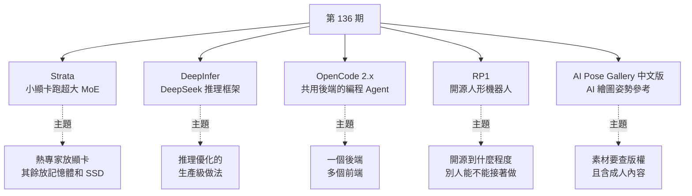
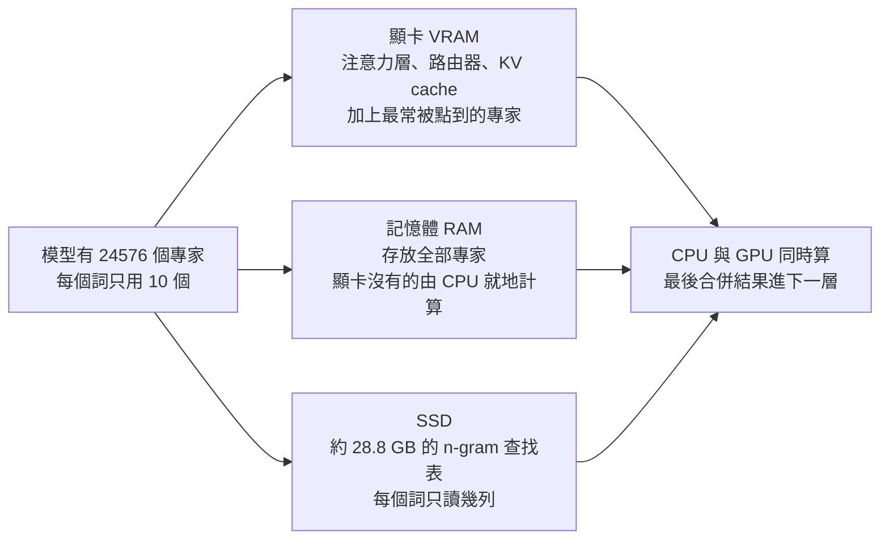

# 第 136 期:消費級顯卡跑 DeepSeek(Strata)、DeepSeek 推理框架(DeepInfer)、OpenCode 2.x、開源人形機器人平台(RP1)與 AI 姿勢參考圖庫中文版

> GitHub 一週熱點第 136 期(2026/10/31 發布,約 8 分鐘)。本期五個專案:
>
> - **Strata:** 讓 12–24 GB 顯卡也能跑超大 MoE 模型(Qwen3.8-Flash-Next、DeepSeek V4.1 Flash),靠顯卡、記憶體、SSD 分工。
> - **DeepInfer:** DeepSeek 開源的大規模推理框架,目前只開放離線推理部分。
> - **OpenCode 2.x:** 開源編程 Agent 的 2.0 大版本,改成「共用後端 + 多種客戶端」。
> - **RP1:** RoboParty 的全開源人形機器人平台(機構、電子、韌體、控制、學習全包)。
> - **AI Pose Gallery 中文版:** 日本原站姿勢參考圖庫的中文化鏡像,現已擴成「姿勢 + 服裝 + 人像」三合一。

---

## 本期速覽

---

## 1. Strata —— 小顯卡也能跑 DeepSeek

- **連結:** <https://github.com/Niko1221/Strata>
- **Repo 現況(2026-11-01 查核):** ⭐ 約 3.7 萬、MIT、C++;2026-09-24 建立,一個多月就破 3 萬星;最新推送 2026-10-31。README 目前版本 0.2.9。

**它解決什麼:** 本機跑模型已有 Ollama、LM Studio,為何還要一個?影片的回答是:Strata **專門適配體積超大的 MoE 模型**(README 列的是 Qwen3.8-Flash-Next、Qwen3.6-35B-A3B、DeepSeekV4.1-Flash-1017),這類模型的專家總量遠超顯存。

**怎麼塞進小顯卡(依 README 的 HOW_IT_WORKS 對照影片):**

- 常用專家留在顯存,其餘放記憶體,**CPU 變成運算的參與者**,與 GPU 同時進行;顯存裡的專家名單會依近期使用情況動態調整。
- README 的說法:每多 1 GB 顯存約多容納 700 個專家,**顯存容量比 GPU 快慢更重要**。
- 另有「先猜再驗」的推測解碼(模型自帶 MTP 層),官方稱可快 1.6–1.8 倍,輸出品質不變。

**官方實測(README,DeepSeek V4.1 Flash 2.00 bpw 量化,Strata 0.2.5):**

| 硬體 | 輸出速度 | 提示處理 |
|---|---:|---:|
| RTX 5070 12 GB + 64 GB 記憶體 | 4–6 tokens/s | 約 110 tokens/s(4K) |
| RTX 3060 12 GB + 46 GB 記憶體 | 9–11 tokens/s | 約 155 tokens/s(4K) |
| 1x Radeon AI PRO R9700 + 251 GB 記憶體 | 21–25 tokens/s | 320–360 tokens/s(8K) |
| Ryzen AI Max+ 395(Strix Halo)128 GB | 19–21(寫程式)、11(聊天) | 87 tokens/s(4K) |

影片引用的是第一列(「12G 的 5070 加 64G 記憶體,每秒約 4–6 個 token」),與 README 相符。

**磁碟門檻:** DeepSeek V4.1 Flash 的 1.75 / 2.00 / 2.25 bpw 三組下載量分別是 239 / 257 / 274 GB,**要預留約 245–280 GB 空間**,放不進記憶體的部分從 SSD 讀。

**使用:**
- 桌面 App(Windows / Linux / Mac 各一個安裝檔)或終端版 `strata launch`。首次啟動有引導選模型、自動下載。
- 影片實測感受:預設下載線路「非常慢,基本下不動」;桌面 App 裡他**沒看到 DeepSeek**,要跑 DeepSeek 得用終端版。⚠️ 但 README 寫桌面 App 與終端都支援 DeepSeek,可能是版本差異,以你下載的版本為準。
- 聊天、檔案、本機 API 這些功能不算獨有,影片作者覺得**成熟度不如 LM Studio**;真正差異是對超大 MoE 的專門適配,以及把運行與工作區混在一起的介面。**常換不同模型的人沒必要遷移。**
- 也提供 OpenAI / Anthropic 相容 API,可接 Claude Code、Codex CLI、OpenCode 等(`strata connect` 會顯示設定方式)。

> ⚠️ **安裝注意:** README 的 Windows 安裝指令是 `irm .../install.ps1 | iex`、Linux/Mac 是下載 `install.sh` 再執行,屬於「直接執行遠端腳本」。先讀過腳本或改用 Releases 的安裝檔再裝。另外 README 底部有 Buy Me a Coffee 贊助連結與合作信箱,屬一般的個人專案募款,不是廣告。

> 💡 影片作者順帶吐槽:今年記憶體與 SSD 漲價非常誇張。這類方案的代價就是**吃掉大量記憶體與硬碟**,比較適合本來就有大容量的玩家。

---

## 2. DeepInfer —— DeepSeek 的大規模推理框架

- **連結:** <https://github.com/deepseek-ai/DeepInfer>
- **Repo 現況:** ⭐ 約 2.5 萬、Apache-2.0、Python;2026-10-16 建立,最後推送 2026-10-26。

**是什麼:** README 自稱是**支撐 DeepSeek 大規模線上服務的高效能推理框架**,這次開源的是**離線推理**與服務所需的核心功能。目前只支援 **DeepSeek-V4.1-Flash**。

**支援的功能(README):**
- 最佳化 kernel、模型與取樣器 runtime
- 平行策略:Attention DP / balanced CP,MoE 的 EP + EPLB
- DSpark(草稿 token 加速解碼)與置信度排程驗證
- SWA bounded replay(只重播有界尾段,減少 prefill 工作量)
- 非同步排程(零額外開銷的 batch scheduler,預設開啟)
- Batch-invariant 推理(不同 batch 組合結果一致)、確定性取樣、結構化輸出(regex / JSON schema / EBNF)

**底層 kernel:** 串連了 DeepSeek 之前開源的 FlashMLA、DeepGEMM、DeepEP、TileKernels、DeepSelect,以及自家 TileLang kernel。影片說「之前介紹過的 FlashMLA、DeepGEMM、DeepEP 等底層優化被串起來了」,與 README 一致。

**硬體:** NVIDIA **SM100** GPU 與**華為昇騰 950 NPU**。影片強調這次昇騰成為「一等公民」,顯示 DeepSeek 加大國產硬體支援。環境需求:Linux、GCC 13 以上、Python 3.12、CUDA 13(NVIDIA)或 CANN 9.2(昇騰)。

**沒開源的部分(README 明列):** KV cache 系統、VE/Prefill/Decode 拆分、資料平行副本間的負載平衡。這三塊是做完整推理服務所需,**不在這次釋出內**。

**誠實的判斷:** 影片作者認為對做模型服務、推理優化的團隊有價值,**一般使用者看熱鬧為主**。⚠️ 影片還提到一個流量數字(單叢集每日處理量),Whisper 轉錄不清且我沒在 README 找到,**未能核實,本文不引用**。

---

## 3. OpenCode 2.x —— 共用後端的編程 Agent

- **連結:** <https://github.com/anomalyco/opencode>(官網 <https://opencode.ai>)
- **Repo 現況:** ⭐ 約 22.4 萬、MIT、TypeScript;最新版 v2.2.5(2026-10-30 發布)。

**是什麼:** 可接不同模型的開源編程 Agent,2.0 後又熱起來。

**2.0 的架構變化(影片說法,對照 README 與 release notes):**
- **每個使用者一個共用後台服務**,負責管理工作階段、設定、權限與工具執行;本機客戶端連到它。
- 客戶端選擇變多:完整終端介面、精簡介面、桌面 App;開發者也能用統一的服務端介面自製客戶端。
- 程式碼體驗:長文件側邊縮圖(影片字幕為「側面的地圖查看」,推定為 minimap)、桌面端**按輪次**檢視改動的檔案與行數差異。
- 最新 2.2 系列加入實驗性的**桌面插件**。release notes 另列:2.2.3 可在 `/connect` 選 **Claude Agent**,用自己的 Claude Code 登入與模型;2.2.4 桌面終端隨 session 保留。

**升級與遷移:**
- 舊版(1.x)終端用戶:影片說用 `opencode upgrade` 加一個 major 旗標升到 2.0。⚠️ 字幕不清,**旗標名稱未能核實**,請看官方文件。App 用戶直接下載新版。
- README 的安裝方式已改成 `curl -fsSL https://opencode.ai/v2/install | bash` 或 `npm i -g @opencode/cli@latest`,並提醒先移除 0.1.x 更舊的版本。
- ⚠️ **相容性:** 影片提醒舊的插件實作不能直接在 2.x 跑,串接舊服務與介面的整合也要改。

**內建 Agent:** `build`(預設、完整權限)與 `plan`(唯讀、預設拒絕改檔、跑 bash 前要問),另有 `@general` 子 Agent 處理複雜搜尋。

> ⚠️ **影片裡的一則商業說法要小心:** 影片說近期 OpenCode 是「國內能用 Opus 5.5 的相對容易上手方式」,還說付款支援支付寶。這是影片作者的觀察,**README 沒有這些內容,我未核實,也不建議依此選擇付費管道**。用第三方管道前先讀本庫 [[llm-api-relay-stations]] 談的風險。同庫另有 OpenCode 相關筆記:[[ai-coding-three-illusions-opencode]]、[[opencode-console-breach-guardrail-asymmetry]]。

---

## 4. RP1 —— 開源人形機器人平台

- **連結:** <https://github.com/Roboparty/RP1>(官網 <https://roboparty.com>)
- **Repo 現況:** ⭐ 約 1,070、GPL-3.0;2026-10-01 建立。這個 repo 是**總覽入口**,不收 PR。

**定位:** README 標題是「RP1:給 Agentic Humanoids 的全端開源平台」,從機構設計、電子、韌體、控制到學習都放進同一個開發堆疊。影片的觀點很實在:機器人開源**要看到底開放多少、別人能不能沿著資料接著做**。

**把它當導航頁看(README 的子倉庫):**

| 方向 | 子倉庫 | 內容 |
|---|---|---|
| 硬體與工具 | `rp1_hardware` | 機械原始檔、電子、測試與組裝 SOP |
| | `ROMOMO` | 關節模組、韌體、上位機工具 |
| | `rp_dexhand` | 靈巧手文件、接線、CAD、C++ / Python / ROS 2 SDK 入口 |
| 軟體與系統 | `roboparty_deploy` | 部署框架,imu / motor / inference / camera 的 SDK(C++、Python) |
| | `RP1_description` | URDF、MJCF 模型與 3D 網格 |
| | `roboparty_train` | Isaac Lab 訓練工作區(AMP、BeyondMimic、Parkour,RSL-RL) |
| | `RP1_firmware` | Linux BSP、USB-CAN 橋接、底層 SDK |
| 學習 Demo | AMP、BeyondMimic、Parkour、MimicLite、UFO、PBFM 等 | 運動先驗、動作模仿、地形穿越、無監督強化學習 |

支援 24、28、30、42 DoF 等配置。README 的控制架構是:輸入/感知,到動作控制底座(動作重定向、策略),到即時控制(動作解碼加串聯連桿求解,**500 Hz**),再到全身執行(ROMOMO 關節模組、RP 靈巧手),另有急停與高頻回饋迴路。

**建議的讀法(影片):** 先看機器人模型與配置,再到模擬與訓練環境研究動作,最後照部署說明接到真機。⚠️ 實際支援哪個機型、程式長什麼樣,**要回各子倉庫確認**,總 repo 只是目錄。

> 📌 README 另列相關論文(P-BFM、I-BFM、PredActor 等,連結為 arXiv 與會議名)。我沒逐篇核實,只當作延伸閱讀。影片提到海外有 Hugging Face 等公司開源過幾款機器人,國內開源逐漸增多。

---

## 5. AI Pose Gallery 中文版 —— AI 姿勢參考圖庫

- **連結:** <https://github.com/anhao/ai-pose-gallery-zh>(線上版 <https://ai-pose-gallery.anhao.app/>)
- **Repo 現況:** ⭐ 約 4,650、TypeScript;2026-10-27 建立。授權欄位顯示 **NOASSERTION**(GitHub 無法判定標準授權)。

**是什麼:** 日本創作者ギア(@giaaibusi)的三個 AI 繪圖參考圖庫(姿勢、服裝、人像)的**中文化鏡像**。影片只提到姿勢庫,但 README 顯示現在已是「三合一」:

| 圖庫 | 記錄數 |
|---|---:|
| 姿勢 | 1,439 |
| 服裝 | 1,407 |
| 人像 | 1,499 |
| 合計 | 4,345 條 / 8,690 張本地圖 |

**用法:**
- 關鍵字搜尋、依動作與視角(正面、斜前、側面、背面、俯視)篩選,可按姿勢分組、下載原圖拿去 AI 工具創作。
- 可線上看,也可 clone 後本機跑成內網靜態版。
- 另有 Web 合成台(挑人像加服裝加姿勢組合,接 Gemini / GPT Image / Qwen / 豆包 / 本機 ComfyUI),以及 **ComfyUI 自訂節點**(clone 到 `ComfyUI/custom_nodes/` 即可)。

> ⚠️⚠️ **內容與版權兩個提醒(README 自己寫的):**
> 1. 圖庫**含 18+ 成人向姿勢與內衣、性感穿搭參考**,預設開啟安全模式隱藏,未成年人不得解鎖。公司電腦或公開場合使用前要先確認。
> 2. **全部圖片版權屬原作者ギア**,本 repo 只是翻譯整理與學習存檔,**禁止打包倒賣**。影片也提醒「素材和程式碼要注意版權」。商用或用來訓練模型都要自己負責。

---

## 6. 本期資料分享

影片最後介紹兩份報告(口頭介紹,無附連結,作者說有需要可告知):

1. **端側智能產業發展報告(中國信通院與中國人工智能產業發展聯盟):** 從晶片、儲存、基礎軟體到模型與應用,談 AI 怎麼在資源有限的裝置上穩定運行,並梳理辦公、出行、家庭與機器人場景。⚠️ 字幕把年份聽成「2020」且報告名不確定,**推定為 2026 年版**,未核實。
2. **《走向 Agentic Commerce》:** AI 如何改變消費者購物與電商經營。影片提到快雙十一,購物入口正從搜尋、推薦逐步演變成 Agent 代為挑選與執行交易。

---

## 應用案例 / 怎麼用在自己的工作

1. **評估自己的電腦能不能跑 DeepSeek V4.1 Flash(Strata):**
   - 例:手上有 RTX 3060 12 GB 加 46 GB 記憶體,對照 README 實測約 9–11 tokens/s,聊天可用、跑長任務偏慢。
   - 先確認硬碟空閒是否超過 265 GB(2.00 bpw 組),再用 `strata launch --plan` 看計畫。
   - 若只有 16 GB 記憶體、一顆小顯卡,這條路會很吃力,不如用雲端 API 或較小模型。

2. **想做「本機 Agent + 本機模型」:** Strata 提供 OpenAI / Anthropic 相容 API,可把 OpenCode 或 Claude Code 指到本機位址。這樣程式碼不離開自己的電腦;代價是速度只有雲端的幾分之一,適合批次、夜間任務,不適合需要即時往返的互動。

3. **從 DeepInfer 學推理優化:** 即使沒有 SM100 GPU,README 的功能清單就是一份「生產級推理要做哪些事」的清單:非同步排程、batch-invariant(同輸入不因 batch 不同而結果漂移)、結構化輸出、SWA 重播、推測解碼。做自家模型服務的團隊可以拿來對照自己的缺口。

4. **團隊從 OpenCode 1.x 升 2.x 的步驟:**
   - 先盤點自己用了哪些舊插件、自訂整合;影片明說舊實作不能直接跑。
   - 先在一個專案試升,確認插件與 MCP 設定能用,再全員推。
   - 評估要不要用桌面端的「按輪次看改動」功能做 AI 產出的審查。

5. **機器人團隊或實驗室用 RP1:**
   - 沒有真機時,先走「模型與設定,模擬與訓練」兩步(`RP1_description` 加 `roboparty_train`)。
   - 有真機再接 `roboparty_deploy`。總 repo 是目錄,別期待 clone 一個就能跑。

6. **AI 繪圖要擺姿勢又怕版權:** 把圖庫當「構圖參考」而非素材來源;讓 ComfyUI 讀姿勢圖當控制條件,生成自己的角色,而不是直接拿原圖二次發布。公開發布前確認沒有用到成人類別。

7. **本期共同模式「資源不夠就分層」:** Strata 把模型分到顯卡、記憶體、SSD;DeepInfer 把 prefill 與 decode、專家平行拆開;OpenCode 把前端與後端拆開。遇到單點撐不住的系統,先問「哪些東西熱、哪些冷、能不能分開放」。

---

## 字幕還原(Whisper 校正)

| 字幕原文 | 校正為 | 依據 |
|---|---|---|
| Gatehub、Deepsync、Deepseak | GitHub、DeepSeek | 說明欄與 README |
| Stratta / Strada | Strata | 說明欄 |
| Olamac、IORM Studio | Ollama、LM Studio | 上下文(同類工具) |
| 每秒大概 6-4 個 | 4–6 tokens/s | README 實測表 |
| RPE | RP1 | 說明欄 |
| 大插招表 | n-gram 查找表 | HOW_IT_WORKS(推定) |
| 生土 | 生圖 | 上下文 |
| 側面的地圖查看 | 推定為 minimap(側邊縮圖) | 未核實 |
| 「大飛魚,才是真正的 OpenAI」 | 無法確定,未引用 | 轉錄不清 |
| 支付宣 | 推定為支付寶 | 上下文 |

---

## 來源

- 影片:「Github一周热点136期」小显卡也能运行deepseek，内存和SSD来帮忙(2026-10-31):<https://www.youtube.com/watch?v=1QpE9zu-MFI>
  - 該片無字幕,講解內容以 CPU 版 Whisper(faster-whisper small)轉錄取得,非官方字幕,可能有少量聽寫誤差。專案清單取自影片說明欄,細節以各 repo README 與 GitHub API(2026-11-01)查核。
  - 原 GitHub repo `itcoffee66/githubweekly` 的 `_weekly/136.md` 仍為 404(未恢復同步)。
- 本期專案:
  - Strata:<https://github.com/Niko1221/Strata>(原理說明 <https://github.com/Niko1221/Strata/blob/main/docs/HOW_IT_WORKS.md>)
  - DeepInfer:<https://github.com/deepseek-ai/DeepInfer>
  - OpenCode:<https://github.com/anomalyco/opencode>(release notes <https://github.com/anomalyco/opencode/releases>)
  - RP1:<https://github.com/Roboparty/RP1>
  - AI Pose Gallery 中文版:<https://github.com/anhao/ai-pose-gallery-zh>
- 延伸(本庫):[DeepSeek V4 工程拆解](../llm-internals/architecture/deepseek-v4-engineering.md) · [MoE 混合專家](../llm-internals/architecture/moe-mixture-of-experts-from-ffn.md) · [OpenCode 三個幻覺](../ai-productivity/ai-coding-three-illusions-opencode.md) · [OpenCode 控制台事件](../ai-safety/opencode-console-breach-guardrail-asymmetry.md) · [LLM API 中轉站](../ai-industry/llm-api-relay-stations.md) · [第 135 期](./issue-135.md)
