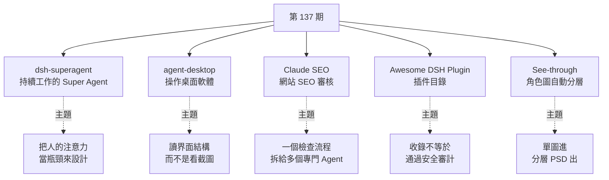
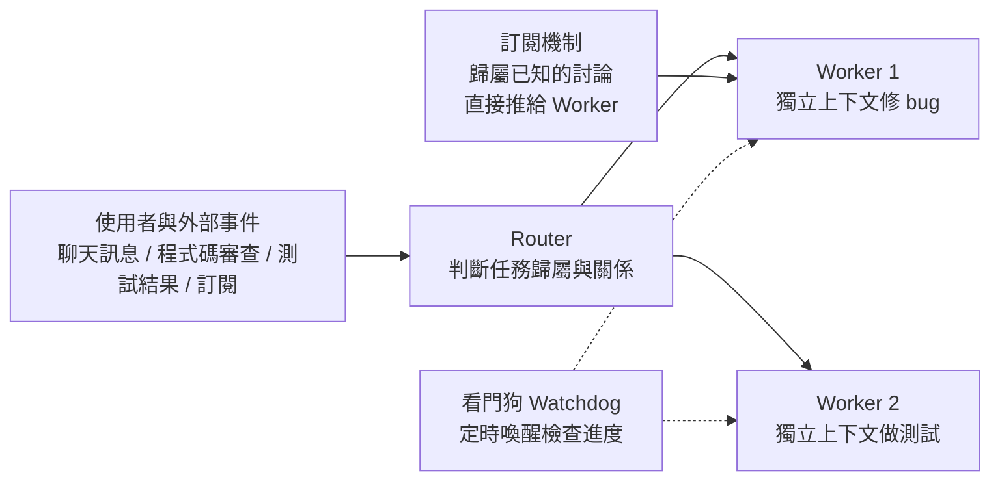

# 第 137 期:DeepSeek Super Agent 原型、讓 Agent 操作桌面軟體(agent-desktop)、網站 SEO Skill(Claude SEO)、DeepSeek Harness 插件目錄與動漫角色自動分層(See-through)

> GitHub 一週熱點第 137 期(2026/11/07 發布,約 10 分鐘)。本期五個專案:
>
> - **dsh-superagent-prototype:** DeepSeek 開源的「Super Agent」原型,Router 加 Worker 兩層、事件訂閱、算存分離。
> - **agent-desktop:** 透過作業系統無障礙(accessibility)介面讀取桌面軟體結構,讓 Agent 點按鈕、填輸入框。
> - **Claude SEO:** 把網站 SEO 檢查做成 Claude Code 外掛,多個專門 Agent 並行審核。
> - **Awesome DSH Plugin:** DeepSeek Harness 的社群插件精選目錄,也可當插件市場索引。
> - **See-through:** 單張動漫角色圖拆成最多 23 個語意圖層並輸出 PSD(SIGGRAPH 2026 論文)。
>
> ⚠️ 立場:IT咖啡馆說明欄無業配;但影片作者提到自己做了一套 DeepSeek Harness 教程「很快發出」,屬頻道自家內容預告。本期 **Claude SEO 的作者另有付費社群(Skool)**,見第 3 節。

---

## 本期速覽



---

## 1. dsh-superagent-prototype —— 「持續工作的智能體」原型

- **連結:** <https://github.com/deepseek-ai/dsh-superagent-prototype>
- **Repo 現況(2026-11-08 查核):** ⭐ 約 2.08 萬、MIT、TypeScript;2026-10-31 建立,最近推送 2026-11-03。

**影片的論述(依字幕整理):**

- 問題:同時開多個編程 Agent(修 bug、寫功能、查日誌、做測試),Agent 越能幹,人越忙。DeepSeek 的判斷是:**單一任務的上限由模型能力決定,多任務並行時瓶頸轉為人的注意力**;影片轉述「一個人只能同時跟進 3 到 5 個活躍會話」。
- Super Agent 的目標是給使用者**一個持續工作的智能體**,底下開幾個會話、哪些任務並行、訊息轉給誰,由系統管理。影片強調這裡的「超級」**不是換更聰明的模型**,而是圍繞模型重新設計整套工作系統。

**影片介紹的五個設計點,與 repo 的對照:**



| 設計 | 影片說法 | 核實 |
|---|---|---|
| 兩級架構 | Router 是前台調度員(接訊息、判斷任務關係、安排任務);Worker 各自獨立上下文推進。影片自己說**不是 DeepSeek 獨創**,價值在把調度思維用到長期運轉的 Agent 系統。 | 概念層面與本庫既有筆記一致,見 [[deepseek-super-agent-router-walker-xuanyuan]];repo 實際用語與影片不盡相同,細節以該筆記第 4 節核實紀錄為準。 |
| 訂閱機制 | Worker 一旦訂閱某個討論(例:GitHub 上一段討論),後續回覆直接推送過去;只有歸屬不明時才叫 Router 判斷。 | README 描述的是「監聽 GitHub 與可選的飛書,有授權的人要求工作時開工單、在獨立會話與目錄中處理、在原對話回覆(例如 PR)」,方向一致。 |
| 噪音控制 | 事件驅動的另一面是噪音:群裡每句話都觸發 AI 動作會是災難,所以原型加入來源檢測、白名單與策略判斷。 | README「授權」文件(docs/002)與「哲學」文件(docs/000)對應「只在被要求或團隊寫下的規則允許時行動」。**「來源檢測」一詞字幕不清,推定,未核實。** |
| 非同步與渠道適配 | 耗時命令先回「已啟動」再推結果;即時通訊只發決策與結論,郵件和文件才寫完整內容。 | README 的原則句:「用最少的人類注意力、給最多的價值;只在有人必須行動或能用到結果時才說話」。 |
| 算存分離、Watchdog | 計算做成無狀態容器放雲端、狀態進資料庫、執行環境留在本機(輕量 daemon);Watchdog 在主系統外定時喚醒檢查 Worker 有無實質進展。 | ⚠️ **README 明講:此 repo 不等同於文章描述的內部實作,文章中部分設計是未來方向、原型沒有實作。** 既有筆記核實過 repo 並未實作 Watchdog,本期不要把這兩點當成可直接安裝的功能。 |

**它到底是什麼(README):** 「為單一 GitHub 倉庫打包成 DeepSeek Harness bundle 的主動式編程 Agent」,附一個網頁面板顯示需要人處理的事項;README 開頭自稱 **「僅供參考的研究原型,非官方 DeepSeek 產品,不是 production-ready」**,程式大量由編程 Agent 產出,可能有 bug。安裝方式是請你的編程 Agent 讀 `SETUP.md` 一步步帶你裝。

**和 DeepSeek Harness 的關係(影片):** Harness 提供模型接入、工具、會話、插件等基礎運行環境;Super Agent 是在其上探索「如何組織一個持續在線、跨任務協作的系統」。本庫 Harness 筆記見 [[agent-runtime-deepseek-harness-cordis]]。

**誠實的判斷:** 對「一個人要照顧很多 Agent 會話」的痛點描述很精準,但原型範圍很窄(單 repo、GitHub 加飛書)。要用就當作研究參考,不要直接放進正式流程。

---

## 2. agent-desktop —— 讓 Agent 操作桌面軟體

- **連結:** <https://agent-browser.dev/desktop>(原始碼 <https://github.com/vercel-labs/agent-desktop>,Vercel Labs 專案;說明欄只給文件頁連結,repo 位置由本文查得)
- **Repo 現況(2026-11-08 查核):** ⭐ 約 1.88 萬、Apache-2.0、Rust;2026-02-19 建立。

**怎麼運作(官方文件頁,與影片一致):**

- 讀取桌面 App 的**無障礙樹**(macOS Accessibility、Windows UI Automation、Linux AT-SPI),以 JSON 回傳;每個可操作元素有一個 **ref**。Agent 對 ref 行動(點擊、輸入、捲動等),再重讀界面驗證結果,如此循環。
- 以 CLI 與 C 函式庫兩種形式提供,支援 macOS、Windows、Linux。`npm install -g agent-desktop`;`agent-desktop status` 顯示平台、權限、支援的 surface;`agent-desktop skills get desktop` 取 Agent 該先載入的指南。
- 官方的四步迴圈:`snapshot --skeleton`(先看淺層骨架)、`snapshot --root <ref>`(展開某區)、`click <ref>`(操作)、`wait --element <ref> --predicate value --value 7`(驗證,例:計算機顯示 7)。文件強調「操作成功不代表介面真的變了,迴圈最後一定要讀一次」。

**它不是什麼(官方明講):** 它是給 Agent 呼叫的工具,**自己不是 Agent**、內部不含 LLM、沒有 GUI;只管桌面 App,**網頁請用 agent-browser**;**不比對像素**,所以介面若沒有公開無障礙樹就看不到。這與影片的提醒相符:自繪介面、複雜畫布或權限限制會失效;影片說 macOS 需先授權輔助功能權限,文件頁只確認 `status` 會檢查權限,**macOS 具體設定路徑本文未逐項核實**。

**和截圖式 computer use 的差別:** 影片的比喻是「給 Agent 一份界面元素目錄」,選元素再操作,而不是每步看截圖猜座標。優點是結構化、較穩;限制是完全取決於該 App 有沒有好好暴露無障礙資訊。截圖式作法見 [[claude-haiku-5-5-cheap-model-computer-use]]。

---

## 3. Claude SEO —— 網站 SEO 審核外掛

- **連結:** <https://github.com/AgriciDaniel/claude-seo>
- **Repo 現況:** ⭐ 約 2.73 萬、MIT、Python;2026-02-07 建立,最近推送 2026-11-01。
- ⚠️ **立場標示:** README 以「AI Marketing Hub Pro」Skool 付費社群為導流對象(付費版有早期功能的私有版本),並有與傳統 SEO 服務價格的對比圖,README 自己標註為示意價格。公開版 MIT 免費。

**內容(README):** 26 個子技能加 19 個專門 Agent,最多 17 個 Agent 同時審核;涵蓋技術 SEO、E-E-A-T、結構化資料(Schema)、AI 搜尋(GEO/AEO)、本地、電商、國際 SEO、Google API 與 PDF/Excel 報告;另有 9 個可選的即時資料擴充。README 稱完整審核約 10 到 15 分鐘,產出依重要性排序的行動計畫。

**指令(影片的「SEO Setup / SEO Audit」對應 README 的實際指令):**

```text
/plugin install claude-seo@agricidaniel-claude-seo
/seo setup                 # 建立獨立的 Python 環境與無頭瀏覽器
/seo doctor                # 檢查執行環境
/seo audit https://example.com   # 整站審核
/seo page <url>            # 單頁深入分析
/seo plan <type>           # 策略規劃(saas、local、ecommerce、publisher、agency)
```

**安全註記:** README 的 Windows 手動安裝改用 `git clone` 再讀過 `install.ps1` 才執行,並說明原因是 `irm | iex` 屬供應鏈風險,值得肯定。第三方外掛會執行你機器上的程式,裝前建議先看過內容。

**誠實的判斷:** README 的「一年省十萬美元」之類對比是行銷圖,不是實測。「測試 1077 個通過」是倉庫徽章自述,本文未重跑。對剛上線的獨立開發者,把自己的頁面跑一次、看標題、結構與結構化資料有無問題,是影片提出且合理的用法。同類延伸見 [[ai-website-building-claude-code]]。

---

## 4. Awesome DSH Plugin —— DeepSeek Harness 插件目錄

- **連結:** <https://github.com/awesome-dsh-plugin/awesome-dsh-plugin>
- **Repo 現況:** ⭐ 約 2.36 萬、CC0-1.0、JavaScript;2026-08-13 建立,最近推送 2026-11-07。

**是什麼:** 社群整理、可用 `dsh plugin add`(各自宣告 `dsh.bundle` 設定檔)安裝的插件清單。README 說 DeepSeek Harness 的設計是「一切皆插件」:模型、工具、沙箱、會話儲存、UI、甚至 Agent 迴圈本身都能換。

**分類(README 實際章節):** AGI 架構探索、UI 增強、用量與計費、主題外觀、模型與供應商、身分與通訊、會話與訊息、記憶、工具與能力、WSL 與 Windows、瀏覽器與網頁、視覺與多模態、語音、文件與渲染、Skills、工作流與自動化、Git 與程式碼審查、通知與整合、開發與執行環境、安全與權限、遠端與行動、插件市場與管理、趣味類。影片說「缺什麼就補什麼、想提升記憶就找記憶類」,與分類相符。

**當插件市場索引用(README,dsh 0.2.1+):** 在 **Plugins → Discover → Index sources** 加入 `https://cdn.jsdelivr.net/npm/dsh-plugin-catalog/index.json`,之後 Discover 頁與 `plugin_market` 工具就能搜同一份清單(只涵蓋已發佈到 npm 且有版本的插件;只在 GitHub 的仍要用條目旁的指令安裝)。README 另推薦 **dsh-market**(`dsh plugin --profile web add dshmarket`),影片也說它的展示效果比官方市場好;這是影片作者的主觀評價,且 README 自己推薦該項目,兩者同向,讀的時候知道即可。

> ⚠️ **安全警告(README 原文意旨,影片也提醒):** 安裝插件等於以你的權限執行第三方程式,可讀檔案、用憑證、連網路。**被收錄不等於通過安全審計**。

---

## 5. See-through —— 單張動漫角色圖自動分層

- **連結:** <https://github.com/shitagaki-lab/see-through>
- **Repo 現況:** ⭐ 約 5,500、Apache-2.0、Python;2026-03-31 建立;對應 **ACM SIGGRAPH 2026 Conference Papers** 論文《Single-image Layer Decomposition for Anime Characters》。

**做什麼:** 從一張完成的動漫角色圖出發,判斷部位與前後遮擋關係,拆成頭髮、臉、眼睛、衣服、配件等**最多 23 個語意圖層**,對被遮住的區域**補全(inpainting)**,輸出分層 **PSD**,用來做 2.5D 模型(例:Live2D 式皮套)。影片說「二三層」是 23 層的聽寫。

**怎麼跑(README):**
- 線上:Hugging Face Space(ZeroGPU,註冊後約每天 1–2 次、每次約 2–3 分鐘,1280 解析度);中國大陸可用魔搭社區 ModelScope 示範站,目前免費且解析度略高。
- 本機:`python inference/scripts/inference_psd.py --srcp <圖或資料夾> --save_to_psd`;管線包含 LayerDiff 3D(透明圖層生成)與微調的 Marigold(偽深度),頭部與身體分兩階段處理,因此比論文原版慢。
- **顯存:** bf16 預設約 **12–16 GB**(1280 解析度);12 GB 顯卡開 group offload 可降到約 10 GB。與影片「12 到 16G」一致。

**限制:** 影片提醒複雜遮擋、手部與細節仍需人工檢查修復,符合預期。使用的範例圖含第三方角色版權(README 圖註標示東北ずん子專案),**自己的素材與商用請另行確認授權**。

---

## 6. 本期資料分享

影片最後口頭介紹兩份報告(未附連結,說有需要可私訊):

1. **中國 AIGC 發展研究報告 2026:** 梳理 AI 寫作、圖像設計、音視訊內容的生產工具,以及辦公、營銷、編程的 Agent 與工作流。
2. **2026–2027 中國消費 AI 硬件趨勢報告:** 把消費 AI 硬件分成穿戴、健康、運動、桌面、寵物、玩具六大類。

⚠️ 兩份報告的發布單位與確切名稱字幕未提,**本文未能核實**,僅轉述影片說法。

---

## 應用案例 / 怎麼用在自己的工作

1. **一個人同時顧多個 Agent 會話時:** 先照 Super Agent 的視角盤點注意力。列出你現在開了幾個會話、哪些其實是同一件事的後續,再決定要不要把「歸屬已知的討論」做成訂閱、把「要你拍板」的事集中成一個面板。參考實作可看 repo 的 docs 000–003,但記得它是研究原型。
2. **自動化沒有 API 的內部桌面軟體(agent-desktop):** 例:公司有一套舊式報表工具,只能點介面。先 `agent-desktop status` 看權限與支援狀態,`snapshot --skeleton` 看骨架,再逐步 `click`、`wait` 驗證。若 App 是自繪畫布、無障礙樹空空如也,就改走截圖式 computer use。
3. **新站上線前的 SEO 體檢(Claude SEO):** 對自己的頁面跑 `/seo audit`,把輸出的優先順序清單當 checklist;只信能自己驗證的項目(例:標題、meta、Schema 能否被測試工具解析),「AI 搜尋引用」類建議先當假設。
4. **團隊建立 DeepSeek Harness 插件白名單(Awesome DSH Plugin):** 先加入索引源逛一圈,選定幾個插件後 **讀過原始碼或固定版本** 再放進團隊標準環境;不要因為在清單裡就全員安裝。
5. **獨立遊戲或 Vtuber 製作(See-through):** 先用線上示範站驗證一張自己有版權的角色圖拆得準不準,再決定要不要本機部署(12–16 GB 顯存)。拆完後在 PSD 裡檢查手部與遮擋區,補畫後再進 Live2D 類軟體。
6. **本期共同模式「讀結構,不要猜」:** Super Agent 讓系統管理會話歸屬、agent-desktop 讀界面結構而非截圖、SEO 外掛讀頁面的技術結構、See-through 推斷圖層順序。需要 Agent 穩定行動時,先問「有沒有一份結構化的事實可以讀」。

---

## 字幕還原(Whisper 校正)

> 逐字稿以 `large-v3-turbo` 不帶詞表轉錄,通讀一次;下表為確定或推定的更正。

| 字幕原文 | 校正為 | 依據 |
|---|---|---|
| Deep Seek / Deepseek / Deep Stick | DeepSeek | 說明欄 |
| 絕話 / 繪畫 | 會話(session) | 上下文 |
| gethub | GitHub | 說明欄 |
| 廢輸 | 飛書 | 上下文(同段說「GitHub 與飛書」) |
| 背名單 | 白名單 | 上下文 |
| washdog | watchdog | 上下文 |
| 原的檢測 | 推定為「來源檢測」 | 未核實 |
| Cloud SEO / SEO Setup | Claude SEO / `/seo setup` | 說明欄與 README |
| C through | See-through | 說明欄 |
| 二三層 | 23 層 | README |
| 搜索眼鏡 | 搜尋引擎 | 上下文 |
| 羽翼的圖層 | 一個個圖層 | 上下文(推定) |
| DSHMarket / DSH Market | dsh-market | README |

---

## 來源

- 影片:「Github一周热点137期」快速看懂 DeepSeek superAgent(2026-11-07):<https://www.youtube.com/watch?v=Qx4mrAfCs08>
  - 該片無字幕,逐字稿以 CPU 版 faster-whisper `large-v3-turbo`(int8,不帶詞表)轉錄取得,非官方字幕,可能有少量聽寫誤差。專案清單取自影片說明欄,細節以各 repo README、官方文件頁與 GitHub API(2026-11-08)查核。
  - 原 GitHub repo `itcoffee66/githubweekly` 的 `_weekly/137.md` 仍為 404(未恢復同步)。
- 本期專案:
  - dsh-superagent-prototype:<https://github.com/deepseek-ai/dsh-superagent-prototype>
  - agent-desktop:<https://agent-browser.dev/desktop>、<https://github.com/vercel-labs/agent-desktop>
  - Claude SEO:<https://github.com/AgriciDaniel/claude-seo>
  - Awesome DSH Plugin:<https://github.com/awesome-dsh-plugin/awesome-dsh-plugin>
  - See-through:<https://github.com/shitagaki-lab/see-through>
- 延伸(本庫):[DeepSeek Super Agent 筆記](../ai-agents/autonomy/deepseek-super-agent-router-walker-xuanyuan.md) · [DeepSeek Harness 運行時](../ai-agents/foundations/agent-runtime-deepseek-harness-cordis.md) · [Claude Haiku 5.5 與 computer use](../ai-industry/claude-haiku-5-5-cheap-model-computer-use.md) · [用 Claude Code 建網站](../applied-ai/design/ai-website-building-claude-code.md) · [第 136 期](./issue-136.md)
