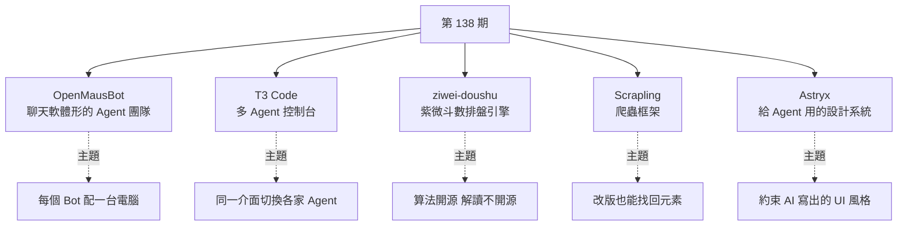

# 第 138 期:開源版 Grok Bot(OpenMausBot)、T3 Code、紫微斗數排盤引擎、Scrapling 爬蟲框架與 Meta Astryx 設計系統

> GitHub 一週熱點第 138 期(2026/11/14 發布,約 7.5 分鐘)。本期五個專案:
>
> - **OpenMausBot:** 把 AI 做成「聊天軟體裡的一排 Bot」,每個 Bot 背後是本機的 Claude / Codex / Grok CLI,可配雲端 Linux 桌面、隔離本機 VM 或你自己的電腦。
> - **T3 Code:** 管理多個程式 Agent 的跨裝置控制台(同一專案在 11/14 另有[辰星說Github 週報](./chenxing-github-top5-2026-11-14-graphify-hallmark-anthropic-skills-pocock-t3code.md)介紹)。
> - **ziwei-doushu:** 紫微斗數開源排盤引擎,依倪海廈《天紀》體系;引擎開源,斷語庫與 AI 解讀不開源。
> - **Scrapling:** Python 爬蟲框架,從單次請求到整站爬取一套包辦,附 MCP 與 Agent Skill。
> - **Astryx:** Meta 開源的 React 設計系統,內建給 Agent 查詢元件與規則的 CLI。
>
> ⚠️ 立場:頻道說明欄無業配,但片尾推自己做的 DeepSeek Harness 入門教程與夸克網盤資料包(自家內容)。本期的 OpenMausBot README 列有贊助商 boat.dev 與 ModelGo;ziwei-doushu 的 README 導向作者自營的商業網站 ouranic.cn;Scrapling README 含贊助商 Evomi 的代理服務廣告,見各節。

---

## 本期速覽

---

## 1. OpenMausBot —— 開源版 Grok Bot

- **連結:** <https://github.com/milind-soni/OpenMausBot>
- **Repo 現況(2026-11-15 查核):** ⭐ 約 2.28 萬、Apache-2.0(`enterprise/` 資料夾例外,見下)、TypeScript。
- **影片時間點:** [從 0:08 開始,講到 0:18](https://www.youtube.com/watch?v=aZOuB8kQ_Yw&t=8s)(逐字稿 `[0:18]` 起)。

**影片說法:** AI 公司開始推「AI 員工」(Meta Muse、Grok Bot、OpenAI dots),都是給 AI 一台雲端電腦加瀏覽器,幫你做日常事務或背景長任務;本專案做開源版。介面像聊天軟體,左側聯絡人換成自己建的 Bot:取名、給職責、選模型就能工作,也可以把幾個 Bot 放進同一個頻道。每個 Bot 可分配雲端 Linux 桌面、隔離的本機虛擬機,或你正在用的這台電腦;可透過 Composio 對接「幾百種」常用工具。影片提醒雲端電腦不是免費的。

**README 核實:**

| 影片說法 | repo 實況 | 結論 |
|---|---|---|
| 開源版 Grok Bot | README 自稱「**受 Grok Bot 啟發的獨立專案**」,同時定位為 Meta Muse、OpenAI dots、Cue by Manus 的開源替代;並非 xAI 官方 | ✅ 已核實(「獨立專案」是 README 自述) |
| Bot 可接 Claude / Codex / Grok 命令列 | README:Bot 在你本機的 `claude`、`codex`、`grok` CLI 上跑 | ✅ 已核實 |
| 三種電腦型態 | README:雲端 Linux 桌面、隔離 Local VM,或「在平台安全邊界已認證的地方」用你自己的電腦;各平台支援度不同(Windows 可選 This computer;Ubuntu 因 Wayland 安全閘預設關閉) | ✅ 已核實,影片略過各平台差異 |
| Composio 對接幾百種 | README 寫「500+ apps through Composio」 | ✅ 已核實(可說「500 以上」) |
| 雲端電腦要錢 | README:雲端電腦由第三方 Boat(boat.dev)提供,試用後付費 | ✅ 已核實 |
| 授權 | `LICENSING.md`:Apache-2.0,但 `enterprise/` 資料夾是 source-available,正式環境需授權金鑰 | ℹ️ 影片未提;自用不受影響 |

**額外要注意:** README 開頭聲明「與任何加密貨幣無關」,並指出冒用 OpenMausBot、Maus 名稱的代幣不是本專案發行——使用者在搜尋時要小心仿冒。README 另列贊助商 boat.dev(雲端電腦)與 ModelGo(推理供應商)。

---

## 2. T3 Code —— 多 Agent 開發控制台

- **連結:** <https://github.com/pingdotgg/t3code>
- **Repo 現況(2026-11-15 查核):** ⭐ 約 6.06 萬、MIT、TypeScript。
- **影片時間點:** [從 1:44 開始,講到 1:54](https://www.youtube.com/watch?v=aZOuB8kQ_Yw&t=104s)。
- 專案介紹、與其他編排器的比較已在 [辰星說Github 週報筆記](./chenxing-github-top5-2026-11-14-graphify-hallmark-anthropic-skills-pocock-t3code.md) 與 [[ai-orchestrators-32-tools-seven-dimensions]] 整理,這裡只記本片的角度。

**影片的觀點(作者主觀,非實測數據):**

- 適用場景:手上有好幾個程式 Agent,任務交叉使用 Claude Code、Codex、OpenCode,原本要在多個視窗間切換;T3 Code 把它們放進同一個管理介面,桌面、網頁、手機都有入口。
- 與「Orca」比較(`[2:26]` 字幕寫成「Oracle」、`[2:55]` 寫成「ORAC」,**推定為 Orca**,因為本庫 [[ai-orchestrators-32-tools-seven-dimensions]] 把 Orca 列為編排器第一名):作者個人感覺 T3 Code 沒有特別強調 agent team 的概念,定位圍繞開發;Thread 加 Environment 的設計在管理多個開發環境時有優勢;若只在單一機器上想搞自動化 Agent,他覺得 Orca 功能更強。
- 操作:啟動後自動偵測本機已有的 Agent;用 Claude Code 而非 Claude 桌面版時要把路徑改成完整路徑;可透過 ACP 接入(例:本機的 Kimi Code,設路徑並在參數放 ACP);任務完成可看改動、提交、開 PR;同時處理多任務可用 Git worktree 各建工作目錄;可設定多個 environment;可統一查看各 Agent 的 token 消耗。
- 作者結論:只用一個主力 Agent 的人「沒必要用」。作者自述體驗時間不長。

---

## 3. ziwei-doushu —— 紫微斗數開源排盤引擎

- **連結:** <https://github.com/Renhuai123/ziwei-doushu>
- **Repo 現況(2026-11-15 查核):** ⭐ 約 1.82 萬、程式碼 MIT、資料集 CC BY 4.0、TypeScript(Next.js)。
- **影片時間點:** [從 3:53 開始,講到 4:03](https://www.youtube.com/watch?v=aZOuB8kQ_Yw&t=233s)。

**影片說法:** 紫微斗數是中國傳統命理的一種;用出生年月日時辰排成命盤,把紫微等星曜放進不同宮位,結合四化、運限等規則解釋;專案基於倪海廈老師在《天紀》中系統梳理的體系;有線上版可填出生資料生成命盤,看宮位內容與不同年齡、年份的變化;倉庫整理了古籍與知識資料;**開源的主要是排盤引擎、資料與演示,完整的 AI 解讀與後端要自己做**。

**README 核實:**

| 影片說法 | repo 實況 | 結論 |
|---|---|---|
| 基於倪海廈《天紀》體系 | README 一、二節明寫「基於倪海廈《天紀》教學體系」 | ✅ 已核實 |
| 開源排盤引擎、資料、演示 | README「開源邊界」表:開源 = 排盤引擎 `lib/ziwei/`、古籍公版原文、SEO 知識圖譜、Demo 介面、51.8 萬樣本資料集、13 維解讀資料集 v4.0 | ✅ 已核實 |
| AI 解讀與後端不開源 | 同表「不開源」:斷語庫(`lib/ziwei/db-analysis.ts` 只是占位,線上是上萬行 13 主題斷語)、AI 解讀 prompt、後端 API、使用者系統、服務端安全 | ✅ 已核實 |
| 有線上版本可體驗 | README 導向 `ouranic.cn`;這是作者自營的商業網站(含登入、會員、支付) | ✅ 已核實;**屬於專案作者自我宣傳,見下** |

**需要特別標明的幾點:**

- ⚠️ **這是命理工具,不是科學驗證過的預測方法。** 排盤引擎做的是「依規則把出生資料排成命盤」(演算法層面可驗證是否排對),不代表解讀能預測人生。README 自己也引倪師原話承認「斗數批六親本來就比較差一點」。本庫收錄此片是因為它是 GitHub 熱門的 AI 加傳統文化工程案例,不替命理背書。
- README 的數字(13 維解讀資料集 v4.0:674,976 張命盤、8,774,688 段解讀、解壓後 56.6 GB;逐幀精讀 17 集 1,604,675 幀)全是**作者自述**,本庫未下載資料集驗證。
- 專案與倪海廈本人或其遺產方是否有授權關係,README 的「倪師原話非商用」授權條款只說明資料用途,**未能核實授權關係**。

---

## 4. Scrapling —— 現代化爬蟲框架

- **連結:** <https://github.com/D4Vinci/Scrapling> · 文件 <https://scrapling.readthedocs.io>
- **Repo 現況(2026-11-15 查核):** ⭐ 約 10.3 萬、BSD-3-Clause、Python;`pyproject.toml` 版本 0.5.1(**尚未 1.0**)。
- **影片時間點:** [從 4:59 開始,講到 5:09](https://www.youtube.com/watch?v=aZOuB8kQ_Yw&t=299s)。

**影片說法:** 爬蟲的痛點是網站改版就抓不到;Scrapling 把常見問題收在一起:簡單頁面直接發請求,要執行 JavaScript 就用瀏覽器抓,抓回來用 CSS 選擇器或 XPath 讀內容;連續爬很多頁有 Spider,可設並行請求數、間隔、用哪些 session;對用 Agent 的人更直接的是它提供的 MCP 與 Skill,可把網頁轉成 Markdown;最重要的是遵守規則,能爬什麼不能爬什麼別亂來。

**README 核實:**

- ✅ Fetcher 系列:`Fetcher`(HTTP,可模擬瀏覽器 TLS 指紋)、`StealthyFetcher`(Playwright Chromium / Chrome 的隱匿瀏覽器)、`FetcherSession` / `StealthySession`(保存 cookie 與狀態)。
- ✅ 解析:CSS、XPath、文字與 regex 搜尋;**adaptive element tracking(改版後自動重新定位元素)是影片沒明講、但正好對應「網站改版」痛點的核心賣點**。
- ✅ Spider:類 Scrapy 的 API(`start_urls`、非同步 `parse`、`Request` / `Response`)、多 session 路由、串流模式、AutoThrottle、暫停/續跑、`CrawlSpider` / `SitemapSpider` 範本。
- ✅ AI 整合:MCP server(README 標頭有 `mcp-name`)與 Agent Skill(repo 內 `agent-skill/` 資料夾),可把整站收成乾淨 Markdown。
- ✅ `robots_txt_obey` 旗標:**選用**,尊重 `Disallow`、`Crawl-delay`、`Request-rate`,預設是否開啟 README 未明寫,使用者須自己打開。
- ⚠️ **影片說「遵守規則」,但框架本身主打反偵測**:README 稱 `StealthyFetcher` 可「輕鬆繞過所有 Cloudflare Turnstile / Interstitial」。繞過防爬機制可能違反目標網站的服務條款,甚至在部分法域涉及法律問題;**用不用、怎麼用是使用者的責任**,本庫只記錄功能,不鼓勵繞過。
- README 含贊助商廣告(Evomi 住宅代理與「繞過反爬蟲」服務),屬專案自己的贊助版位;使用者買代理或繞過服務前要自己評估。

---

## 5. Astryx —— Meta 開源的 Agent 友善設計系統

- **連結:** <https://github.com/meta/astryx> · 文件 <https://astryx.atmeta.com>
- **Repo 現況(2026-11-15 查核):** ⭐ 約 2.81 萬、MIT、TypeScript;核心套件 `@astryxdesign/core` 版本 0.7.17,README 標示 **Beta**。
- **影片時間點:** [從 5:43 開始,講到 5:53](https://www.youtube.com/watch?v=aZOuB8kQ_Yw&t=343s)。

**影片說法:** 用 AI 寫頁面常見問題是第一頁不錯,後面按鈕、表單、彈窗樣式漂移,放一起不像同一個產品;設計系統約束按鈕長相、表單排法、顏色間距;Astryx 從 Meta 內部設計系統發展而來,提供現成元件、主題、顏色模式與頁面範本;Beta、要求 React 19 以上;最大亮點是專門給 Agent 準備的元件查詢與設計規則命令列工具;換品牌色可調主題變數;作者認為做後台與內部管理工具時很實用。

**README 核實:**

| 影片說法 | repo 實況 | 結論 |
|---|---|---|
| 從 Meta 內部設計系統發展 | README:在 Meta 內部發展約八年,「是公司內最常用、最大的設計系統,供 13,000+ 應用使用」(**Meta 自述,未能獨立核實**) | ✅ 說法一致 |
| Beta、React 19+ | README:Currently in Beta;`react` 與 `react-dom` peer dependency `>=19.0.0` | ✅ 已核實 |
| 現成元件、主題、深色模式、範本 | README:150+ 無障礙元件、品牌級主題、深色模式、ready-to-ship templates、CLI | ✅ 已核實 |
| 換品牌色調主題變數 | README:「主題是一組 CSS 自訂屬性覆寫」,不用 fork | ✅ 已核實 |
| 給 Agent 的查詢工具 | CLI 提供 `astryx search`、`astryx component <名稱>`、`astryx docs <主題>`,並有 `--dense` 省 token 的輸出模式 | ✅ 已核實 |
| 影片未提 | 樣式以 **StyleX** 撰寫,但對使用者是隱形的,可用 Tailwind、CSS modules 或純 CSS 覆寫;`swizzle` 可把元件取出改寫 | ℹ️ 補充 |

---

## 6. 本期分享的兩份資料

- **第 57 次《中國互聯網絡發展狀況統計報告》**(`[6:51]` 起):影片說統計 2025 年中國互聯網發展,有網民規模、網購、短影片,也有專門一章談生成式 AI。本庫搜尋到媒體轉述一致:截至 2025 年 12 月,網民約 11.25 億人、普及率超過 80%,生成式 AI 用戶約 6.02 億人(普及率 42.8%)。**⚠️ 這些數字來自新聞轉述,未能取得 CNNIC 報告原文核對**,引用前請讀原文。
- **作者自製的 DeepSeek Harness 入門教程**(`[7:11]` 起):屬頻道自家內容,資料需向作者索取(說明欄附夸克網盤連結),本庫不收錄付費或私域素材。

---

## 應用案例

1. **同時有 Claude Code 與 Codex 兩個訂閱的個人開發者:** 想在手機上看進度、批准下一步,可評估 T3 Code;若只在一台機器上做自動化,影片作者推薦先看 Orca。評估前先看 [[ai-orchestrators-32-tools-seven-dimensions]] 的七維度比較。
2. **一人公司做 SaaS 後台:** 用 Claude Code 寫管理頁面時,先裝 Astryx 核心套件加 `@astryxdesign/cli`,讓 Agent 先 `astryx search` 找元件、`astryx component` 看用法,再寫頁面,可降低「每頁風格不同」的問題。注意它還是 Beta,先在內部工具試用。
3. **做價格比對或輿情蒐集的資料工程師:** 先用 Scrapling 的 `Fetcher` 抓靜態頁,遇到 JavaScript 渲染再換 `StealthyFetcher`;**務必先讀目標網站的 robots.txt 與服務條款,並打開 `robots_txt_obey`**。繞過 Cloudflare 防護前先確認法律風險。
4. **想在公司內試辦「AI 員工」的團隊:** OpenMausBot 讓每個 Bot 有獨立職責與電腦,可先用「隔離本機 VM」型態在測試帳號跑,不要一開始就開放「你自己的電腦」並給 Composio 的正式帳號授權;評估企業用途時注意 `enterprise/` 資料夾的授權不同。
5. **對傳統文化 + AI 有興趣的工程師:** ziwei-doushu 適合當「規則型排盤引擎」的程式碼範例(`lib/ziwei/`),也可當研究資料集的來源;但不要把命盤解讀當作決策依據。

---

## 來源

- 影片:「Github一周热点138期」開源版Grok Bot、多Agent編程工作台、紫微斗數排盤、現代化爬蟲和Meta設計系統(IT咖啡馆,2026-11-14):<https://www.youtube.com/watch?v=aZOuB8kQ_Yw>
  - 該片無字幕,逐字稿以 CPU 版 faster-whisper `large-v3-turbo`(int8,不帶詞表)轉錄取得,非官方字幕,可能有少量聽寫誤差(如專案名 OpenMausBot 被聽成 OpenMouseBot、Orca 被聽成 Oracle);專案清單取自影片說明欄,細節以各 repo 為準。
  - 原 GitHub repo `itcoffee66/githubweekly` 的 `_weekly/138.md` 本次未再檢查(前幾期皆未恢復同步)。
- 本期專案(2026-11-15 clone 並讀 README 與目錄核實,clone 已刪除):
  - OpenMausBot:<https://github.com/milind-soni/OpenMausBot>(官網 <https://www.openmausbot.com>)
  - T3 Code:<https://github.com/pingdotgg/t3code>
  - ziwei-doushu:<https://github.com/Renhuai123/ziwei-doushu>
  - Scrapling:<https://github.com/D4Vinci/Scrapling>(文件 <https://scrapling.readthedocs.io>)
  - Astryx:<https://github.com/meta/astryx>(文件 <https://astryx.atmeta.com>)
- 統計報告(媒體轉述,未讀原文):<https://www.news.cn/tech/20260302/66c4ab06b6f34f8d806b416b3acc9f0b/c.html>、<https://www.cls.cn/detail/2281146>
- 星數與授權來自 GitHub API(`https://api.github.com/repos/<owner>/<repo>`),2026-11-15 查詢。

## 相關筆記

- [[chenxing-github-top5-2026-11-14-graphify-hallmark-anthropic-skills-pocock-t3code]] — T3 Code 在另一支週報的介紹與版本差異
- [[ai-orchestrators-32-tools-seven-dimensions]] — T3 Code、Orca 等編排器的七維度比較
- [[always-on-agent-grok-bot-lee-robinson]] — Grok Bot 概念與「常駐 Agent」的設計
- [[issue-137]] — 上一期(DeepSeek Super Agent、agent-desktop 等)
- [[issue-139]] — 下一期(Sure、AG-UI、EGM、Auto Ontology 等)
- [[claude-web-design-skills-benchmark-pnh]] — 設計類 Skill 讓 AI 網頁不走樣的實測,與 Astryx 的用途相呼應
