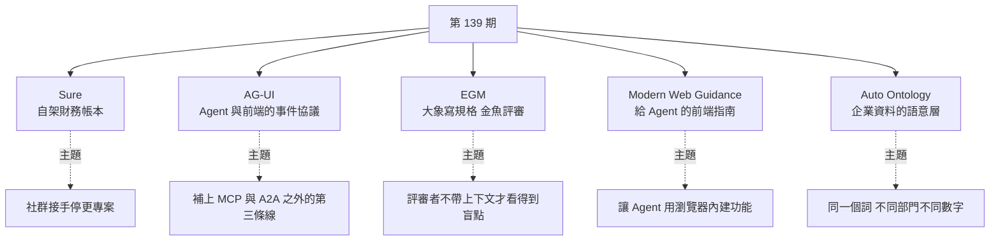

# 第 139 期:Sure 個人財務帳本、AG-UI 協議、大象金魚評審插件、Modern Web Guidance 與 NVIDIA Auto Ontology

> GitHub 一週熱點第 139 期(2026/11/21 發布,約 7.5 分鐘)。本期五個專案:
>
> - **Sure:** 可自架的個人財務帳本,是已停止維護的 Maybe Finance 的社群 fork。
> - **AG-UI:** 連接 Agent 與前端應用的開放事件協議,已到 1.0。
> - **Elephant-Goldfish Model(EGM):** Google 的設計與評審插件,「大象寫規格、金魚不帶前情來挑毛病」。
> - **Modern Web Guidance:** Chrome 團隊給編程 Agent 的現代前端知識庫(本庫已有專篇)。
> - **Auto Ontology:** NVIDIA 的開源框架,從企業元資料自動建「業務語意層」給 Agent 用。
>
> 逐字稿來源:該片無字幕,以 CPU 版 faster-whisper `large-v3-turbo` 轉錄取得,非官方字幕;時間點取自帶時間逐字稿。專案名稱、指令以說明欄與 repo 為準(Whisper 把「Maybe」聽成「妹币」、「CLI」聽成「CRI」、「A2UI」聽成「A2AI」、「brainstorm / draft」聽成「bristorm / drop」,已校正)。
> ⚠️ 立場:說明欄無業配,片尾分享 Gartner 2027 十大戰略技術趨勢與一份 Token 推理優化白皮書(夸克網盤資料包)。EGM 與 Auto Ontology 都是大公司官方專案,README 自述的排行榜名次屬廠商自報。

---

## 本期速覽

---

## 1. Sure —— 可自架的個人財務帳本

- **連結:** <https://github.com/we-promise/sure>
- **Repo 現況(2026-11-22 查核):** ⭐ 約 1.71 萬、AGPL-3.0、Ruby、2026-11-21 仍有推送。
- **影片時間點:** [從 0:11 開始,講到 1:32](https://www.youtube.com/watch?v=LvyC-FTblTM&t=11s)(逐字稿 `[0:21]` 起)。

**影片說法:** 這是曾介紹過的個人財務帳本,當時叫 Maybe;原專案不再維護,現在由社群接手。可記錄收入與支出、把多個帳戶放在一起看、區分消費與自己的錢換地方(轉帳)、看資產與負債;可用 Docker 跑起來,自託管是賣點之一;自動同步要看是否支援,因為主要針對海外服務;自架記得做好備份。

**README 核實:**

| 影片說法 | repo 實況 | 結論 |
|---|---|---|
| 原專案停更、社群接手 | README:「community fork of the now-abandoned Maybe Finance project」,Maybe 團隊 2023 年中停止開發,曾推出託管版但 B2C 模式不可持續 | ✅ 已核實 |
| 可用 Docker 自託管 | README:「self hosted with Docker」,附 `docs/hosting/docker.md` | ✅ 已核實 |
| 自動同步偏海外服務 | 我沒有讀銀行同步的文件 | 未能核實 |
| 授權 | AGPL-3.0(GitHub API);影片未提 | ℹ️ 自架自用無妨,改作後提供網路服務需開放原始碼 |
| 其他 | README 提到可由瀏覽器、macOS 桌面 App、行動 App、API 與 LLM Agent 存取,儀表板截圖含 AI 助理 | ➕ 影片未提 |

---

## 2. AG-UI —— Agent 與前端界面的通信協議

- **連結:** <https://github.com/ag-ui-protocol/ag-ui>
- **Repo 現況(2026-11-22 查核):** ⭐ 約 2.10 萬、MIT、TypeScript;`@ag-ui/core` 套件版本 1.0.5、`protocolVersion` 1.0。
- **影片時間點:** [從 1:22 開始,講到 3:13](https://www.youtube.com/watch?v=LvyC-FTblTM&t=82s)。

**影片說法:** AG-UI 是把 Agent 連到任何應用的開放協議,最近更新到 1.0。AI 應用有三個角色:使用者、Agent、外部工具;MCP 解決 Agent 與工具,A2A 解決 Agent 之間,AG-UI 解決 Agent 與前端。它是「輕量、事件驅動」的協議,支援雙向即時通訊(例:AI 視頻助手每寫好一個分鏡,頁面多一張卡,使用者改了再確認,助手按修改後繼續)。容易混淆的是 A2UI:讓 Agent 決定介面出現哪些元件,可與 AG-UI 搭配。

**README 核實:**

| 影片說法 | repo 實況 | 結論 |
|---|---|---|
| 到 1.0 | 套件 1.0.5、spec 連結 `docs.ag-ui.com/spec/1.0` | ✅ 已核實 |
| 開放、輕量、事件驅動、雙向 | README 首句:「open, lightweight, event-based protocol」,「one bi-directional event stream: the agent emits typed events, and any client can render them」 | ✅ 已核實 |
| 與 A2UI 的關係 | README:A2UI、MCP Apps、Open-JSON-UI 是「generative UI specs」,描述 Agent 想顯示什麼 UI;AG-UI 是「runtime protocol」,負責搬運這些 payload 與其他一切 | ✅ 已核實,影片說法一致 |
| 2025 年 5 月由 CopilotKit 團隊發起 | README 有 CopilotKit 的文件連結,但我沒找到發起日期 | 未能核實 |
| MCP、A2A 的分工 | README 的 Protocols 區把 A2A、MCP、MCP Apps、A2UI 並列為可搭配的協議 | ✅ 方向一致 |

---

## 3. Elephant-Goldfish Model(EGM)—— 大象寫規格,金魚來評審

- **連結:** <https://github.com/google/elephant-goldfish-model>
- **Repo 現況(2026-11-22 查核):** ⭐ 約 2.19 萬、Apache-2.0、Python。
- **影片時間點:** [從 3:03 開始,講到 4:29](https://www.youtube.com/watch?v=LvyC-FTblTM&t=183s)。
- 本庫已有完整專篇:[[elephant-goldfish-model-egm-spec-review]],這裡只補本期角度與核實。

**影片說法:** 名字有 Model 但不是模型,是評審插件。對話跑偏後越跑越偏,是因為長期記憶把錯誤干擾帶進上下文;所以讓「大象」理解專案背景並寫規格,「金魚」評審員在不依賴之前討論的情況下審查草稿與參考資料,找出未被提及的假設。使用者做架構決策並批准規格;用 `egm-review` 評審文件;有 brainstorm、draft、review 等 skill;作者覺得這和另設獨立審核 Agent 的思路相近。

**README 與目錄核實:**

| 影片說法 | repo 實況 | 結論 |
|---|---|---|
| 不是模型,是插件 | README:「EGM is an open-source plugin for AI assistants」 | ✅ 已核實 |
| 大象持有背景寫規格,金魚不帶前情評審,人做取捨與批准 | README:「Elephant holds your project context and drafts the specification. Goldfish reviewers examine the draft and referenced source material without the earlier conversation... You make the architectural trade-offs and approve the specification」 | ✅ 已核實 |
| 多個 skill | `skills/` 有 egm-bootstrap、egm-brainstorm、egm-draft、egm-drift-report、egm-lite、egm-resolve、egm-review、egm-review-loop 八個 | ✅ 已核實(影片只講了其中幾個) |
| 用常用 Agent 安裝 | README 有 Antigravity CLI、Claude Code、Codex CLI 的安裝指令(例:`claude plugin marketplace add google/elephant-goldfish-model`、`claude plugin install egm@egm`) | ✅ 已核實 |
| 補充 | 腦力激盪與評審需要能建立新子代理(fresh subagents)的工作階段;除了評審,還有 `egm-drift-report` 比對文件與現有程式碼的偏離 | ➕ 影片未提 |

---

## 4. Modern Web Guidance —— 給編程 Agent 的前端指南

- **連結:** <https://github.com/GoogleChrome/modern-web-guidance-src>
- **Repo 現況(2026-11-22 查核):** ⭐ 約 9,900、Apache-2.0、TypeScript,2026-11-20 仍有推送。
- **影片時間點:** [從 4:19 開始,講到 5:40](https://www.youtube.com/watch?v=LvyC-FTblTM&t=260s)。
- 本庫已有完整查證:[[modern-web-guidance-chrome-agent-skill-why-qq]](含 clone repo 核實 Node 22+、遙測會收搜尋字串、上下文約 205 token 等)。

**影片說法:** 模型學了大量舊網頁程式碼,而瀏覽器已內建很多新功能,模型仍用舊寫法重做。例:點按鈕彈出小面板、點空白處關閉,舊資料會要你掛頁面點擊監聽,現代瀏覽器已有原生彈出層(Popover)可交給瀏覽器。專案把外部專家整理的寫法、範例與相容資訊做成 Agent 能查的 skill,裝進 Codex、Claude Code 等;使用時提醒 Agent 寫網頁前先查瀏覽器現成功能。Google 另做了專門頁面。

**結論:** 屬已在本庫核實過的專案,本期只是簡介;影片的用法(提醒 Agent 先查現成功能)與專篇一致。我這次沒有重新 clone 讀原始碼。

---

## 5. Auto Ontology —— 為企業資料建語意推理層

- **連結:** <https://github.com/NVIDIA/auto-ontology>
- **Repo 現況(2026-11-22 查核):** ⭐ 約 1.42 萬、Apache-2.0、Python;README 掛有 BEAVER 排行榜第 1、BIRD-Interact 第 2 的徽章(**廠商自報**,影片未提)。
- **影片時間點:** [從 5:30 開始,講到 6:43](https://www.youtube.com/watch?v=LvyC-FTblTM&t=330s)。

**影片說法:** 用自然語言查詢業務數據的開源框架。例:老闆問「上月收入多少」,銷售按簽單報一個數、財務按帳面報一個數、AI 寫的 SQL 查出第三個數,因為每人對「收入」理解不同。企業資料平台累積了表、結構、BI、指標,但不等於形成可供 Agent 使用的業務知識。專案是開放函式庫,從企業元資料自動建本體、協調不同系統間的定義,並以 MCP、CLI、API 暴露給 Agent;官方概括五個動作:發現、對齊、驗證、暴露、學習;價值在減少候選模型的手工整理,業務判斷並未消失。作者沒有企業級資料,沒有實測。

**README 核實:**

| 影片說法 | repo 實況 | 結論 |
|---|---|---|
| 從元資料自動建本體、協調不同定義 | README:「builds that ontology automatically from enterprise metadata, reconciles definitions across systems」 | ✅ 已核實 |
| 以 MCP、CLI、API 暴露給 Agent | README:「exposes it to any agent harness through MCP, CLI, and API」 | ✅ 已核實 |
| 五個動作 | README 的五項為 **Discover、Ground、Validate、Expose、Learn**;影片的「對齊」對應 Ground,字面更接近「落地、給 Agent 可信的業務意義(並協調各系統不一致的定義)」 | ⚠️ 需修正譯法:Ground 不是單純「對齊」 |
| 業務判斷不會消失 | README 「Validate」:專家認證前先用真實問題測試草稿,每個答案附 SQL 與步驟;「Learn」只吸收**已認證**的修正 | ✅ 一致(專家仍在迴圈裡) |
| 補充 | README 也坦言:只有單一建模良好的資料源、問題固定時,直接寫 SQL 就夠;本體在問題多樣、資料源分散、定義衝突時才值得 | ➕ 影片未提,適用邊界 |
| 快速上手 | 需 Docker Compose v2、uv 與 NVIDIA API Key(build.nvidia.com),示範資料庫為微軟 Wide World Importers | ➕ 影片未提;因此免費試用仍要金鑰 |

---

## 6. 本期分享的兩份資料

影片 [6:43](https://www.youtube.com/watch?v=LvyC-FTblTM&t=393s) 起分享:

1. **Gartner 2027 十大戰略技術趨勢**(提到世界模型、語音推理模型、AI 智能身份等)。
2. **Token 驅動的大模型推理效能優化技術白皮書**(四個面向:算力調度與資源編排、單輪推理優化、多輪智能體優化、Token 商業化運營)。

兩份都在作者的夸克網盤資料包,我沒有取得原檔,**內容與數字未能核實**。

---

## 我的判讀

1. **本期共同主題是「給 Agent 提供它不會自己知道的上下文」**:Modern Web Guidance 給瀏覽器新功能、Auto Ontology 給業務定義、AG-UI 給前端互動、EGM 反過來「刻意拿掉上下文」才看得到盲點。
2. **EGM 的金魚設計值得抄**:你自己的審查流程,第二個審查者最好不要看前面的討論,只看成品與引用資料。
3. **Auto Ontology 的價值取決於你的資料是否真的混亂**;README 自己說單一資料源直接寫 SQL 就夠,別因為是 NVIDIA 就上。

## 應用案例

**案例一:自架財務帳本**
用 Docker 跑 Sure,把兩三個銀行帳戶與信用卡每月手動匯入,先分清「消費」與「轉帳」,三個月後看淨資產曲線。重點是備份資料庫,README 的託管文件有說明。

**案例二:設計文件的金魚評審**
把待實作的功能先在對話裡討論、寫成規格檔,再開新的工作階段執行 `egm-review` 指到那個檔案,讓不知前情的審查者找出隱含假設。

**案例三:跨部門「收入」定義**
列出「簽單收入、認列收入、收款」三種口徑與各自資料表,先人工寫成對照表,再評估 Auto Ontology 能否替你省下建本體的工。

**案例四:前端 Agent 的原生功能檢查**
在專案的 AGENTS.md 加一句「寫網頁前先查 Modern Web Guidance,優先用原生 Popover、dialog」,再比較改前後產生的程式碼行數。

## 相關筆記

- [[elephant-goldfish-model-egm-spec-review]] — EGM 專篇
- [[modern-web-guidance-chrome-agent-skill-why-qq]] — Modern Web Guidance 完整查證
- [[function-calling-mcp-a2a]] — MCP 與 A2A 的分工,對照 AG-UI
- [[cross-model-review-claude-codex-harness]] — 獨立審查者的另一種做法
- [[mcp-stateless-migration-guide]] — MCP 的最新演進

## 來源

- IT咖啡馆〈Github一周热点139期〉:https://www.youtube.com/watch?v=LvyC-FTblTM (無字幕,逐字稿以 faster-whisper large-v3-turbo 轉錄,非官方字幕)
- Sure:https://github.com/we-promise/sure
- AG-UI:https://github.com/ag-ui-protocol/ag-ui(spec:https://docs.ag-ui.com/spec/1.0)
- Elephant-Goldfish Model:https://github.com/google/elephant-goldfish-model
- Modern Web Guidance:https://github.com/GoogleChrome/modern-web-guidance-src
- NVIDIA Auto Ontology:https://github.com/NVIDIA/auto-ontology
- Maybe Finance 最終版:https://github.com/maybe-finance/maybe/releases/tag/v0.6.0
- Repo 星數與授權:GitHub API(2026-11-22 查詢);README 內容為淺層 clone 讀取後刪除
