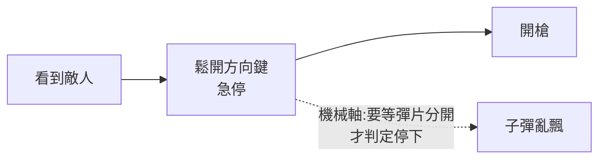

# 磁軸鍵盤原理:霍爾感測、Rapid Trigger,與飛智 FS68 的雙霍爾與蜂窩墊設計

> Redknot(喬紅)〈用最好的动画为你讲解——磁轴键盘的原理〉(2026-05-12)。以飛智(Flydigi)FS68 多霍爾電競磁軸鍵盤為例講解。

> 📌 揭露:影片未標示業配,但內容以單一品牌型號(FS68)為主、含外觀材質與稱讚,**帶產品介紹性質**。本篇只保留通用原理與其機制,**飛智自家宣稱的數字(如預判釋放省 5–10ms)標為廠商宣稱、未獨立驗證**,外觀與評價不納入。

---

## TL;DR

1. 傳統機械軸靠**兩片金屬彈片接觸**,只知道「按下 / 鬆開」兩態,且有「觸發行程」與較長的「復位行程」。FPS 急停時,手指已鬆開但彈片仍接觸,角色還判定在走。
2. 磁軸:軸芯上嵌**磁鐵**,PCB 上放**霍爾感測器**,能量測磁場強度 ⇒ 知道按下的**連續位移量**。
3. 因此能做 **Rapid Trigger(RT,快速觸發)**:觸發點不固定,而是依位移變化動態判斷(往下一點即觸發、往上一點即釋放)。
4. 單霍爾架構的缺點:磁場強度隨距離呈**立方級**衰減,鍵在頂部時訊號最弱 ⇒ 易受抖動、溫度、電磁干擾誤判,需設較長死區;軸芯偏移也無法與正常下壓區分。

---

## 1. 為什麼 FPS 在乎「釋放得多快」

CS2 還要多按一步反方向鍵才能剎停。機械軸「按下觸發點」與「抬起復位點」固定在某位置(換軸才能改);磁軸的霍爾感測器在鬆手瞬間就偵測到軸芯開始回彈,馬上觸發 RT。

## 2. 改進一:貫穿式磁軸 + 雙霍爾(影片以 FS68 說明)

| 問題 | 做法 |
|---|---|
| 磁場遠端太弱 | PCB 開孔讓磁鐵穿過,整段行程都貼近感測器;磁鐵極性改水平方向,感測器移到孔邊 |
| 軸芯偏移難分辨 | 在孔對面再加一顆霍爾,左右兩顆互相校正,偏移時一邊強一邊弱,以算法抵消 |
| 雜訊 | **差分電路**在類比階段直接相減:共模雜訊被抵消,差異被放大,硬體層修正近乎即時,不增延遲 |
| 溫度漂移 | 主板三顆溫度感測器(左中右)即時補償 |
| WASD | 每鍵 4 顆霍爾(PCB 正反各 2) |

## 3. 改進二:預判釋放(廠商稱 Pre-RT)與蜂窩墊

- 以觸底力 40gf 為例;玩家實際常壓到 120gf。普通磁軸要等力降到 40gf 以下軸芯才開始回彈 ⇒ 120→40gf 這段是**感知死區**。
- FS68 在 PCB 下加**蜂窩緩衝墊**:觸底後多出的 80gf 壓縮蜂窩墊;鬆力時墊先回彈,磁鐵微上移,霍爾捕捉到並算出手指離開的**加速度**,超過閾值就提前觸發 RT。
- 蜂窩墊分區獨立開槽、各有固定腳,只形變單鍵不影響鄰鍵;也提供觸底回饋感與濾音。
- 廠商宣稱可比普通磁軸多搶 **5–10ms**(Flydigi 說法,經 [xiaomitoday](https://xiaomitoday.com/flydigi-launches-fs68-magnetic-switch-keyboard-with-quad-sensor-wasd-keys-and-pre-rt-support/) 轉述,未獨立驗證)。
- 畫面標題為「**Pre-RT 预判释放技术**」(影片 t=691s 截圖,即 transcript_tools 找到的 [11:41] 行連結);字幕「PrayRT」為聽寫錯誤。

## 4. 應用案例

- **選購磁軸鍵盤**:看規格時關心 ①是否可調 RT 靈敏度與死區 ②頂部死區多長(越長代表頂部訊噪比越差)③是否有溫度補償,比單看「0.1ms 延遲」宣傳有意義。
- **遊戲設定**:FPS 移動鍵開 RT、把 RT 靈敏度調到 0.1–0.3mm 級,急停更俐落;打字則可調回固定觸發點避免誤觸。
- **舉一反三**:同樣的霍爾 + 磁鐵架構也用在搖桿與扳機(影片提到飛智做過力調節搖桿),原理是「以磁場強度推算位置」。

## 5. 核實狀態

- **原理層**(磁軸以霍爾感測量位移、RT、機械軸彈片接觸):為業界通行知識,與影片一致;未逐項查一手文件。
- **磁場隨距離呈立方衰減**:**已核實(理想偶極子、軸向)**。[Vernier 實驗頁](https://www.vernier.com/experiment/pwv-31_the-magnetic-field-of-a-permanent-magnet) 給出理想偶極子軸向場 B = (μ₀/4π)(2μ/d³),並說明這是三次方反比、不同於平方反比。它只適用於理想偶極子與軸向,頁面未說明適用距離範圍;實際鍵盤磁鐵形狀與近場會偏離,**鍵盤內的實際衰減曲線未實測**,因此保留「理論上」的限定。
- **部分核實(二手報導,非官方規格表)**:[xiaomitoday](https://xiaomitoday.com/flydigi-launches-fs68-magnetic-switch-keyboard-with-quad-sensor-wasd-keys-and-pre-rt-support/) 報導:「多數按鍵為雙霍爾」、「WASD 為四霍爾設置」、PCB 上有三顆溫度感測器;Pre-RT 為「在按鍵完全釋放前偵測手指放鬆壓力」;5–10ms 依 Flydigi 說法。報導也把蜂窩墊列為隔音材料之一,與影片「過濾敲擊聲」一致。
- **未能核實**:影片說的「每個按鍵 4 顆霍爾(PCB 正反各 2)」與報導的「WASD 四霍爾」(未說明是每鍵或整組)不一致,無法判定;蜂窩墊「只形變單鍵、不干擾鄰鍵」的機制未查到獨立資料;5–10ms 為廠商宣稱,一篇日文評測提醒它不代表整體延遲降低(搜尋摘要,未開全文)。
- 逐字稿還原:「磁周/磋轴」=磁軸、「非智/非晱」=飛智(Flydigi)、「画尔」=霍爾、「蜂窝电」=蜂窩墊、「Priority 预判释放」→ 畫面標題為 **Pre-RT 預判釋放技術**(已由畫面確認,見上)。

## 延伸閱讀與深度補充(2026-11-07 核實增補)

- **偶極子磁場的距離律(一手,已讀)**:[Vernier 實驗頁](https://www.vernier.com/experiment/pwv-31_the-magnetic-field-of-a-permanent-magnet) 的重點是「軸向場 ∝ 1/d³」。另一搜尋結果 [attackshark 部落格](https://attackshark.jp/blogs/knowledges/magnetic-keyboard-jitter-mobile-phone-interference-guide) 稱鍵盤磁鐵依平方反比衰減,與理想偶極子結果衝突,**不採用**。
- **Hall 感測在鍵盤中的用途(僅搜尋摘要,未開全文)**:[TI 應用文件 SLYA093](https://www.ti.com/document-viewer/lit/html/SLYA093/GUID-7FE4A4D2-8EB3-4573-9C3D-8A39D79171C4) 摘要描述按鍵下壓時磁鐵靠近感測器、場強增加,即影片「以磁場強度推算位移」的原理。
- **影片數字是動畫示意,非實測**:t=616s 截圖(影片連結 `&t=616s`,即 transcript_tools 找到的 [10:26] 行)畫面標示「120.00gf」,字幕為「從 120 克降到 40 克的這個階段」;t=673s 截圖畫面標示「0.00gf」,字幕「而飛智的 FS68」。影片的 120gf / 40gf 是示意動畫的標示值,不是量測結果。
- **Pre-RT 的實際邊界**:影片與報導都只說「預判手指放鬆」,沒有公開判定演算法或延遲量測方法;「加速度超過閾值即觸發」是影片的文字描述,未見廠商技術白皮書核對。

## 來源

- 影片:[用最好的动画为你讲解--磁轴键盘的原理(Redknot-乔红,2026-05-12)](https://www.youtube.com/watch?v=N3o8AcflmO4)
  - ⚠️ 該片無官方字幕,逐字稿以 CPU 版 Whisper 轉錄,可能有同音字誤差。
