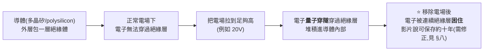
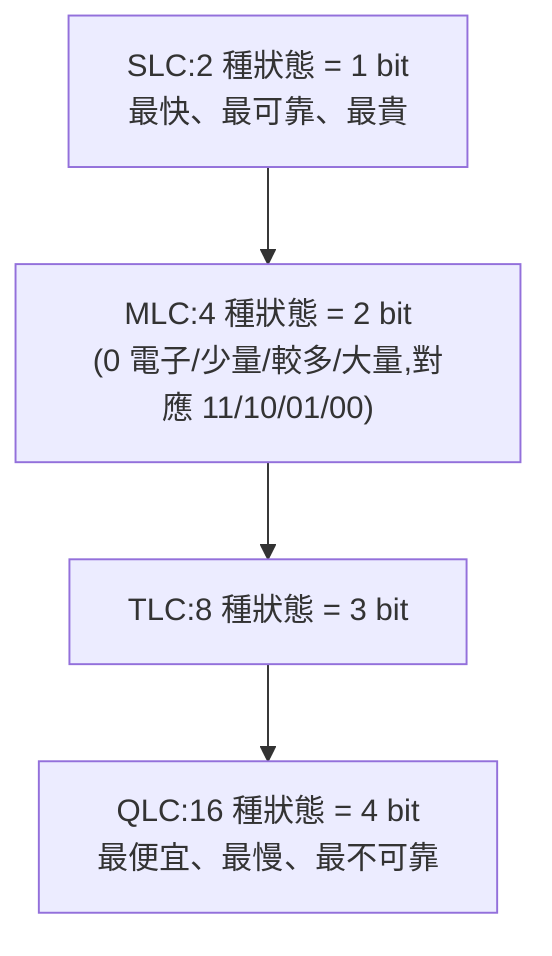
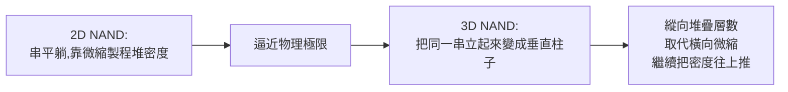

# SSD 怎麼存資料:從量子穿隧到 3D NAND 陣列

> 整理自 Redknot-乔红〈[How SSD Works](https://www.youtube.com/watch?v=rQR_0WZzjV4)〉。
> ⚠️ **影片原音為英文自動配音敘事,逐字稿以 CPU 版 Whisper 轉錄取得(該片無中文官方字幕、YouTube 限流抓不到官方英文字幕)。
> 因轉錄時使用中文語言設定,部分段落被誤轉成無意義的同音中文亂碼**(例如把 "floating gate" 誤轉成「浮動閩」「輪返車」等雜訊字串);
> **本文已對照音訊語境與電子工程常識還原,亂碼片段不轉述,只保留可辨識的技術內容。**

---

## 一、問題:固態硬碟憑什麼比機械硬碟小、輕、快

SSD 沒有馬達、磁頭、旋轉碟片,靠的是**浮閘電晶體(floating gate transistor)**——
一種能「鎖住」電子、斷電也不會丟失資料的電晶體。整部影片要解決的核心問題只有一個:
**電子要怎麼被「關」進一個被絕緣層包起來的導體裡,又要怎麼被「放」出來?**

---

## 二、解法一:量子穿隧(quantum tunneling)

> 想像一個電子前面有一面絕緣牆。常識告訴我們電子不可能穿過去。
> 但在微觀尺度,**只要把電場強度拉高到某個門檻,電子穿過去的機率會從「幾乎不可能」暴增**——
> 這就是**量子穿隧效應**(更精確的機制是 **Fowler-Nordheim tunneling**,穿隧電流隨電場強度指數上升)。

**這就是浮閘(floating gate)的由來**——一塊被絕緣層完全包起來、既收不到外部線路、
也放不出去的導電小塊,靠量子穿隧把電子「請進去」、靠反向電場把電子「請出去」。

---

## 三、解法二:浮閘電晶體 = 記憶單元

把浮閘塞進一個標準 MOS 電晶體的控制閘(gate)正下方,就得到**浮閘電晶體(floating gate transistor)**——
NAND flash 的最小記憶單元。

| 動作 | 做法 |
|---|---|
| **寫入(program)** | 控制閘拉到高電壓(例如 20V)、基板維持 0V,電場把電子**穿隧進浮閘** |
| **抹除(erase)** | 反轉電場方向,把浮閘裡的電子**穿隧推出來** |
| **讀取(read)** | 在控制閘加一個**門檻電壓**,測試電晶體導不導通 |

**讀取的判斷邏輯:**

- 浮閘內**沒有**電子 ⇒ 門檻電壓不受影響 ⇒ 電晶體**導通**,電流能流過 ⇒ 判讀為 **1**
- 浮閘內**有**電子 ⇒ 電子抵消掉一部分閘極電壓 ⇒ 門檻電壓升高 ⇒ 同樣的測試電壓下電晶體**不導通** ⇒ 判讀為 **0**

> 📌 直覺有點反著來:**「有電子」存的是 0,「沒電子」才是 1。**

---

## 四、解法三:一個浮閘不夠用 —— SLC / MLC / TLC / QLC

一個浮閘電晶體預設只能分辨「有電子 / 沒電子」兩種狀態 = **1 個 bit**,這就是 **SLC(Single-Level Cell)**。
把「電子多寡」切得更細,一個浮閘就能存更多 bit:

**代價是什麼:**

- **讀取**:SLC 只需一次門檻電壓測試;MLC/TLC/QLC 要測試**多個門檻**,才能分辨更多狀態。
- **寫入**:MLC 用「寫入→讀取驗證→電壓再調高一點→再寫→再驗證」反覆逼近目標電子數量,
  **每多一個 bit,寫入步驟和耗時都大幅增加**。
- **換來的是**:同一顆晶粒能存的資料量越大、單位容量的成本越低。

> 📌 **這組取捨(bit 密度 ↔ 速度/可靠度/成本)是整個 NAND 產業定價與選型的核心邏輯**——
> 企業級 SSD 多用 SLC/MLC 求可靠,消費級大容量 SSD 多用 TLC/QLC 求便宜。

---

## 五、把浮閘串成陣列:NAND 的名字從哪來

多個浮閘電晶體**串聯**起來:只有整串電晶體全部導通,位元線才會被拉到地,
讀出的邏輯關係等同 NAND(AND 後再反相)。前後各接一個普通 MOS 電晶體當開關:

| 元件 | 角色 |
|---|---|
| **String select transistor** | 串的最前端開關 |
| **Ground select transistor** | 串的最末端開關,接地 |
| **Bit line(位元線)** | 從 string select 端往外延伸,縱向貫穿陣列 |
| **Word line(字線)** | 橫向連接同一層所有串的控制閘;**同一條 word line 連到的所有儲存格合稱一個「頁(page)」** |
| **String select line** | 橫向連接所有串的 string select transistor |

> 📌 **這套結構由 Toshiba 的 Fujio Masuoka 發明**(1980 年代),因為電晶體以**串聯方式讀寫、動作類似邏輯上的 NAND 閘**,
> 所以命名為 **NAND Flash**(與之相對、電晶體並聯、動作類似 NOR 閘的是 NOR Flash,容量小但隨機存取快,常用在開機韌體)。

### 讀取操作(一次只能讀一個 page)

1. **string select line + ground select line** 都拉高電壓,打開兩端開關。
2. **未選取的 word line** 加一個足夠高、但不會觸發穿隧的電壓(例如 10V)——
   高到能強迫**所有**電晶體導通(即使浮閘塞滿電子),同時又不會干擾資料。
3. **被選取的 word line** 加門檻電壓做實際測試。
4. 看對應的 **bit line** 導不導通 ⇒ 讀出每個電晶體存的是 0 還是 1,結果先暫存進 **page buffer**。

### 寫入操作與「誤寫」問題

寫入時把目標 word line 拉到觸發穿隧的高電壓(例如 20V)。**問題是:同一條 word line 貫穿整個 page**,
如果只想寫其中一格,其他格也會同時被這個高電壓打到,電子也會被誤推進去。

**解法:channel inhibition / channel self-boosting**——
不想被寫入的那些格,對應的 bit line 加一個中等電壓(例如 8V);
這格的浮閘雖然也感受到 20V 的 word line 電壓,但因為下方通道已經被墊高到 8V,
**實際跨越絕緣層的淨電場只剩約 12V,不足以觸發穿隧** ⇒ 這格安全地「被跳過」。

> 📌 **這一步是整個 NAND 寫入電路最精巧的設計**——用「加法抵消」而不是「實體隔離」來保護沒被選中的格。

---

## 六、2D NAND 的極限 → 3D NAND:把陣列立起來

當製程微縮(2D 陣列靠縮小單一電晶體面積來堆密度)逼近物理極限,廠商把整條「串」**立起來變成一根柱子(pillar)**——
內部結構完全不變(string select 在柱頂、ground select 在柱底、中間一串浮閘電晶體),
只是從平面排列變成**垂直堆疊**,再把多根柱子橫向排成陣列,就是 **3D NAND**。

---

## 七、應用案例

1. **選購 SSD 時的實務判斷**:企業資料庫/寫入密集場景選 SLC/企業級 MLC(耐寫、快,貴);
   一般消費級大容量儲存選 TLC/QLC(便宜,但寫入較慢、耐用度較低)——這正是本篇 §4 的 bit 密度取捨在零售市場的體現。
2. **「為什麼 SSD 用久了會變慢」**:TLC/QLC 的「寫入→驗證→再寫」多階段逼近,加上 3D NAND 層數越多、
   讀寫路徑越長,是大容量/低價位 SSD 寫入速度明顯慢於小容量高階 SSD 的物理原因之一。
3. **理解「掉電資料保存多久」的物理極限**:浮閘靠絕緣層把電子困住,影片原話是「約十年」,
   但實際保存期限**不是固定十年**,與溫度(電荷流失速率隨絕對溫度呈指數上升)與寫入次數(P/E 次數)有關,
   見 §八「需修正」。這也是「SSD 長期斷電存放會不會丟資料」這類問題背後的真正機制——
   例如消費級 SSD 長期不通電放在高溫環境,資料完整性風險遠高於放在室溫、通電定期使用的狀態。

---

## 八、核實狀態

### ✅ 已核實(電子工程教材常識,與公開技術文獻一致)

| 影片說法 | 核實結果 |
|---|---|
| **浮閘電晶體靠量子穿隧(Fowler-Nordheim tunneling)寫入/抹除資料** | **屬實**,為 NAND/NOR flash 的標準教科書機制 |
| **NAND Flash 由 Toshiba 的 Fujio Masuoka 發明,命名源於電晶體串聯動作類似 NAND 邏輯閘** | **屬實**,為業界公開的歷史記載 |
| **SLC/MLC/TLC/QLC 分別存 1/2/3/4 bit,bit 數與速度、可靠度、成本的取捨** | **屬實** |
| **2D NAND 陣列的 string / word line / bit line / page / string select / ground select 結構** | **屬實**,與公開的 NAND 陣列架構圖一致 |
| **channel inhibition / channel self-boosting 用來保護未選取儲存格不被誤寫** | **屬實**,為業界標準寫入保護技術 |
| **3D NAND 將 2D 的「串」立起來堆疊以突破微縮極限** | **屬實** |

### 🔧 需修正(2026-11-07 核實)

- **「浮閘電子可停留約十年」**——影片原話,見 [1:31] 「它們能夠處理在這裡十年之內」(轉錄有誤差,原句意為十年量級;[連結](https://www.youtube.com/watch?v=rQR_0WZzjV4&t=81s))。
  核實結果:**需修正**。保存期限不是固定值,而是電荷流失速率的函數,強烈受溫度與寫入次數影響。
  JEDEC 固態硬碟標準 JESD218 系列的用戶端(client)條件,依二手轉述為「30°C 斷電保存 1 年」、企業級為「40°C 斷電保存 3 個月」
  (來源:JESD218A 表格的二手轉述,**未能直接核對 JESD218 最新版原文**,2025 年 5 月更新版的數字未能核實)。
  另有 SEL 白皮書轉述 SLC 基準為「100,000 次 P/E 後 55°C 保存 1 年」(二手來源)。**因此「十年」應理解為寬鬆的口語量級,不可當成規格。**
- **Mermaid 圖與 §七 應用案例 3** 已依上述修正為「影片說約十年、實際依溫度與寫入次數而定」。

### ⚠️ 未能獨立查證(影片轉述,未逐項核對原始技術文件)

- **影片片尾提到的「三星放緩擴產、英特爾退出 SSD 市場、長江存儲(YMTC)成功突圍」這段產業格局敘述**——
  影片明說這是「下一支影片」的預告內容,本片未展開細節,**本文不轉述具體產業數字,僅記錄其為該頻道後續影片的鋪墊**。
- **channel inhibition / self-boosting 具體電壓數字(8V/20V/10V/12V 等)**——以影片口述與畫面標註的教學示意數字為準
  (畫面 [15:07] 可見位元線與通道皆標 8V 的示意圖,字幕與畫面一致)。實際通過電壓(pass voltage)與程式化電壓依廠商、製程節點而異,**未能核對特定廠商規格**。
- **「10V 通過電壓強迫所有電晶體導通」的說法**——為示意;實際 NAND 通過電壓的量級與設計相關,未能以一手規格逐項核實。

---

## 延伸閱讀與深度補充(2026-11-07 核實增補)

**1. 浮閘寫入機制:Fowler–Nordheim 穿隧(已讀維基條目)**
- 影片「量子穿隧」的精確名稱是 Fowler–Nordheim tunneling,穿隧電流隨電場強度**指數**上升,這正是影片「電場拉高後機率暴增」的數學來源。
- 維基條目說明:電子從控制閘移入浮閘的過程稱為 Fowler–Nordheim tunneling,此效應**可逆**,因此同一機制既能寫入也能抹除。
- 同一條目也說明:浮閘被絕緣層隔離,電子被困住;浮閘電荷會抬高單元的門檻電壓,這就是讀取的依據。
- 來源:[Flash memory – Wikipedia](https://en.wikipedia.org/wiki/Flash_memory)

**2. 保存期限與溫度(已讀同一條目 Limitations 段)**
- 條目指出電荷流失速率**隨絕對溫度指數上升**;以 45 nm NOR 為例,1000 小時後 25°C 的門檻電壓損失約為 90°C 的一半。條目未給出「年」為單位的保存期限。
- 因此影片「約十年」與 JESD218 的「用戶端 30°C 斷電 1 年」並非矛盾,而是**不同條件、不同製程、不同寫入次數**下的數字;單一「十年」不足以描述。
- 來源:同上;JESD218 數字來自 JEDEC 相關搜尋摘要與二手表格(**未能直接讀到 JEDEC 原文**,亦未能確認 2025 年更新版內容)。

**3. NAND 的發明歷史(已讀 Kioxia 官方歷史頁)**
- Kioxia 官方頁面:Toshiba 於 1984 年推出世界第一顆 NOR flash;「in 1987, it invented NAND flash memory, which is widely used still today」;並稱「Operating principles were announced in 1987, and Toshiba was the first to commercialize」。
- 頁面點名 Fujio Masuoka 為 NAND 發明人(當時任職 Toshiba)。
- 影片說法「由 Masuoka 發明並以 NAND 命名」**大致屬實**;但「IEDM 1987」的論文標題與出處**只來自搜尋摘要**(New ultra high density EPROM and flash EEPROM with NAND structure cell,DOI 10.1109/IEDM.1987.191485),**未能直接開啟 IEEE 原文核對**。
- 歷史細節(如發明年份、Toshiba 內部獎勵與後續爭議)各來源說法不一,本文不採信細節。
- 來源:[Kioxia – History of Our Memory](https://www.kioxia.com/en-jp/insights/history-of-our-memory-201910.html)(已讀);[Fujio Masuoka – Wikipedia](https://en.wikipedia.org/wiki/Fujio_Masuoka)(僅依搜尋摘要,未開啟)

**4. 通道自升壓(self-boosting)的機制來源(專利文字,非廠商規格)**
- 自升壓做法:未選取位元線拉到禁寫電壓(例如 Vdd),未選取字線加通過電壓(文件舉例 9V),使未選取串的通道被耦合抬高,抑制誤寫。
- 通過電壓不能無限提高,過高會造成「pass disturb」,限制自升壓效果——這點與影片「10V 剛好夠高、又不會干擾資料」的說法方向一致,但影片沒講這個上限的代價。
- 另有「局部自升壓」「擦除區域自升壓(REASB)」等變體,是為了減少高字線的漏電問題。
- 來源(僅依搜尋摘要,**未逐頁讀原文**):[US5991202A(REASB 變體)](https://patents.google.com/patent/US5991202)、[US8027202 自升壓專利](https://image-ppubs.uspto.gov/dirsearch-public/print/downloadPdf/8027202)。**專利為機制描述,非特定廠商電壓規格,影片 8V/20V 數字未能由此核實。**

**5. 讀者可繼續深入的關鍵字(未核實內容,僅列出)**
- Program/Erase cycling 與 wear leveling、ISPP(增量步進脈衝程式化,即 §四 的「寫入→驗證→再加壓」)。
- 3D NAND 的 charge trap(電荷捕捉)替代浮閘的技術路線:影片未提,這是實際產業中 3D NAND 常用的替代結構,**需另行核實後再寫入筆記**。

---

## 來源

- YouTube:[How SSD Works — Redknot-乔红](https://www.youtube.com/watch?v=rQR_0WZzjV4)(頻道:Redknot-乔红)
  - ⚠️ **該片無中文官方字幕,YouTube 限流抓不到官方字幕,逐字稿以 CPU 版 Whisper 轉錄取得;
    影片原音為英文,因轉錄語言設定誤判,部分段落出現無意義中文亂碼,已排除不轉述,僅保留可辨識內容。**
