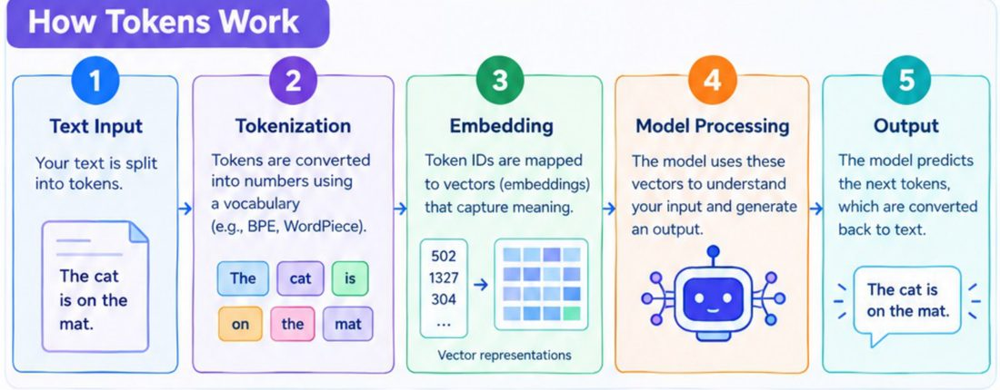
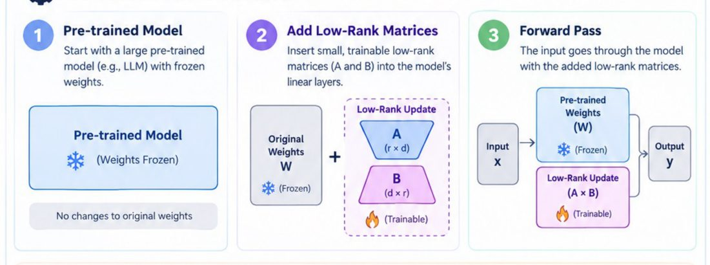
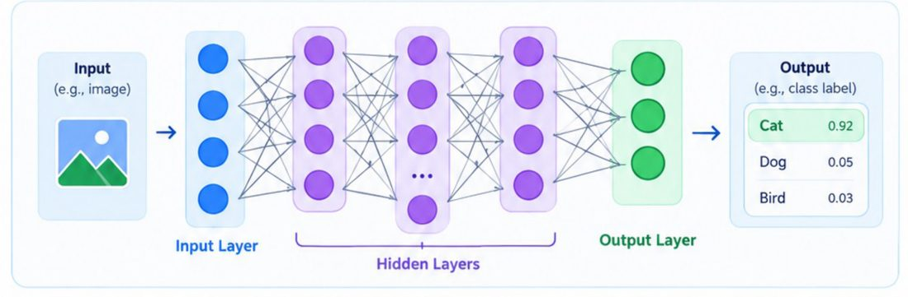

# AI 入門 13 個必懂概念:LLM、Token、神經網路、幻覺、LoRA、MoE、語音到 Agentic、Vibe Coding

> **素材性質揭露**:整理自社群引流型輪播 PDF《13 Essential AI Concepts for Beginners》(作者 Anjana「AI & Tech」@aiwithanju,13 頁、每頁一張資訊圖、**沒有文字層**,內容由我逐頁看圖轉寫)。同批素材常見 “Comment AI to get full PDF” 類引流字樣與作者帳號;本篇只整理知識內容,不轉述導購。原稿屬**入門科普**,每概念 1 頁,我補上一手查證與已知錯誤。

## 13 個概念一張表

| # | 概念 | 一句話(我的白話) | 原稿的流程 | 常見誤解 / 補充 |
|---|---|---|---|---|
| 1 | **LoRA** | 凍結原模型,只訓練兩個小矩陣 A、B 來表達「權重的變化量」 | 預訓練模型(凍結)→ 在線性層旁加低秩矩陣 A、B → 前向傳播 W 與 A×B 相加 → 只更新 A、B | 不是「加更多層」;訓練完可把 BA 合併回 W,推論零額外延遲(見查證) |
| 2 | **Fine-Tuning** | 用你的資料繼續訓練預訓練模型 | 準備資料(清洗、切 train/val)→ 設定訓練 → 微調(更新權重)→ 評估部署 | 擅長改風格/格式/分類行為,不是灌新知識的最佳手段 |
| 3 | **MoE** | 多個專家 + 路由器,只啟動少數專家 | 輸入 → 路由 → 選專家 → 合併 → 輸出 | 省的是活躍參數的運算,**總參數與記憶體需求仍在**。見 [[moe-mixture-of-experts-from-ffn]] |
| 4 | **Neural Network** | 層層相連的神經元,靠調整權重學出規律 | 輸入層 → 隱藏層 → 激活函數(非線性)→ 輸出層 → 訓練(損失函數+反向傳播) | 「受大腦啟發」只是比喻,別當成生物學對應 |
| 5 | **Tokens** | 文字被切成的最小處理單位,再轉成數字 | 文字 → 分詞(BPE、WordPiece)→ 嵌入向量 → 模型 → 預測下一個 token → 轉回文字 | token 數決定**成本、上下文長度** |
| 6 | **AI Hallucination** | 模型說得很自信但事實錯誤 | 原因:訓練資料有限、只做下一詞預測、缺乏事實依據、過度自信、問題複雜 | 緩解:RAG、好 prompt、事實查核、微調與評測;**無法根絕** |
| 7 | **LLM** | 用大量文字訓練、以 Transformer 預測下一個 token 的模型 | 輸入 → 分詞 → 嵌入 → Transformer 處理 → 逐 token 生成 → 輸出 | 見 [[llm-explained-3blue1brown]] |
| 8 | **TTS** | 文字轉語音 | 文字 → 文本分析 → 語音合成(音素+韻律)→ 音訊生成 → 輸出 | 見 [[voxcpm-report]]、[[edge-tts-microsoft-edge-tts]] |
| 9 | **Speech-to-Speech (S2S)** | 語音進、語音出(可含翻譯),不顯示文字 | 收音 → 語音理解(內部 STT)→ 翻譯 → 語音生成(TTS)→ 輸出 | 原稿畫的是**串接式**管線;也有端到端直接語音模型,原稿未提 |
| 10 | **Generative AI** | 從資料學規律、產生新內容(文字/圖/碼/音/影) | 輸入提示 → 處理 → 生成 → 輸出 | 「新」是指樣本層面的新,不保證事實或原創 |
| 11 | **Agentic AI** | 能理解目標、規劃、用工具、採取行動的 AI | 使用者請求 → 推理規劃 → 使用工具行動 → 交付 → 學習改進 | 深入見 [[agentic-ai-ten-concepts-interview-map]] |
| 12 | **NLP** | 讓機器理解、處理、生成人類語言 | 文本輸入 → 預處理(小寫、分詞、去停用詞、詞幹)→ 語言理解 → 推論 → 輸出 | 預處理步驟是**傳統 NLP**;現代 LLM 多半不再做去停用詞/詞幹 |
| 13 | **Vibe Coding** | 用自然語言描述需求,由 AI 產生程式,再回饋迭代 | 描述想法 → AI 產碼 → 你執行/檢視 → AI 修正 → 反覆 → 上線 | 「不需深入寫碼知識」只適用原型;上線仍需審查、測試、安全 |

## 圖解(原稿的三張資訊圖,僅裁出圖表部分)

### Tokens 的處理流程

圖:原稿《13 Essential AI Concepts for Beginners.pdf》p5。重點:模型從不直接看字,它看的是 token ID 再查嵌入表得到向量;輸出是下一個 token 的機率分佈。

### LoRA 如何運作

圖:原稿 p1(裁出步驟 1–3)。重點:W 凍結(雪花),只有 A、B 可訓練(火焰);r 遠小於 d,所以可訓練參數大幅減少。深入見 [[lora-fine-tuning-explained]]。

### 神經網路的分層

圖:原稿 p4。輸出層的 0.92/0.05/0.03 相加為 1,是 softmax 之後的機率,代表「模型對各類別的信心分配」,不等於「92% 的機率真的是貓」(校準另是一回事)。

## 應用案例

**案例:你要做一個「中文法律條文問答」小工具。**
1. **LLM(7)** 負責理解問題與生成;你在意成本時要估 **Token(5)** 數——中文 token 通常比英文多,見 [[tokenizer-tax-chinese-vs-english-token-cost]]。
2. 直接問會 **幻覺(6)**(編造不存在的條號)→ 用 RAG 先檢索條文再回答,並要求附條號。
3. 若回答格式老是不一致 → 用少量範例 **微調(2)**;資源不足就用 **LoRA(1)** 在單張消費級 GPU 上做。
4. 想讓它能「查最新修法、算罰金」→ 升級為 **Agentic(11)**:加搜尋與計算工具。
5. 原型用 **Vibe Coding(13)** 兩小時做出網頁介面,但上線前仍要自己審查程式、補測試。

## 延伸閱讀與深度補充(一手資料查證)

| 項目 | 結論 | 我實際讀到 / 做到的內容 |
|---|---|---|
| LoRA 效益 | **已核實** | 讀 arXiv 2106.09685 摘要:相對於以 Adam 微調 GPT-3 175B,LoRA 可把**可訓練參數降低約 10,000 倍**、**GPU 記憶體需求降低約 3 倍**,且**不增加推論延遲**(不像 adapter)。原稿只說「更少算力與記憶體」,未給量級,也未提「無推論延遲」這個關鍵優點。矩陣形狀 A(r×d)、B(d×r) 在原稿內自洽(論文記法為 W₀+BA,維度標示略有不同,屬記號差異,我未逐式比對論文內文) |
| Token 範例「OpenAI creates powerful AI models.」= 7 tokens | **已核實(自行驗證)** | 我用 tiktoken `cl100k_base` 實際切分,結果為 `Open / AI / ␣creates / ␣powerful / ␣AI / ␣models / .`,恰為 7 個,與原稿一致。注意實際 token 帶前導空格,且**不同模型的 tokenizer 結果不同** |
| 另一份姊妹 PDF 的 `"AI is powerful" → [AI][is][power][ful]` | **需修正** | 同批《20 AI Engineering Concepts》的示意切法;我用 `cl100k_base` 實測 `"AI is powerful"` 只有 3 個 token(`AI / ␣is / ␣powerful`),`powerful` 並未被拆開。該例僅為「示意子詞」,不要當成實際切法。見 [[ai-engineering-twenty-concepts-serving-rag-ops]] |
| 幻覺頁的範例「艾菲爾鐵塔何時建成?→ 1889 年」被標成 Hallucination | **需修正(原稿內部矛盾)** | 這頁圖上同一格寫著 “(Actually built in 1889)” 又把「The Eiffel Tower was built in 1889」打上紅色 ✗ Hallucination,**答案其實是對的**,標註自相矛盾,應視為排版/製作錯誤。其餘三例(Mona Lisa 誤為梵谷、林肯出生地誤為紐約、澳洲首都誤為雪梨)為典型錯誤示例;「東京最高建築是東京鐵塔」的對錯我**未查證**(「最高建築」與「最高構造物」定義不同) |
| 原稿 NLP 預處理(去停用詞、詞幹) | **需補充** | 屬傳統 NLP 管線;LLM 時代通常直接餵原文給子詞分詞器,不做這些預處理。**我未另讀一手文獻**,屬通行工程常識 |
| S2S「不經過文字」 | **需補充,未核實細節** | 原稿圖示仍經內部 STT→翻譯→TTS 的串接管線(它自己寫 “speech-to-text internally, not shown to the user”)。是否有端到端模型、其品質如何,我**未查證** |
| Vibe Coding 定義與起源 | **未能核實** | 我未讀一手出處(提出者的原始貼文);原稿只給通俗定義,未註明來源 |
| MoE「更高準確度」之類的 Key Benefits | **未能核實** | 原稿的 benefit 皆為概括性宣稱,未附論文或數據,我未逐項驗證 |

## 來源

- 使用者提供的本機素材批次 `new/ai-guide/`(2026-11-07 收件),檔案:`13 Essential AI Concepts for Beginners.pdf`(作者 Anjana「AI & Tech」@aiwithanju;社群引流型素材)。
- Hu 等,LoRA: Low-Rank Adaptation of Large Language Models:https://arxiv.org/abs/2106.09685
- tiktoken(OpenAI 開源 tokenizer,本機以 `cl100k_base` 實測):https://github.com/openai/tiktoken
