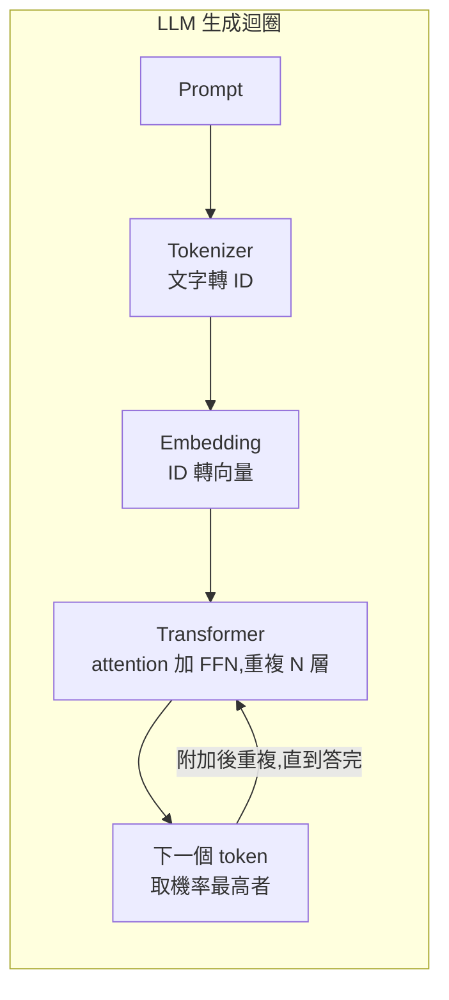
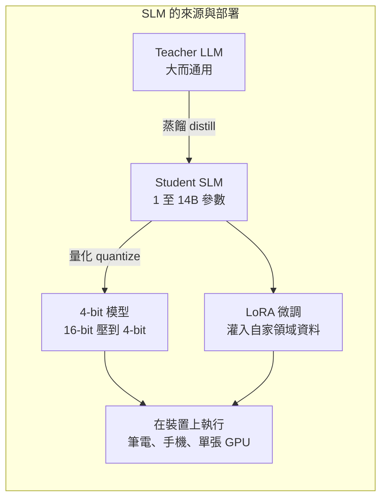
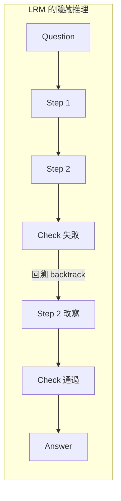
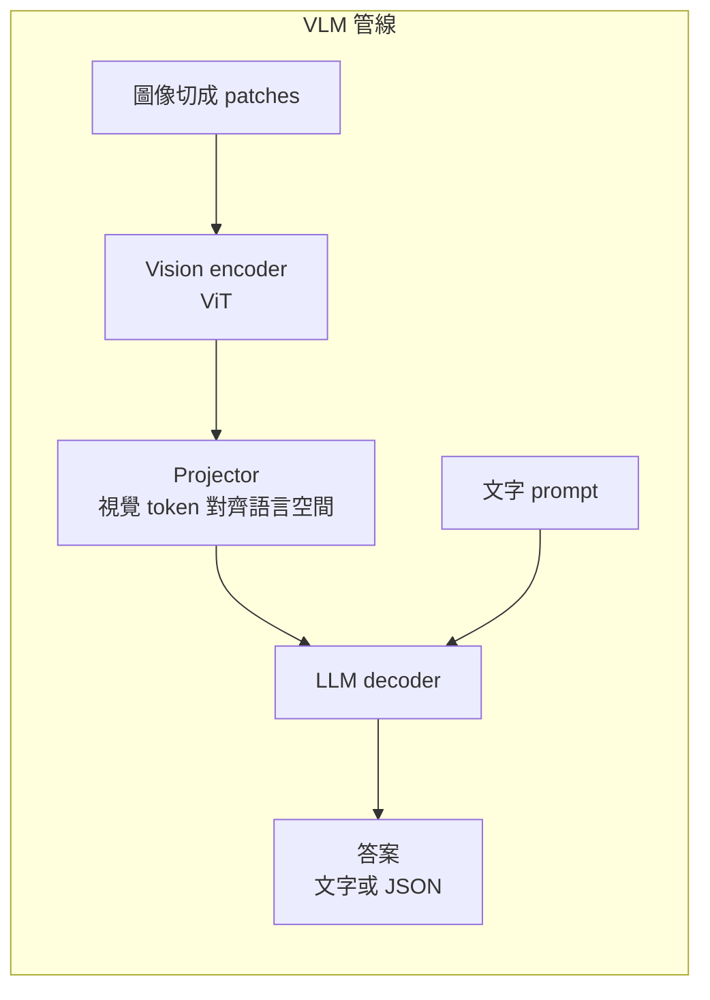
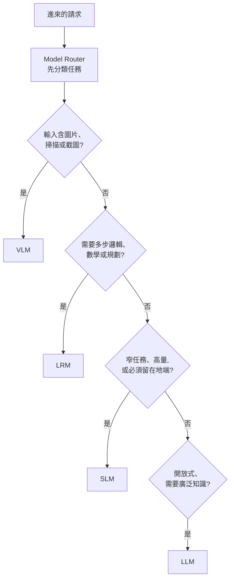

# LLM、SLM、LRM、VLM 四種模型怎麼分、什麼時候用(企業 AI 路由法則)

> 整理日期:2026-11-06
> 來源性質:使用者提供的一張英文資訊圖(標題 "LLM vs SLM vs LRM vs VLM — Which Model To Use In Enterprise AI, and When"),圖上沒有標示作者與原始出處(畫面角落只有轉貼帳號的浮水印)。**它是第三方科普圖,不是論文或官方文件**;下文把圖上的主張與可核對的通用事實分開標示。

## 1. 一句話

四個縮寫不是四個互斥的「型號」,而是**四種「任務形狀」對應的模型類型**:
LLM 處理開放式廣泛知識、SLM 處理窄而大量或必須留在本地、LRM 處理要多步推理的難題、VLM 處理輸入含圖像的任務。圖的結論是一條路由規則:**「先用便宜的,任務需要時才升級」(Route cheap-first. Escalate only when the task needs it.)**

## 2. 四類模型對照

| 類型 | 全名 | 圖上定義 | 代表例子(圖上列出) | 適用 | 避免 |
|---|---|---|---|---|---|
| LLM | Large Language Model | 通用大模型,常見 100B+ 參數,廣泛世界知識,通常經雲端 API 使用 | GPT、Claude、Gemini、Mistral Large | 跨領域開放問題、Copilot、起草與摘要、RAG 對話 | 數百萬次簡單重複呼叫(成本疊加)、資料不能離開內網 |
| SLM | Small Language Model | 約 1–14B 參數,單張 GPU 或邊緣裝置可跑;用自家資料微調後,在單一窄任務上常能追平大得多的模型 | Phi、Gemma、Llama 3.2 3B、Mistral 7B | 大量分類、抽取、路由;嚴格隱私、地端或低延遲 | 需要廣泛世界知識的問題、開放式跨領域推理 |
| LRM | Large Reasoning Model | 被訓練成「先想再答」的 LLM,推論時多花算力做規劃、檢查、修正,拿速度與成本換準確度 | OpenAI o 系列、DeepSeek-R1、Claude / Gemini 的 thinking 模式 | 多步分析、數學、程式、規劃;高風險、準確度重於速度 | 即時聊天、簡單查詢、高量且對延遲敏感的流量 |
| VLM | Vision Language Model | 同時讀圖與文字;視覺編碼器把像素轉成 token,語言模型再對其推理 | GPT-4o、Gemini、Qwen-VL、LLaVA | 發票、表單、證件、掃描 PDF;圖表、儀表板、UI 截圖、照片 | 輸入本來就是乾淨文字;要求像素級精確計數或量測 |

## 3. 四張內部機制圖的重點

- **LLM**:逐 token 預測,每步把新 token 接回輸入,直到答案完整。
- **SLM**:常見做法是「大模型教小模型」(蒸餾)、量化降低位元、再用 LoRA 灌入領域資料;賣點是更小、更快、更便宜、資料不外流。
- **LRM**:用 RL(強化學習)獎勵「最後答對」,模型學會在隱藏的思考 token 裡規劃、嘗試、驗證,錯了就回溯。代價是延遲與 token 成本上升。
- **VLM**:影像被切成 patch,經 ViT 之類的視覺編碼器與 projector 變成 LLM 可讀的 token,與文字一起進同一個解碼器。

## 4. 路由法則(圖最下方)

判斷順序就是圖上的順序:圖像 → 推理 → 窄/量大/私有 → 開放知識。實務上「cheap-first」要補一句:順序只決定**預設路由**,仍要用評測驗證每一路的品質,再決定哪些流量降級給 SLM、哪些升級給 LRM。

## 5. 核實與保留

| 項目 | 狀態 |
|---|---|
| 四個縮寫的基本定義(LLM / SLM / LRM / VLM)與機制(蒸餾、量化、LoRA、ViT + projector、思考 token)為業界通用說法 | 已核實(通用概念) |
| 例子清單中的模型家族(GPT、Claude、Gemini、Mistral、Phi、Gemma、Llama、o 系列、DeepSeek-R1、Qwen-VL、LLaVA)存在且類別大致正確 | 已核實(家族層級);**具體版本與參數量隨時間變動,圖沒標版本** |
| 「LLM 常見 100B+」「SLM 約 1–14B」 | 圖上的**經驗界線**,業界並無統一標準;不同文獻對 SLM 的上限從數 B 到 10B+ 都有 |
| 圖把 GPT-4o 歸為 VLM、把 Claude / Gemini 同時列在 LLM 與 LRM、VLM | 需修正理解:**現代旗艦模型往往同時是 LLM、VLM,並可開 thinking 模式成為 LRM,四類是「能力/用法」而非互斥品牌** |
| 「SLM 微調後常追平大得多的模型」 | 僅在窄任務成立,圖沒有給出評測;不可推廣到通用能力 |
| 圖未給成本、延遲、準確度數字 | 本篇沒有補數字,避免憑空編造 |
| 圖作者與原始出處 | 未能核實 |

## 6. 應用案例

**客服工單系統(混合路由)**:
1. 每天 50 萬則工單,先用 SLM(微調過的 3–8B 模型,地端部署)做分類與欄位抽取,因為量大、格式固定、含客戶個資不能出內網。
2. 工單附有截圖或帳單照片,路由器轉給 VLM 讀取金額與日期。
3. 少數「帳單對不上、需要跨三個系統推理」的複雜案件,升級給 LRM 逐步核對,並接受較高延遲與成本。
4. 客戶端的開放式問答、回覆草稿,交給 LLM 並搭 RAG。
5. 監控每一路的錯誤率與成本,定期把穩定的 LLM 流量下放給 SLM,這就是「cheap-first、按需升級」。

## 相關筆記
- [[ai-concepts-layered-map-baibai]]:Token 到 Agent 的概念地圖與職場選型(另一種切法)
- [[claude-haiku-5-5-cheap-model-computer-use]]:便宜小模型能做到什麼
- [[qwen38-27b-local-economics-and-august-checkpoint-wave]]:本地小模型的成本算術

## 來源
- 使用者提供的資訊圖:"LLM vs SLM vs LRM vs VLM: Which Model To Use In Enterprise AI, and When"(作者與原始網址不明,第三方轉貼;僅作為整理依據,非一手來源)。
